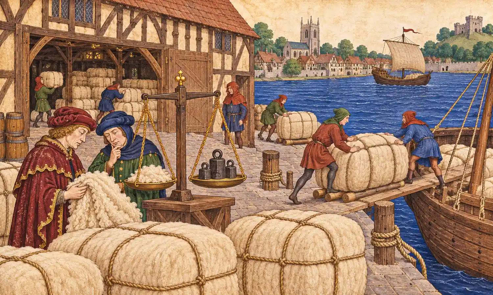
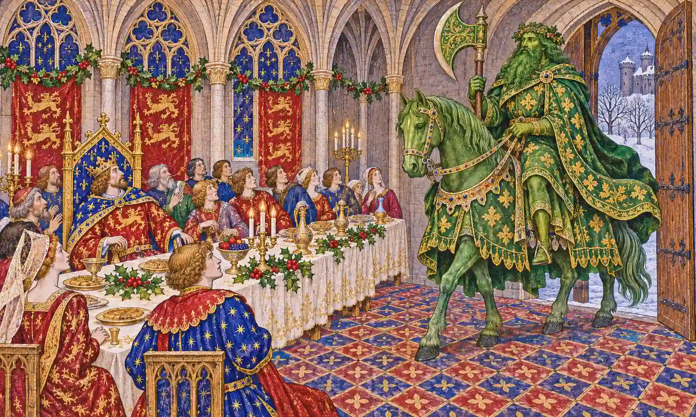
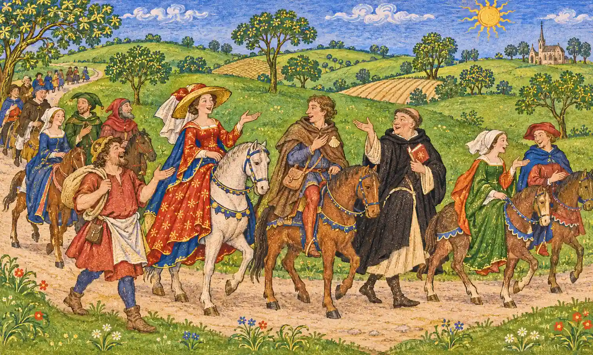

The later fourteenth century made English a major literary language again. Geoffrey Chaucer wrote for a courtly and urban readership, but he also drew on French and Italian literature. The age's major writers did not share one voice: their works range from comic tale-telling to moral allegory and political reflection.

## The world of this age

<figure class="article-illustration" data-illustration="wool-trade">
  
  <figcaption>Wool merchants and porters at an English river port.</figcaption>
</figure>

In the summer of 1348 the **Black Death** reached England by sea from France. Estimates of the death toll vary, but it may have killed as many as half of the people. Whole villages were emptied. Workers became scarce, and the survivors could ask for higher wages. Lords and the government tried to hold wages down by law, and that angered the poor. Historians often see this long quarrel as one root of the revolt of 1381. In the longer run, many peasants gained more freedom and better pay.

The Catholic Church shaped daily life, and its language was Latin. Parish priests, monks, nuns and friars were part of every community. Pilgrimage was a popular form of devotion, and Canterbury drew crowds to the shrine of Thomas Becket, the archbishop murdered in his cathedral in 1170. The poets of the age knew the Church well and often laughed at its failings, especially greedy friars and sellers of pardons.

Some wanted deeper change. John Wyclif, a teacher at Oxford, argued that ordinary people should be able to read the Bible, and he criticised the wealth of the clergy. He died on the last day of 1384, but his followers, called **Lollards**, kept his ideas alive. An English Bible, translated from the Latin Vulgate, appeared in the early 1380s, and a smoother revision followed about 1388. In the early fifteenth century Church leaders moved against the Lollards and their Bible. Alongside this protest, hermits and anchoresses lived in prayer and wrote guides for others.

## The language

<figure class="article-illustration" data-illustration="gawain">
  
  <figcaption>An imagined scene from Sir Gawain and the Green Knight.</figcaption>
</figure>

No other period changed English so fast. The old system of word endings, which Old English used to show who did what, wore away. Nouns lost their grammatical gender, and word order became much more fixed, with the subject first, then the verb, then the object, as it is today.

There was no standard language. Scholars usually describe five main dialects: Northern, East Midland, West Midland, Southern and Kentish. *Sir Gawain and the Green Knight* was written in a dialect of the north-west Midlands and *Piers Plowman* in the west Midlands. Chaucer wrote in the English of London, a form of East Midland.

The status of English rose slowly. By the late fourteenth century even many nobles were using it, and French was turning into a language learned at school. In 1362 the Pleading in English Act, often called the **Statute of Pleading**, ruled that court cases must be argued in English, though the records were still kept in Latin. Historians debate how much difference it made. In the early fifteenth century, under Henry V, the royal writing office, the Chancery, began to use a form of London English for official papers. This **Chancery Standard**, together with the printing press, helped to fix the written language. Around 1400 the long vowels also began to change in the Great Vowel Shift, which later set Chaucer's sounds apart from our own.

## Manuscripts and readers

<figure class="article-illustration" data-illustration="canterbury-pilgrims">
  
  <figcaption>Pilgrims on the road, imagined from The Canterbury Tales.</figcaption>
</figure>

The poems of the Gawain poet survive in a single book, now called Cotton Nero A.x, made around 1400. If that one manuscript had been lost, *Pearl*, *Cleanness*, *Patience* and *Sir Gawain and the Green Knight* would be unknown. *Piers Plowman* had the opposite fate. More than fifty manuscripts of it survive, a sign of how widely it was read.

## Poetry and dream vision

In the later fourteenth century the old unrhymed, alliterative verse came back in what is called the **alliterative revival**. *Sir Gawain and the Green Knight*, about 2,530 lines in 101 stanzas, is its finest romance. The poet is unknown, and the same hand is credited with *Pearl*, a dream vision in which a grieving speaker meets a young girl who has died, and with *Cleanness* and *Patience*. Each stanza of *Gawain* ends in five short rhymed lines called the **bob and wheel**. The story opens at Camelot at Christmas, when a green giant challenges the court to a beheading game. Gawain cuts off his head, and the giant picks it up and tells Gawain to meet him in a year. On the way Gawain stays in a castle, where the lady tempts him and he hides a green girdle that she says will protect his life. At the Green Chapel the Green Knight swings his axe three times and leaves only a small cut, because Gawain kept the girdle. The knight is the lord of the castle. The poem tests the ideal of the perfect knight and finds that he is human.

William Langland's *Piers Plowman* belongs to the same alliterative tradition but has a different spirit. It is a **dream vision**. A dreamer named Will falls asleep on the Malvern Hills and sees a field full of folk, rich and poor, who stand for the whole of society. In later dreams he sees the seven deadly sins confess and meets an honest ploughman named Piers. He searches for the answer to how a man should live, which the poem calls Do-Well, Do-Better and Do-Best. Langland attacks corrupt clergy and the greed of the powerful. The poem exists in versions called A (1360s), B (late 1370s) and C (1380s). It also holds the earliest certain mention of Robin Hood tales, when the lazy priest Sloth admits that he knows rhymes of Robin Hood better than his prayers.

## Chaucer and his contemporaries

Geoffrey Chaucer was born in London around 1343, the son of a wine merchant. As a young man he served as a page in a noble household, and in 1359 he was captured in France, where the king helped to pay his ransom. He later worked as a soldier, a diplomat who visited Italy, controller of wool customs in London from 1374, and Clerk of the King's Works from 1389. He died in 1400 and was buried in Westminster Abbey, in what later became Poets' Corner.

His poetry is often divided into three phases. In the first he followed French models. *The Book of the Duchess* mourns Blanche, the wife of John of Gaunt, who died in 1368. In the second he learned from Italian writers such as Boccaccio. *The Parliament of Fowls* and *Troilus and Criseyde*, a long love story set in the Trojan War and written in **rhyme royal**, belong here. In the third he turned to English life, and the result was *The Canterbury Tales*. He also translated Boethius and wrote a *Treatise on the Astrolabe* for his young son.

*The Canterbury Tales*, begun about 1387, is a frame story. About thirty pilgrims meet at the Tabard Inn in Southwark on their way to the shrine of Thomas Becket at Canterbury. Their host, Harry Bailly, suggests that each of them should tell tales on the road, and that the best storyteller should win a free supper. Chaucer planned four tales from each pilgrim, two on the way there and two on the way back. He finished only 24, and some of those are incomplete. The General Prologue gives a sharp portrait of each traveller, from the Knight to the Miller, the Wife of Bath and the Pardoner. The tales that follow come in every style: a noble romance, a rude comic story called a **fabliau**, a beast fable, a sermon in prose. Most are in rhyming couplets of ten syllables, and Chaucer is usually credited with bringing both this couplet and the rhyme royal stanza into English poetry.

## Criticism and scholarship

Chaucer's reputation stayed high long after his death. In 1700, in the Preface to his *Fables, Ancient and Modern*, John Dryden called him the father of English poetry, and said of the pilgrims, "here is God's plenty". Dryden also thought Chaucer's lines were rough, because nobody then understood how Middle English had been pronounced.

Proper scholarship began in the nineteenth century. In 1864 F. J. Furnivall founded the Early English Text Society to print early texts that survived only in manuscript, and in 1868 he founded the Chaucer Society. Walter W. Skeat produced a three-text edition of *Piers Plowman* in 1886 and a six-volume *Complete Works of Geoffrey Chaucer* in 1894, with a supplement in 1897. Matthew Arnold, in "The Study of Poetry" (1880), admired Chaucer's "liquid" diction but said he lacked the "high seriousness" of Homer, Dante, Shakespeare and Milton.

In the twentieth century C. S. Lewis's *The Allegory of Love* (1936) studied courtly love and allegory, and D. W. Robertson's *A Preface to Chaucer* (1962) argued that medieval writers should be read in the light of Christian teaching. Carolyn Dinshaw's *Chaucer's Sexual Poetics* (1989) brought questions of gender and desire to Chaucer. The standard edition today is *The Riverside Chaucer* (1987), edited by Larry D. Benson.

## Literature in focus

### Gower and the range of English writing

John Gower wrote in French, Latin and English. His *Confessio Amantis* uses a lover's confession as a frame for moral stories. It offers a useful comparison with the pilgrimage frame of *The Canterbury Tales*: both can contain many narratives, but the organising situation and the narrator's task are different.

Religious writing remained central. Julian of Norwich described the revelations she experienced in 1373, first in a shorter account and later in a longer text. The chronology of an experience is not automatically the date of every surviving version of its written account. An exam answer should keep those dates separate.

### Reading Chaucer carefully

The narrator of a tale and the writer of the whole collection are different levels of the work. A pilgrim can speak with confidence while the framing narrative invites us to question that confidence. The General Prologue introduces occupations, manners and claims to status; the tales then develop or complicate those impressions. This variety matters more than treating every speaker as Chaucer's own opinion.

Chaucer's unfinished collection includes prose as well as verse and twenty-four tales, some incomplete. It is therefore inaccurate to say that he completed all twenty-four. The surviving collection and the much larger proposed storytelling scheme must be distinguished.

## Key terms

- **Alliterative revival** - the return of unrhymed alliterative verse in the later fourteenth century, as in *Gawain* and *Piers Plowman*.
- **Bob and wheel** - the five short rhyming lines that close each stanza of *Sir Gawain and the Green Knight*.
- **Dream vision** - a poem in which the narrator falls asleep and sees a vision, as in *Piers Plowman* and *Pearl*.
- **Rhyme royal** - a seven-line stanza rhyming ababbcc, used by Chaucer in *Troilus and Criseyde*.

## Writers and works

| Writer | Works | What to remember |
|---|---|---|
| John Gower | Confessio Amantis | Moral narratives within a confession frame |

## Important points to remember

- The timeline uses 1340–1400 for this chapter. Literary boundaries are approximate.
- Check the date of a work separately from its writer's lifetime.
- Read this chapter alongside the wider period guide when comparing neighbouring ages.

## Quick revision - 11 points

1. **The Black Death** — The Black Death came by sea from France in the summer of 1348.
2. **Cotton Nero A.x** — If this one manuscript had been lost, the four poems would be unknown.
3. **Five short rhyming lines at the end of each stanza** — Each of the 101 stanzas ends with these five short lines.
4. **William Langland** — Langland wrote it in A, B and C versions.
5. **London** — He checked wool, skins and leather at the port of London.
6. **The Tabard Inn** — The Tabard Inn stood in Southwark.
7. **Rhyme royal** — Rhyme royal rhymes ababbcc.
8. **John Gower** — His English poem is the Confessio Amantis, of about 33,000 lines.
9. **Matthew Arnold** — He said so in "The Study of Poetry".
10. **It is unfinished and includes twenty-four tales, some incomplete** — The surviving collection differs from the much larger proposed scheme.
11. **A lover’s confession** — Gower organises moral narratives within a confession frame.

## Quick quiz - 11 questions

Tap an answer to see at once if it is right. You do not need to log in.

**1. Which disease reached England in 1348 and may have killed about half of the people?**

- A) The sweating sickness
- B) Smallpox
- C) Cholera
- D) The Black Death

Answer: D. The Black Death came by sea from France in the summer of 1348.

**2. Which single manuscript preserves Pearl, Cleanness, Patience and Sir Gawain and the Green Knight?**

- A) The Auchinleck Manuscript
- B) The Exeter Book
- C) The Winchester Manuscript
- D) Cotton Nero A.x

Answer: D. If this one manuscript had been lost, the four poems would be unknown.

**3. What is the "bob and wheel" in Sir Gawain and the Green Knight?**

- A) Five short rhyming lines at the end of each stanza
- B) A pause in the middle of a line
- C) A comic story in verse
- D) A wagon used for a mystery play

Answer: A. Each of the 101 stanzas ends with these five short lines.

**4. Who wrote Piers Plowman?**

- A) Geoffrey Chaucer
- B) William Langland
- C) John Gower
- D) Thomas Malory

Answer: B. Langland wrote it in A, B and C versions.

**5. In which port did Chaucer become controller of customs in 1374?**

- A) Southampton
- B) Bristol
- C) Dover
- D) London

Answer: D. He checked wool, skins and leather at the port of London.

**6. Where do the pilgrims of The Canterbury Tales meet before they set out?**

- A) The Mermaid Tavern
- B) The Tabard Inn
- C) Canterbury Cathedral
- D) Westminster Abbey

Answer: B. The Tabard Inn stood in Southwark.

**7. What is the name of the seven-line stanza that Chaucer used in Troilus and Criseyde?**

- A) Heroic couplet
- B) Bob and wheel
- C) Rhyme royal
- D) Kenning

Answer: C. Rhyme royal rhymes ababbcc.

**8. Which poet wrote major works in French, Latin and English?**

- A) William Langland
- B) Thomas Hoccleve
- C) John Lydgate
- D) John Gower

Answer: D. His English poem is the Confessio Amantis, of about 33,000 lines.

**9. Which critic said in 1880 that Chaucer lacked "high seriousness"?**

- A) John Dryden
- B) Matthew Arnold
- C) C. S. Lewis
- D) Walter W. Skeat

Answer: B. He said so in "The Study of Poetry".

**10. Which description of The Canterbury Tales is accurate?**

- A) All its speakers express the same opinion
- B) It is unfinished and includes twenty-four tales, some incomplete
- C) It contains a completed scheme of 120 tales
- D) Every tale is in prose

Answer: B. The surviving collection differs from the much larger proposed scheme.

**11. What provides the narrative frame of Confessio Amantis?**

- A) A sea voyage around the world
- B) A Roman military campaign
- C) A lover’s confession
- D) A modern court trial

Answer: C. Gower organises moral narratives within a confession frame.

## Frequently asked questions

**Does this chapter use exact historical boundaries?**
The dates are the timeline's study convention. Language, literary forms and writers' careers can cross them. Use the date of the particular work when a question asks about a narrower age.

**Where can I read the wider historical context?**
The [full period guide](/notes/middle-english/) contains the longer background. This chapter concentrates on the age named above and keeps its own revision and practice sections.

**Are these pictures historical documents?**
The artwork is illustrative. Captions identify representative or imagined scenes and modern painted interpretations; those images are not evidence that the pictured scene happened exactly as shown.

**How should I use the quiz?**
Read the explanations after answering. Questions about earlier events or later criticism are background questions, not claims that every named date falls inside the chapter's boundaries.

## Sources and further reading

The relevant background, text references and public practice material are retained from the [original middle english guide](/notes/middle-english/#sources). Publication dates, authorship and period boundaries should be checked against the source editions listed there.

- [Harvard Chaucer: texts and study resources](https://chaucer.fas.harvard.edu/)

Afsar Khan, Ph.D. English
