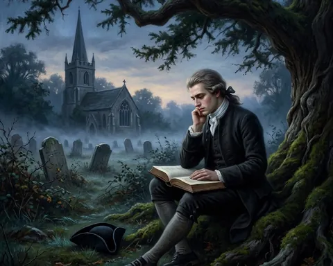

The Age of Sensibility gives greater attention to feeling, sympathy and the reader's emotional response. It does not mean that reason disappeared after 1745; literary tastes overlapped. The label is useful for tracing a change within eighteenth-century culture before Romanticism.

## The world of this age

<figure class="article-illustration">
  
  <figcaption>Imagined eighteenth-century scene of a reader beside a churchyard.</figcaption>
</figure>

Society was a ladder, and rank decided nearly everything. At the top stood a small group of noble and landowning families whose wealth came from rents. Below them came the gentry, then merchants, lawyers, doctors and clergymen, then shopkeepers and craftsmen, and at the bottom the farm labourers and the city poor. A growing middle rank of traders and professional people supplied the age with its readers, its theatre audiences and many of its writers.

Land and industry were changing too. Large landowners enclosed open fields and tried new farming methods, which raised the harvest but pushed many small farmers off the land. From the 1760s, new machines for spinning cotton and James Watt's improved steam engine began what is now called the Industrial Revolution, and towns in the Midlands and the north grew fast.

Part of the wealth came from the Atlantic slave trade, which carried enslaved Africans to work on sugar and tobacco plantations in the Americas. Ports such as Bristol and Liverpool grew rich on it. An organised campaign against the trade began in 1787. In 1789 Olaudah Equiano, who had bought his own freedom in 1766, published his autobiography, and in 1773 the poems of Phillis Wheatley, a young woman enslaved in Boston, were printed in London. Both showed that Black writers already belonged to English literature in this age.

The Church of England was the state church. The Toleration Act of 1689 let Protestant Dissenters, such as Baptists, Quakers and Presbyterians, worship in their own chapels, though they still could not easily hold public office or study at the English universities. Catholics fared worse, living under laws that shut them out of public life. Pope's Catholic family left London for Binfield, in Windsor Forest, around 1700, and Pope, barred from the universities by his faith, taught himself.

At the same time, a new way of thinking was spreading. In 1687 Isaac Newton published his *Principia*, which showed that planets and falling stones obey the same natural laws. In 1690 John Locke's *Essay Concerning Human Understanding* argued that knowledge comes from experience. Many educated people concluded that the world is an orderly machine which human reason can understand, and that God, as its maker, could be known through nature. This faith in reason is why the century is called the Age of Reason. Pope's *Essay on Man* belongs to that mood. Some thinkers went further. In 1748 David Hume argued that reports of miracles are weak evidence.

Many ordinary people found such religion too cold. In 1738 John Wesley, an Anglican clergyman, felt at a meeting in Aldersgate Street, London, that his heart was warmed by faith. He and his brother Charles began a revival that grew into Methodism. They preached in the open air to miners and labourers, and Charles Wesley wrote thousands of hymns. Isaac Watts, a Dissenting minister, wrote hymns and children's verses for the same hunger, and children memorised his *Divine Songs* for generations.

## The language

The work was finally done by one man. Samuel Johnson, a bookseller's son from Lichfield, signed a contract in 1746 to write a dictionary and spent about nine years on it. Instead of inventing meanings, he gathered thousands of quotations from good writers, from the Elizabethan age onward, to show how words had really been used. When the *Dictionary of the English Language* appeared in 1755, it began to act as the standard for spelling and meaning. Johnson had started with the hope of fixing the tongue, but in his preface he admitted that a living language cannot be held still.

Others wrote grammar books, such as Robert Lowth's *Short Introduction to English Grammar* (1762), which taught correct usage to a growing middle class. Prose style came to prize clearness. Swift said that good style meant the proper words in the proper places, and the best prose of the age, from Defoe's plain narrative to Addison's easy essays, follows that rule. Johnson wrote a heavier, more Latin-sounding prose, but he too aimed at balance and precision.

## Readers, booksellers and patrons

For centuries writers had depended on rich patrons, who gave money in return for praise in a dedication. Patronage did not vanish in 1700, but print slowly gave writers another way to live. In 1695 Parliament had let the old Licensing Act lapse, which ended the system of censoring books before they were printed. Authors could still be punished afterwards, as Daniel Defoe found in 1703, when he was put in the pillory for a pamphlet that mocked the enemies of the Dissenters. The *Daily Courant* became London's first daily newspaper in 1702, and in 1710 the Statute of Anne became the first copyright law, giving authors and booksellers rights over printed works for a fixed term.

Booksellers, who were also publishers, grew powerful, and a writer could now sell a manuscript to them for cash. Some who did so lived in poverty around Grub Street, a London street of hack writers whose name came to stand for all cheap, hurried writing. Others found a better way in subscription, in which readers paid in advance for a book not yet printed. Pope sold his translation of Homer's *Iliad* this way, and its success made him rich enough to live on his writing alone, in a villa at Twickenham beside the river Thames.

Johnson's quarrel with Lord Chesterfield showed that the old system was ending. Chesterfield had given the *Dictionary* no help while it was being written, and then praised it in print when it was about to appear. In a letter of 1755 Johnson asked whether a patron was not someone who watches a drowning man without concern and then loads him with help once he has reached the shore.

Reading itself was spreading. Coffee houses kept newspapers on their tables, *The Gentleman's Magazine* began in 1731, and from the middle of the century circulating libraries lent novels for a small fee. The reading public now included merchants, shopkeepers' wives and ladies of leisure, and writers began to write for them.

## Poetry

Other poets moved away from Pope's manner. James Thomson, a Scot, wrote *The Seasons* (1726-1730) in blank verse, giving readers long, loving descriptions of weather and countryside. Edward Young's *Night Thoughts* (1742-1745) brooded on death in the dark and began a taste for graveyard poetry. Thomas Gray's *Elegy Written in a Country Churchyard* (1751) carried that mood to a village burial ground, where it wonders what the buried poor might have become had life given them a chance. It is one of the best-known poems of the century.

## Prose

Non-fiction grew strong as well. After his *Dictionary*, Samuel Johnson edited Shakespeare (1765) and wrote *Lives of the English Poets* (1779-1781). In 1763, in a London bookshop, he met James Boswell, a young Scot who later wrote the *Life of Samuel Johnson* (1791), often called the finest biography in English. Johnson's talk was best heard at a dinner club that he founded with the painter Joshua Reynolds in 1764, which later drew in Edmund Burke, Oliver Goldsmith and the actor David Garrick. Edward Gibbon began his *History of the Decline and Fall of the Roman Empire* (1776-1788) after, as he later recalled, sitting among the ruins of the Roman Capitol in 1764 and listening to friars singing in an old temple. After 1789 the French Revolution turned prose to politics. Burke's *Reflections on the Revolution in France* (1790) attacked it, Thomas Paine answered with *Rights of Man* (1791-1792), and Mary Wollstonecraft wrote *A Vindication of the Rights of Woman* (1792), arguing that women also had rights and needed education.

## Drama

Comedy revived in the 1770s. Oliver Goldsmith's *She Stoops to Conquer* (1773) and Richard Brinsley Sheridan's *The Rivals* (1775) and *The School for Scandal* (1777) brought back laughter and quick wit without losing decency. Sheridan's Mrs Malaprop, who mixes up long words, gave English the word *malapropism*. The actor David Garrick, who managed the Drury Lane theatre from 1747 to 1776, made acting more natural and helped bring Shakespeare back to the centre of the stage.

## The novel

Women shaped the novel at every stage. Eliza Haywood and Charlotte Lennox wrote popular fiction early on, and Frances Burney's *Evelina* (1778), told in letters and published without her name, showed a young girl's entry into society with comic sharpness. In the last decades a taste for terror produced the Gothic novel, beginning with Horace Walpole's *The Castle of Otranto* (1764) and reaching a wide audience in Ann Radcliffe's *The Mysteries of Udolpho* (1794). Jane Austen's novels belong to the next age, but she was already a young writer in the 1790s.

## Criticism and changing taste

Some critics began to question the Augustan taste. Joseph Warton's essay on Pope (1756) placed Pope below the greatest poets, because he thought Pope had too much wit and too little imagination. Edmund Burke's *Philosophical Enquiry* into the sublime and the beautiful (1757) argued that terror and vastness give a special pleasure. Edward Young's *Conjectures on Original Composition* (1759) said that genius should create and not copy. Much later, Ian Watt's *The Rise of the Novel* (1957) argued that the new form grew out of middle-class readers and a style of close, realistic detail.

By the 1760s the Augustan manner had begun to feel worn. Pope's couplets had been copied for half a century, and many readers wanted more feeling and less polish. This new taste is called sensibility, the habit of valuing tender feeling and sympathy. Richardson's weeping heroines, Goldsmith's *The Vicar of Wakefield* (1766) and Sterne's *A Sentimental Journey* (1768) all fed it.

At the same time, poets turned toward an older and wilder past. Thomas Percy's *Reliques of Ancient English Poetry* (1765) printed old ballads for a wide public. In the 1760s James Macpherson claimed to have translated the poems of an ancient Gaelic bard named Ossian. Doubters, Johnson among them, said that Macpherson had written much of them himself, and later scholars agreed. The young poet Thomas Chatterton went further and forged poems in medieval English, saying that a monk named Thomas Rowley had written them. He died in 1770, at the age of seventeen.

## Literature in focus

### Feeling as a subject of literature

Sensibility means a capacity for feeling and responding, especially to other people's suffering. It became an important value in later eighteenth-century writing. That does not mean reason vanished in 1745. Johnson, Gray, Goldsmith and the writers of sentimental fiction worked in a culture where judgement and emotion continually met.

### Gray and ordinary lives

Gray's *Elegy Written in a Country Churchyard* was published in 1751. Its speaker reflects on rural graves and on lives whose abilities may never have found public recognition. The measured verse makes an important comparison with the emotion of the subject: feeling is expressed through an ordered form. Sensibility should not be equated with shapeless or uncontrolled writing.

### The Gothic and the past

Horace Walpole's *The Castle of Otranto* appeared in 1764 and is conventionally identified as the first Gothic novel. Ruined buildings, threatened inheritance and the supernatural gave fiction new ways to explore fear. The label describes a literary tradition, not a claim that its imagined events really happened. Ballad collecting and interest in older literature also widened the period's sense of the past.

### A transition without a sudden ending

The date 1785 marks a teaching boundary on this timeline. It is not the date when every writer stopped valuing sensibility. Cowper's *The Task* appeared in that year. *Lyrical Ballads* followed in 1798 and became another important landmark for accounts of Romanticism. Both chronology and literary continuity matter when a course chooses one boundary rather than another.

## Key terms

- **Epistolary novel** - a novel told through letters, as in Richardson's *Pamela*.
- **Sensibility** - a taste for tender feeling and sympathy, strong in the later eighteenth century.
- **Gothic novel** - a tale of mystery, terror and old buildings, begun by Walpole's *The Castle of Otranto*.

## Writers and works

| Writer | Works | What to remember |
|---|---|---|
| Thomas Gray | Elegy Written in a Country Churchyard (1751) | Memory, mortality and ordinary lives |
| William Cowper | The Task (1785) | Reflective poetry at the timeline boundary |

## Important points to remember

- The timeline uses 1745–1785 for this chapter. Literary boundaries are approximate.
- Check the date of a work separately from its writer's lifetime.
- Read this chapter alongside the wider period guide when comparing neighbouring ages.

## Quick revision - 10 points

1. **Two rhymed lines of iambic pentameter** — The heroic couplet was the favourite verse form of the age and Pope's chief tool.
2. **1755** — The *Dictionary of the English Language* appeared in 1755, about nine years after the contract was signed.
3. **The Castle of Otranto** — Horace Walpole's *The Castle of Otranto* (1764) began the Gothic tradition.
4. **1751** — The *Elegy* appeared in 1751 and became one of the best-known poems of the century.
5. **Oliver Goldsmith** — Goldsmith's play revived laughter on a stage that had grown used to sentimental comedy.
6. **Patronage** — Johnson asked whether a patron was one who watches a drowning man without concern and then loads him with help.
7. **Capacity for feeling and sympathy** — The term concerns the ability to respond emotionally.
8. **The Task** — Cowper’s poem falls at this timeline’s boundary.
9. **Rhymed quatrains** — Its ordered stanza form expresses reflection and feeling.
10. **No; it is a teaching boundary** — Literary tastes overlap across period boundaries.

## Quick quiz - 10 questions

Tap an answer to see at once if it is right. You do not need to log in.

**1. What is a heroic couplet?**

- A) A stanza of four lines with alternate rhymes
- B) Two rhymed lines of iambic pentameter
- C) A poem of fourteen lines
- D) Two lines of unrhymed blank verse

Answer: B. The heroic couplet was the favourite verse form of the age and Pope's chief tool.

**2. In which year did Johnson's *Dictionary* appear?**

- A) 1709
- B) 1738
- C) 1765
- D) 1755

Answer: D. The *Dictionary of the English Language* appeared in 1755, about nine years after the contract was signed.

**3. Which book is usually called the first Gothic novel?**

- A) The Mysteries of Udolpho
- B) Evelina
- C) The Castle of Otranto
- D) Pamela

Answer: C. Horace Walpole's *The Castle of Otranto* (1764) began the Gothic tradition.

**4. In which year was Gray's *Elegy Written in a Country Churchyard* published?**

- A) 1731
- B) 1745
- C) 1760
- D) 1751

Answer: D. The *Elegy* appeared in 1751 and became one of the best-known poems of the century.

**5. Which writer brought back laughing comedy with *She Stoops to Conquer* (1773)?**

- A) Oliver Goldsmith
- B) George Lillo
- C) Richard Steele
- D) Joseph Addison

Answer: A. Goldsmith's play revived laughter on a stage that had grown used to sentimental comedy.

**6. Which old system did Johnson's letter to Lord Chesterfield (1755) reject?**

- A) Censorship
- B) Patronage
- C) Subscription
- D) Copyright

Answer: B. Johnson asked whether a patron was one who watches a drowning man without concern and then loads him with help.

**7. Which quality is central to sensibility?**

- A) Exclusive use of Latin
- B) Indifference to suffering
- C) Capacity for feeling and sympathy
- D) A ban on all emotion

Answer: C. The term concerns the ability to respond emotionally.

**8. Which poem appeared in 1785?**

- A) The Waste Land
- B) Beowulf
- C) Astrophil and Stella
- D) The Task

Answer: D. Cowper’s poem falls at this timeline’s boundary.

**9. Which form does Gray’s Elegy use?**

- A) Rhymed quatrains
- B) Unrhymed dramatic prose
- C) A sonnet sequence
- D) A single heroic couplet

Answer: A. Its ordered stanza form expresses reflection and feeling.

**10. Does the date 1785 mark the disappearance of sensibility?**

- A) Yes; all novels ended
- B) No; it is a teaching boundary
- C) Yes; every writer changed style that year
- D) Yes; poetry was banned

Answer: B. Literary tastes overlap across period boundaries.

## Frequently asked questions

**Does this chapter use exact historical boundaries?**
The dates are the timeline's study convention. Language, literary forms and writers' careers can cross them. Use the date of the particular work when a question asks about a narrower age.

**Where can I read the wider historical context?**
The [full period guide](/notes/augustan-age/) contains the longer background. This chapter concentrates on the age named above and keeps its own revision and practice sections.

**Are these pictures historical documents?**
The artwork is illustrative. Captions identify representative or imagined scenes and modern painted interpretations; those images are not evidence that the pictured scene happened exactly as shown.

**How should I use the quiz?**
Read the explanations after answering. Questions about earlier events or later criticism are background questions, not claims that every named date falls inside the chapter's boundaries.

## Sources and further reading

The relevant background, text references and public practice material are retained from the [original augustan age guide](/notes/augustan-age/#sources). Publication dates, authorship and period boundaries should be checked against the source editions listed there.

- [Thomas Gray Archive: Elegy, text and publication history](https://thomasgray.org/texts/poems/elcc)

Afsar Khan, Ph.D. English
