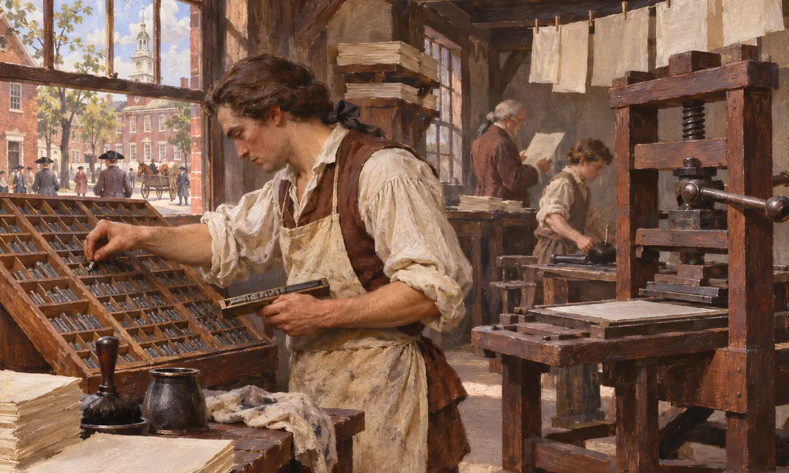
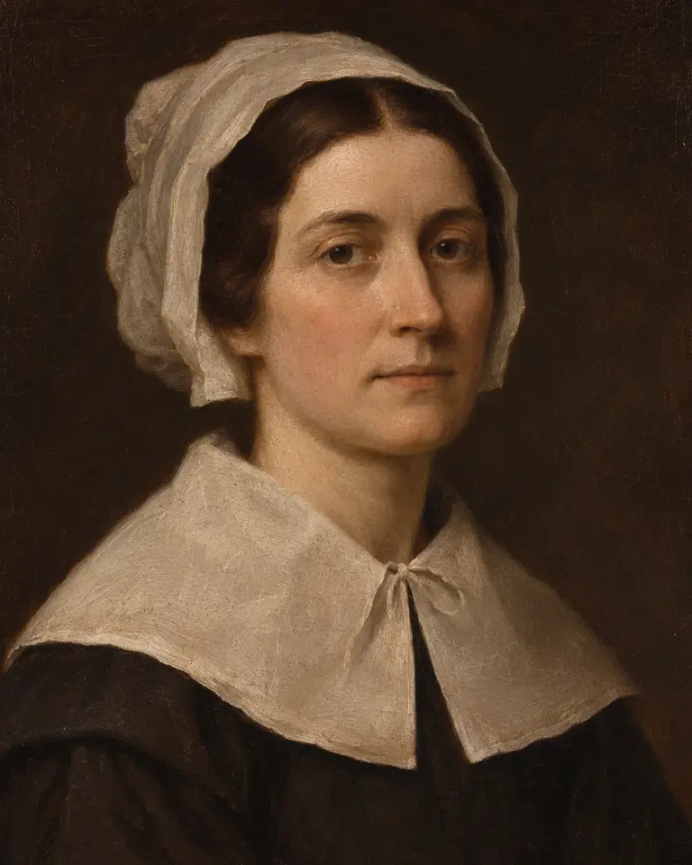

The first book printed in what is now the United States was not a novel or a poem written for fun. It was a book of psalms to be sung in church. The *Bay Psalm Book* came out in 1640 in Cambridge, Massachusetts, and about 1,700 copies were printed. That small fact explains a lot about early American writing. The people who crossed the sea cared about God, the Bible and their new communities long before they cared about art.

This article covers American literature from about 1600 to 1830. It starts with the first English settlers at Jamestown in 1607. It ends in the 1820s, when Washington Irving and James Fenimore Cooper became the first American writers whom readers in Europe knew by name. In these 230 years, writers lived through two big changes. First they were English subjects living far from home. After 1776 they were citizens of a new country, and they had to decide what an American voice should sound like.

We will go step by step. First we look at the world these writers lived in: politics, society, money and religion. Then we read the writing itself: poems, sermons, histories, pamphlets, plays and the first novels. Every hard term is explained the first time it appears.

## The world of this period

### Political life

The story begins in Virginia. In 1607 English settlers sent by a trading company, the Virginia Company, built Jamestown. It became the first lasting English settlement in North America. The company wanted money and more settlers, so early writing about Virginia often sounds like advertising. Many of the first settlers died in the first year.

Self-rule started early. In 1619 Virginia held the first meeting of the House of Burgesses, the first law-making assembly in English North America. It had 22 members from 11 settlements. In November 1620 the passengers of the *Mayflower* reached Cape Cod. There, 41 men signed the Mayflower Compact, a short agreement to make fair laws for the group and to obey them. It is seen as the first agreement on self-government in English North America.

In 1630 a much larger group of Puritans came to Massachusetts Bay under John Winthrop, who became the first governor. Winthrop told them that their colony should be like a "city upon a hill", a model Christian community that the whole world could see. The idea that America has a special mission returns again and again in later American writing.

Over the next century the colonies grew and slowly drifted away from England. In 1754 Benjamin Franklin proposed a plan to unite them at the Albany Congress. The colonial assemblies refused, because they did not want to give up their own power. Then came the French and Indian War (1754-1763), and after it new British taxes such as the Stamp Act of 1765. Writers answered with newspaper essays, pamphlets and plays.

Fighting began in 1775. In January 1776 Thomas Paine's pamphlet *Common Sense* argued for full independence, and on July 4, 1776 the Declaration of Independence was adopted. After the war, a new Constitution was approved in 1787. To win support for it, Alexander Hamilton, James Madison and John Jay wrote 85 essays under the shared name "Publius". We now call them *The Federalist Papers* (1787-88). Hamilton wrote 51 of them, Madison 29 and Jay 5.

The young nation stayed nervous. In 1798 Congress passed the Alien and Sedition Acts because many leaders feared French influence. The Sedition Act was aimed at newspapers that criticised President John Adams, and ten editors were fined or jailed. After the War of 1812, many writers began to call loudly for a truly American literature.

### Social life

Colonial society was a mix of peoples. English settlers were the largest group, but the land already belonged to Native nations such as the Powhatan in Virginia and the Wampanoag and Narragansett in New England. Contact brought trade, and it also brought disease and war. King Philip's War (1675-76) was a bitter fight between New England colonists and Native fighters led by the Wampanoag chief Metacom, whom the English called King Philip. It gave early American literature one of its most famous stories, the captivity of Mary Rowlandson.

Slavery also began early. In August 1619 a Dutch ship brought about twenty Africans to Jamestown. They are the first Africans known to have reached English North America. Slavery spread through the colonies and became central to the economy, especially in the South. The first African American to publish a book of poetry, Phillis Wheatley, was herself enslaved.

Women had few public rights, yet several of them wrote important books. Anne Bradstreet and Mary Rowlandson wrote in the 1600s. Phillis Wheatley wrote in the 1700s. Hannah Adams, a Massachusetts writer on religion and history, is generally considered the first professional woman author in America.

Education and printing grew out of religion. The Massachusetts Bay colony voted to start Harvard College in 1636, mainly to train ministers. In 1638 the first printing press in the colonies arrived at Cambridge, together with the printer Stephen Daye. Protestant settlers believed that people should read the Bible for themselves, so reading was valued.

By the late 1700s the population was very mixed. The writer J. Hector St. John de Crèvecoeur described families whose ancestors were English, Dutch and French. He asked a question that writers still ask: "What is an American?"

### Economic life

The colonies lived mainly from farming and trade. In Virginia, tobacco became the base of the economy and brought thousands of English workers to the fields. In the North, port towns such as Boston and Philadelphia grew around trade, shops and printing houses. Even the Puritan leaders of Massachusetts Bay cared about money as well as religion. Enslaved Africans did much of the hardest work, especially on southern farms.

Printing was a business too. Benjamin Franklin ran a newspaper, the *Pennsylvania Gazette*, from 1729. In 1732 he began *Poor Richard's Almanack*, a yearly book of weather notes, jokes and wise sayings. Franklin wrote that he kept it going for about twenty-five years.

Writers, however, could rarely live on their writing. Only about ninety American works of fiction were printed between 1789 and 1820, and few of them made a profit. Charles Brockden Brown, who wrote four novels in about two years, is often called the first professional American writer. Washington Irving later arranged for his *Sketch Book* to appear in England and America together, so he was paid and protected by copyright in both countries.

### Religion

Religion shaped almost everything. The Pilgrims of Plymouth were Separatists, people who wanted to break away from the Church of England. The Puritans, who settled Massachusetts Bay, wanted to "purify" the church and live by strict Bible rules. Both groups followed Calvinism, a Protestant teaching that stresses the Bible, faith, God's grace and predestination, the belief that God has already chosen who will be saved. Ministers were among the most powerful writers of the time, and many of their sermons were printed.

The dark side of this strict faith showed in Salem, Massachusetts, in 1692-93. After a few girls named neighbours as witches, courts tried many people, and about twenty were put to death. Later, many people felt that the trials had been a terrible mistake.

Then faith took a new, more emotional form. In the 1730s and 1740s the First Great Awakening, a wave of revival meetings, swept through the colonies. In New England it is traced to 1734, when Jonathan Edwards preached on justification by faith, the teaching that people are saved by faith alone, in Northampton, Massachusetts. The English preacher George Whitefield toured the colonies from 1739. His farewell sermon in Boston in October 1740 drew about 20,000 people, by one estimate. Supporters of the revival were called New Lights, and its opponents were called Old Lights. A Second Great Awakening began in New England in the 1790s.

Educated people were drawn to another movement, the Enlightenment, an 18th-century way of thinking that trusted reason and science. Franklin and Paine were two of its leaders in America. Many Enlightenment thinkers were deists. A deist believes that God made the world and can be known through nature and reason, and often doubts the Bible's miracles. Paine's *The Age of Reason* (1794-95) is the best-known deist book from this period.

Not every settler was a Puritan. Pennsylvania was a Quaker colony, and Charles Brockden Brown was born into a Quaker family in Philadelphia.

### Did you know?

The *Mayflower* was heading for Virginia, not Massachusetts. A storm blew it far to the north, and it landed on Cape Cod in November 1620. The original Mayflower Compact has been lost. The oldest copy we have is in William Bradford's own handwriting, inside his history of the colony.

### Important points to remember

- Jamestown (1607) was the first lasting English settlement in North America.
- The House of Burgesses (1619) and the Mayflower Compact (1620) were early steps toward self-government.
- In 1619 a Dutch ship brought about twenty Africans to Jamestown.
- John Winthrop led the Puritans to Massachusetts Bay in 1630 and spoke of a "city upon a hill".
- Harvard College (1636) and the first printing press (1638) grew out of Puritan religion.
- The First Great Awakening of the 1730s and 1740s was led by Jonathan Edwards and George Whitefield.
- The Enlightenment trusted reason, and Franklin and Paine were its main American voices.
- *Common Sense* (January 1776) and the Declaration of Independence (July 4, 1776) led the way to the new nation.
- *The Federalist Papers* (1787-88) had 85 essays, written under the name "Publius".
- Few writers could live on writing, so printing, newspapers and almanacs mattered a great deal.

## Literature in this period

### The language

Almost all colonial writers wrote in English, but English was not the only language of this land. Native peoples had a rich spoken literature: songs, chants, myths, riddles, proverbs, epics and trickster tales. Because these were told aloud and not written down, we call them oral literature. Spanish and French explorers also wrote accounts of the places they saw. The oldest European record of exploring America is not in these languages at all. It is the Old Norse *Vinland Saga*, which tells of the voyage of Leif Eriksson.

English writing in America began as a branch of English writing. Britannica notes that all 17th-century American writing followed British models. John Smith wrote like a travel and geography writer. William Bradford copied the rhythm of the King James Bible. The Mathers wrote rich, decorated prose, as many writers did at that time. Smith's *A True Relation of Virginia* (1608) is often called the first English book written in America.

Later writers wanted a voice of their own. Noah Webster published his *American Spelling Book* in 1783, known as the "Blue-Backed Speller" because of its cover. In 1828 he published *An American Dictionary of the English Language*, with about 70,000 entries. Webster believed that spelling and usage should follow the living, spoken language. He argued for simple spellings such as *theater* and *plow*.

### How the writing was printed and kept

<figure class="article-illustration">
  
  <figcaption>A representative eighteenth-century printing shop, imagined by a modern artist.</figcaption>
</figure>

Printing started late. The first press in the colonies came to Cambridge in 1638, brought over by Jesse Glover, with the printer Stephen Daye. Daye printed the *Bay Psalm Book* in 1640. It was a new English version of the psalms in verse, made by Puritan leaders including Richard Mather, John Eliot and Thomas Weld. It is called the first book printed in British North America. A press had worked in Mexico a century earlier, so it was not the first book printed anywhere in North America.

Many colonial writers had to go to London to be printed. Anne Bradstreet's poems appeared there in 1650, Cotton Mather's big church history in 1702, Phillis Wheatley's poems in 1773 and Crèvecoeur's *Letters* in 1782. Franklin's *Autobiography* was printed first in French, in Paris in 1791.

Some works were lost and found again. William Bradford's manuscript disappeared from Boston around the time of the Revolution. It was found in London, in the library of the Bishop of London at Fulham Palace, and Massachusetts printed it in 1856. It came back to Massachusetts in 1897. The original manuscript of Mary Rowlandson's book has not survived. Edward Taylor's poems stayed unread for more than two hundred years.

Newspapers, pamphlets and almanacs carried most of the new writing. *Common Sense* was a pamphlet of just 47 pages. Irving's *Sketch Book* came out in seven parts, from 1819 to 1820, before it became a book.

### Poetry

<figure class="article-illustration article-illustration--float article-illustration--portrait">
  
  <figcaption>Imagined portrait of Anne Bradstreet; no verified likeness is known.</figcaption>
</figure>

The earliest verse was religious. The *Bay Psalm Book* turned the psalms into rhymed lines that a congregation could sing. The first poet who is still widely read is Anne Bradstreet (about 1612-1672). She wrote while running a house and raising eight children. In the late 1640s her brother-in-law, the minister John Woodbridge, took her poems to England. They were printed in London in 1650 as *The Tenth Muse Lately Sprung Up in America*, "by a Gentlewoman in those parts". The Clements Library calls it the first book of poetry published by an American. It includes a long poem on the *Four Monarchies* and a *Dialogue between Old England and New*.

Woodbridge's preface says the book was printed without her knowledge. Bradstreet answered with a poem, "The Author to Her Book", in which she treats the book like a child that friends took away too soon. Some modern scholars doubt that she was really surprised. A second, larger book, *Several Poems*, was printed in Boston in 1678, after her death.

Edward Taylor (about 1642-1729) was a minister and doctor in Westfield, Massachusetts. His poems are written in the metaphysical style, which uses bold, surprising comparisons, as the English poet John Donne did. Taylor's poem "Huswifery" (about 1680) compares a person to a spinning wheel and loom that God uses. He is the only major American poet of this period to write in that style. No poem of his was printed in his lifetime.

Phillis Wheatley (about 1753-1784) was born in Senegal, Africa, and was brought to Boston in 1761 as a child, where she was sold to John Wheatley. The Wheatley family taught her to read and write. In 1772 she was questioned by eighteen leading Bostonians, including Governor Thomas Hutchinson and John Hancock. They signed a paper saying she had really written her poems. This paper, called an attestation, was printed at the front of her book. *Poems on Various Subjects, Religious and Moral* appeared in London on September 1, 1773. It has 39 poems, and the Countess of Huntingdon helped to pay for it. At least eight London magazines reviewed it. Wheatley was freed in the autumn of 1773. She was the first African American to publish a book of poetry. The first American edition came out in Philadelphia in 1786.

Philip Freneau (1752-1832) is called the "Poet of the American Revolution". His war poems, such as *General Gage's Confession* (1775), were satires that helped the patriot cause. After he was captured at sea, he wrote *The British Prison Ship* (1781). Later he turned to nature. His best-known poem, "The Wild Honey Suckle" (1786), has four stanzas of six lines each and describes a small flower that grows unseen and does not last. Many critics see it as an early sign of Romantic poetry in America.

William Cullen Bryant, a New Englander, won attention in his early twenties with the first version of "Thanatopsis" in 1817. The title means "view of death". Britannica says it was written under the influence of English 18th-century poets.

### Prose

The first English prose from America was about adventure and survival. John Smith (1580-1631), one of the Jamestown leaders, wrote *A True Relation* (1608) and *The Generall Historie of Virginia, New England, and the Summer Isles* (1624). The second book tells how the Powhatan girl Pocahontas supposedly saved his life. Historians still discuss how much of the story is true.

William Bradford (1590-1657), a leader and long-time governor of Plymouth, wrote *Of Plymouth Plantation* between 1630 and 1651. It tells the Pilgrims' story from their time in the Dutch Republic, through the *Mayflower* voyage, to 1647. Earlier, Bradford and Edward Winslow had helped to write *Mourt's Relation* (1622), a report on the first months at Plymouth.

Mary Rowlandson (about 1637-1711) was taken prisoner in 1675, when Native fighters attacked Lancaster, Massachusetts, during King Philip's War. She was freed in May 1676 after Boston's women raised a ransom of £20. Her book, *The Sovereignty and Goodness of God*, was printed in Cambridge, Massachusetts, in 1682 and in London in the same year. Its preface is thought to be by Increase Mather. It is the model for the American captivity narrative, a story told by a person held prisoner.

Cotton Mather (1663-1728) was the best-known Puritan minister of his time and wrote nearly 400 works. He took an active part in the Salem trials and defended them in *Wonders of the Invisible World* (1693). Robert Calef answered him with *More Wonders of the Invisible World* (1700). Mather's big book, *Magnalia Christi Americana* (1702), is a church history of New England from 1620 to 1698. It was printed in London. One scholar calls it the grandest of American jeremiads.

The sermon is the form for which Jonathan Edwards (1703-1758) is remembered. Edwards was a Yale-educated minister who came from a long line of Puritan ministers. On July 8, 1741 he preached *Sinners in the Hands of an Angry God* in Enfield, Connecticut, a town where the revival had not reached. Its text was a line from Deuteronomy, "Their foot shall slide in due time". Whitefield travelled more, but Edwards gave the most famous sermon of the 18th century.

Benjamin Franklin (1706-1790) wrote on science, politics and daily life. He began the *Pennsylvania Gazette* in 1729 and *Poor Richard's Almanack* in 1732, using the pen name Richard Saunders. His *Autobiography* was written in four parts, in 1771, 1784, 1788 and 1789-90, and it covers only a little more than his first forty years. Part One was addressed to his son William, then royal governor of New Jersey. It was first printed in French in 1791. The first English edition (London, 1793) was a translation back from the French. His grandson William Temple Franklin printed an English version in 1818, and the first accurate edition came in 1868. The historian Edmund S. Morgan called it the most widely read autobiography ever written by an American.

Thomas Paine (1737-1809) arrived in Philadelphia in November 1774 with a letter of introduction from Franklin. His pamphlet *Common Sense* appeared on January 10, 1776, without his name, under the line "By an Englishman". It was printed by Robert Bell in plain words that ordinary people could follow. Paine himself said that it sold 120,000 copies in three months. He later wrote *The Age of Reason* in Paris (1794-95). He spent eleven months in prison between its two parts.

J. Hector St. John de Crèvecoeur (1735-1813), born in Normandy, France, wrote *Letters from an American Farmer*, published in London in 1782. The letters come from an imaginary farmer named James, who lives in the Quaker colony of Pennsylvania and writes to an English friend. Letter III asks "What is an American?" and answers that Americans are a new people made from many nations. In Letter IX he speaks against slavery. The book was printed only once in America in the 1790s, and it was mostly ignored in the 1800s.

### Drama and the novel

The theatre came late. Royall Tyler's *The Contrast* was staged in New York on April 16, 1787, by the American Company. It was the first comedy by an American-born writer to be produced professionally. Tyler copied Sheridan's *The School for Scandal* but made the country servant Jonathan the first "Yankee" character on the American stage. Earlier, Mercy Otis Warren had printed a satire, *The Adulateur* (1773), which attacked Governor Hutchinson. Tyler also wrote *The Algerine Captive* (1797), a novel.

The first American novel is generally agreed to be *The Power of Sympathy* by William Hill Brown (1765-1793). It was printed in Boston by Isaiah Thomas on January 21, 1789, without the author's name. It is an epistolary novel, told in letters, and a sentimental novel, a type that Samuel Richardson made popular in England. Its tragic love story was meant to warn readers about seduction and to argue for better education for women. It sold poorly, and for years it was wrongly credited to another writer.

Charles Brockden Brown (1771-1810) wrote four novels in two years to earn a living. In *Wieland* (1798) a religious man is driven mad by a mysterious voice, and the voice turns out to come from a ventriloquist. Brown set his novels in America, near Philadelphia, and gave the Gothic story an American home. He is often called the "father of the American novel". His work later influenced Poe and Hawthorne.

### Irving and Cooper

By the 1820s two writers made American fiction famous abroad. Washington Irving (1783-1859) is called the first American man of letters. His *Sketch Book of Geoffrey Crayon, Gent.* appeared in seven parts in 1819-20. Geoffrey Crayon is a made-up narrator who travels in England. Only a few of the pieces are about America, but two of them, "Rip Van Winkle" and "The Legend of Sleepy Hollow", are often called the first American short stories. Both are presented as writings left by an imaginary Dutch historian, Diedrich Knickerbocker, and both use German folk tales set in New York. "Rip Van Winkle" came out in the first part, on June 23, 1819.

James Fenimore Cooper (1789-1851) wrote five novels about the frontier scout Natty Bumppo, known as the Leatherstocking Tales: *The Pioneers* (1823), *The Last of the Mohicans* (1826), *The Prairie* (1827), *The Pathfinder* (1840) and *The Deerslayer* (1841). *The Pioneers* sold 3,500 copies on the morning it was published. *The Last of the Mohicans*, subtitled *A Narrative of 1757*, is set in the French and Indian War, where Natty is called Hawkeye. It is Cooper's most widely read book. His novel *The Pilot* (1823) began a second series of sea stories.

### Ideas and movements

Several streams of thought run through these 230 years. The first is Puritanism. Puritans read history as God's plan, so they often looked for "types", or signs, of Bible stories in everyday events. The second is the Great Awakening, which put feeling and personal conversion ahead of formal religion.

The third is the Enlightenment, which gave the age its pamphlets and its belief in reason. The fourth is Revolutionary writing, the newspaper essays, satires and pamphlets of Paine, Freneau, Samuel Adams and others. The fifth is sentimental and Gothic fiction, brought from England and given American settings by the two Browns. The sixth, after the War of 1812, was the call for a truly national literature, answered by Bryant, Irving and Cooper.

### An interesting story

Edward Taylor was a minister and doctor in the small frontier town of Westfield, Massachusetts. For years he wrote poems as private prayers. He asked his heirs never to publish his writings, and they obeyed. For more than two hundred years nobody read them. Then, in 1937, a scholar named Thomas H. Johnson found Taylor's 400-page manuscript in the library of Yale University. He printed a selection in the *New England Quarterly* in 1937 and a book, *The Poetical Works of Edward Taylor*, in 1939. A poet who wanted silence became one of the best-known voices of Puritan America.

### Key terms

- **Colony** - a settlement ruled by another country; here, the English settlements in America.
- **Puritan** - a Protestant who wanted to purify the Church of England and live by strict Bible rules.
- **Separatist** - a person who wanted to break away from the Church of England; the Pilgrims were Separatists.
- **Calvinism** - a Protestant teaching that stresses the Bible, faith, God's grace and predestination.
- **Predestination** - the belief that God has already chosen who will be saved.
- **Sermon** - a religious speech given by a minister, often printed and read at home.
- **Jeremiad** - a sermon or speech that warns that society has sinned and must change.
- **Typology** - a way of reading in which people and events echo stories in the Bible.
- **Captivity narrative** - a true story written by a person who was taken prisoner.
- **Metaphysical poetry** - poetry that uses bold, surprising comparisons to speak about faith and ideas.
- **Oral literature** - songs, stories and speeches that are told aloud and not written down.
- **Great Awakening** - a wave of emotional revival meetings in the colonies in the 1730s and 1740s.
- **Enlightenment** - an 18th-century movement that trusted reason and science.
- **Deism** - the belief that God made the world and can be known through reason, not through miracles.
- **Pamphlet** - a short, cheap, unbound booklet, such as *Common Sense*.
- **Almanac** - a yearly book of calendars, weather notes and sayings, such as *Poor Richard's Almanack*.
- **Epistolary novel** - a novel told through letters.
- **Sentimental novel** - a novel that appeals strongly to the reader's feelings.
- **American Gothic** - a type of fiction with fear, madness and dark secrets, set in America.
- **Attestation** - a signed statement that confirms a fact, as in Wheatley's book.

### Criticism and scholarship

Scholars have studied this period in several waves. Moses Coit Tyler's *A History of American Literature, 1607-1765* (1878) was a major early history. In the 1930s Perry Miller changed the field. His *The New England Mind: The Seventeenth Century* (1939) showed that Puritan ideas were serious and complex, not just a list of strict rules. With Thomas H. Johnson he also edited a source book, *The Puritans* (1938). Johnson then brought out Edward Taylor's poems. Samuel Eliot Morison, in *Builders of the Bay Colony* (1930), praised Anne Bradstreet as one of the best poets of her time.

Later, Sacvan Bercovitch gave Puritan writing a new reading. In *The Puritan Origins of the American Self* (1975) and *The American Jeremiad* (1978) he argued that Puritan ideas, especially typology and the sense of a special mission, shaped how Americans later thought of themselves. He also edited volume 1 of *The Cambridge History of American Literature* (1590-1820), which one reviewer called the leading scholarly history of its generation. For the Revolution and the early nation, see Emory Elliott's *Revolutionary Writers* (1982) and Cathy N. Davidson's *Revolution and the Word* (1986), which studies the rise of the novel in America.

Single writers have started many debates. Was Bradstreet really surprised by her book in 1650? Some modern scholars say she knew and wanted it. Crèvecoeur's picture of Americans as a new people has been criticised because it left out enslaved Black Americans and did not match what most writers of his own day believed. Critics still argue over which of Cooper's five Leatherstocking novels is the best. Some pick *The Pioneers* and *The Prairie*, others *The Deerslayer*. Mark Twain made fun of Cooper in his essay "Fenimore Cooper's Literary Offences".

In recent decades critics have given more attention to Native, Black and women writers. Examples are Wheatley, Rowlandson and the Pequot writer William Apess, whose *A Son of the Forest* (1829) was the first long autobiography by a Native American.

### Important points to remember

- Colonial writing began as part of English writing, and most 17th-century authors followed British models.
- Native oral literature, and Spanish and French exploration writing, are also part of the early picture.
- Religion shaped early prose: Bradford's history, Rowlandson's captivity narrative, Mather's *Magnalia* and Edwards's sermons.
- Anne Bradstreet's *The Tenth Muse* (1650) is called the first book of poetry published by an American.
- Edward Taylor's poems were not printed until 1939, after Thomas H. Johnson found them at Yale.
- Phillis Wheatley's 1773 book was the first book of poetry by an African American.
- Franklin's *Autobiography* and *Poor Richard's Almanack* show the practical, Enlightenment side of American writing.
- Paine's *Common Sense* (1776) was the most powerful pamphlet of the Revolution.
- Tyler's *The Contrast* (1787) and Brown's *The Power of Sympathy* (1789) began American drama and the American novel.
- Irving and Cooper were the first American writers with a large readership abroad.

## How the period ends

By the 1820s the mood had changed. The country had faced Britain in a second war, in 1812, and writers felt ready to speak for themselves. Britannica names four writers who began a great half century of American writing: Bryant, Irving, Cooper and Edgar Allan Poe.

Irving's *Sketch Book* (1819-20) had made him famous on both sides of the ocean. Cooper's Leatherstocking Tales had turned the frontier into an American legend. Noah Webster's dictionary of 1828 gave the country a large book of its own about its own language. In 1829 the Pequot writer William Apess published *A Son of the Forest*, and in 1833 his essay "An Indian's Looking-Glass for the White Man" attacked racial prejudice. These voices came from outside the old New England circle, and they show how wide American writing was becoming.

Around 1830 a new period begins. Nathaniel Hawthorne, Herman Melville and Walt Whitman started to publish in the years that followed. Their time is the next chapter in this series, the American Renaissance.

### Important points to remember

- After the War of 1812, writers called more and more for a truly American literature.
- Bryant, Irving, Cooper and Poe began a great half century of American writing.
- Irving's *Sketch Book* (1819-20) and Cooper's Leatherstocking Tales gave American fiction a world audience.
- Webster's *American Dictionary of the English Language* (1828) put American usage into a large book.
- William Apess's *A Son of the Forest* (1829) was the first long autobiography by a Native American.
- A new period, the American Renaissance, begins around 1830 with writers such as Hawthorne, Melville and Whitman.

## Writers and works

| Writer | Dates | Main works | Remembered for |
|---|---|---|---|
| John Smith | 1580-1631 | *A True Relation* (1608); *The Generall Historie* (1624) | Early Virginia writing; the Pocahontas story |
| William Bradford | 1590-1657 | *Of Plymouth Plantation* (written 1630-1651) | The history of Plymouth and the Pilgrims |
| Anne Bradstreet | c. 1612-1672 | *The Tenth Muse* (1650); *Several Poems* (1678) | First book of poetry by an American |
| Mary Rowlandson | c. 1637-1711 | *The Sovereignty and Goodness of God* (1682) | The model captivity narrative |
| Edward Taylor | c. 1642-1729 | *The Poetical Works* (1939); "Huswifery" | Puritan poet of the metaphysical style |
| Cotton Mather | 1663-1728 | *Wonders of the Invisible World* (1693); *Magnalia Christi Americana* (1702) | Puritan minister; the Salem trials; a church history |
| Jonathan Edwards | 1703-1758 | *Sinners in the Hands of an Angry God* (1741) | Preacher of the Great Awakening |
| Benjamin Franklin | 1706-1790 | *Poor Richard's Almanack* (1732); *Autobiography* (1771-90) | Printer, scientist and writer |
| J. Hector St. John de Crèvecoeur | 1735-1813 | *Letters from an American Farmer* (1782) | The question "What is an American?" |
| Thomas Paine | 1737-1809 | *Common Sense* (1776); *The Age of Reason* (1794-95) | Pamphleteer of the Revolution |
| Philip Freneau | 1752-1832 | *General Gage's Confession* (1775); "The Wild Honey Suckle" (1786) | "Poet of the American Revolution" |
| Phillis Wheatley | c. 1753-1784 | *Poems on Various Subjects, Religious and Moral* (1773) | First African American to publish a book of poetry |
| Royall Tyler | 1757-1826 | *The Contrast* (1787); *The Algerine Captive* (1797) | First American comedy staged professionally |
| Noah Webster | 1758-1843 | *American Spelling Book* (1783); *An American Dictionary of the English Language* (1828) | A voice for American English |
| William Hill Brown | 1765-1793 | *The Power of Sympathy* (1789) | The first American novel |
| Charles Brockden Brown | 1771-1810 | *Wieland* (1798) | Early American Gothic fiction |
| Washington Irving | 1783-1859 | *The Sketch Book* (1819-20) | "Rip Van Winkle"; "The Legend of Sleepy Hollow" |
| James Fenimore Cooper | 1789-1851 | The Leatherstocking Tales (1823-41) | Frontier novels; Natty Bumppo |

## Quick revision - 50 points

1. The *Bay Psalm Book* (1640) was the first book printed in what is now the United States.
2. It was printed in Cambridge, Massachusetts, by Stephen Daye.
3. About 1,700 copies of the *Bay Psalm Book* were printed.
4. Jamestown, founded in 1607, was the first lasting English settlement in North America.
5. The Virginia Company, a trading company, sent the Jamestown settlers.
6. The House of Burgesses first met in 1619 and had 22 members.
7. A Dutch ship brought about twenty Africans to Jamestown in August 1619.
8. In November 1620, 41 men signed the Mayflower Compact.
9. The *Mayflower* was bound for Virginia but landed on Cape Cod.
10. John Winthrop led the Puritans to Massachusetts Bay in 1630.
11. Winthrop spoke of a "city upon a hill".
12. Harvard College was founded by a vote of the colony in 1636.
13. King Philip's War was fought in 1675-76.
14. The Salem witch trials took place in 1692-93.
15. Franklin's 1754 plan to unite the colonies was refused by the colonial assemblies.
16. *Common Sense* was published on January 10, 1776.
17. The Declaration of Independence was adopted on July 4, 1776.
18. *The Federalist Papers* have 85 essays and were signed "Publius".
19. Hamilton wrote 51 Federalist essays, Madison 29 and Jay 5.
20. The Alien and Sedition Acts were passed in 1798.
21. John Smith's *A True Relation* (1608) is often called the first English book written in America.
22. William Bradford wrote *Of Plymouth Plantation* between 1630 and 1651.
23. *Of Plymouth Plantation* was first printed in full in 1856.
24. Anne Bradstreet's *The Tenth Muse* was printed in London in 1650.
25. Her brother-in-law John Woodbridge took her poems to England.
26. Mary Rowlandson's captivity narrative was printed in 1682.
27. Edward Taylor's poems were not printed until 1939.
28. Thomas H. Johnson found Taylor's manuscript at Yale.
29. Taylor wrote in the metaphysical style, like John Donne.
30. Cotton Mather defended the Salem trials in *Wonders of the Invisible World* (1693).
31. Mather's *Magnalia Christi Americana* (1702) is a church history of New England.
32. Jonathan Edwards preached *Sinners in the Hands of an Angry God* at Enfield on July 8, 1741.
33. George Whitefield began his tour of the colonies in 1739.
34. Franklin began *Poor Richard's Almanack* in 1732.
35. Franklin wrote his *Autobiography* between 1771 and 1790.
36. The *Autobiography* was first printed in French in 1791.
37. Paine's *The Age of Reason* (1794-95) is a deist book that attacks the Bible.
38. Phillis Wheatley's *Poems on Various Subjects, Religious and Moral* appeared in London in 1773.
39. Wheatley's book has 39 poems and an attestation signed by eighteen Bostonians.
40. Wheatley was the first African American to publish a book of poetry.
41. Crèvecoeur's *Letters from an American Farmer* (1782) asks "What is an American?"
42. Philip Freneau is called the "Poet of the American Revolution".
43. Freneau's "The Wild Honey Suckle" dates from 1786.
44. Royall Tyler's *The Contrast* (1787) was the first American comedy staged professionally.
45. William Hill Brown's *The Power of Sympathy* (1789) is generally called the first American novel.
46. Charles Brockden Brown's *Wieland* (1798) is an early American Gothic novel.
47. Irving's *Sketch Book* (1819-20) contains "Rip Van Winkle" and "The Legend of Sleepy Hollow".
48. Cooper's five Leatherstocking Tales were published between 1823 and 1841.
49. *The Last of the Mohicans* (1826) is set during the French and Indian War.
50. Noah Webster's *American Dictionary of the English Language* appeared in 1828.

## Quick quiz - 25 questions

Tap an answer to see at once if it is right. You do not need to log in.

**1. What was the first book printed in what is now the United States?**

- A) The *Bay Psalm Book*
- B) *The Tenth Muse*
- C) *Common Sense*
- D) *Poor Richard's Almanack*

Answer: A. It was printed in 1640 in Cambridge, Massachusetts.

**2. In which year was Jamestown founded?**

- A) 1636
- B) 1620
- C) 1630
- D) 1607

Answer: D. Settlers sent by the Virginia Company built Jamestown in 1607.

**3. What did 41 men sign in November 1620?**

- A) The Stamp Act
- B) The Albany Plan
- C) The Mayflower Compact
- D) The Declaration of Independence

Answer: C. The Mayflower Compact was a short agreement to make fair laws and obey them.

**4. Who led the Puritans to Massachusetts Bay in 1630?**

- A) John Winthrop
- B) William Bradford
- C) John Smith
- D) Jonathan Edwards

Answer: A. Winthrop became the first governor and spoke of a "city upon a hill".

**5. Which book of 1650 is called the first book of poetry published by an American?**

- A) *Several Poems*
- B) *The Wild Honey Suckle*
- C) *Poems on Various Subjects, Religious and Moral*
- D) *The Tenth Muse*

Answer: D. Anne Bradstreet's *The Tenth Muse* was printed in London in 1650.

**6. Who took Anne Bradstreet's poems to England?**

- A) Her brother-in-law, John Woodbridge
- B) Cotton Mather
- C) Richard Mather
- D) William Bradford

Answer: A. Woodbridge, a minister, carried the manuscript to London in the late 1640s.

**7. What did Edward Taylor ask his heirs to do with his poems?**

- A) Print them in London
- B) Give them to Harvard
- C) Burn them
- D) Never publish them

Answer: D. His poems stayed unread for more than two hundred years.

**8. Who found Edward Taylor's poems at Yale in 1937?**

- A) Perry Miller
- B) Sacvan Bercovitch
- C) Moses Coit Tyler
- D) Thomas H. Johnson

Answer: D. Johnson printed a selection in 1937 and the book *The Poetical Works of Edward Taylor* in 1939.

**9. Which sermon did Jonathan Edwards preach at Enfield in 1741?**

- A) *A Model of Christian Charity*
- B) *The Age of Reason*
- C) *Sinners in the Hands of an Angry God*
- D) *Common Sense*

Answer: C. He preached it on July 8, 1741, at a time of the Great Awakening.

**10. When was *Common Sense* first published?**

- A) January 1776
- B) July 1776
- C) 1787
- D) 1765

Answer: A. Thomas Paine's pamphlet appeared on January 10, 1776.

**11. Which writer is called the "Poet of the American Revolution"?**

- A) Philip Freneau
- B) Edward Taylor
- C) Anne Bradstreet
- D) William Cullen Bryant

Answer: A. Freneau wrote war satires and later nature poems such as "The Wild Honey Suckle".

**12. How many Bostonians signed the attestation in Phillis Wheatley's book?**

- A) 8
- B) 12
- C) 39
- D) 18

Answer: D. Eighteen leading Bostonians signed a paper saying she had written the poems herself.

**13. Who began *Poor Richard's Almanack* in 1732?**

- A) Thomas Paine
- B) Benjamin Franklin
- C) Cotton Mather
- D) Noah Webster

Answer: B. Franklin used the pen name Richard Saunders.

**14. In which language was Franklin's *Autobiography* first printed?**

- A) English
- B) German
- C) Latin
- D) French

Answer: D. It appeared in French in Paris in 1791.

**15. What is Mary Rowlandson's book of 1682 about?**

- A) The voyage of the *Mayflower*
- B) Her capture during King Philip's War
- C) The Salem witch trials
- D) A journey to London

Answer: B. It is the model captivity narrative.

**16. Which play of 1787 was the first American comedy staged professionally?**

- A) *The Adulateur*
- B) *The Power of Sympathy*
- C) *The Contrast*
- D) *The Algerine Captive*

Answer: C. Royall Tyler's *The Contrast* was staged in New York on April 16, 1787.

**17. Which book is generally called the first American novel?**

- A) *Wieland*
- B) *The Power of Sympathy*
- C) *The Pioneers*
- D) *The Algerine Captive*

Answer: B. William Hill Brown's novel was printed in Boston in 1789.

**18. Who wrote *Wieland* (1798)?**

- A) William Hill Brown
- B) Royall Tyler
- C) Charles Brockden Brown
- D) Washington Irving

Answer: C. *Wieland* is an early American Gothic novel.

**19. In which book did "Rip Van Winkle" first appear?**

- A) *The Sketch Book*
- B) *Letters from an American Farmer*
- C) *Magnalia Christi Americana*
- D) *The Prairie*

Answer: A. It came out in the first part of Irving's *Sketch Book* on June 23, 1819.

**20. Which of these is NOT one of Cooper's Leatherstocking Tales?**

- A) *The Pioneers*
- B) *The Prairie*
- C) *The Deerslayer*
- D) *Wieland*

Answer: D. *Wieland* was written by Charles Brockden Brown.

**21. Which author wrote the most essays in *The Federalist Papers*?**

- A) James Madison
- B) John Jay
- C) Alexander Hamilton
- D) Thomas Paine

Answer: C. Hamilton wrote 51 of the 85 essays.

**22. What question does Letter III of Crèvecoeur's *Letters from an American Farmer* ask?**

- A) Who owns the land?
- B) What is an American?
- C) Who is free?
- D) Where is home?

Answer: B. The question "What is an American?" is the title of Letter III.

**23. In which year did Noah Webster publish *An American Dictionary of the English Language*?**

- A) 1783
- B) 1806
- C) 1828
- D) 1841

Answer: C. The dictionary had about 70,000 entries.

**24. What does the title "Thanatopsis" mean?**

- A) Song of the sea
- B) View of death
- C) Hymn of freedom
- D) Letter from home

Answer: B. William Cullen Bryant's poem first appeared in 1817.

**25. Which statement about Phillis Wheatley's first book is correct?**

- A) It was first printed in Boston in 1773.
- B) It was first printed in London in 1773 and has 39 poems.
- C) It was first printed in Philadelphia in 1786 and has 18 poems.
- D) It was printed in 1750, before she was freed.

Answer: B. The first American edition came later, in Philadelphia in 1786.

## Frequently asked questions

**What does "colonial and early national period" mean in American literature?**
It is the long first period, from about 1600 to 1830. "Colonial" covers the years when the settlers lived under English rule, up to 1776. "Early national" covers the first decades of the United States, when writers tried to build a literature of their own.

**Who was the first American poet?**
Anne Bradstreet is usually named, because her *Tenth Muse* (1650) is called the first book of poetry published by an American. Verse had been printed earlier in the *Bay Psalm Book* (1640), but that book was a group translation of the psalms, not one poet's work.

**Why were so many early American books printed in London?**
Printing in the colonies began only in 1638, and London was the centre of the English book trade. London also gave writers a larger audience. Wheatley's supporters, for example, looked to London for a publisher who would accept a book by an enslaved poet.

**How is Puritan writing different from Enlightenment writing?**
Puritan writing sees the world as part of God's plan and asks readers to examine their souls. Bradford, Bradstreet, Taylor, Mather and Edwards belong here. Enlightenment writing trusts reason and science and often deals with politics and daily life. Franklin and Paine belong here. The two streams overlap. Edwards, for example, was shaped by both strict Calvinism and the open-minded spirit of the Enlightenment.

**Which book is the first American novel, and is that certain?**
*The Power of Sympathy* (1789) by William Hill Brown is widely accepted as the first American novel. Its author's name was uncertain for a long time, because it was printed without one, but scholars settled the question by the end of the 1800s. Charles Brockden Brown, who wrote *Wieland*, is often called the "father of the American novel".

**Why is Phillis Wheatley important?**
She was the first African American to publish a book of poetry. Her 1773 book had to carry a signed statement from eighteen Bostonians that she had written the poems herself, which shows the prejudice she faced. The book was reviewed in London magazines, and Wheatley was freed in 1773.

## Sources

- Hart, James D. *The Oxford Companion to American Literature.* First edition. New York: Oxford University Press, 1941. Entries used: Albany Congress, *The Age of Reason*, *The Adulateur*, *The Algerine Captive*, the Alien and Sedition Acts, Hannah Adams and Abolitionist.
- Bercovitch, Sacvan, ed. *The Cambridge History of American Literature, Volume 1: 1590-1820.* Cambridge: Cambridge University Press.
- Tyler, Moses Coit. *A History of American Literature, 1607-1765.* New York: G. P. Putnam's Sons, 1878.
- Miller, Perry. *The New England Mind: The Seventeenth Century.* New York: Macmillan, 1939.
- Miller, Perry, and Thomas H. Johnson, eds. *The Puritans: A Sourcebook of Their Writings.* New York: American Book Company, 1938.
- Johnson, Thomas H., ed. *The Poetical Works of Edward Taylor.* New York: Rockland Editions, 1939.
- Bercovitch, Sacvan. *The Puritan Origins of the American Self.* New Haven: Yale University Press, 1975.
- Bercovitch, Sacvan. *The American Jeremiad.* Madison: University of Wisconsin Press, 1978.
- Elliott, Emory. *Revolutionary Writers: Literature and Authority in the New Republic, 1725-1810.* New York: Oxford University Press, 1982.
- Davidson, Cathy N. *Revolution and the Word: The Rise of the Novel in America.* New York: Oxford University Press, 1986.
- Morison, Samuel Eliot. *Builders of the Bay Colony.* Boston: Houghton Mifflin, 1930.
- *Encyclopaedia Britannica.* Articles "American literature" (17th, 18th and 19th century sections), "Washington Irving", "James Fenimore Cooper", "The Leatherstocking Tales", "Bay Psalm Book", "Great Awakening", "Noah Webster" and "Charles Brockden Brown".
- Library of Congress. Catalogue records and exhibit page for the *Bay Psalm Book* (1640).
- Massachusetts Historical Society. "Poems on Various Subjects, Religious and Moral" and "Object of the Month".
- State Library of Massachusetts. "Bradford's Manuscript *Of Plimoth Plantation*." Mass.gov.
- William L. Clements Library, University of Michigan. "For National Poetry Month: Anne Bradstreet's *Tenth Muse*."
- Academy of American Poets (Poets.org) and Poetry Foundation. Author and book pages on Phillis Wheatley and Philip Freneau.
- University of Virginia. *Literature in Context: An Open Anthology.* Headnotes.
- EBSCO Research Starters (Salem Press, *Magill's Survey of American Literature*). Articles on *Common Sense*, "Sinners in the Hands of an Angry God", *Of Plymouth Plantation* and "The Wild Honey Suckle".
- Digital History, University of Houston. "A Chronology of American History: 17th Century."

Afsar Khan, Ph.D. English
