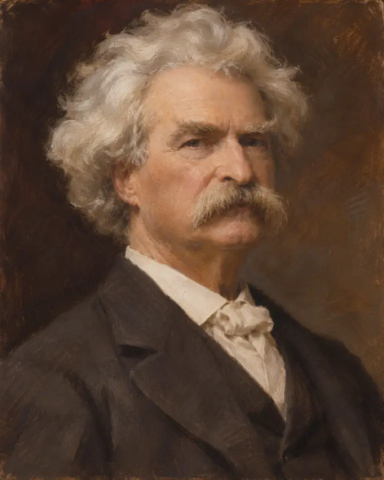
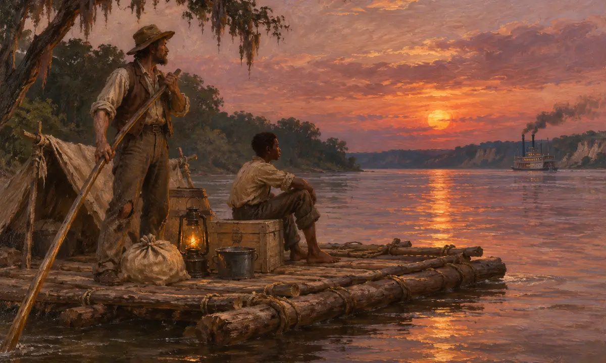

A boy on a raft asks questions that the respectable adults around him prefer to avoid. In Mark Twain's *Adventures of Huckleberry Finn*, ordinary speech and an uncomfortable moral choice expose the cruelty of slavery. The book suggests that a believable person can reveal more about a society than an ideal hero.

This article covers American literature from 1865, when the Civil War ended, to 1914, when the First World War began in Europe. These dates mark a useful period of change, not strict walls around every writer's career. **Realism** examines recognizable people and everyday social life. **Naturalism** often asks how far poverty, environment and inherited conditions restrict human choice.

The article begins with politics, social life, work and religion after the war. It then explains the writing, writers, major books and forms that grew from these conditions. Difficult literary terms are explained as they appear.

## The world of this period

### Political life

The American Civil War ended in 1865, leaving the United States united but deeply divided. The Thirteenth Amendment abolished slavery, except as a punishment for crime after conviction. The Fourteenth Amendment, ratified in 1868, addressed citizenship and equal protection. The Fifteenth Amendment, ratified in 1870, prohibited denying voting rights on the basis of race, color or previous enslavement. Legal promises, however, did not produce equal treatment in daily life.

**Reconstruction** was the attempt to rebuild the former Confederate states and define freedom after slavery. It is commonly dated from 1865 to 1877. Black voters, teachers and elected officials helped shape public life, while white supremacist violence fought against these changes. After federal Reconstruction ended, Southern states imposed systems that took away Black political rights. The Supreme Court's *Plessy v. Ferguson* decision of 1896 upheld racial separation under a doctrine of supposed equality.

The federal government also continued taking Indigenous lands and restricting Native nations' independence. The Dawes Act of 1887 divided many communally held tribal lands into individual allotments. This policy damaged Indigenous landholding and community life. The period's public language about settlement and progress often concealed dispossession. Some writing celebrated expansion, while other texts questioned who paid its human cost.

Politics increasingly revolved around railroads, banks, corporations and the rights of workers. The disputed presidential election of 1876 was followed by the end of federal Reconstruction in 1877. The Spanish-American War of 1898 raised new questions about overseas power. Reformers in the **Progressive Era**, especially after 1900, sought responses to political corruption, unsafe labor and concentrated wealth. Fiction and essays brought these struggles into stories about individual choices.

### Social life

During these decades, millions of Americans moved between farms, towns and cities. Immigration helped make industrial cities multilingual and culturally varied. Black communities built schools, churches, newspapers and professional networks despite severe discrimination. Families entering unfamiliar workplaces and neighborhoods often experienced both opportunity and danger. Writers used streets, rented rooms, offices and homes as scenes where large social changes became personal.

A growing **middle class**, meaning households with some economic security beyond immediate survival, became an important reading public. It was not a single uniform group. Wealth, race, gender and location shaped the chances available to each family. Domestic life still carried strong rules about the behavior expected of women. For many women, gaining education or paid work did not remove legal and social limits on independence.

The movement for women's voting rights remained active, and women increasingly wrote and edited widely read magazines. **Gender roles** are expectations that a society places on people because they are seen as men or women. Kate Chopin and Edith Wharton examine the conflicts these expectations can create. Their characters may appear comfortable from outside but feel trapped by marriage, status or dependence on wealth. Readers begin to see private rooms as places of social pressure.

Different regions did not share one American experience. The Mississippi Valley, the South, New England and western settlements had distinct speech and customs. Writers of **local color**, a form that uses a place's language, landscape and habits, made those differences visible. This approach could preserve everyday detail, but it could also repeat stereotypes. A careful reader asks whose voice is heard and whose story is missing.

### Economic life

After the Civil War, factories, railroads and large firms changed how goods moved and how people worked. New industrial wealth created striking contrasts between rich owners and poorly paid workers. Urban growth made tenements and crowded streets familiar parts of American life. **Industrialization** means the expansion of machine-based production and large workplaces. It gave writers new characters, including clerks, saleswomen, railway workers and struggling families.

Labor disputes made the costs of industrial growth clear. The Haymarket affair took place in Chicago in 1886, during a campaign for shorter working hours. The Pullman Strike of 1894 showed conflict between railway labor and corporate power. The financial Panic of 1893 disrupted jobs and businesses. Such events made chance, economic systems and unequal power difficult for novelists to ignore.

Railroads linked markets but also gave large companies influence over prices and land. Frank Norris explored this problem in his fiction about California wheat farmers. The search for personal advancement also became a frequent story pattern. A character might rise in income while losing a sense of honesty or belonging. William Dean Howells made this tension central to his social novels, where money and moral success are not the same thing.

**Consumer culture** means a social life increasingly shaped by buying, advertising and new goods. Department stores and magazines offered images of success that many people could not afford. In Theodore Dreiser's fiction, shop windows can become symbols of desire and exclusion. The effect is not merely decorative: wanting things affects the decisions characters make. Naturalist fiction often shows money acting almost like an invisible pressure on the plot.

### Religion

Religion remained central to many American communities, but industrial growth and new ideas produced debate. Protestant churches, Catholic communities, Jewish communities and other faith traditions took part in changing public life. The **Social Gospel** was a Protestant reform movement that connected religious duty with problems such as poverty and unfair work. Its supporters argued that social conditions deserved moral attention, not only individual conduct.

**Evolutionary theory**, especially public debate around Charles Darwin's ideas, encouraged questions about nature and human behavior. Writers also encountered new forms of psychology and social science. These debates did not simply replace faith with science. Some people defended familiar beliefs, some revised them, and others questioned religious authority. Naturalist writers borrowed ideas of physical causes and surrounding conditions without turning every novel into a scientific experiment.

Churches played major roles in Black education and civic organization. W. E. B. Du Bois studied spiritual life and the songs of enslaved communities in *The Souls of Black Folk* (1903). Mark Twain, meanwhile, often exposed the gap between public religious language and private conduct. Thus religion entered literature as faith, institution, comfort and sometimes social criticism. These different approaches belong to the same period.

### Did you know?

Mark Twain's *Adventures of Huckleberry Finn* appeared in Britain in 1884 before its United States publication in 1885. The difference matters when giving a single publication year. Both dates refer to the same novel, not to two separate books.

### Important points to remember

- The Civil War ended in 1865.
- Reconstruction is commonly dated from 1865 to 1877.
- The Thirteenth Amendment abolished slavery with an exception for criminal punishment.
- *Plessy v. Ferguson* upheld racial segregation in 1896.
- The Dawes Act of 1887 weakened many Indigenous communities' landholding.
- Industrialization changed work and city life after the war.
- The Panic of 1893 caused widespread economic disruption.
- The Social Gospel connected religion with social reform.

## Literature in this period

### Why writers turned toward everyday life

Earlier American Romantic writing often explored extraordinary situations, symbols and exceptional individuals. After the war, writers increasingly studied the kinds of people readers might meet in ordinary life. Their stories showed families arguing, workers searching for wages and travelers misunderstanding social customs. This did not mean that every realist work abandoned imagination. It meant that the story's world should feel recognizable and its conflicts should have plausible causes.

A **realist narrator** may notice small gestures, habits and spoken phrases rather than announce a simple moral. Realist characters are often mixed in their motives. They can be decent in one situation and weak in another. The story may leave readers with difficult questions instead of rewarding virtue and punishing wrongdoing. Such uncertainty reflects a society in which inherited moral rules no longer explained every experience.

Realism also affected literary language. A writer could record **dialect**, a form of speech associated with a region or social group. A sentence might sound unlike the polished language of an older formal novel. This change helped bring new voices to the page, though written dialect can also distort or mock speakers. Literary realism is therefore a method of selecting and arranging reality, not an exact recording of everything that happened.

The **short story** offered a compact way to examine a single episode or discovery. Newspapers and magazines made short fiction widely available, while serialized novels kept readers returning for later installments. **Serialization** means publishing a longer work in parts before or alongside book publication. Editors influenced which voices were printed and how readers understood new ideas. Literature developed through the publishing market as well as through writers' private efforts.

### Realism and naturalism are related but different

**Naturalism** developed from realism but often gave more weight to forces outside a character's control. A naturalist story may show how poverty, hunger, heredity and environment shape behavior. **Determinism** is the view that earlier causes strongly govern later actions. Naturalist writers sometimes use it to question the idea that anyone can succeed simply through effort. Their characters may struggle against systems they scarcely understand.

Naturalism also drew on the work of French novelist Émile Zola, who connected fiction with systematic observation. American writers did not all follow one strict theory. Stephen Crane emphasized fear and perception, Frank Norris examined large economic forces, and Theodore Dreiser studied desire and social restriction. These differences show why a label helps organize reading but cannot replace attention to individual books.

### Mark Twain and the Mississippi

<figure class="article-illustration article-illustration--float article-illustration--portrait">
  
  <figcaption>Mark Twain — modern painted interpretation.</figcaption>
</figure>

**Mark Twain** was the pen name of Samuel Langhorne Clemens (1835-1910). His writing grew from experiences of towns, river travel and American speech. *The Adventures of Tom Sawyer* (1876) follows childhood adventure near the Mississippi River. Its humor comes partly from the gap between children's plans and adult rules. The book also shows how a town teaches its younger members what is admired and what is feared.

Twain's *Adventures of Huckleberry Finn* was published in Britain in 1884 and the United States in 1885. Huck narrates his journey along the Mississippi with Jim, a man escaping enslavement. The **first-person narrator** speaks as a character inside the story. Huck's account is shaped by his limited knowledge and by ideas learned from his community. Readers can recognize cruelty or hypocrisy that Huck has not fully understood.

An important **moral conflict** occurs when Huck must choose between socially accepted rules and his growing concern for Jim. The novel shows how a society can teach an unjust standard of right and wrong. Jim has his own fears, hopes and family ties, even though the story remains filtered through Huck's viewpoint. The book also contains racial language and scenes that modern readers must study critically in historical context.

Twain's humor is often **satire**, a form of criticism that exposes foolish or harmful behavior through irony or exaggeration. On the river, apparent freedom contrasts with the violence and injustice found on shore. The story's spoken language makes social difference audible. Twain uses a boy's perspective to challenge adult confidence rather than presenting an ideal model of American life.

### William Dean Howells and social realism

**William Dean Howells** (1837-1920) helped make realism a central subject of American literary debate. As a novelist, reviewer and influential editor, he supported writing about ordinary lives and recognizable social choices. His novel *The Rise of Silas Lapham* (1885) follows a businessman whose wealth tests family values and moral judgment. A rise in character is not necessarily a rise in social position or money.

Howells's **social realism** concentrates on the ties between personal conduct and social expectations. Class differences appear through conversation, marriage plans and household decisions rather than through fantastic events. His characters are not simply good or bad. A choice can damage one hope while protecting another person's dignity. This patient attention to moral complexity made his fiction a useful model for later writers.

Howells argued publicly for literature that respected common experience. His book *Criticism and Fiction* (1891) collected arguments about taste and representation. Yet his own preferred realism reflected particular assumptions about social life. Later critics have asked which groups were welcomed into his idea of the ordinary. That question is essential when realism claims to tell the truth about a whole nation.

### Henry James and the life of the mind

<figure class="article-illustration">
  
  <figcaption>An imagined Mississippi raft scene inspired by Huckleberry Finn.</figcaption>
</figure>

**Henry James** (1843-1916) made inner thought and uncertain judgment central to fiction. His **psychological realism** follows how people interpret events and often misunderstand one another. In *Daisy Miller* (1878), a young American woman traveling in Europe becomes the subject of judgment and gossip. Social rules matter because the characters cannot easily know another person's intentions.

*The Portrait of a Lady* (1881) follows Isabel Archer, an independent young American who seeks a meaningful life. Her choices are shaped by money, marriage and other people's plans. The novel studies the cost of freedom when knowledge comes too late. James does not reduce Isabel's difficulties to a single moral lesson. The reader must think about how confidence and manipulation operate together.

In *The Turn of the Screw* (1898), a governess reports disturbing experiences while caring for children. Its **ambiguity** means that the evidence allows more than one interpretation. Readers debate the nature of what she sees and how trustworthy her account may be. James uses restricted knowledge to create tension rather than supplying a fully settled explanation. This technique also shows that realism can include uncertainty and apparent supernatural events.

*The Ambassadors* (1903) explores the perceptions of Lambert Strether, an American sent to Europe on a difficult personal mission. His view of other people changes as he encounters unfamiliar relationships. James's **international theme** compares American and European social attitudes without making either world simple. The mind observing the world becomes as important as the visible action itself.

### Women's lives and regional writing

**Kate Chopin** (1850-1904) wrote about Louisiana communities, marriage and women's private lives. Regional detail in her stories supplies more than scenery; speech and custom help explain social expectations. *The Awakening* (1899) centers on Edna Pontellier, who seeks greater personal and emotional freedom. The novel studies the tension between her desires and the roles assigned to a wife and mother.

Edna's story asks whether recognizing a desire produces the power to live differently. The ending remains troubling and open to debate rather than offering a neat solution. The novel drew strong negative reactions when published, yet later readers recovered its importance for thinking about women and social rules. Chopin's short story *The Story of an Hour* (1894), originally published as *The Dream of an Hour*, also examines marriage and a sudden sense of personal possibility.

**Edith Wharton** (1862-1937) examined the codes of wealthy society and their effects on people with limited choices. In *Ethan Frome* (1911), a harsh New England setting reflects lives narrowed by duty and circumstance. **Setting** means the place and conditions in which a story happens. Here winter and isolation shape the emotional atmosphere, not just the background scenery.

Wharton's *The House of Mirth* (1905) follows Lily Bart through a social world that connects marriage and financial survival. Her later novel *The Age of Innocence* appeared in **1920**, after this article's 1914 endpoint. It looks back at the old New York social elite and the limits placed on personal desire. Its presence in this literary roadmap is useful, but its publication date must not be moved backward.

### Stephen Crane and fear in battle

**Stephen Crane** (1871-1900) used sharp images and restricted perception to study people under pressure. His novel *The Red Badge of Courage* (1895) follows Henry Fleming, a young soldier in the American Civil War. Crane was born after that war ended, so the novel is not an eyewitness memoir of its battles. Its force comes from an imagined account of a frightened mind in combat.

Henry wants to believe that he will act bravely, but fear changes his understanding of himself. The novel explores the distance between heroic public stories and private bodily reactions. **Irony** occurs when the real meaning of a situation differs from what a character expects. Crane's shifting view of courage makes the subject difficult rather than celebrating battle without question.

Crane is often read as both a realist and a naturalist. He pays close attention to the physical world, accident and imperfect knowledge. His scenes suggest that nature does not adjust itself to human wishes. At the same time, the story's intense colors and images remind readers that literary representation always involves artistic choices. His work therefore resists a neat division between movements.

### Dreiser, Norris and London: pressure and survival

**Theodore Dreiser** (1871-1945) studied how ambition and material conditions affect people in industrial America. In *Sister Carrie* (1900), Caroline Meeber leaves a smaller community for Chicago and seeks a new life. Money, clothing, work and personal relationships shape her changing opportunities. Dreiser presents desire as powerful but not easily governed by conventional judgments about reward and punishment.

Dreiser's *An American Tragedy* was published in **1925**, eleven years after the period's endpoint. The novel examines Clyde Griffiths, whose hopes for success meet class pressures and destructive choices. It belongs to the larger development of American naturalism but not to a list of books published before 1914. Naming that difference prevents a common chronological mistake.

**Frank Norris** (1870-1902) wrote about appetite, power and the systems that control economic life. *McTeague* (1899) studies lives damaged by possessiveness, money and violent pressures. His *The Octopus* (1901) connects California wheat farmers with railroad power. In this novel, an **economic system** becomes a force that shapes lives across a large region. Norris combines concrete social conflict with strong, sometimes dramatic images.

Norris planned a cycle on wheat production and trade. *The Octopus* shows the agricultural side, while *The Pit* (1903), published after his death, turns to speculation in Chicago. His work suggests that individual characters cannot understand every force affecting their futures. Yet Norris does not simply copy nature like a camera. He builds sweeping plots and symbolic patterns from social material.

**Jack London** (1876-1916) brought naturalist questions into adventure fiction. *The Call of the Wild* (1903) follows Buck, a dog taken from a comfortable life into the harsh conditions of the northern gold rush. The struggle for survival is shaped by hunger, violence, training and changing environments. The animal's story asks what civilization means when familiar protections disappear.

London's language often describes action directly, but his stories carry questions about instinct and social power. Buck's experiences are not a simple scientific demonstration. The novel combines imagined animal consciousness, adventure and the pressure of environment. This mixture shows how American naturalism can use popular storytelling while still examining limits on freedom.

### Race, education and the question of citizenship

**Booker T. Washington** (1856-1915) was born enslaved and later became a major educator and public figure. He opened the Tuskegee Institute in Alabama in 1881. His autobiography *Up from Slavery* (1901) connects personal experience with the pursuit of education, skilled work and institution building. An **autobiography** is a person's account of their own life, written from their own point of view.

Washington's public program placed strong emphasis on vocational education and economic advancement. His address at the Atlanta Cotton States and International Exposition in 1895 became central to debate over Black civil rights. Some listeners praised his practical approach, while critics challenged the political concessions they saw in it. Reading his writing requires attention to the unequal conditions under which he worked.

**W. E. B. Du Bois** (1868-1963) approached racial justice through historical study, sociology and public argument. In *The Souls of Black Folk* (1903), he examined freedom, education and life under the racial order created after Reconstruction. His idea of **double consciousness** describes the strain of seeing oneself through one's own awareness and through a society's prejudiced judgments. The phrase identifies a social injury, not a division inherent in Black people.

Du Bois sharply criticized Washington's political strategy, particularly its willingness to postpone demands for full civic equality. Yet their disagreement should not hide their shared concern with education and the future of Black Americans. Washington wrote largely from institution building and lived experience; Du Bois combined personal reflection, history and analysis. Their works make race and democratic citizenship central to the period's prose.

Du Bois also discussed the **color line**, the racial division shaping life in the United States and beyond. The essays in *The Souls of Black Folk* refuse the idea that postwar progress automatically meant justice. Its combination of social study, personal narrative and cultural criticism stretches the usual meaning of realism. To describe American life accurately, literature had to attend to people excluded from dominant accounts of prosperity.

### How the writing reaches the reader

Realist literature changed the relationship between a reader and a story. A local-color passage may explain a region through an unfamiliar accent. A psychological novel may limit what a reader knows, while a naturalist novel may reveal the pressures a character cannot see. **Point of view** is the position from which a narrative presents events. Choosing that position changes what seems certain and whose experience deserves attention.

### An interesting story

On July 4, 1881, Booker T. Washington opened the Tuskegee Institute in Alabama. The school began in modest conditions, using an old church rather than a purpose-built campus. Washington later recalled that the first teaching space was in such poor repair that rain could interrupt a lesson. In *Up from Slavery*, he described a student holding an umbrella over him when water came through the building. The detail is easy to remember because it turns an abstract idea, the struggle for education, into a visible scene. Tuskegee later developed into an important institution, but this small beginning reveals the material obstacles that Washington and his students faced. The story comes from Washington's autobiography and is described by the National Park Service.

### Key terms

- **Realism** - writing that studies recognizable people and believable social conditions.
- **Naturalism** - writing that often stresses the pressure of environment, heredity and material circumstances.
- **Reconstruction** - the effort to rebuild the former Confederate states and define freedom after the Civil War.
- **Industrialization** - the growth of factories, machine production and large workplaces.
- **Local color** - writing that presents a region through its speech, habits and setting.
- **Dialect** - a variety of language associated with a region or social group.
- **Serialization** - releasing a longer literary work in separate installments.
- **Determinism** - the idea that prior conditions strongly shape later events or actions.
- **Satire** - writing that uses humor or irony to expose faults.
- **First-person narrator** - a character who tells a story using their own viewpoint.
- **Moral conflict** - a situation in which competing ideas of right conduct create a difficult choice.
- **Social realism** - realistic writing focused on the effects of social expectations and institutions.
- **Psychological realism** - realistic writing that closely follows thoughts, perception and motives.
- **Ambiguity** - a situation or text open to more than one supported interpretation.
- **International theme** - literary attention to encounters between American and European cultures.
- **Irony** - a contrast between appearance or expectation and actual meaning.
- **Autobiography** - a life account written by the person who lived it.
- **Double consciousness** - Du Bois's account of experiencing oneself amid one's own identity and racialized social judgment.
- **Color line** - racial boundaries that structure rights, opportunities and social life.
- **Point of view** - the perspective from which a story presents events.

### Criticism and scholarship

Amy Kaplan, in *The Social Construction of American Realism* (1988), argues that realist fiction does more than reflect a settled social world. Her studies of Howells, Wharton and Dreiser show how narrative actively shapes readers' understanding of conflict and change. Realism is therefore not a transparent window through which society simply appears.

Michael Davitt Bell's *The Problem of American Realism* (1993) examines the history of the term itself. He questions the easy assumption that all post-Civil War fiction was moving toward one stable idea of realism. His approach reminds readers that movements are critical labels, formed through debate among writers, reviewers and later historians.

June Howard, in *Form and History in American Literary Naturalism* (1985), connects naturalist narrative forms to wider historical ideas and institutions. Her study makes social conditions part of the explanation for naturalism's literary choices. Donald Pizer's *The Theory and Practice of American Literary Naturalism* (1993) likewise examines naturalism as a changing tradition rather than one fixed formula. Together these studies encourage close reading of particular novels instead of treating determinism as a complete summary.

### Important points to remember

- Realism often studies ordinary people and recognizable situations.
- Naturalism often emphasizes pressures that limit personal control.
- Twain published *The Adventures of Tom Sawyer* in 1876.
- *Adventures of Huckleberry Finn* appeared in Britain in 1884 and America in 1885.
- Howells published *The Rise of Silas Lapham* in 1885.
- James used psychological realism and the international theme.
- Crane published *The Red Badge of Courage* in 1895.
- Chopin published *The Awakening* in 1899.
- *The Souls of Black Folk* introduced many readers to Du Bois's double consciousness in 1903.

## How the period ends

The year 1914 is a convenient boundary because the First World War began in Europe and the new century was changing public expectations. It did not end realism or naturalism overnight. James, Dreiser, Wharton and London continued to write across literary period labels, and later works developed earlier questions. Wharton's *The Age of Innocence* (1920) and Dreiser's *An American Tragedy* (1925) show why chronology and literary classification must be kept distinct.

New writing in the decades that followed experimented more openly with broken chronology, shifting viewpoints and the uncertainty of modern life. **Modernism** is the broad name often given to these experiments, though it did not replace all older methods. The tensions already visible in realism, between an individual and society, helped prepare readers for those developments. The next period in this series is American Modernism (1914-1945).

### Important points to remember

- The First World War began in Europe in 1914.
- Literary movements do not end on one exact date.
- *Ethan Frome* was published in 1911, within this period.
- *The Age of Innocence* appeared in 1920, after this period.
- *An American Tragedy* appeared in 1925, after this period.
- Modernism often experimented with narrative form and viewpoint.
- American Modernism (1914-1945) follows this period in the roadmap.

## Writers and works

| Writer | Dates | Main works | Remembered for |
|---|---|---|---|
| Mark Twain (Samuel Clemens) | 1835-1910 | *The Adventures of Tom Sawyer* (1876); *Adventures of Huckleberry Finn* (1884 Britain; 1885 United States) | Regional speech, humor and moral criticism |
| Henry James | 1843-1916 | *Daisy Miller* (1878); *The Portrait of a Lady* (1881); *The Turn of the Screw* (1898); *The Ambassadors* (1903) | Psychological realism and the international theme |
| William Dean Howells | 1837-1920 | *The Rise of Silas Lapham* (1885); *Criticism and Fiction* (1891) | Social realism and criticism |
| Stephen Crane | 1871-1900 | *The Red Badge of Courage* (1895) | Psychological portrayal of fear and war |
| Theodore Dreiser | 1871-1945 | *Sister Carrie* (1900); *An American Tragedy* (1925, later) | Desire, class and social pressure |
| Frank Norris | 1870-1902 | *McTeague* (1899); *The Octopus* (1901); *The Pit* (1903, posthumous) | Economic forces and naturalist fiction |
| Jack London | 1876-1916 | *The Call of the Wild* (1903) | Survival and the pressure of environment |
| Kate Chopin | 1850-1904 | *The Story of an Hour* (1894); *The Awakening* (1899) | Marriage, regional life and women's choices |
| Edith Wharton | 1862-1937 | *The House of Mirth* (1905); *Ethan Frome* (1911); *The Age of Innocence* (1920, later) | Social rank, moral codes and constraint |
| Booker T. Washington | 1856-1915 | *Up from Slavery* (1901) | Education, institution building and autobiography |
| W. E. B. Du Bois | 1868-1963 | *The Souls of Black Folk* (1903) | The color line and double consciousness |

## Quick revision - 50 points

1. The American Civil War ended in 1865.
2. The Thirteenth Amendment abolished slavery with an exception for punishment after conviction.
3. The Fourteenth Amendment was ratified in 1868.
4. The Fifteenth Amendment was ratified in 1870.
5. Reconstruction is commonly dated from 1865 to 1877.
6. The *Plessy v. Ferguson* decision was issued in 1896.
7. The Dawes Act of 1887 divided many communally held Indigenous lands.
8. The Haymarket affair occurred in Chicago in 1886.
9. The Pullman Strike took place in 1894.
10. The Panic of 1893 disrupted jobs and businesses.
11. The Social Gospel joined Protestant religious duty to social reform.
12. Realism represents recognizable people and believable conditions.
13. Naturalism often stresses forces that limit individual freedom.
14. Determinism links later actions to earlier causes.
15. Local color uses a region’s speech, customs and setting.
16. Serialization publishes a longer work in separate installments.
17. Mark Twain was the pen name of Samuel Langhorne Clemens.
18. Twain published *The Adventures of Tom Sawyer* in 1876.
19. *Adventures of Huckleberry Finn* first appeared in Britain in 1884.
20. The United States edition of *Adventures of Huckleberry Finn* appeared in 1885.
21. Huck tells his story as a first-person narrator.
22. Jim travels with Huck while escaping enslavement.
23. Twain uses satire to question social behavior.
24. Howells published *The Rise of Silas Lapham* in 1885.
25. Howells published *Criticism and Fiction* in 1891.
26. James published *Daisy Miller* in 1878.
27. James published *The Portrait of a Lady* in 1881.
28. *The Portrait of a Lady* follows Isabel Archer.
29. James published *The Turn of the Screw* in 1898.
30. *The Turn of the Screw* uses a governess’s uncertain account.
31. James published *The Ambassadors* in 1903.
32. *The Ambassadors* follows Lambert Strether.
33. Chopin published *The Awakening* in 1899.
34. *The Awakening* centers on Edna Pontellier.
35. Chopin’s *The Story of an Hour* was published in 1894.
36. Wharton published *The House of Mirth* in 1905.
37. Wharton published *Ethan Frome* in 1911.
38. Wharton published *The Age of Innocence* in 1920, after the period.
39. Crane published *The Red Badge of Courage* in 1895.
40. Crane’s novel follows the soldier Henry Fleming.
41. Dreiser published *Sister Carrie* in 1900.
42. Dreiser published *An American Tragedy* in 1925, after the period.
43. Norris published *McTeague* in 1899.
44. Norris published *The Octopus* in 1901.
45. London published *The Call of the Wild* in 1903.
46. Buck is the dog at the center of *The Call of the Wild*.
47. Washington opened the Tuskegee Institute in 1881.
48. Washington published *Up from Slavery* in 1901.
49. Du Bois published *The Souls of Black Folk* in 1903.
50. Du Bois’s double consciousness examines the pressure of racialized social judgment.

## Quick quiz - 25 questions

Tap an answer to see at once if it is right. You do not need to log in.

**1. Which event marks the starting year of this period?**

- A) The end of the American Civil War
- B) The end of Reconstruction
- C) The Dawes Act
- D) The start of the First World War

Answer: A. The Civil War ended in 1865.

**2. Which two movements give this period its title?**

- A) Modernism and Romanticism
- B) Realism and naturalism
- C) Puritanism and Transcendentalism
- D) Imagism and Symbolism

Answer: B. Realism and naturalism are the movements examined here.

**3. Which year commonly marks the end of Reconstruction?**

- A) 1865
- B) 1896
- C) 1877
- D) 1914

Answer: C. Reconstruction is commonly dated from 1865 to 1877.

**4. Which decision upheld racial segregation in 1896?**

- A) Dred Scott v. Sandford
- B) Brown v. Board of Education
- C) Marbury v. Madison
- D) Plessy v. Ferguson

Answer: D. The 1896 Plessy decision upheld segregation.

**5. Which feature is especially associated with naturalism?**

- A) Pressure from environment and material circumstances
- B) Ideal heroes beyond ordinary experience
- C) A complete absence of social conditions
- D) Plots without causes or consequences

Answer: A. Naturalism often studies forces limiting personal control.

**6. What does dialect mean in literary study?**

- A) A long symbolic poem
- B) A variety of speech linked to a place or group
- C) A story without a narrator
- D) A novel printed only once

Answer: B. Dialect is language associated with a region or social group.

**7. Which narrative voice tells Huck’s adventures?**

- A) An all-knowing historian
- B) A stage narrator
- C) Huck’s first-person voice
- D) Jim’s diary

Answer: C. Huck narrates his own story in the first person.

**8. When was *The Adventures of Tom Sawyer* published?**

- A) 1885
- B) 1900
- C) 1895
- D) 1876

Answer: D. Twain published the novel in 1876.

**9. In which year did *Adventures of Huckleberry Finn* first appear in Britain?**

- A) 1884
- B) 1885
- C) 1876
- D) 1898

Answer: A. Its British publication was in 1884, before the 1885 American edition.

**10. Which novel by Howells appeared in 1885?**

- A) *Sister Carrie*
- B) *The Rise of Silas Lapham*
- C) *The Portrait of a Lady*
- D) *Ethan Frome*

Answer: B. Howells published *The Rise of Silas Lapham* in 1885.

**11. In which year was James’s *The Portrait of a Lady* published?**

- A) 1878
- B) 1898
- C) 1881
- D) 1903

Answer: C. James published the novel in 1881.

**12. Which James work is told through a governess’s uncertain account?**

- A) *Daisy Miller*
- B) *The Ambassadors*
- C) *The Portrait of a Lady*
- D) *The Turn of the Screw*

Answer: D. A governess narrates the troubling events in *The Turn of the Screw*.

**13. Who wrote *The Ambassadors* (1903)?**

- A) Henry James
- B) Mark Twain
- C) Frank Norris
- D) William Dean Howells

Answer: A. Henry James published *The Ambassadors* in 1903.

**14. Who is at the center of Kate Chopin’s *The Awakening*?**

- A) Isabel Archer
- B) Edna Pontellier
- C) Lily Bart
- D) Carrie Meeber

Answer: B. Edna Pontellier is the central character of *The Awakening*.

**15. When did Edith Wharton publish *Ethan Frome*?**

- A) 1899
- B) 1920
- C) 1911
- D) 1905

Answer: C. *Ethan Frome* appeared in 1911.

**16. Which listed novel appeared after 1914, in 1920?**

- A) *The Awakening*
- B) *The House of Mirth*
- C) *Sister Carrie*
- D) *The Age of Innocence*

Answer: D. Wharton’s *The Age of Innocence* was published in 1920.

**17. Who wrote *The Red Badge of Courage*?**

- A) Stephen Crane
- B) Jack London
- C) Theodore Dreiser
- D) Frank Norris

Answer: A. Stephen Crane published the novel in 1895.

**18. Who is the young soldier in *The Red Badge of Courage*?**

- A) Lambert Strether
- B) Henry Fleming
- C) Huck Finn
- D) Clyde Griffiths

Answer: B. Henry Fleming is the frightened young soldier in Crane’s novel.

**19. In which year did Dreiser publish *Sister Carrie*?**

- A) 1885
- B) 1911
- C) 1900
- D) 1925

Answer: C. *Sister Carrie* was published in 1900.

**20. Which Norris novel about California farmers and railroad power appeared in 1901?**

- A) *McTeague*
- B) *The Pit*
- C) *The Call of the Wild*
- D) *The Octopus*

Answer: D. *The Octopus* connects wheat farmers with railroad power.

**21. What is the name of the dog in *The Call of the Wild*?**

- A) Buck
- B) Jim
- C) Tom
- D) Henry

Answer: A. Buck is the main animal character in London’s novel.

**22. In which year did Booker T. Washington open the Tuskegee Institute?**

- A) 1895
- B) 1881
- C) 1901
- D) 1903

Answer: B. Washington opened Tuskegee in 1881.

**23. Which autobiography did Washington publish in 1901?**

- A) *The Souls of Black Folk*
- B) *The House of Mirth*
- C) *Up from Slavery*
- D) *Criticism and Fiction*

Answer: C. Washington’s autobiography *Up from Slavery* appeared in 1901.

**24. Which idea is strongly associated with Du Bois’s *The Souls of Black Folk*?**

- A) International theme
- B) Local color
- C) Serialization
- D) Double consciousness

Answer: D. Du Bois develops the idea of double consciousness in this work.

**25. Who wrote *The Social Construction of American Realism* (1988)?**

- A) Amy Kaplan
- B) June Howard
- C) Michael Davitt Bell
- D) Donald Pizer

Answer: A. Amy Kaplan published this study of realism in 1988.

## Frequently asked questions

**What was American realism in literature from 1865 to 1914?**
American realism focused on believable people, social conditions and recognizable settings. It often explored ordinary moral choices instead of ideal heroes and extraordinary events. Twain, Howells and James used different forms of this approach.

**What is the difference between realism and naturalism?**
Realism gives close attention to everyday life and plausible motives. Naturalism also explores how environment, poverty, heredity and other forces can restrict choices. The two methods often overlap in a single work.

**Why is Mark Twain important to American realism?**
Twain used regional speech, first-person narration and satire to question accepted social behavior. *Adventures of Huckleberry Finn* makes Huck’s moral struggle central to its criticism of slavery. Its British and American publication dates were 1884 and 1885.

**How did women writers shape this period?**
Kate Chopin examined marriage, desire and social expectations in *The Awakening* (1899). Edith Wharton explored the power of money and social rank in works such as *Ethan Frome* (1911). Their stories show how private choices are shaped by public rules.

**What does double consciousness mean in Du Bois’s writing?**
In *The Souls of Black Folk* (1903), Du Bois describes the strain of living with one’s own sense of identity while facing racialized social judgment. The idea helps explain the damage done by the color line. It is a social analysis, not a claim that Black identity is naturally divided.

**Why are some works published after 1914 included in this period?**
Literary movements do not stop on exact calendar dates. The roadmap includes Wharton’s *The Age of Innocence* (1920) and Dreiser’s *An American Tragedy* (1925) because of their links with realism and naturalism. Their actual publication years remain clearly identified.

## Sources

- Amy Kaplan, *The Social Construction of American Realism*, University of Chicago Press, 1988.
- Michael Davitt Bell, *The Problem of American Realism: Studies in the Cultural History of a Literary Idea*, University of Chicago Press, 1993.
- June Howard, *Form and History in American Literary Naturalism*, University of North Carolina Press, 1985.
- Donald Pizer, *The Theory and Practice of American Literary Naturalism: Selected Essays and Reviews*, Southern Illinois University Press, 1993.

Afsar Khan, Ph.D. English
