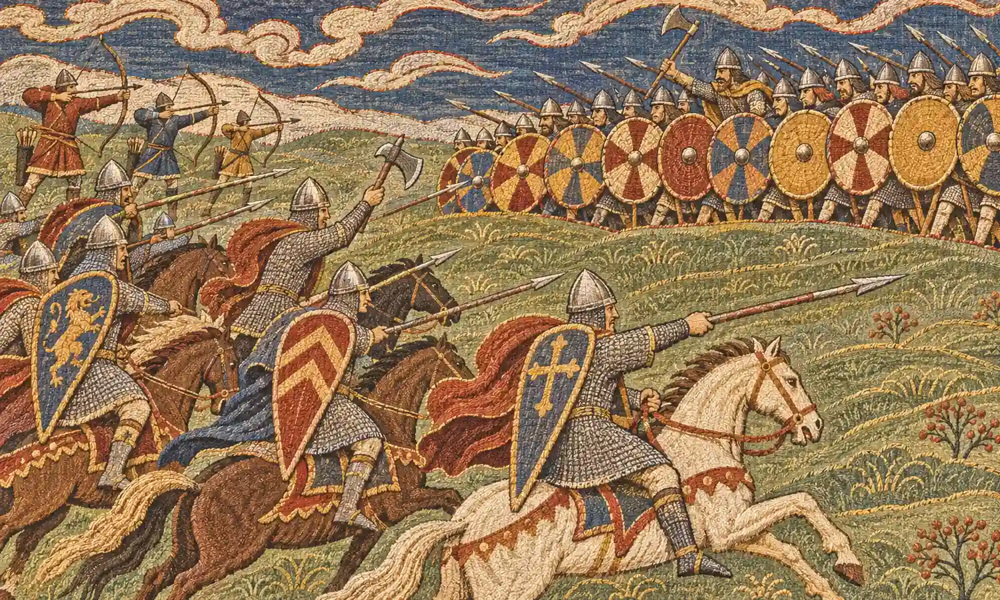
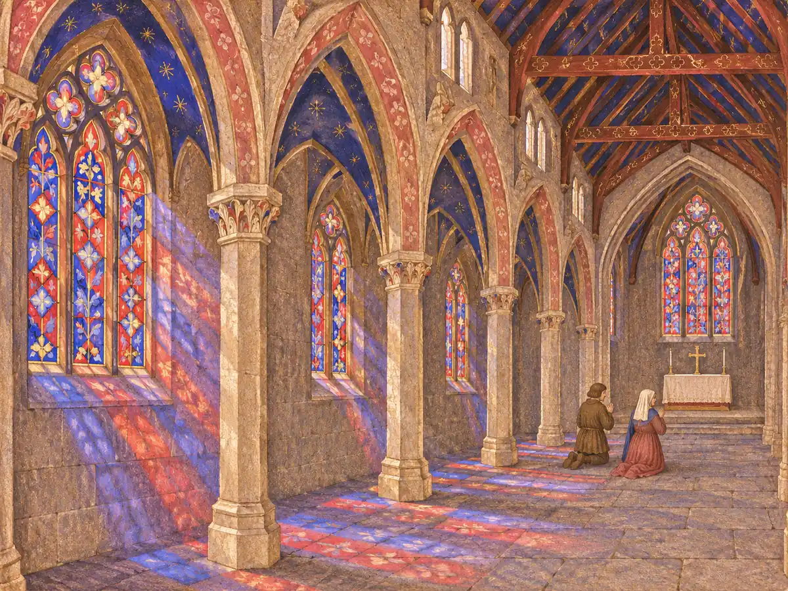

The Norman Conquest reshaped the languages of English writing. French was used at court, Latin remained important in learning and the Church, and English continued among the wider population. This was a multilingual literary culture, so a work produced in England need not have been written in English.

## The world of this age

<figure class="article-illustration" data-illustration="hastings">
  
  <figcaption>An imagined reconstruction of the Battle of Hastings, 1066.</figcaption>
</figure>

William of Normandy defeated King Harold at Hastings on 14 October 1066 and was crowned in Westminster Abbey on Christmas Day. He gave English land to his Norman followers, and in 1086 his officials carried out a great survey of the kingdom, recorded in **Domesday Book**. The new rulers were French-speaking lords who also held land across the Channel, and that link drew England into long wars with France.

English society was built in layers. The king gave land to great lords, the lords gave land to knights, and each held it in return for service in war. At the bottom were the peasants, many of them villeins, who worked their lord's fields, paid dues in labour and goods, and could not leave the manor freely. In the towns, craftsmen and merchants joined guilds that controlled training, prices and quality.

The ideal man of the upper class was the knight: brave, loyal and polite. Stories about knights taught a code called **chivalry** and a fashion called **courtly love**, in which a knight served a noble lady with devotion, often from a distance. Most women worked on the land, in the home or in small trades, though a few, like the merchant's daughter Margery Kempe, travelled far on pilgrimage. The universities at Oxford and Cambridge took shape in this age and trained the clerks and priests who made up most of the educated class.

The Catholic Church shaped daily life, and its language was Latin. Parish priests, monks, nuns and friars were part of every community. Pilgrimage was a popular form of devotion, and Canterbury drew crowds to the shrine of Thomas Becket, the archbishop murdered in his cathedral in 1170. The poets of the age knew the Church well and often laughed at its failings, especially greedy friars and sellers of pardons.

## The language

<figure class="article-illustration article-illustration--float" data-illustration="guild-workshop">
  
  <figcaption>Craft skills passed from master to apprentice.</figcaption>
</figure>

No other period changed English so fast. The old system of word endings, which Old English used to show who did what, wore away. Nouns lost their grammatical gender, and word order became much more fixed, with the subject first, then the verb, then the object, as it is today.

French poured into the vocabulary. Roughly ten thousand French words entered English in these centuries, among them *court*, *justice*, *prison*, *prayer* and *beauty*. Latin words arrived through the Church and the schools. The result was an English with a rich stock of near-synonyms, such as *kingly* (English), *royal* (French) and *regal* (Latin).

## Manuscripts and readers

<figure class="article-illustration article-illustration--float article-illustration--left" data-illustration="church-life">
  
  <figcaption>Prayer and stained glass in a medieval church.</figcaption>
</figure>

Most Middle English writing survives only because someone copied it by hand. The **Auchinleck Manuscript**, made in London between 1330 and 1340, is one of the earliest large collections of English verse. Every text in it is English, and it holds romances such as *Sir Orfeo*. It seems to have been made for well-off readers who were not nobles, which shows that a new reading public was growing.

## Poetry, romance and prose

The first English poems after the Conquest still used old forms. Around 1200 a priest named **Layamon**, who lived at Areley Kings in Worcestershire, wrote the *Brut*, a poem of about 16,000 lines. It tells the legendary history of Britain, and it was the first work in English to tell the story of King Arthur. Layamon took his story from the French poet Wace. Another writer, Orm, produced the *Ormulum*, about 20,000 lines of unrhymed verse on the Gospel readings of the Mass. Its only manuscript is in his own hand.

Poets also tried lighter forms. *The Owl and the Nightingale*, 1,794 lines in rhyming couplets, is a debate between two birds. The nightingale stands for joy and the owl for gloom, and neither wins. Its date is uncertain, but it was probably written around 1200 or a little later. One short song survives with its music: "Sumer is icumen in", a six-part round of about 1260.

The most popular kind of story was the **romance**, a tale of knights, love and marvels. Romances came from France first, and English versions followed. *King Horn* and *Havelok the Dane* are early examples. *Sir Orfeo* retells the Greek story of Orpheus as a fairy tale in which the husband wins his wife back. The Arthurian stories, known as the Matter of Britain, were told again and again.

English prose grew later than English verse and began with religious writing. The *Ancrene Wisse*, from the early thirteenth century, is a guide for women who chose to live shut away in prayer, called **anchoresses**. In the fourteenth century Richard Rolle, Walter Hilton and the unknown author of *The Cloud of Unknowing* wrote guides to prayer for lay readers.

## Literature in focus

### Wace and Marie de France

Wace wrote the *Roman de Brut* in French, adapting Geoffrey of Monmouth's Latin history of the kings of Britain. Layamon then drew on Wace for an English *Brut*. These are connected works, but they are not the same poem in three names. They show how a story could pass through Latin, French and English while changing in the process.

Marie de France wrote short narrative poems called lais in French. Love, loyalty, secrecy and the marvellous are important in them. Her place in this chapter is a reminder that the literature of medieval England cannot be reduced to works written in English. Her identity is uncertain; the name attached to her poems is not a complete biography.

### Reading a multilingual period

Anglo-Norman is a variety of French used in medieval Britain. Middle English is a stage of the English language. The two labels describe different things and can apply to the same historical setting. A courtly audience might know more than one language, while Latin connected religious and scholarly writers across national borders.

Romance also needs care as a term. In medieval study it usually means a narrative of adventure, chivalry, love or marvels. It does not simply mean a modern love story. Chronicles offered accounts of the past, but their legendary material should not be treated as verified political history. Arthurian stories are literary evidence of what readers imagined and valued; they are not straightforward records of actual battles.

### Continuity with earlier English

The conquest changed patronage and government, but English speech and writing continued. Layamon's work is especially useful for seeing older English habits beside material transmitted through French. Religious instruction also maintained a readership for English prose. The period prepares for Chaucer without being merely an empty interval before him.

## Key terms

- **Romance** - a story of knights, love, adventure and the marvellous.
- **Courtly love** - the code in which a knight serves his lady with devotion and often from a distance.

## Writers and works

| Writer | Works | What to remember |
|---|---|---|
| Wace | Roman de Brut | French verse narrative; a source for Layamon |
| Marie de France | Lais | Short narratives in French |

## Important points to remember

- The timeline uses 1066–1340 for this chapter. Literary boundaries are approximate.
- Check the date of a work separately from its writer's lifetime.
- Read this chapter alongside the wider period guide when comparing neighbouring ages.

## Quick revision - 10 points

1. **1066** — William won on 14 October 1066 and was crowned on Christmas Day.
2. **Domesday Book** — Domesday Book records the survey carried out by William's officials.
3. **Latin** — French was the language of the court, and English the language of most ordinary people.
4. **Layamon** — Layamon was a priest at Areley Kings in Worcestershire.
5. **Wace** — Layamon later used Wace as a source for his English Brut.
6. **The lai** — Her lais are short narrative poems in French.
7. **French** — It refers to French used in medieval Britain.
8. **A narrative of adventure, chivalry or marvels** — The literary term has a wider meaning than a modern love story.
9. **English continued to be spoken and written** — Political change did not end English speech or writing.
10. **Ancrene Wisse** — It belongs to early Middle English religious prose.

## Quick quiz - 10 questions

Tap an answer to see at once if it is right. You do not need to log in.

**1. In which year did William of Normandy win the Battle of Hastings?**

- A) 1016
- B) 1086
- C) 1066
- D) 1215

Answer: C. William won on 14 October 1066 and was crowned on Christmas Day.

**2. Which great survey of the kingdom was recorded in 1086?**

- A) Domesday Book
- B) Magna Carta
- C) The Ormulum
- D) The Paston Letters

Answer: A. Domesday Book records the survey carried out by William's officials.

**3. Which language was used mainly by the Church and the schools?**

- A) French
- B) English
- C) Latin
- D) Norse

Answer: C. French was the language of the court, and English the language of most ordinary people.

**4. Who wrote the Brut, the first work in English to tell the story of King Arthur?**

- A) Orm
- B) Layamon
- C) Langland
- D) Gower

Answer: B. Layamon was a priest at Areley Kings in Worcestershire.

**5. Who wrote the Roman de Brut in French?**

- A) Wace
- B) Layamon
- C) Chaucer
- D) Malory

Answer: A. Layamon later used Wace as a source for his English Brut.

**6. Which form is associated with Marie de France?**

- A) The Restoration comedy
- B) The lai
- C) The Victorian novel
- D) The Modernist manifesto

Answer: B. Her lais are short narrative poems in French.

**7. Which language is Anglo-Norman a variety of?**

- A) Greek
- B) Norse
- C) French
- D) English

Answer: C. It refers to French used in medieval Britain.

**8. What does romance usually mean in medieval literary study?**

- A) Only a factual biography
- B) Only a modern love story
- C) A parliamentary report
- D) A narrative of adventure, chivalry or marvels

Answer: D. The literary term has a wider meaning than a modern love story.

**9. Which statement about the Norman Conquest is accurate?**

- A) English continued to be spoken and written
- B) English speech vanished immediately
- C) All writing became Greek
- D) Latin ceased to be used

Answer: A. Political change did not end English speech or writing.

**10. Which work is a guide for anchoresses?**

- A) The Waste Land
- B) Ancrene Wisse
- C) Utopia
- D) The Spectator

Answer: B. It belongs to early Middle English religious prose.

## Frequently asked questions

**Does this chapter use exact historical boundaries?**
The dates are the timeline's study convention. Language, literary forms and writers' careers can cross them. Use the date of the particular work when a question asks about a narrower age.

**Where can I read the wider historical context?**
The [full period guide](/notes/middle-english/) contains the longer background. This chapter concentrates on the age named above and keeps its own revision and practice sections.

**Are these pictures historical documents?**
The artwork is illustrative. Captions identify representative or imagined scenes and modern painted interpretations; those images are not evidence that the pictured scene happened exactly as shown.

**How should I use the quiz?**
Read the explanations after answering. Questions about earlier events or later criticism are background questions, not claims that every named date falls inside the chapter's boundaries.

## Sources and further reading

The relevant background, text references and public practice material are retained from the [original middle english guide](/notes/middle-english/#sources). Publication dates, authorship and period boundaries should be checked against the source editions listed there.

- [Wace, Roman de Brut — Oxford edition introduction](https://api.pageplace.de/preview/DT0400.9780192699015_A48302985/preview-9780192699015_A48302985.pdf)

Afsar Khan, Ph.D. English
