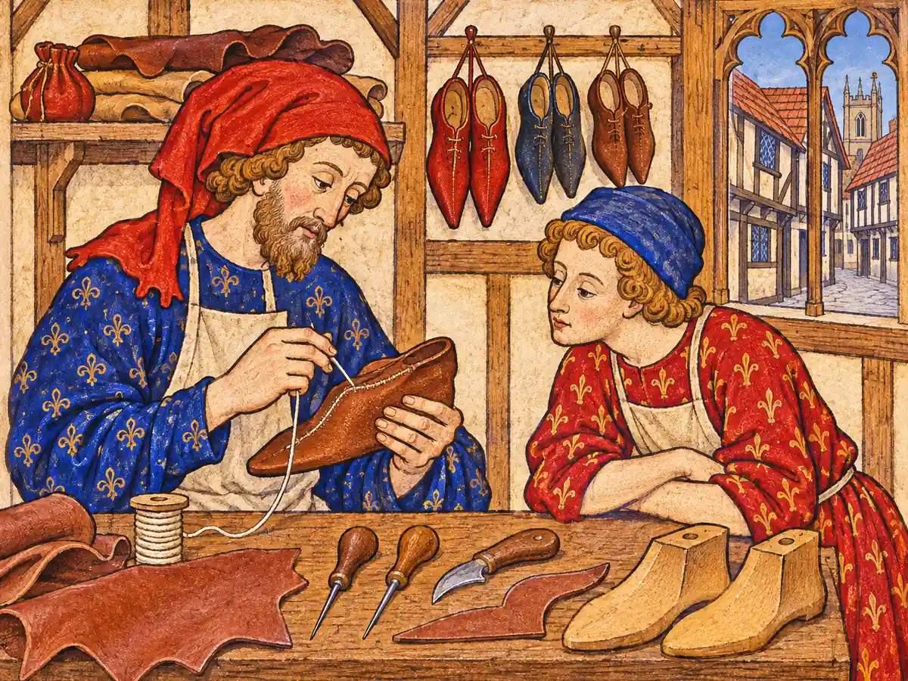

The Old English chapter ended with a kingdom facing conquest. This chapter begins with its consequences. A change of rulers did not silence English, but it changed the languages of power, learning and literary fashion. Picture three books on a table: one in Latin, one in French and one in English. All three could belong to the literary life of medieval England. The interesting question is how their stories met. A legendary history could move from Latin to French and then into English; an adventure could gain a new audience through each retelling. Follow those journeys through this chapter. They show how English literature continued by changing, long before Chaucer became its most famous medieval voice.

The Norman Conquest reshaped the languages of English writing. French was used at court, Latin remained important in learning and the Church, and English continued among the wider population. This was a multilingual literary culture, so a work produced in England need not have been written in English.

## The world of this age

<figure class="article-illustration" data-illustration="hastings">
  
  <figcaption>An imagined reconstruction of the Battle of Hastings, 1066.</figcaption>
</figure>

William of Normandy defeated King Harold at Hastings on 14 October 1066 and was crowned in Westminster Abbey on Christmas Day. He gave English land to his Norman followers, and in 1086 his officials carried out a great survey of the kingdom, recorded in **Domesday Book**. The new rulers were French-speaking lords who also held land across the Channel, and that link drew England into long wars with France.

English society was built in layers. The king gave land to great lords, the lords gave land to knights, and each held it in return for service in war. At the bottom were the peasants, many of them villeins, who worked their lord's fields, paid dues in labour and goods, and could not leave the manor freely. In the towns, craftsmen and merchants joined guilds that controlled training, prices and quality.

The ideal man of the upper class was the knight: brave, loyal and polite. Stories about knights taught a code called **chivalry** and a fashion called **courtly love**, in which a knight served a noble lady with devotion, often from a distance. Most women worked on the land, in the home or in small trades, while religious travel also formed part of medieval life. The universities at Oxford and Cambridge took shape in this age and trained the clerks and priests who made up most of the educated class.

The Catholic Church shaped daily life, and its language was Latin. Parish priests, monks, nuns and friars were part of every community. Pilgrimage was a popular form of devotion, and Canterbury drew crowds to the shrine of Thomas Becket, the archbishop murdered in his cathedral in 1170. The poets of the age knew the Church well and often laughed at its failings, especially greedy friars and sellers of pardons.

## The language

<figure class="article-illustration article-illustration--float" data-illustration="guild-workshop">
  
  <figcaption>Craft skills passed from master to apprentice.</figcaption>
</figure>

English changed deeply in these centuries. The old system of word endings, which Old English used to show who did what, wore away. Nouns lost their grammatical gender, and word order became much more fixed, with the subject first, then the verb, then the object, as it is today.

French poured into the vocabulary. Roughly ten thousand French words entered English in these centuries, among them *court*, *justice*, *prison*, *prayer* and *beauty*. Latin words arrived through the Church and the schools. The result was an English with a rich stock of near-synonyms, such as *kingly* (English), *royal* (French) and *regal* (Latin).

## Manuscripts and readers

<figure class="article-illustration article-illustration--float article-illustration--left" data-illustration="church-life">
  
  <figcaption>Prayer and stained glass in a medieval church.</figcaption>
</figure>

Most Middle English writing survives only because someone copied it by hand. The **Auchinleck Manuscript**, made in London between 1330 and 1340, is one of the earliest large collections of English verse. Every text in it is English, and it holds romances such as *Sir Orfeo*. It seems to have been made for well-off readers who were not nobles, which shows that a new reading public was growing.

## Poetry, romance and prose

The first English poems after the Conquest still used old forms. Around 1200 a priest named **Layamon**, who lived at Areley Kings in Worcestershire, wrote the *Brut*, a poem of about 16,000 lines. It tells the legendary history of Britain, and it was the first work in English to tell the story of King Arthur. Layamon took his story from the French poet Wace. Another writer, Orm, produced the *Ormulum*, about 20,000 lines of unrhymed verse on the Gospel readings of the Mass. Its only manuscript is in his own hand.

Poets also tried lighter forms. *The Owl and the Nightingale*, 1,794 lines in rhyming couplets, is a debate between two birds. The nightingale stands for joy and the owl for gloom, and neither wins. Its date is uncertain, but it was probably written around 1200 or a little later. One short song survives with its music: "Sumer is icumen in", a six-part round of about 1260.

The most popular kind of story was the **romance**, a tale of knights, love and marvels. Romances came from France first, and English versions followed. *King Horn* and *Havelok the Dane* are early examples. *Sir Orfeo* retells the Greek story of Orpheus as a fairy tale in which the husband wins his wife back. The Arthurian stories, known as the Matter of Britain, were told again and again.

Religious writing remained an important part of English prose after the Conquest. The *Ancrene Wisse*, from the early thirteenth century, is a guide for women who chose to live shut away in prayer, called **anchoresses**. In the fourteenth century Richard Rolle, Walter Hilton and the unknown author of *The Cloud of Unknowing* wrote guides to prayer for lay readers.

## Literature in focus

### Wace and Marie de France

Wace wrote the *Roman de Brut* in French, adapting Geoffrey of Monmouth's Latin history of the kings of Britain. Layamon then drew on Wace for an English *Brut*. These are connected works, but they are not the same poem in three names. They show how a story could pass through Latin, French and English while changing in the process.

Marie de France wrote short narrative poems called lais in French. Love, loyalty, secrecy and the marvellous are important in them. Her place in this chapter is a reminder that the literature of medieval England cannot be reduced to works written in English. Her identity is uncertain; the name attached to her poems is not a complete biography.

### Reading a multilingual period

Anglo-Norman is a variety of French used in medieval Britain. Middle English is a stage of the English language. The two labels describe different things and can apply to the same historical setting. A courtly audience might know more than one language, while Latin connected religious and scholarly writers across national borders.

Romance also needs care as a term. In medieval study it usually means a narrative of adventure, chivalry, love or marvels. It does not simply mean a modern love story. Chronicles offered accounts of the past, but their legendary material should not be treated as verified political history. Arthurian stories are literary evidence of what readers imagined and valued; they are not straightforward records of actual battles.

### Continuity with earlier English

The conquest changed patronage and government, but English speech and writing continued. Layamon's work is especially useful for seeing older English habits beside material transmitted through French. Religious instruction also maintained a readership for English prose. The period prepares for Chaucer without being merely an empty interval before him.

## Following a story across three languages

A useful way into this age is to follow one story rather than one king. Geoffrey of Monmouth wrote a legendary history of Britain's rulers in Latin. Wace adapted that material in French, and Layamon drew on Wace for his English Brut. The journey gives us a small model of the whole period. A story can remain recognisable while its language, audience and purpose change. A translation is therefore part of literary history in its own right. It may choose different details, give more space to a scene, or make a speaker sound different.

Imagine reading two accounts of the same encounter. One writer may hurry toward the next event; another may stay with a speech or a description. The action alone will not tell us what has changed. We also need to notice the pace, the kind of language and the attention given to a character. This is why the connection between Wace and Layamon matters. It shows English literature receiving material through French without becoming a simple copy of French literature.

There is another distinction to keep clear. A legendary history can be valuable evidence about the imagination of a period without being a reliable record of the events it describes. We can study why an audience wanted a story about Britain's past without accepting every ruler and battle as historical fact. That distinction protects us from confusing a literary tradition with a modern history textbook.

### What happened to the heroic world?

In the Old English chapter, loyalty between a leader and his followers helped organise heroic stories. The hall could stand for protection, belonging and a remembered community. Those concerns did not suddenly become meaningless after the Conquest. Yet the romance gave writers other ways to organise an adventure. A journey might test a knight's conduct, or a promise might place private feeling against public duty. The question becomes not only whether someone is brave, but how that person behaves when different obligations compete.

This does not mean that every Old English poem is about battle or every romance is about courtly love. The comparison is a way of noticing a change in emphasis. A careful reader always returns to the individual work. Which relationship matters most? What does the story call admirable? What does the ending reward, and what does it leave unsettled? These questions reveal a literary value more clearly than a long list of period labels.

## Marie de France: a short story can hold a difficult choice

The lai offers a different scale from a long chronicle. Because it is brief, a promise, an encounter or an unexpected event can carry great weight. Marie's narratives often place love and loyalty under pressure. The reader has to follow what a character knows and what that character can safely reveal. Secrecy may protect a relationship, but it can also make judgement difficult. The interest lies in the tension between the private life and the rules surrounding it.

When approaching a lai, first make a simple map of the relationships. Who owes loyalty to whom? Who has the power to make a decision? Who is able to speak? Then consider the marvellous element. An event outside everyday experience need not be an empty ornament. It can create a situation in which an ordinary social rule becomes visible or difficult to obey. The story asks us to consider a choice, not simply to admire something strange.

Marie's identity is not fully known. That uncertainty should remain in the account. It is better to say what the texts and their attributed name allow us to know than to invent a complete life to make the chapter feel more colourful. The writing is interesting enough without a false biography. We can study the form, the voice and the choices in a narrative while being honest about the limits of historical knowledge.

## Debate, song and religious instruction

The Owl and the Nightingale gives us another kind of literary pleasure: a disagreement that develops through competing voices. A debate poem invites the audience to listen to arguments rather than simply follow an adventure. Notice how each speaker tries to define the terms of the dispute. A quality praised by one voice may be presented as a fault by the other. The reader's task is to hear the force and the limits of both positions.

The poem also warns us against turning a character into one fixed idea. A bird can carry associations, but the writing is made from a developing exchange. Ask how an accusation is answered, whether the reply changes the subject, and whether the speaker supports a claim. These are simple questions, but they make the debate lively. They also connect medieval reading with a skill we use whenever we judge an argument today.

Song belongs to a different situation. Its words work with sound, repeated patterns and, where evidence survives, music. A lyric that is easy to remember may have a life beyond a single reader with a book. This helps explain why the history of literature must include listening and performance. A surviving page is evidence of a work's preservation; it may not show every way in which people originally encountered it.

Religious instruction, meanwhile, gave English prose a practical purpose. Ancrene Wisse addresses the life of women devoted to religious withdrawal. Such a work is not trying to entertain in the same way as an adventure story. Its organisation, tone and advice serve a particular kind of reader. Comparing it with a romance shows how many different tasks English could perform before Chaucer. The language did not wait for one famous poet to become useful.

## A manuscript is a physical part of the story

A modern reader may expect every copy of a book to contain the same text. Manuscript culture asks for greater care. A book had to be made and copied, and its survival depended on people keeping it. A text might be selected for a collection because it suited the interests of a particular reader or group. Its neighbours in the manuscript can therefore help us understand how it was received.

The Auchinleck Manuscript is especially useful in this chapter because it preserves a collection of English writing from the early fourteenth century. Think about the difference between a work and a collection. An individual romance has its own plot, but placing several texts together gives a reader a wider set of choices. The collection tells us something about the value placed on English reading. It also reminds us that a language's status grows through many readers and books, not through one declaration.

Do not assume that an anonymous work had no author in the ordinary sense. Anonymous means that we cannot securely attach a surviving name to it. The work still involved choices about form, sequence and language. Likewise, a copyist is not automatically the author. Keeping author, translator, compiler and copyist distinct makes the period easier to understand and prevents several common mistakes in examination answers.

## From this age to Chaucer

By the end of this chapter, English has continued through political change and has received material from other languages. It can tell a romance, stage a debate in verse and offer religious guidance in prose. The next age will build on those possibilities. Chaucer's achievement is easier to appreciate when we see the culture of translation, varied forms and changing readers that came before him.

The connection is a growth in range rather than a simple recovery from silence. French and Latin remain important, while English develops new literary uses. When revising, choose one example of each process: a story moving between languages, a work using an inherited form, and a book showing a readership for English. Together those examples tell a clearer story than the mistaken idea that English disappeared in 1066 and returned fully formed in the fourteenth century.

## One name, several kinds of knowledge

Consider what you know when you read a name such as Arthur. You may recognise a king, a body of stories and a set of expectations about knights. Those kinds of knowledge are connected, but they are not interchangeable. Recognising a literary tradition does not prove the historical accuracy of every episode. A useful reader keeps the pleasure of the story and the question of its evidence in view together.

Now consider what changes when the story moves into another language. The new writer does not merely exchange one set of sounds for another. A different audience may need an explanation that the first audience did not need. A name or custom may be familiar in one setting and strange in the next. Even a decision about what to explain can change the reader's relation to the material.

This gives a practical method for comparing adaptations. Choose a short scene and describe its purpose in each version. Does it introduce a relationship, establish a ruler's claim or prepare an adventure? Then examine how much space is given to speech and action. The differences can show what the new writer wants readers to notice. You do not need to declare one version better before you can explain how they work differently.

The same method can be applied to a familiar story told today in a different form. A change of audience creates choices about pace, emphasis and explanation. That comparison is a reading exercise, not a claim that medieval manuscript culture was identical to modern publishing. It simply makes the translator's task easier to imagine.

The Anglo-Norman period rewards this kind of patient attention. Its several languages do not make the literary history confused; they make it connected. Latin learning, French narrative and continuing English writing meet through particular people and texts. The more carefully those relations are described, the less convincing the idea of a silent gap becomes. What comes before Chaucer is an active world of reading, retelling and instruction.

Before leaving the chapter, explain one connection in your own words without relying on a string of dates. You might describe how Wace and Layamon are related, why a lai differs from a chronicle, or why a manuscript collection matters. If the explanation names both the form and its purpose, the period has begun to become a literary experience rather than only an item to memorise.

A final distinction concerns language and social rank. A language associated with authority can gain prestige, but that does not make every speaker powerful or every text written in it official. Look at the particular audience and purpose. The contrast among Latin, French and English is a starting map of the culture, not a complete description of every person within it. Keeping that map flexible helps us understand how texts and readers could move across its boundaries.

## Key terms

- **Romance** - a story of knights, love, adventure and the marvellous.
- **Courtly love** - the code in which a knight serves his lady with devotion and often from a distance.

## Writers and works

| Writer | Works | What to remember |
|---|---|---|
| Wace | Roman de Brut | French verse narrative; a source for Layamon |
| Marie de France | Lais | Short narratives in French |

## Important points to remember

- The timeline uses 1066–1340 for this chapter. Literary boundaries are approximate.
- Check the date of a work separately from its writer's lifetime.
- Read this chapter alongside the wider period guide when comparing neighbouring ages.

## Quick revision - 10 points

1. **1066** — William won on 14 October 1066 and was crowned on Christmas Day.
2. **Domesday Book** — Domesday Book records the survey carried out by William's officials.
3. **Latin** — French was the language of the court, and English the language of most ordinary people.
4. **Layamon** — Layamon was a priest at Areley Kings in Worcestershire.
5. **Wace** — Layamon later used Wace as a source for his English Brut.
6. **The lai** — Her lais are short narrative poems in French.
7. **French** — It refers to French used in medieval Britain.
8. **A narrative of adventure, chivalry or marvels** — The literary term has a wider meaning than a modern love story.
9. **English continued to be spoken and written** — Political change did not end English speech or writing.
10. **Ancrene Wisse** — It belongs to early Middle English religious prose.

## Quick quiz - 15 questions

Tap an answer to see at once if it is right. You do not need to log in.

**1. In which year did William of Normandy win the Battle of Hastings?**

- A) 1016
- B) 1086
- C) 1066
- D) 1215

Answer: C. William won on 14 October 1066 and was crowned on Christmas Day.

**2. Which great survey of the kingdom was recorded in 1086?**

- A) Domesday Book
- B) Magna Carta
- C) The Ormulum
- D) The Paston Letters

Answer: A. Domesday Book records the survey carried out by William's officials.

**3. Which language was used mainly by the Church and the schools?**

- A) French
- B) English
- C) Latin
- D) Norse

Answer: C. French was the language of the court, and English the language of most ordinary people.

**4. Who wrote the Brut, the first work in English to tell the story of King Arthur?**

- A) Orm
- B) Layamon
- C) Langland
- D) Gower

Answer: B. Layamon was a priest at Areley Kings in Worcestershire.

**5. Who wrote the Roman de Brut in French?**

- A) Wace
- B) Layamon
- C) Chaucer
- D) Malory

Answer: A. Layamon later used Wace as a source for his English Brut.

**6. Which form is associated with Marie de France?**

- A) The Restoration comedy
- B) The lai
- C) The Victorian novel
- D) The Modernist manifesto

Answer: B. Her lais are short narrative poems in French.

**7. Which language is Anglo-Norman a variety of?**

- A) Greek
- B) Norse
- C) French
- D) English

Answer: C. It refers to French used in medieval Britain.

**8. What does romance usually mean in medieval literary study?**

- A) Only a factual biography
- B) Only a modern love story
- C) A parliamentary report
- D) A narrative of adventure, chivalry or marvels

Answer: D. The literary term has a wider meaning than a modern love story.

**9. Which statement about the Norman Conquest is accurate?**

- A) English continued to be spoken and written
- B) English speech vanished immediately
- C) All writing became Greek
- D) Latin ceased to be used

Answer: A. Political change did not end English speech or writing.

**10. Which work is a guide for anchoresses?**

- A) The Waste Land
- B) Ancrene Wisse
- C) Utopia
- D) The Spectator

Answer: B. It belongs to early Middle English religious prose.

**11. Which sequence correctly traces the material behind Layamon's Brut?**

- A) Malory, Caxton, then Geoffrey
- B) Layamon in Greek, then Wace in Latin
- C) Geoffrey of Monmouth in Latin, Wace in French, then Layamon in English
- D) Chaucer, Milton, then Wace

Answer: C. The linked works show how legendary history moved between languages.

**12. What can a legendary history reliably reveal even when its events are unverified?**

- A) The exact facts of every battle
- B) The identity of every anonymous writer
- C) The absence of translation
- D) Literary interests and ways of imagining the past

Answer: D. Literary value does not make every narrated event a historical fact.

**13. What does anonymous mean when describing a medieval work?**

- A) Its author's name is not securely known
- B) It had no maker
- C) It was never read
- D) It must be a translation

Answer: A. A surviving work can show deliberate choices even when the author's name is lost.

**14. What should a reader follow in a debate poem?**

- A) Only the number of manuscripts
- B) How each speaker makes and answers claims
- C) Only the final rhyme
- D) Only the author's birth date

Answer: B. The exchange of arguments is part of the poem's action.

**15. Why should a copyist not automatically be called an author?**

- A) Authors never used manuscripts
- B) Every manuscript was printed
- C) Copying and composing are different roles
- D) Copyists never used English

Answer: C. The same physical book can involve several different kinds of literary work.

## Frequently asked questions

**Does this chapter use exact historical boundaries?**
The dates are the timeline's study convention. Language, literary forms and writers' careers can cross them. Use the date of the particular work when a question asks about a narrower age.

**Where can I read the wider historical context?**
The [full period guide](/notes/middle-english/) contains the longer background. This chapter concentrates on the age named above and keeps its own revision and practice sections.

**Are these pictures historical documents?**
The artwork is illustrative. Captions identify representative or imagined scenes and modern painted interpretations; those images are not evidence that the pictured scene happened exactly as shown.

**How should I use the quiz?**
Read the explanations after answering. Questions about earlier events or later criticism are background questions, not claims that every named date falls inside the chapter's boundaries.

## Sources and further reading

The relevant background, text references and public practice material are retained from the [original middle english guide](/notes/middle-english/#sources). Publication dates, authorship and period boundaries should be checked against the source editions listed there.

- [Wace, Roman de Brut — Oxford edition introduction](https://api.pageplace.de/preview/DT0400.9780192699015_A48302985/preview-9780192699015_A48302985.pdf)

Afsar Khan, Ph.D. English
