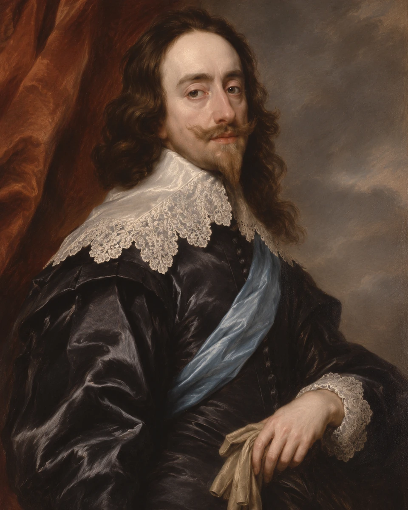
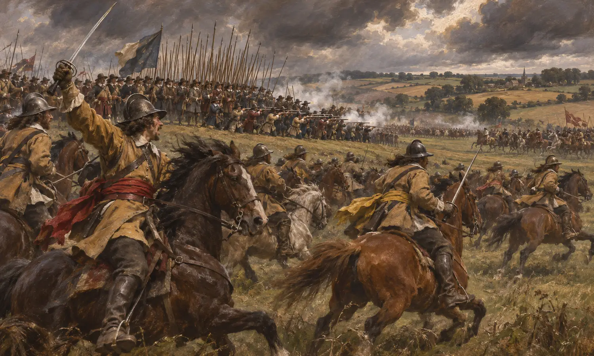
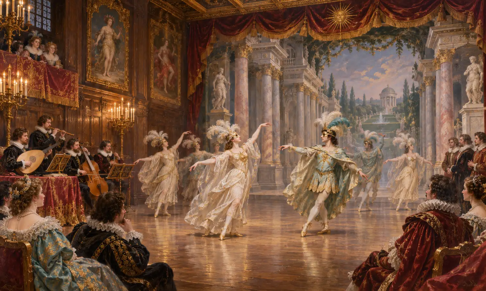
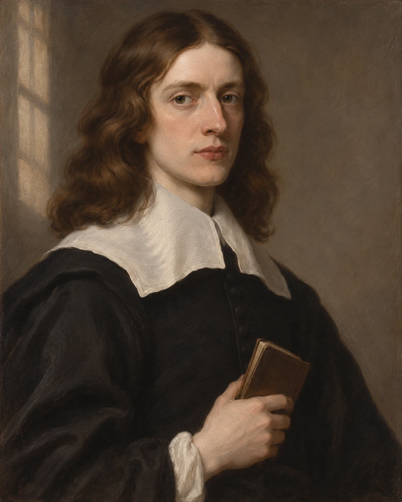

The Caroline age takes its name from Charles I, whose reign ended with his execution in 1649. Courtly verse remained important, while conflict between king and Parliament grew toward civil war. The date label describes a political reign; writers and styles did not all begin or end with it.

## The world of this age

<figure class="article-illustration article-illustration--float article-illustration--left article-illustration--portrait" data-illustration="charles-i">
  
  <figcaption>Charles I — modern painted interpretation.</figcaption>
</figure>

Charles I became king in 1625. He was shy, serious and a fine judge of paintings. He shared his father's belief in royal power, but he lacked his father's skill at avoiding open quarrels. In the same year he married Henrietta Maria, a French Catholic princess, which made many Protestants uneasy. His favourite minister, the Duke of Buckingham, led military expeditions that failed, and Parliament hated him. In 1628 Buckingham was stabbed to death by a discontented officer, and in the same year Parliament forced Charles to accept the Petition of Right, which said that the king could not tax without consent or jail people without cause. A year later Charles sent Parliament home and ruled alone for eleven years. To find money he revived old taxes. The most hated was Ship Money, once paid only by port towns to keep the navy ready, which from 1635 he demanded from inland counties as well.

The crisis came from Scotland. In 1637 Charles and his Archbishop of Canterbury, William Laud, tried to force a new Prayer Book on the Scottish church. To Scottish Presbyterians it looked too close to Catholic worship. They signed the National Covenant in 1638 and raised an army. Charles needed money to answer them, so in 1640 he had to call Parliament again. The first, the Short Parliament, refused to help and was dismissed in three weeks. The second, the Long Parliament, met in November 1640 and attacked the king's advisers. His chief minister, the Earl of Strafford, was executed in 1641. In January 1642 Charles walked into the House of Commons with armed men to arrest five members, but they had already escaped. After that, neither side trusted the other. In August 1642 Charles raised his royal flag at Nottingham, and the Civil War began.

Supporters of the king were called Cavaliers, and supporters of Parliament were nicknamed Roundheads. Parliament built a disciplined force, the New Model Army, which crushed the royal army at Naseby in June 1645. Charles surrendered in 1646 but kept making secret deals, and a second war broke out in 1648. The army then removed the members of Parliament who wanted peace with him, and the rest set up a court. On 30 January 1649 Charles was beheaded outside the Banqueting House at Whitehall.

London was by far the largest city in England, and it was growing fast as people left their villages to look for work. Streets were crowded, and disease spread easily. When James came to the throne, plague was killing thousands of Londoners, his coronation was held with little ceremony, and the theatres stayed closed for many months. Plague returned in 1625 and again in the 1630s, and each time the playhouses shut their doors.

Society was divided into clear ranks. At the top stood the king and the great lords. Below them came the gentry, who owned land and ran the counties, then merchants, craftsmen and farmers, and a large body of labourers and servants. Rank decided a person's clothes, schooling and manners. Girls were mostly taught at home to run a household, few learned Latin, and a married woman had very few rights under the law. Even so, a small number of women found ways to write and publish.

A young gentleman's education followed a clear path. First came grammar school, then Oxford or Cambridge, and then the Inns of Court in London, where law was studied. The Inns were also clubs for young wits. Students went there to learn manners, make friends, watch plays and write verse. John Donne, Francis Beaumont and John Ford all spent time at them.

Under Charles, the Church changed again. Archbishop Laud wanted churches to be orderly and beautiful, with railed altars and rich ceremony. Puritans saw this as a step back toward Rome. Many left, and in 1630 a large group sailed to found the Massachusetts Bay Colony. Those who stayed won power in Parliament, and in the 1640s they set out to change the Church and everyday life.

## The language

<figure class="article-illustration" data-illustration="naseby">
  
  <figcaption>An imagined reconstruction of the Battle of Naseby, 1645.</figcaption>
</figure>

The English of these years is called Early Modern English. It is the language of Shakespeare and the King James Bible. It is close enough to read today, but spelling had no fixed rules, and people still used "thou" and "thee" for close friends, for inferiors and for God. The language was also growing fast. It had borrowed words from Latin, Greek, French and Italian, and many readers felt lost among them. In 1604 a schoolmaster named Robert Cawdrey published *A Table Alphabeticall*, a small list of hard English words with plain meanings. It is regarded as the first English dictionary.

Writers chose their styles with care. Jonson and Bacon liked short, firm sentences. Donne wrote as if arguing aloud, with sudden starts. Thomas Browne preferred long, rolling sentences full of Latin words, and Milton shaped English as if it were Latin, with long, balanced sentences.

## How writing reached readers

<figure class="article-illustration" data-illustration="court-masque">
  
  <figcaption>A court masque combining music, dance, costume and scenery.</figcaption>
</figure>

Poems were handled differently. Gentleman poets often thought it undignified to print their verse, so poems were copied by hand and passed among friends. Many of Donne's poems were read this way for years, and they were printed only in 1633, two years after his death.

## Drama and the masque

<figure class="article-illustration article-illustration--float article-illustration--left article-illustration--portrait" data-illustration="john-milton">
  
  <figcaption>The young John Milton — modern painted interpretation.</figcaption>
</figure>

When Charles I became king, the stage grew more polished and more tied to the court. Charles and Henrietta Maria liked graceful plays about love and honour. Philip Massinger wrote *A New Way to Pay Old Debts* (about 1625), whose greedy villain, Sir Giles Overreach, became a favourite role. John Ford wrote tragedies of forbidden love, such as *'Tis Pity She's a Whore*, and James Shirley wrote comedies about fashionable London life. Meanwhile, Puritan dislike of the stage was growing. William Prynne's huge book *Histriomastix* (1633) attacked plays and actors. Since the queen herself liked to act in court shows, the book was taken as an insult to her, and Prynne was severely punished. Nine years later, Parliament ordered public plays to stop.

## Poetry

George Herbert wrote with the same wit but a quieter voice. He came from a noble family, studied at Cambridge, and hoped for a career at court. When those hopes faded, he became a priest and served the small parish of Bemerton, near Salisbury, from 1630 until his death in 1633. His poems describe a private quarrel and friendship with God. Many are plain and tender, and some, such as "Easter Wings", are shaped on the page like the wings they describe. According to his friend Izaak Walton, Herbert sent his poems from his deathbed to his friend Nicholas Ferrar, saying that they could be published if they might help any poor soul, and otherwise burned. Ferrar published them as *The Temple* in 1633.

Another group of poets belonged to the court. The **Cavalier poets**, Thomas Carew, Sir John Suckling, Richard Lovelace and Robert Herrick, were gentlemen who served or admired Charles I. They were followers of Ben Jonson, and were sometimes called the "sons of Ben". Their verse was short, polished and light, and its themes were love, wine, loyalty and the fast passing of time. Herrick's famous advice, "Gather ye rosebuds while ye may", is an example of **carpe diem**, Latin for "seize the day". Suckling teased a pale lover with "Why so pale and wan, fond lover?" When war came, their loyalty was tested. In 1642 Lovelace was jailed for presenting a petition to Parliament in favour of the king, and in prison he wrote "To Althea, from Prison", which says that stone walls cannot make a prison for a free and loving mind. Herrick's *Hesperides* was published in 1648, in the middle of the war.

John Milton belonged to neither group. He studied at Cambridge and spent years in quiet study, planning to become a great poet. He wrote "On the Morning of Christ's Nativity" in 1629, a masque called *Comus* (1634) for the family of the Earl of Bridgewater at Ludlow Castle, and in 1637 "Lycidas", a poem of grief for a Cambridge friend, Edward King, who drowned in the Irish Sea. "Lycidas" is also an attack on corrupt clergy, a sign of the political storm to come. Then war came, and Milton put his great poem aside and wrote mostly prose for the Puritan cause. *Paradise Lost* (1667) belongs to the next age.

## Criticism and scholarship

The name "metaphysical" began as a complaint. In 1693 John Dryden said that Donne showed off his learning and filled the minds of ladies with hard ideas when he should have been winning their hearts. In 1779, in his *Life of Cowley*, Samuel Johnson used the word metaphysical for a whole group of poets. He admired their learning but disliked their conceits, saying that in them "the most heterogeneous ideas are yoked by violence together".

For about two centuries Donne was little read. Then in 1921 H. J. C. Grierson published an anthology, *Metaphysical Lyrics and Poems of the Seventeenth Century*, and T. S. Eliot reviewed it in an essay, "The Metaphysical Poets". Eliot argued that these poets could feel a thought as directly as the smell of a rose, and that this power was lost after the seventeenth century, a change he called a "dissociation of sensibility". He blamed Milton and Dryden in part. His essay made Donne a favourite of modern poets and readers.

Later critics deepened the study. William Empson's *Seven Types of Ambiguity* (1930) showed how many meanings a line of Donne or Herbert could hold. Cleanth Brooks, in *The Well Wrought Urn* (1947), read Donne's "The Canonization" as a lesson in paradox. Rosemond Tuve's *A Reading of George Herbert* (1952) placed Herbert's images within Christian tradition. Helen Gardner's Penguin anthology *The Metaphysical Poets* (1957) introduced many students to the group.

## Literature in focus

### A reign divided by war

The Caroline period follows Charles I from 1625 to 1649. Court entertainment, religious disagreement and political conflict belong to the same setting, but they should not be collapsed into one mood. A court masque presents order through music, costume and performance; a civil-war pamphlet is addressed to a world in which that order is fiercely disputed.

### Poetry beyond a single school

The Cavalier poets are associated with courtly wit and royalist loyalties. Herbert's devotional poetry has a different purpose, while Milton's early poems do not fit neatly into either group. The headings are useful for comparison, but the poem itself should decide an interpretation. Carpe diem, for example, is an invitation to act before time passes; it is a theme rather than a complete description of every Cavalier poem.

### Prose and the freedom to argue

Milton's *Areopagitica* appeared in 1644, during the Civil War and before the Commonwealth. It answered the system of licensing books before publication. It therefore belongs in this period's prose discussion even though Milton later served the republican government. Moving all of his prose into 1649–1660 would lose that important sequence.

### The boundary at 1642

The order against public stage plays came in 1642, not in 1649. It separates the theatrical conditions of the early reign from the years of war. The end of a public performance system did not end poetry, reading or religious prose. The subsequent Commonwealth chapter examines those continuing forms under a different government.

## Key terms

- **Cavalier** - a supporter of Charles I in the Civil War, and the name for the court poets of his time.
- **Masque** - a court entertainment of music, dance, costume and scenery.
- **Conceit** - a surprising comparison that is stretched far and worked out with logic.
- **Carpe diem** - Latin for "seize the day", a theme urging people to enjoy life while it lasts.

## Writers and works

| Writer | Works | What to remember |
|---|---|---|
| Thomas Carew | Poems | Courtly lyric |
| Richard Lovelace | To Althea, from Prison | Liberty, loyalty and confinement |

## Important points to remember

- The timeline uses 1625–1649 for this chapter. Literary boundaries are approximate.
- Check the date of a work separately from its writer's lifetime.
- Read this chapter alongside the wider period guide when comparing neighbouring ages.

## Quick revision - 10 points

1. **Charles I** — Caroline comes from *Carolus*, the Latin form of Charles.
2. **Public stage plays must stop** — The order said plays should cease while the "sad causes" of the war lasted.
3. **A surprising comparison worked out at length** — Donne's comparison of lovers to the legs of a pair of compasses is a famous example.
4. **George Herbert** — Herbert's friend Nicholas Ferrar published the poems after his death.
5. **"To Althea, from Prison"** — Lovelace had been jailed for presenting a petition in favour of the king.
6. **Robert Herrick** — Herrick also wrote "Gather ye rosebuds while ye may".
7. **A Cambridge friend, Edward King** — Edward King drowned in the Irish Sea.
8. **1644** — Milton’s licensing argument belongs to the Civil War before the Commonwealth.
9. **Seize the day** — The phrase expresses an invitation to act before time passes.
10. **The Commonwealth** — Charles I’s execution in 1649 marks the political boundary.

## Quick quiz - 10 questions

Tap an answer to see at once if it is right. You do not need to log in.

**1. The word "Caroline" in this age refers to the reign of which king?**

- A) Charles I
- B) James I
- C) Henry VII
- D) William III

Answer: A. Caroline comes from *Carolus*, the Latin form of Charles.

**2. What did Parliament order on 2 September 1642?**

- A) Public stage plays must stop
- B) All books must be licensed
- C) Charles I must be tried
- D) The Globe must be rebuilt

Answer: A. The order said plays should cease while the "sad causes" of the war lasted.

**3. What is a conceit?**

- A) A proud poet
- B) A short rhyming line
- C) A poem shaped like its subject
- D) A surprising comparison worked out at length

Answer: D. Donne's comparison of lovers to the legs of a pair of compasses is a famous example.

**4. Which poet wrote *The Temple*, printed in 1633?**

- A) John Donne
- B) George Herbert
- C) Richard Crashaw
- D) Robert Herrick

Answer: B. Herbert's friend Nicholas Ferrar published the poems after his death.

**5. Which poem was written by Richard Lovelace while he was in prison in 1642?**

- A) "To Althea, from Prison"
- B) "To His Coy Mistress"
- C) "Lycidas"
- D) "Easter Wings"

Answer: A. Lovelace had been jailed for presenting a petition in favour of the king.

**6. Which Cavalier poet wrote *Hesperides*, published in 1648?**

- A) Thomas Carew
- B) Sir John Suckling
- C) Robert Herrick
- D) Andrew Marvell

Answer: C. Herrick also wrote "Gather ye rosebuds while ye may".

**7. Milton's "Lycidas" (1637) mourns the death of whom?**

- A) Ben Jonson
- B) John Donne
- C) Charles I
- D) A Cambridge friend, Edward King

Answer: D. Edward King drowned in the Irish Sea.

**8. When was Areopagitica published?**

- A) 1667
- B) 1700
- C) 1755
- D) 1644

Answer: D. Milton’s licensing argument belongs to the Civil War before the Commonwealth.

**9. What does carpe diem mean?**

- A) Seize the day
- B) Remember the Norman Conquest
- C) Avoid all poetry
- D) Imitate a chronicler

Answer: A. The phrase expresses an invitation to act before time passes.

**10. Which period follows the Caroline reign on this timeline?**

- A) The Augustan age
- B) The Commonwealth
- C) The Elizabethan age
- D) The Anglo-Norman period

Answer: B. Charles I’s execution in 1649 marks the political boundary.

## Frequently asked questions

**Does this chapter use exact historical boundaries?**
The dates are the timeline's study convention. Language, literary forms and writers' careers can cross them. Use the date of the particular work when a question asks about a narrower age.

**Where can I read the wider historical context?**
The [full period guide](/notes/jacobean-and-caroline-age/) contains the longer background. This chapter concentrates on the age named above and keeps its own revision and practice sections.

**Are these pictures historical documents?**
The artwork is illustrative. Captions identify representative or imagined scenes and modern painted interpretations; those images are not evidence that the pictured scene happened exactly as shown.

**How should I use the quiz?**
Read the explanations after answering. Questions about earlier events or later criticism are background questions, not claims that every named date falls inside the chapter's boundaries.

## Sources and further reading

The relevant background, text references and public practice material are retained from the [original jacobean and caroline age guide](/notes/jacobean-and-caroline-age/#sources). Publication dates, authorship and period boundaries should be checked against the source editions listed there.

- [Robert Herrick, Hesperides (1648): University of Toronto text note](https://rpo.library.utoronto.ca/content/argument-his-book)
- [Charles I: Royal Household](https://www.royal.uk/charles-i)

Afsar Khan, Ph.D. English
