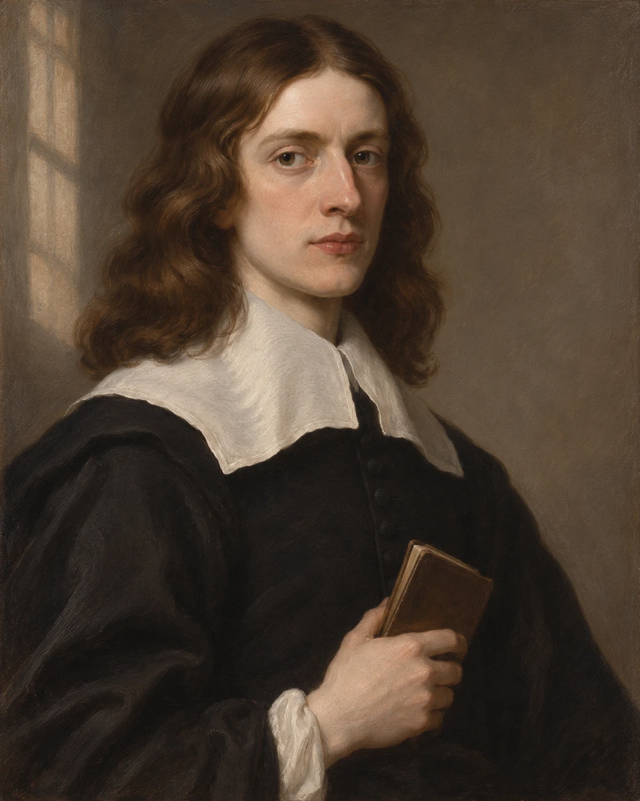

After the execution of Charles I, England became a republic and later a Protectorate under Oliver Cromwell. The public theatres remained closed, and printed argument about religion and government was central to public life. "Commonwealth" is a useful timeline label for these years, though the political arrangements changed within them.

## The world of this age

<figure class="article-illustration article-illustration--float article-illustration--left article-illustration--portrait" data-illustration="john-milton">
  
  <figcaption>The young John Milton — modern painted interpretation.</figcaption>
</figure>

England now became a republic, called the Commonwealth. Its strongest man was Oliver Cromwell, a country gentleman who had become a great general. After he put down resistance in Ireland and Scotland, he took the title Lord Protector in 1653. He died in 1658. His son Richard could not control the army, and the country drifted. In early 1660 General George Monck marched from Scotland to London, a new Parliament was chosen, and it invited Charles's son to return. Charles II entered London on 29 May 1660, his thirtieth birthday.

Society was divided into clear ranks. At the top stood the king and the great lords. Below them came the gentry, who owned land and ran the counties, then merchants, craftsmen and farmers, and a large body of labourers and servants. Rank decided a person's clothes, schooling and manners. Girls were mostly taught at home to run a household, few learned Latin, and a married woman had very few rights under the law. Even so, a small number of women found ways to write and publish.

## Language and public debate

The English of these years is called Early Modern English. It is the language of Shakespeare and the King James Bible. It is close enough to read today, but spelling had no fixed rules, and people still used "thou" and "thee" for close friends, for inferiors and for God. The language was also growing fast. It had borrowed words from Latin, Greek, French and Italian, and many readers felt lost among them. In 1604 a schoolmaster named Robert Cawdrey published *A Table Alphabeticall*, a small list of hard English words with plain meanings. It is regarded as the first English dictionary.

Writers chose their styles with care. Jonson and Bacon liked short, firm sentences. Donne wrote as if arguing aloud, with sudden starts. Thomas Browne preferred long, rolling sentences full of Latin words, and Milton shaped English as if it were Latin, with long, balanced sentences.

## Poetry

Younger poets followed. Henry Vaughan, a Welsh doctor, wrote of nature as a glimpse of heaven in *Silex Scintillans* (1650) and openly admired Herbert. Richard Crashaw, who became a Catholic, wrote passionate, almost dazzling religious verse. Andrew Marvell wrote one of the most famous argument poems of all, "To His Coy Mistress", in which a lover reasons that if time were endless he could court slowly, but since time is short, they should love now. Marvell also wrote the "Horatian Ode" in 1650, which praises Cromwell's power yet speaks with respect of the king's calm courage on the scaffold. His lyric poems were printed only after his death, in 1681.

## Prose and political thought

Then the Civil War turned prose into a weapon. Thomas Hobbes, who feared disorder, had gone to live in Paris in 1640, and there he wrote *Leviathan*, published in 1651. He argued that people must give up some freedom to a strong ruler, or life will be "solitary, poor, nasty, brutish, and short". John Milton argued in the opposite direction. In 1643 Parliament passed a law requiring books to be licensed before printing. Milton answered in 1644 with *Areopagitica*, a speech-like pamphlet saying that destroying a good book is like killing reason itself, and that truth grows stronger in a free contest with falsehood. After the king's execution he defended it in *The Tenure of Kings and Magistrates* (1649) and answered the popular book *Eikon Basilike*, which pictured Charles as a holy martyr, with *Eikonoklastes*. The new Commonwealth employed him as Latin Secretary, to write its letters to foreign powers, and he was blind by 1652. Others wanted more than a change of rulers. Gerrard Winstanley and his Diggers set up a farming community on common land in Surrey in 1649, claiming that the earth should be shared. These were years of fierce pamphlets, thousands of them.

## Religion and everyday writing

After the Civil War began, the Royalist clergyman Jeremy Taylor wrote *Holy Living* (1650) and *Holy Dying* (1651), guides to a good life and a good death. Izaak Walton, also a Royalist, wrote *The Compleat Angler* (1653), a gentle book about fishing and friendship that offers calm in a violent time.

## Theatre during the closure

After the king's death, the Puritans who now governed England tried to reshape national life. They had never liked the theatre. Parliament's order of 2 September 1642 had told actors to stop playing while the "sad causes" of the war lasted. Later orders in 1647 and 1648 went further. They treated actors as rogues, ordered playhouse seats and galleries to be pulled down, and punished spectators. The stage did not die completely. Actors performed in secret, and short comic scenes taken from old plays, called drolls, were acted in private. In 1647 the government also banned the celebration of Christmas.

Yet writing did not stop. Poets, scholars and preachers who had no stage turned to the study and the printing press. William Davenant found a way round the ban in 1656 by staging *The Siege of Rhodes* with music at a private house, as an entertainment rather than a play. It is often called the first English opera.

## How the age ends

In 1658 Cromwell died, and the Puritan government began to break up. In January 1660, as the country waited to see who would rule, a young clerk named Samuel Pepys began a diary in which he wrote about everything around him. It continued for nearly ten years. In May the king returned. In the summer Charles II gave Thomas Killigrew and William Davenant the right to run theatre companies in London, and plays came back to the stage. Milton, who had defended the king's execution, hid for a time, was briefly arrested in 1660 and was then freed. Blind and far from rich, he went on to finish *Paradise Lost*, published in 1667. A new age with new fashions had begun.

## Literature in focus

### Commonwealth and Protectorate

The monarchy was abolished after Charles I's execution in 1649. The years without a reigning English monarch are also called the Interregnum. The Commonwealth and Cromwell's Protectorate were not identical arrangements: Cromwell became Lord Protector in 1653. The timeline uses Commonwealth as a convenient label for the whole 1649–1660 interval.

### Milton as a public writer

Milton served the republican government as a writer of Latin correspondence and defended its cause in prose. *The Tenure of Kings and Magistrates* and *Eikonoklastes* belong to 1649. His earlier *Areopagitica* belongs to 1644 and should be treated as background. His later *Paradise Lost* was first published in 1667, after the monarchy returned. It must not be listed as a Commonwealth publication.

### Reading political prose

Hobbes and Milton give readers contrasting ways of thinking about authority. Read the argument in each work rather than turning the authors into a simple pair of slogans. The political emergency matters: what danger does the writer fear, what kind of power does he defend, and what does he expect that power to do? The answer must be supported by the text.

### Poetry and publication dates

Vaughan's *Silex Scintillans* appeared in 1650, with an enlarged edition in 1655. Marvell's "Horatian Ode" concerns Cromwell's return from Ireland in 1650. These works engage faith, time and public change in different ways. Much of Marvell's verse appeared in print only after his death; an event described in a poem is not automatically its publication date.

### Reading the theatrical gap

The closure of public theatres did not mean that every kind of performance disappeared. Davenant's *The Siege of Rhodes* in 1656 is an important exception to simplistic accounts of complete cultural silence. The relationship among spoken drama, music, private performance and official permission matters. The stage of the Restoration emerged from that interrupted history, rather than from eighteen years in which nobody wrote or performed anything.

## Key terms

- **Interregnum** - the gap between kings, from 1649 to 1660.
- **Conceit** - a surprising comparison that is stretched far and worked out with logic.

## Writers and works

| Writer | Works | What to remember |
|---|---|---|
| John Milton | The Tenure of Kings and Magistrates (1649) | Argument about political authority |
| Andrew Marvell | An Horatian Ode upon Cromwell’s Return from Ireland | Verse on public events in 1650 |

## Important points to remember

- The timeline uses 1649–1660 for this chapter. Literary boundaries are approximate.
- Check the date of a work separately from its writer's lifetime.
- Read this chapter alongside the wider period guide when comparing neighbouring ages.

## Quick revision - 10 points

1. **The Interregnum** — Interregnum means the gap between kings.
2. **Public stage plays must stop** — The order said plays should cease while the "sad causes" of the war lasted.
3. **A surprising comparison worked out at length** — Donne's comparison of lovers to the legs of a pair of compasses is a famous example.
4. **Thomas Hobbes** — Hobbes wrote the book after going to live in Paris in 1640.
5. **1653** — The Protectorate was a distinct political arrangement within the Interregnum.
6. **1667** — Its first publication belongs after the Restoration.
7. **Henry Vaughan** — The first edition appeared in 1650.
8. **The Tenure of Kings and Magistrates** — It argues about political authority.
9. **The Siege of Rhodes** — It complicates the idea that all performance ceased during the theatrical closure.
10. **The return of Charles II in 1660** — The Restoration brought back the monarchy.

## Quick quiz - 10 questions

Tap an answer to see at once if it is right. You do not need to log in.

**1. What name is given to the years 1649 to 1660, when England had no king?**

- A) The Elizabethan Age
- B) The Augustan Age
- C) The Interregnum
- D) The Georgian Age

Answer: C. Interregnum means the gap between kings.

**2. What did Parliament order on 2 September 1642?**

- A) Public stage plays must stop
- B) All books must be licensed
- C) Charles I must be tried
- D) The Globe must be rebuilt

Answer: A. The order said plays should cease while the "sad causes" of the war lasted.

**3. What is a conceit?**

- A) A proud poet
- B) A short rhyming line
- C) A poem shaped like its subject
- D) A surprising comparison worked out at length

Answer: D. Donne's comparison of lovers to the legs of a pair of compasses is a famous example.

**4. Who argued in *Leviathan* (1651) that people must give up some freedom to a strong ruler?**

- A) Thomas Hobbes
- B) John Milton
- C) Thomas Browne
- D) Robert Burton

Answer: A. Hobbes wrote the book after going to live in Paris in 1640.

**5. In which year did Cromwell become Lord Protector?**

- A) 1653
- B) 1603
- C) 1625
- D) 1707

Answer: A. The Protectorate was a distinct political arrangement within the Interregnum.

**6. When was Paradise Lost first published?**

- A) 1656
- B) 1667
- C) 1649
- D) 1651

Answer: B. Its first publication belongs after the Restoration.

**7. Who wrote Silex Scintillans?**

- A) Joseph Addison
- B) John Dryden
- C) Henry Vaughan
- D) Thomas Carew

Answer: C. The first edition appeared in 1650.

**8. Which work by Milton appeared in 1649?**

- A) Paradise Lost
- B) Lyrical Ballads
- C) The Task
- D) The Tenure of Kings and Magistrates

Answer: D. It argues about political authority.

**9. Which work by Davenant belongs to 1656?**

- A) The Siege of Rhodes
- B) The Way of the World
- C) The Spanish Tragedy
- D) The Beggar’s Opera

Answer: A. It complicates the idea that all performance ceased during the theatrical closure.

**10. What event marks the end of the Interregnum?**

- A) The Act of Union
- B) The return of Charles II in 1660
- C) The accession of Elizabeth I
- D) The Norman Conquest

Answer: B. The Restoration brought back the monarchy.

## Frequently asked questions

**Does this chapter use exact historical boundaries?**
The dates are the timeline's study convention. Language, literary forms and writers' careers can cross them. Use the date of the particular work when a question asks about a narrower age.

**Where can I read the wider historical context?**
The [full period guide](/notes/jacobean-and-caroline-age/) contains the longer background. This chapter concentrates on the age named above and keeps its own revision and practice sections.

**Are these pictures historical documents?**
The artwork is illustrative. Captions identify representative or imagined scenes and modern painted interpretations; those images are not evidence that the pictured scene happened exactly as shown.

**How should I use the quiz?**
Read the explanations after answering. Questions about earlier events or later criticism are background questions, not claims that every named date falls inside the chapter's boundaries.

## Sources and further reading

The relevant background, text references and public practice material are retained from the [original jacobean and caroline age guide](/notes/jacobean-and-caroline-age/#sources). Publication dates, authorship and period boundaries should be checked against the source editions listed there.

- [UK Parliament: 1640–1660 chronology](https://www.parliament.uk/about/living-heritage/evolutionofparliament/parliamentaryauthority/civilwar/key-dates/1640-1660/)
- [Cambridge University Library: Milton editions and publication dates](https://wwwe.lib.cam.ac.uk/CUL/exhibitions/Milton/captions.html)

Afsar Khan, Ph.D. English
