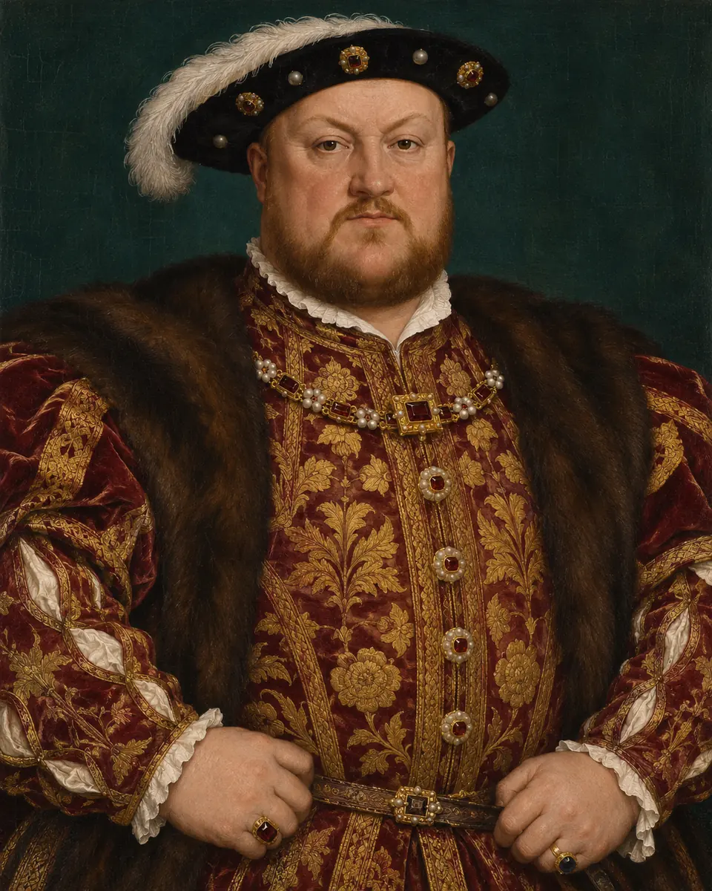
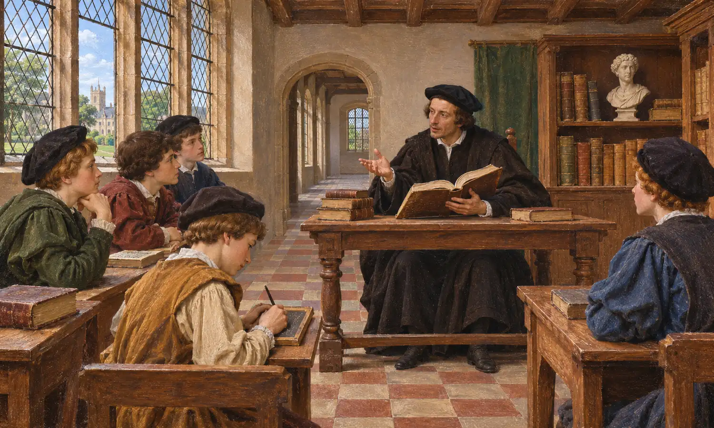
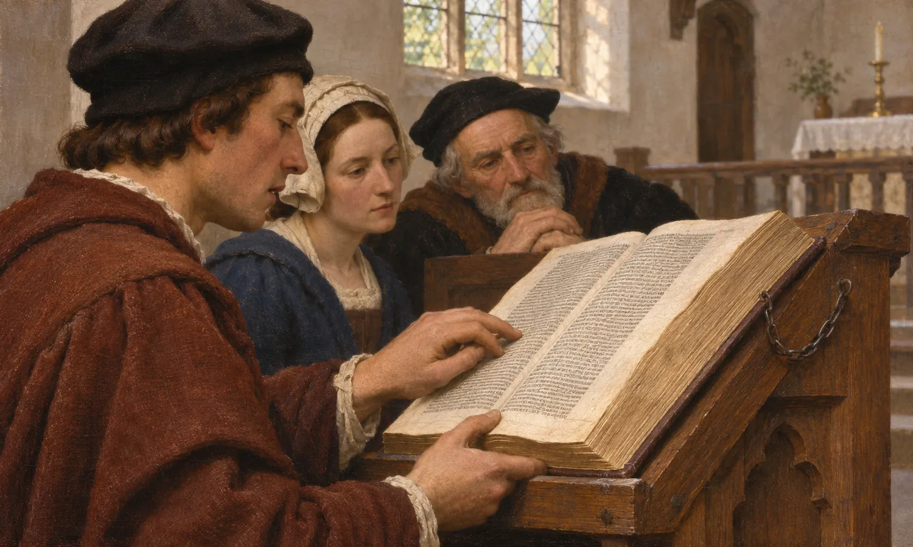

Printing was already changing English reading when the early Tudor writers began their work. They also inherited medieval forms, familiar stories and the reputation of Chaucer. What changed was the range of models they could study and adapt. More imagined another society; Wyatt reshaped a continental lyric; Surrey experimented with a verse form that later playwrights would use. This is a quieter literary setting than the crowded Elizabethan theatre, but it prepares important parts of that later world. As you read, follow one question: how does a borrowed form become useful in another language? The answer involves more than copying a pattern. A writer must make its rhythm, tone and argument work for new readers.

Early Tudor literature developed before the Elizabethan public theatre became the centre of English literary life. Humanist learning encouraged close reading of classical texts, while religious change affected education, books and the language of public debate.

## The world of this age

<figure class="article-illustration article-illustration--float article-illustration--portrait" data-illustration="henry-viii">
  
  <figcaption>Henry VIII — modern painted interpretation.</figcaption>
</figure>

Henry VII ruled from 1485 to 1509, and he spent those years making the crown safe. The Wars of the Roses had shown how dangerous great lords with private armies could be, so Henry kept them in check and filled the royal treasury. He left his son a calm and wealthy kingdom.

That son, Henry VIII, became king in 1509 at the age of seventeen. He was clever, loved music and learning, and wanted to be seen as a great ruler in Europe. But one worry grew in him every year. His wife, Catherine of Aragon, had given him a daughter, Mary, but no living son, and he feared that a kingdom without a male heir might fall back into civil war. He asked the Pope to end the marriage. The Pope, who was then under the power of Catherine's nephew, the Emperor Charles V, refused.

Henry's answer changed England. In 1534 Parliament passed the Act of Supremacy, which made the king, and not the Pope, the Supreme Head of the Church of England. By then Henry had married Anne Boleyn. Between 1536 and 1540 he closed the monasteries and took their lands and wealth. Anyone who refused to accept his new position was in danger. One of them was Thomas More, a former Lord Chancellor and once the king's friend, who was beheaded in 1535.

Henry died in 1547. His son Edward VI came to the throne as a boy, ruled for six years under Protestant advisers, and died at fifteen in 1553. The crown then passed to Mary I, Catherine's daughter. Mary was a devout Catholic who wished to bring back the Pope's authority. She had hundreds of Protestants burned as heretics, and her marriage to Philip II of Spain was disliked by many of her subjects. She died childless in 1558.

Girls from rich families could be well taught. Elizabeth herself read several languages, and More made sure that his daughters learned Latin and Greek. Most girls, however, did not go to school, and the universities of Oxford and Cambridge took only men.

In 1500 England was mainly a farming country that earned its money from wool. Raw wool and woollen cloth were its chief exports, and much of the cloth went through the great port of Antwerp. When landlords found that sheep paid better than crops, they fenced off their fields, a practice called enclosure, and turned farmland into pasture. The families who had worked that land lost their living and took to the roads. Thomas More saw this misery and wrote in *Utopia* that the sheep, once so gentle, had begun to eat up men.

## Religion and the English Bible

<figure class="article-illustration" data-illustration="humanist-school">
  
  <figcaption>A Tudor grammar school shaped by humanist learning.</figcaption>
</figure>

Religion in this age was never a private matter. It decided who could rule, whom a king could marry, and sometimes who lived. In 1517 a German monk named Martin Luther began to attack the Pope's power and the sale of pardons, and his protest grew into the Reformation, which split Western Christianity into Catholic and Protestant. Henry VIII at first opposed Luther. He wrote a book against him in 1521, and the Pope thanked him with the title Defender of the Faith. Only a few years later Henry broke with the Pope himself, for his own reasons. But once the Pope's authority was gone, Protestant ideas flowed in.

Reformers argued that every Christian should read the Bible in a language he understood. William Tyndale, a scholar who worked abroad because the English authorities were against him, printed an English New Testament in 1526, and copies were smuggled into England. He was strangled and burnt as a heretic in 1536. Yet in 1539 the Great Bible, built largely on the work of Tyndale and Miles Coverdale, was placed in the parish churches by order of the king. In 1549 Thomas Cranmer, the Archbishop of Canterbury, produced the Book of Common Prayer, a book of services in English whose rhythms entered the memory of the whole nation.

## The language

<figure class="article-illustration" data-illustration="english-bible">
  
  <figcaption>Reading an English Bible in a Tudor parish church.</figcaption>
</figure>

The English of 1500 was already far from the English of Chaucer, who had died a century earlier. A long change in the sound of vowels, called the Great Vowel Shift, had begun around 1400 and was now settling down, and the printing press was slowly fixing spelling. The language that scholars call Early Modern English was taking shape.

It was also a hungry language. Humanists and translators were bringing ideas from Latin, Greek, Italian and French into English, and English did not always have words for them. Writers borrowed freely, and some borrowed too freely. Critics mocked the showy new words as inkhorn terms, after the pots in which scholars kept their ink. Thomas Wilson, in *The Arte of Rhetorique* (1553), made fun of a letter stuffed with such words. Others defended plain English. Richard Mulcaster, a headmaster, wrote in *Elementarie* (1582) that he loved Rome but loved London better, and honoured Latin but worshipped English.

One small word shows how the language felt. English had two words for "you". *Thou* was used to children, close friends and people of lower rank, and *you* to superiors and strangers. A writer could show a change of feeling between two characters by a change from one word to the other.

## Poetry

The first notable poet of the century looked back as much as forward. John Skelton, once tutor to the boy who became Henry VIII, wrote short, jerky lines that rush from rhyme to rhyme, a style later called Skeltonic verse. He could be tender, as in *Philip Sparrow*, a girl's lament for her pet bird killed by a cat, and he could be fierce, as in *Colin Clout*, which attacked the faults of the clergy.

The real change came through two courtiers who had read Italian. Sir Thomas Wyatt visited Italy in 1527 on the king's business and found the poems of Petrarch, whose love sonnets had been admired across Europe for almost two centuries. English had no sonnets at that time. Wyatt began to translate and imitate them, fitting the fourteen-line Italian form into English. His verse can be rough, because English was still settling after the loss of many sounded word endings, but it often carries real feeling, as in "They flee from me" and "Whoso list to hunt", a poem adapted from Petrarch.

Henry Howard, Earl of Surrey, a younger nobleman and soldier, took the next step. He smoothed the rhythm and shaped the English sonnet: three four-line stanzas with alternate rhymes and a closing couplet, the pattern Shakespeare would later use. In translating two books of Virgil's *Aeneid*, Surrey also became the first English poet to use blank verse, which means unrhymed lines of ten syllables. Both men died young. Wyatt died of a fever in 1542, aged about thirty-nine, and Surrey was beheaded for treason in 1547, when he was about thirty.

## Drama and performance

The English theatre of 1500 was still medieval. Towns put on cycles of mystery plays, which told Bible stories, and morality plays, in which characters stood for virtues and vices. The early Tudors added interludes, short and often funny plays acted in noble halls, the best known by John Heywood. Meanwhile the humanists had brought back the Roman playwrights. Schoolboys acted Plautus and Terence in Latin, and scholars read the bloody tragedies of Seneca, full of ghosts, murders and long speeches. When English writers began to imitate these models, a new drama began.

## Prose and humanism

English prose was still young. For centuries serious writers had used Latin, and the first great English prose came from the Bible and the Prayer Book.

Thomas More's *Utopia*, written in Latin and printed in 1516, was one of the first great works of the age. It describes an imaginary island, found by a traveller, where property is shared and greed has no place, and uses it to criticise the harshness and injustice of England. The name comes from Greek words meaning "no place". Ralph Robinson's English translation followed in 1551. More's unfinished *History of King Richard III*, written in the 1510s, painted the king as a monster and later gave Shakespeare his villain.

## Literature in focus

### Poems before and after print

Wyatt and Surrey's poems circulated in manuscript before many reached a wider audience through *Songes and Sonettes* in 1557, commonly called *Tottel's Miscellany*. The publication falls before Elizabeth's accession in 1558. A poem's composition and its appearance in an anthology need not belong to the same year, so dating a writer from a collected edition alone can mislead.

### Humanist education and English prose

Humanism made language, rhetoric and the reading of classical authors central to education. Thomas Elyot's *The Boke Named the Governour* appeared in 1531 and considered education for governing society. Roger Ascham's *Toxophilus* appeared in 1545 as a dialogue on archery. These books show that English prose could serve practical discussion as well as religious instruction.

More's *Utopia* was written in Latin. It belongs in English literary history because of its writer and intellectual setting, but it should not be described as an English-language book in its first form. Its imaginary society invites comparison with contemporary life; the presence of a fictional speaker does not make every statement a direct declaration of More's personal programme.

### Forms that prepared the Elizabethan age

The sonnet and blank verse had different uses. A sonnet is a short lyric form; blank verse is unrhymed iambic pentameter and can sustain a long translation or drama. Surrey's experiments helped make the latter available to later English writers. The great public theatres of Elizabethan London belong to the following period, even though their dramatic language had roots in these earlier experiments.

## Borrowing a form is a creative problem

The sonnet offers a useful way to understand early Tudor experiment. Its length and pattern give a writer a set of limits. Within those limits, a thought must begin, develop and reach a point of change or conclusion. Bringing such a form into English is therefore more demanding than translating a collection of words. The poet must discover how the argument can move naturally in another language.

Read a sonnet as a small event in thinking. What does its speaker claim at the beginning? Does the claim become harder to maintain? Is the ending an answer, a surprise or a sharper statement of the difficulty? These questions make the form easier to understand than treating it only as a rhyme scheme. The pattern supports a movement of thought.

Wyatt's place in this history becomes clearer through that approach. The continental model provides a starting point, but the resulting English poem has to create a voice of its own. A reader should notice pressure, uncertainty or resistance within that voice rather than assuming that every love poem is a simple record of a real relationship. The speaker is part of the poem's design.

### A lyric can have more than one audience

Courtly writing often works in a setting where praise, favour and reputation matter. An apparently private address can be read by people beyond its named or imagined listener. The speaker's situation may therefore carry social pressure as well as emotion. The poem can ask what it is safe to say and how openly a feeling may be expressed.

This is a reason to avoid treating a lyric as a transparent page from a diary. Biography may help, but it does not remove the need to explain the words. A metaphor can express a relationship while also inviting wider reflections on freedom or dependence. A careful account allows that range without claiming a secret political meaning for every image.

## Surrey and the possibilities of a line

Blank verse removes end rhyme while retaining a regular metrical basis. This gives writers another balance between order and movement. A sentence can run through a sequence of lines without waiting for a repeated end sound to close the thought. The effect depends on the writer's handling of rhythm, pause and emphasis. Unrhymed does not mean without structure.

Surrey's translations help connect classical reading with later English drama. The connection is not that translation and theatre are identical. It is that an available verse resource can be adapted to another purpose. A line that carries a translated narrative can later help sustain an actor's argument or a dramatic speech. Literary forms have careers as well as authors.

For revision, make the distinction concrete. A sonnet is a short form with a particular organisation; blank verse is a kind of verse that can be used across much longer works. Calling both important Tudor innovations is correct, but saying how they differ shows real understanding. It also prepares you to recognise their later Elizabethan uses.

## More's island: thinking through a comparison

Utopia asks readers to consider an imagined society beside the world they know. The imagined setting creates distance. A familiar custom may seem less inevitable when another arrangement can be described. That does not mean every feature of the island must be accepted as the author's direct recommendation. The work's voices, questions and tensions are part of its method.

A productive first question is: what becomes strange when we look at our own society from this distance? Something normally treated as natural may begin to look like a choice. The reader is encouraged to compare, but comparison does not supply an easy blueprint for solving every problem. Fiction can open an argument without closing it.

The language of the original also matters. More wrote in Latin, which connected the book with a learned readership beyond England. That fact complicates a simple division between national and foreign literature. A work can belong to English literary history while speaking through an international language of scholarship. The period's literary life cannot be understood through English-language texts alone.

## Translation can become a public struggle

The English Bible gives the problem of language a different weight. Here translation concerns not only literary pleasure but access to religious teaching. Who should be able to read? What words should be used? Who has the authority to approve the result? These questions connect the page with institutions, belief and political power.

Do not describe translation as a neutral transfer in which nobody cares about the choice of words. A term can carry an argument about religious practice or authority. At the same time, avoid treating every linguistic difference as proof of dishonesty. Translators face difficult decisions because languages organise meaning differently and because readers bring expectations to a text.

This connection with the Reformation helps explain why prose matters so much in the chapter. The development is not only a story of poets learning new patterns. English is also being used to teach, persuade and dispute. The same growing reading culture can make room for a courtly lyric and an urgent argument about belief.

## A book has a history before publication

Tottel's Miscellany is a useful reminder that writing and publication need not happen together. A poem can circulate among readers before appearing in print. A later collection can give earlier work a new audience and make a group of writers appear together in literary memory. The printer's date is important, but it is not automatically the date of composition of every poem in the volume.

Think about what changes when work moves from a limited manuscript circle to a printed collection. A reader may meet a poem without knowing its original situation. Its language has to create a relationship with someone outside the first audience. The collection also places it beside other poems, encouraging comparison and helping establish a sense of a tradition.

The Early Tudor chapter ends with those possibilities open. Elizabethan poets will develop the lyric, dramatists will use blank verse with growing power, and prose will reach readers through many forms. The earlier experiments deserve attention because they make that later range easier to understand. They are finished works with their own interests, as well as part of the preparation for another age.

## Carrying one experiment into the next age

Try explaining the early Tudor contribution without using the word preparation. Wyatt's lyrics, Surrey's verse and More's imagined island have their own purposes and effects. They do not exist only because later writers will become famous. Once those works have been understood in their own setting, it becomes possible to see what later authors inherit from them.

This order of reading matters. If we begin only with Shakespeare, we may value an earlier experiment merely because it points toward his theatre. If we begin with the earlier work, the later connection becomes richer: a form developed for one task is discovered to have another use. Literary history then looks like a set of choices passed between writers, each making something particular from what is available.

That is the connection to carry into the Elizabethan chapter. Innovation can depend on inheritance without being a simple copy of it. A line, a pattern or an argument gains a new life when another writer finds a different purpose for it.

## Key terms

- **Humanism** - the study of ancient writers as guides to living well, and the belief that education makes better people.
- **Blank verse** - unrhymed lines of ten syllables, first used in English by Surrey and made dramatic by Marlowe.

## Writers and works

| Writer | Works | What to remember |
|---|---|---|
| Richard Tottel (printer) | Songes and Sonettes (1557) | Printed collection of courtly lyric |

## Important points to remember

- The timeline uses 1500–1558 for this chapter. Literary boundaries are approximate.
- Check the date of a work separately from its writer's lifetime.
- Read this chapter alongside the wider period guide when comparing neighbouring ages.

## Quick revision - 10 points

1. **Bosworth** — Henry Tudor won at Bosworth and became Henry VII.
2. **1534** — The Act of 1534 made the king Supreme Head of the Church of England.
3. **Thomas More** — More wrote it in Latin and it was printed in 1516.
4. **The Great Bible** — The Great Bible was set up in the churches by order of the king.
5. **Wyatt** — Wyatt read Petrarch in Italy and began to translate and imitate his sonnets.
6. **His translation of two books of Virgil's *Aeneid*** — Translating the *Aeneid* made him the first English poet to use blank verse.
7. **The first printed anthology of English courtly poetry** — It gathered the poems of Wyatt and Surrey, few of which had been printed before.
8. **Latin** — More’s work belongs to English literary history but its original language is Latin.
9. **Unrhymed iambic pentameter** — Surrey used this verse form in translation.
10. **Roger Ascham** — Ascham wrote this dialogue on archery in English.

## Quick quiz - 15 questions

Tap an answer to see at once if it is right. You do not need to log in.

**1. Which battle in 1485 brought Henry Tudor to the throne?**

- A) Agincourt
- B) Towton
- C) Bosworth
- D) Hastings

Answer: C. Henry Tudor won at Bosworth and became Henry VII.

**2. In which year did Parliament pass the Act of Supremacy?**

- A) 1509
- B) 1526
- C) 1559
- D) 1534

Answer: D. The Act of 1534 made the king Supreme Head of the Church of England.

**3. Who wrote *Utopia*?**

- A) Thomas More
- B) Thomas Wyatt
- C) Roger Ascham
- D) Thomas Kyd

Answer: A. More wrote it in Latin and it was printed in 1516.

**4. Which English Bible was placed in the parish churches in 1539?**

- A) The Geneva Bible
- B) The Great Bible
- C) Tyndale's New Testament
- D) The Bible of 1611

Answer: B. The Great Bible was set up in the churches by order of the king.

**5. Who first brought the sonnet from Italy into English?**

- A) Surrey
- B) Sidney
- C) Wyatt
- D) Spenser

Answer: C. Wyatt read Petrarch in Italy and began to translate and imitate his sonnets.

**6. In which work did Surrey first use blank verse in English?**

- A) *Songes and Sonettes*
- B) His translation of two books of Virgil's *Aeneid*
- C) *A Mirror for Magistrates*
- D) *Gorboduc*

Answer: B. Translating the *Aeneid* made him the first English poet to use blank verse.

**7. What was *Tottel's Miscellany* (1557)?**

- A) A play by Thomas Kyd
- B) A translation of the Bible
- C) The first English dictionary
- D) The first printed anthology of English courtly poetry

Answer: D. It gathered the poems of Wyatt and Surrey, few of which had been printed before.

**8. In which language was Utopia first written?**

- A) Old English
- B) Greek
- C) Anglo-Norman
- D) Latin

Answer: D. More’s work belongs to English literary history but its original language is Latin.

**9. What is blank verse?**

- A) Unrhymed iambic pentameter
- B) A fourteen-line rhyming stanza
- C) Any prose printed in lines
- D) A poem without meaning

Answer: A. Surrey used this verse form in translation.

**10. Who wrote Toxophilus?**

- A) Joseph Addison
- B) Roger Ascham
- C) Thomas Kyd
- D) John Webster

Answer: B. Ascham wrote this dialogue on archery in English.

**11. Why is adapting a sonnet more than copying a rhyme scheme?**

- A) Every sonnet is a factual diary
- B) Translation removes all choices
- C) Its argument and voice must work in another language
- D) A sonnet has no thought

Answer: C. A borrowed form has to become effective for new readers.

**12. Which statement about blank verse is accurate?**

- A) It must always be fourteen lines
- B) It is prose with random line breaks
- C) It cannot be used in drama
- D) It has metrical structure without end rhyme

Answer: D. Unrhymed does not mean unstructured.

**13. Why can Utopia belong to English literary history despite its original language?**

- A) National literary history can include works written in Latin
- B) Its first edition was in Old English
- C) Latin was invented by More
- D) The book has no author

Answer: A. The writer and intellectual setting matter alongside the language.

**14. What distinction matters when studying Tottel's Miscellany?**

- A) The collection appeared after Shakespeare's death
- B) Composition and publication need not share a date
- C) A printer must have composed every poem
- D) All lyrics were first spoken in Parliament

Answer: B. Many poems circulated before reaching a printed collection.

**15. Why did Bible translation involve public controversy?**

- A) It removed all questions of belief
- B) No one read religious prose
- C) Language, religious teaching and authority were connected
- D) It concerned only decorative typefaces

Answer: C. Translation affected access to teaching and the power to approve texts.

## Frequently asked questions

**Does this chapter use exact historical boundaries?**
The dates are the timeline's study convention. Language, literary forms and writers' careers can cross them. Use the date of the particular work when a question asks about a narrower age.

**Where can I read the wider historical context?**
The [full period guide](/notes/renaissance/) contains the longer background. This chapter concentrates on the age named above and keeps its own revision and practice sections.

**Are these pictures historical documents?**
The artwork is illustrative. Captions identify representative or imagined scenes and modern painted interpretations; those images are not evidence that the pictured scene happened exactly as shown.

**How should I use the quiz?**
Read the explanations after answering. Questions about earlier events or later criticism are background questions, not claims that every named date falls inside the chapter's boundaries.

## Sources and further reading

The relevant background, text references and public practice material are retained from the [original renaissance guide](/notes/renaissance/#sources). Publication dates, authorship and period boundaries should be checked against the source editions listed there.

- [Sir Thomas Wyatt — Poetry Foundation](https://www.poetryfoundation.org/poets/thomas-wyatt)

Afsar Khan, Ph.D. English
