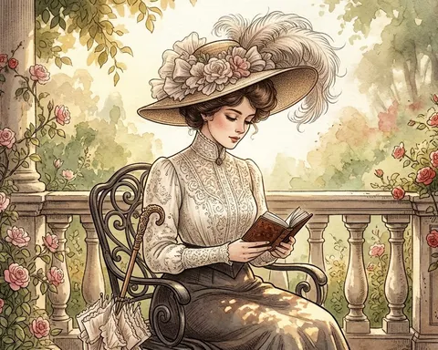

Queen Victoria's death gives this chapter a clear starting point, but books do not change with the turn of a calendar. Edwardian writers inherited Victorian realism, its detailed social worlds and its large reading public. They also questioned the institutions and habits those worlds had made familiar. Wells, Bennett, Galsworthy and Forster examine money, houses, work and belonging, while Shaw turns a conversation on stage into a contest between ideas. Begin with those ordinary objects and relationships. A house may reveal a whole system of class; an argument about charity may lead to questions about where wealth comes from. This is how the period connects inherited literary forms with a century becoming less certain of its own assumptions.

The Edwardian label follows the death of Queen Victoria in 1901 and the reign of Edward VII, though literary timelines often carry it to the outbreak of the First World War in 1914. It marks a short transitional moment: writers questioned inherited social structures before the war transformed public life.

## The world of this age

<figure class="article-illustration">
  
  <figcaption>Illustrative artwork of an Edwardian reader; a modern interpretation.</figcaption>
</figure>

On 22 January 1901, Queen Victoria died at Osborne House on the Isle of Wight. She had ruled since 1837, so most people in Britain had never lived under another monarch. Her name had come to stand for a whole age of steady progress, strict manners and a vast empire. When the news spread, many felt that something larger than a reign had come to an end.

The new century did not begin with a clean break. Her son became King Edward VII, and for a few years life went on in its comfortable Edwardian way for those who could afford it. Underneath, the old certainties were wearing thin. Science was shaking religious belief, women were demanding the vote, workers were organising, and the great powers of Europe were building bigger armies. Writers began to feel that the old ways of telling a story or shaping a poem no longer matched the world around them.

The Edwardian years opened with a sense of unease. Britain had just fought the Boer War in South Africa (1899-1902), and the army's poor start had shocked the public. In 1906 the Liberal Party won a great election victory and began to build the first parts of a welfare system. Old-age pensions were voted in 1908, and the National Insurance Act of 1911 gave some workers help in sickness and unemployment.

Women were pressing for change as well. In 1903 Emmeline Pankhurst founded the Women's Social and Political Union, whose members, called suffragettes, used marches, protests and sometimes damage to property to win the vote. Ireland was another centre of storm. Many Irish people wanted Home Rule, a parliament of their own in Dublin, while Protestants in the north feared it.

Behind the comfortable Edwardian picture lay hard poverty. In 1901 Seebohm Rowntree, the son of a York chocolate maker, studied the families of his home city and found that more than a quarter of its people did not earn enough for the plain necessities of life. His findings came as a shock because York was an ordinary provincial town, not a London slum.

## New ideas and culture

New ideas about the mind and the universe also unsettled old beliefs. In *The Interpretation of Dreams* (1899), the Viennese doctor Sigmund Freud argued that much of the human mind lies hidden, speaking through dreams and desires a person does not know about. In 1905 Albert Einstein published his theory of special relativity, which treated time and space as linked rather than fixed. The French thinker Henri Bergson held that real time is felt inside the mind as a flowing stream, not as the ticking of a clock. Writers read all this, and it changed how they pictured a human being.

## Poetry

Thomas Hardy stood between the old century and the new. After the hostile reception of his novel *Jude the Obscure* in 1895 he had given up fiction and returned to poetry, his first love. His epic drama *The Dynasts* (1904-08) pictured the Napoleonic wars as a puppet show moved by an unfeeling force.

## Prose

The Edwardian novel carried on the Victorian habit of long, solid stories about society. H. G. Wells, who began with scientific romances, now wrote social comedies such as *Tono-Bungay* (1909). Arnold Bennett's *The Old Wives' Tale* (1908) followed two sisters through a lifetime in the pottery towns of Staffordshire, and John Galsworthy's *The Man of Property* (1906) opened the story of the Forsyte family.

## Drama

The liveliest drama came from Ireland. With money from the English patron Annie Horniman, W. B. Yeats and Lady Gregory opened the Abbey Theatre in Dublin on 27 December 1904, to stage plays about Irish life by Irish writers.

Its dramatists included J. M. Synge, who wrote *Riders to the Sea* (1904), a short, tragic play about a fishing family and the sea. His comedy *The Playboy of the Western World* (1907) tells of a young man who boasts of killing his father and is hailed as a hero by the villagers. Some in the audience felt that Irish country people were being mocked, and riots broke out.

## Criticism and scholarship

Before 1900 much English criticism was either chatty or moral in tone. A. C. Bradley's *Shakespearean Tragedy* (1904) was a landmark of the new century, a careful study of Shakespeare's great tragedies that treated their heroes as living persons.

## Literature in focus

### The dates of the period

Edward VII reigned from 1901 to 1910. Literary histories sometimes extend "Edwardian" to the outbreak of war in 1914. This timeline uses that extended convention. A reader should state the convention rather than imply that Edward VII remained king until 1914.

### Fiction and social observation

Wells's *Tono-Bungay* and Bennett's *The Old Wives' Tale* examine commercial and provincial worlds through different kinds of narrative. Galsworthy's *The Man of Property* asks how possession affects family and personal relationships. Forster's *Howards End* brings houses, money and human connection into conflict. These writers give the period its own concerns rather than merely waiting for Modernism to begin.

### Shaw and the discussion play

George Bernard Shaw's *Major Barbara* makes wealth, charity and the arms trade part of a theatrical argument. Dialogue tests ideas through characters with interests and blind spots. A discussion play still needs dramatic conflict: opposing beliefs matter because the people holding them have choices to make. Shaw's career began before Edward VII's reign and continued long after it, so he should not be confined to these dates.

### Childhood, empire and the wider readership

Edwardian reading included children's literature and popular books as well as the social novel. The University of Edinburgh's Edwardian reading list includes *Peter Pan*, *The Railway Children* and *The Wind in the Willows*. The range matters: a history based only on a few adult realist novels would miss important audiences. Colonial power, class and women's position also shaped public debate.

### Later criticism as later evidence

Virginia Woolf later used "Edwardian" when criticising the methods of Bennett, Wells and Galsworthy. Her argument is a later intervention in a debate about fiction. It should not be treated as a neutral summary of what all Edwardian writers believed. Read a novelist's actual methods before deciding whether that judgement fits.

### The boundary with Modernism

Realism and experimentation overlapped. The beginning of George V's reign in 1910 did not make every novel suddenly Modernist, and the war did not erase earlier forms. A useful comparison asks how a scene gives readers access to a character: through social detail, through speech, through inner thought, or through several of these at once.

## A house can tell a story about a society

A house is an ordinary object, but fiction can make it carry a surprising amount of meaning. Who owns it? Who works in it? Who may enter comfortably, and who feels out of place? These questions turn a setting into a map of relationships. They are especially useful when approaching Edwardian fiction, where property and social position often shape the choices available to a character.

Do not reduce material detail to a list of furniture. A room can show what its owner values, what the family wishes others to think, and what a visitor is allowed to see. The same space may feel safe to one person and restrictive to another. The reader learns about a world through those different experiences. Realism works partly through this movement between the visible object and the life organised around it.

This helps explain the connection with Victorian fiction. The detailed social world remains important, but a new book can use it to question the values of an inherited order. There is no need to wait for an experimental stream of consciousness before a novel can challenge assumptions. A realistic scene can do that by making the ordinary arrangement of a household seem less innocent than it first appears.

## Galsworthy: when possession enters a relationship

The title The Man of Property places a social identity before the reader. Property can promise independence, continuity and respectability. Yet the habit of possession can become troubling when it extends into the way a person understands another human being. The novel's interest is not simply that some people have money. It asks what a system of ownership can do to the imagination and the emotional life.

A useful distinction is the difference between legal entitlement and understanding. A character may believe that a recognised right settles a personal matter. The feelings of another person do not necessarily follow that rule. Fiction gives room for this disagreement because it can show more than one experience of the same relationship. The reader is asked to judge a habit of thought as well as a visible action.

When writing about this theme, avoid claiming that every prosperous character is identical. Look at the language of a particular encounter. Does someone describe a choice as an obligation, a feeling as an inconvenience, or a person as part of a stable arrangement? Those details can show the pressure of possessiveness more clearly than a broad claim about a whole social class.

## Bennett: the drama inside an apparently ordinary life

The Old Wives' Tale offers another reason not to dismiss realistic fiction as a record of things outside the mind. Following lives across time lets a writer place small decisions within a much larger pattern. A choice may look minor when it happens, yet acquire a different meaning when the reader sees its consequences. The length of a life changes the scale of judgement.

The provincial setting matters because literary experience need not be limited to a capital, a court or an exceptional adventure. Work, routine and relationships can supply serious narrative interest. A familiar place is not necessarily a simple place. Its customs can offer support while also limiting what a person expects to be possible. The novel can make those limits visible through the lives lived within them.

Try comparing the way a person understands herself with the way the surrounding community describes her. The gap can create sympathy, comedy or unease. This is a form of narrative intelligence: the reader is allowed to notice more than any one participant understands. To explain its effect, use a specific situation rather than calling the whole book merely a picture of provincial life.

## Wells: social comedy as a serious method

Wells is often introduced through scientific romance, but his social fiction gives another way into the Edwardian world. Commerce, aspiration and the hope of improving one's position can all supply a story. A comic surface does not remove the importance of the subject. It can make a familiar promise sound doubtful by showing the distance between what people say and what their actions produce.

In reading a social comedy, distinguish laughing at an individual from questioning a system. A character may be foolish, but the story may also show institutions that encourage the foolishness. The reader has to decide where the criticism falls. Does the book make the person seem exceptional, or does the situation reveal a larger habit of judgement?

This question also connects Wells with the wider period. Edwardian writing repeatedly asks what an apparently successful society is overlooking. An account of progress can sound confident from a distance and look more troubled when examined through one life. Fiction brings those scales together. It can show a public promise and then follow a person who has to live with its limits.

## Shaw: an argument becomes a dramatic event

A discussion play should not be read as an essay cut into speeches. Each speaker has a place in the action and something at stake. A clever answer may protect a person's position, test another character or avoid an uncomfortable question. The audience watches ideas being used by people, not merely displayed on a board. That is part of the energy of Shaw's theatre.

Major Barbara is useful because charity and wealth are difficult to separate. A good intention may depend on resources that raise another moral question. This is more demanding than dividing the cast into people who care and people who do not. The play asks what happens when the means of doing good become part of the problem that good action hopes to solve.

Read an exchange by identifying its turning point. When does a speaker have to answer a question he or she would rather avoid? Does a witty phrase actually settle the issue? Does the scene leave the audience with a clear conclusion or with a contradiction it must continue to consider? These questions help preserve the dramatic life of a play while explaining its social argument.

## The reader is part of the Edwardian world

A literary period includes the people who read as well as the people who write. Different readers wanted different things: entertainment, information, stories for children, social argument or an encounter with unfamiliar experience. The variety of books matters because no single genre can represent all those uses. A history focused only on one kind of adult novel would make the reading world smaller than it was.

Children's writing is particularly useful for questioning a narrow account of the period. A book for younger readers may examine rules, freedom, home or adventure through a different scale of experience. Its apparent accessibility does not place it outside literary history. It asks how a reader learns to imagine another life and how a familiar world may become strange.

This chapter's reading list is therefore an invitation to compare audiences. What does a work expect its reader to recognise? How much explanation does it offer? What emotions does it encourage, and what kind of ending feels satisfying? These are questions that can be asked of a children's story, a social novel and a play without pretending that they work in the same way.

## Woolf's later challenge: a debate, not a verdict

Woolf's criticism of the Edwardian novelists belongs to a later argument about the art of fiction. Her challenge helps us notice the difference between building a detailed external world and following the flow of consciousness. But it should lead us back to the novels, not excuse us from reading them. A critical label can identify a real difference while leaving out much that a work actually does.

A fair comparison asks what each method can reveal. Social detail can show how money and institutions shape a life. An inward method can show how an apparently small moment expands through memory and feeling. Neither question is unimportant. The interesting issue is how a particular book connects inner experience with the world around it.

The movement into the Modern period is easier to understand through that debate. Earlier methods remain available while new writers put them under pressure. Literary change does not require every reader or author to agree that an old method has failed. It can begin when writers discover that a different question needs a different way of telling.

## From an object to a whole life

Choose an ordinary object in a realist scene: a house, a piece of clothing or a letter. Begin by describing what the story actually tells you about it. Then ask who values it and why. An object may represent security to one person, status to another and work to someone who has to maintain it. The difference makes social relationships visible without requiring a narrator to state every judgement directly.

This is a useful answer to the assumption that external detail and inner life must be enemies. A person's feelings can be shaped by a material world, while an object can acquire meaning through memory and desire. The novel may connect these aspects rather than choose only one. To explain that connection, follow what the object permits, promises or prevents within the action.

Now consider a scene in a discussion play. The equivalent of the object may be an apparently agreed value: charity, duty or respectability. The drama begins to move when the speakers discover that the same word means different things in practice. A character's definition can protect an interest, and another character can expose that interest by asking a difficult question.

The connection between the novel and the stage is therefore more precise than the general claim that both discuss society. Both can begin with something familiar and make its assumptions visible. Their methods differ, but the reader or audience is invited to reconsider an ordinary arrangement. This gives the Edwardian chapter its own energy before the more famous experiments of the Modern period.

As you leave the chapter, keep one of those questions open. What makes a home a home? When does possession become a failure to understand another person? Can a good intention be separated from the source of its money? The literature remains engaging because its characters have to live inside those questions rather than merely supply definitions for them.

The movement into a new age also changes how an earlier book is remembered. Later criticism can make one feature seem more dominant than it felt to an original reader. Keep both encounters available: the work as it develops on the page, and the later argument about its place in literary history. That double attention makes the Edwardian writers more interesting than a brief label such as transitional can suggest. Their choices deserve to be understood before they are placed on the road to someone else.

## Key terms

- **Bloomsbury Group** - the London circle of Virginia Woolf, Forster, Strachey, Fry and Keynes.

## Writers and works

| Writer | Works | What to remember |
|---|---|---|
| H. G. Wells | Tono-Bungay | Fiction and commercial life |
| Arnold Bennett | The Old Wives’ Tale | Provincial lives and social detail |
| John Galsworthy | The Man of Property | Property and personal relationships |
| George Bernard Shaw | Major Barbara | Drama of social argument |
| E. M. Forster | Howards End | Class, property and connection |

## Important points to remember

- The timeline uses 1901–1914 for this chapter. Literary boundaries are approximate.
- Check the date of a work separately from its writer's lifetime.
- Read this chapter alongside the wider period guide when comparing neighbouring ages.

## Quick revision - 10 points

1. **The death of Queen Victoria** — Queen Victoria died on 22 January 1901, and the period is dated from that year.
2. **Emmeline Pankhurst** — Its members were called suffragettes.
3. **Seebohm Rowntree** — His findings showed that poverty was not only a London problem.
4. **27 December 1904** — Annie Horniman supplied the money.
5. ***The Playboy of the Western World*** — Some of the audience felt that Irish country people were being mocked.
6. **1901–1910** — The extended literary convention sometimes runs to 1914.
7. **Arnold Bennett** — Bennett’s novel examines provincial lives through social detail.
8. **John Galsworthy** — It examines possession and personal relationships.
9. **Tono-Bungay** — It forms part of Wells’s social fiction.
10. **A play by Shaw** — Shaw makes social questions part of dramatic conflict.

## Quick quiz - 15 questions

Tap an answer to see at once if it is right. You do not need to log in.

**1. Which event is used to mark the beginning of the Edwardian period?**

- A) The outbreak of the First World War
- B) The death of Queen Victoria
- C) The Easter Rising
- D) The Wall Street Crash

Answer: B. Queen Victoria died on 22 January 1901, and the period is dated from that year.

**2. Who founded the Women's Social and Political Union in 1903?**

- A) Emmeline Pankhurst
- B) Virginia Woolf
- C) Annie Horniman
- D) Vera Brittain

Answer: A. Its members were called suffragettes.

**3. Which social researcher found in 1901 that more than a quarter of the people of York lived in poverty?**

- A) John Maynard Keynes
- B) Lytton Strachey
- C) Roger Fry
- D) Seebohm Rowntree

Answer: D. His findings showed that poverty was not only a London problem.

**4. When did the Abbey Theatre open in Dublin?**

- A) 1 January 1900
- B) 27 December 1904
- C) 4 August 1914
- D) 2 February 1922

Answer: B. Annie Horniman supplied the money.

**5. Which play by Synge caused riots in Dublin in 1907?**

- A) *Riders to the Sea*
- B) *Juno and the Paycock*
- C) *The Playboy of the Western World*
- D) *Saint Joan*

Answer: C. Some of the audience felt that Irish country people were being mocked.

**6. What were Edward VII’s actual regnal dates?**

- A) 1837–1901
- B) 1901–1910
- C) 1901–1914
- D) 1910–1936

Answer: B. The extended literary convention sometimes runs to 1914.

**7. Who wrote The Old Wives’ Tale?**

- A) George Bernard Shaw
- B) Edward Marsh
- C) Arnold Bennett
- D) John Galsworthy

Answer: C. Bennett’s novel examines provincial lives through social detail.

**8. Which writer wrote The Man of Property?**

- A) Rupert Brooke
- B) Thomas Hardy
- C) Walter de la Mare
- D) John Galsworthy

Answer: D. It examines possession and personal relationships.

**9. Which work is by H. G. Wells?**

- A) Tono-Bungay
- B) Howards End
- C) Major Barbara
- D) The Listeners

Answer: A. It forms part of Wells’s social fiction.

**10. What kind of work is Major Barbara?**

- A) A medieval chronicle
- B) A play by Shaw
- C) An anthology edited by Marsh
- D) A dictionary by Johnson

Answer: B. Shaw makes social questions part of dramatic conflict.

**11. What can a house reveal in a realist novel?**

- A) Nothing beyond scenery
- B) The author's birth date
- C) Relationships organised by class, work and ownership
- D) Only the exact cost of each chair

Answer: C. Setting can make a social arrangement visible.

**12. Which distinction helps explain Galsworthy's interest in possession?**

- A) Property can never shape a relationship
- B) Every owner has the same personality
- C) A novel contains no moral questions
- D) Legal entitlement is not the same as personal understanding

Answer: D. A person's feelings do not automatically follow another person's rights or expectations.

**13. Why should Shaw's discussion play not be read as an essay divided into speeches?**

- A) The speakers have interests and choices within dramatic action
- B) It has no ideas
- C) Every speech is a historical document
- D) It contains no conflict

Answer: A. Ideas matter through the people who use and contest them.

**14. Why is Woolf's account of the Edwardians a subject for discussion?**

- A) It proves all realist methods are identical
- B) It is a later critical intervention, not a final neutral verdict
- C) She wrote it before all Edwardian novels
- D) It removes the need to read the novels

Answer: B. The novels remain the evidence against which a critical claim must be tested.

**15. What makes the Edwardian-to-Modern transition more accurate?**

- A) Placing all Edwardian writing after 1945
- B) Ignoring changes of audience
- C) Recognising that older and newer methods overlap
- D) Assuming every novelist changed method in 1910

Answer: C. Literary practices do not all change at a single political boundary.

## Frequently asked questions

**Does this chapter use exact historical boundaries?**
The dates are the timeline's study convention. Language, literary forms and writers' careers can cross them. Use the date of the particular work when a question asks about a narrower age.

**Where can I read the wider historical context?**
The [full period guide](/notes/modern-age/) contains the longer background. This chapter concentrates on the age named above and keeps its own revision and practice sections.

**Are these pictures historical documents?**
The artwork is illustrative. Captions identify representative or imagined scenes and modern painted interpretations; those images are not evidence that the pictured scene happened exactly as shown.

**How should I use the quiz?**
Read the explanations after answering. Questions about earlier events or later criticism are background questions, not claims that every named date falls inside the chapter's boundaries.

## Sources and further reading

The relevant background, text references and public practice material are retained from the [original modern age guide](/notes/modern-age/#sources). Publication dates, authorship and period boundaries should be checked against the source editions listed there.

- [University of Edinburgh: Edwardian texts and contexts reading list](https://www.drps.ed.ac.uk/26-27/dpt/cxenli10273.htm)

Afsar Khan, Ph.D. English
