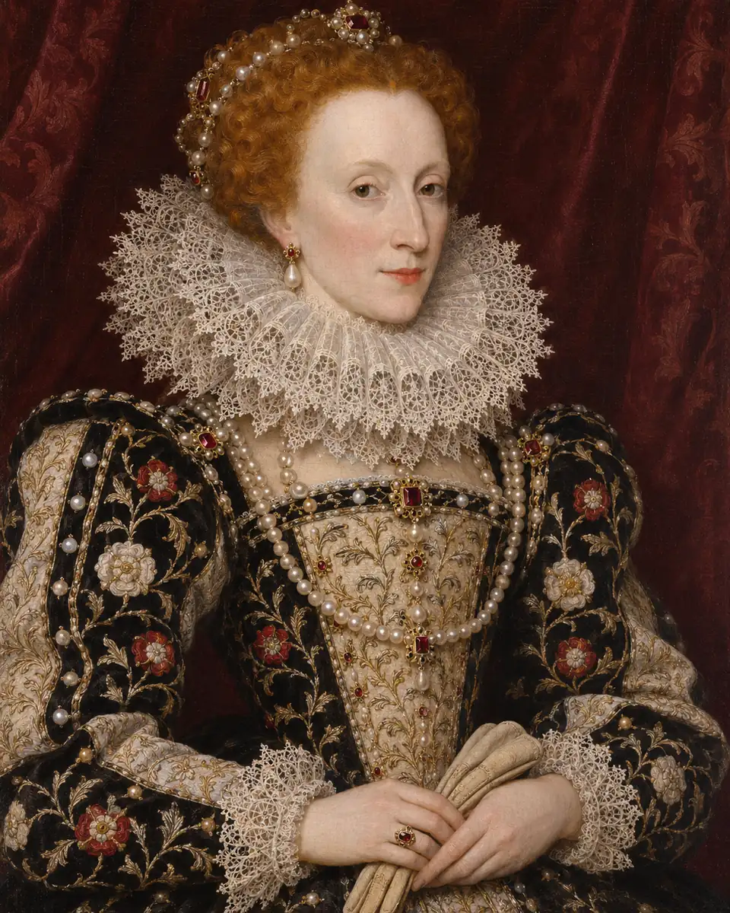
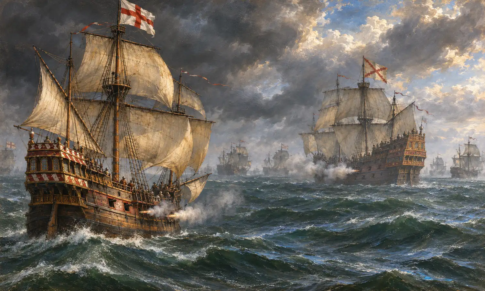
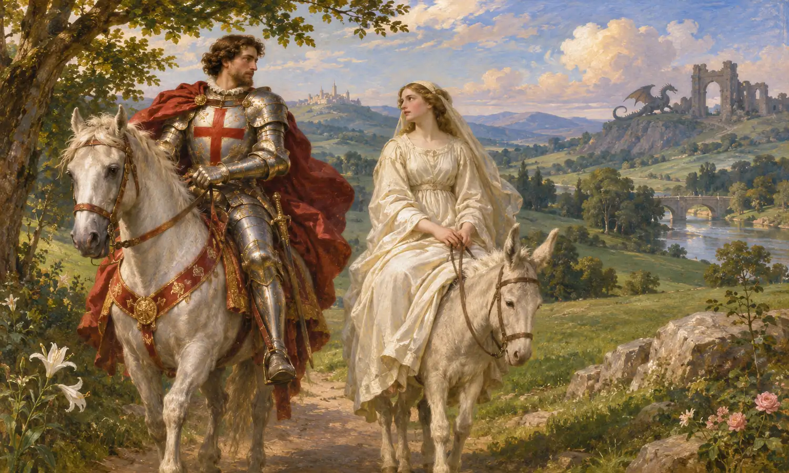
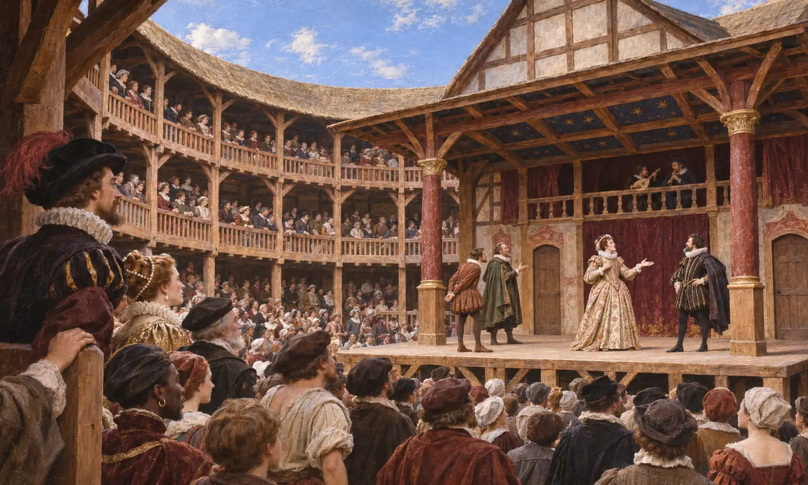
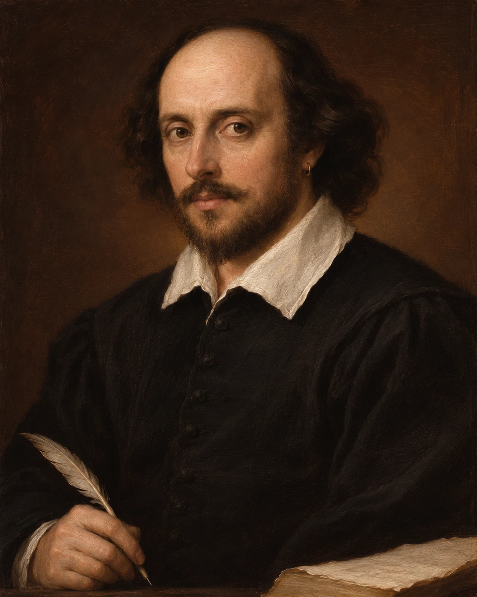

The early Tudors had helped make the English sonnet, blank verse and humanist prose possible. Under Elizabeth I, those resources reached new audiences. A poem could circulate among friends, a printed romance could travel beyond its writer's circle, and a play could bring many kinds of Londoner into one audience. This chapter begins where the earlier experiments become a broad literary culture. It is tempting to let Shakespeare fill the whole picture, but Sidney, Spenser, Kyd, Marlowe and many others made different contributions. Watch how each form works: a sonnet turns on a thought, an allegory gives an adventure another meaning, and a play makes words into action in front of an audience.

The reign of Elizabeth I saw English poetry and drama grow in range and public reach. This age inherited Tudor humanist education and the English lyric, then added a flourishing theatre and ambitious works in prose and verse.

## The world of this age

<figure class="article-illustration article-illustration--float article-illustration--left article-illustration--portrait" data-illustration="elizabeth-i">
  
  <figcaption>Elizabeth I — modern painted interpretation.</figcaption>
</figure>

Elizabeth I, the daughter of Anne Boleyn, became queen at twenty-five. She inherited a divided and nervous country and ruled it for forty-four years. She chose her advisers well, above all William Cecil, later Lord Burghley, and she never married, though princes from across Europe asked for her hand. Her single life became part of her public image as the Virgin Queen, and poems, portraits and pageants grew up around it.

Her dangers were real. In 1570 the Pope declared her excommunicated, which encouraged Catholic plots against her. Many of these plots gathered around her cousin Mary, Queen of Scots, a Catholic who had fled to England in 1568 and had a claim to the English crown. After long years in captivity Mary was executed in 1587. Philip II of Spain, who had once been Elizabeth's brother-in-law and was now her enemy, answered in 1588 by sending a great fleet, the Armada, to invade England. The English ships, helped by storms, drove it off. The victory did not make England a great power overnight, but it gave the country a new pride in itself, and writers soon made use of that pride.

English society was pictured as a ladder. At the top stood the monarch, then the great nobles, then the gentry who owned land and held local offices, then yeomen farmers, merchants and craftsmen, and at the bottom the labourers and the poor. People were taught that this order came from God. Thinkers liked to imagine it as a great chain reaching from God through angels, kings, men and animals down to plants and stones. Every link had its place, and to pull at one link was to shake all the rest. This idea, the Great Chain of Being, appears again and again in the plays and poems of the age, usually at moments when something has gone wrong in the order of things.

Life was changing all the same. The population grew, and many people moved from villages into towns, above all into London, which by 1600 was by far the largest city in the country. Schools spread too. Grammar schools, many of them founded or refounded under Henry VIII and Edward VI, taught boys Latin through Roman authors such as Cicero, Virgil and Ovid. Behind this teaching stood a movement called humanism. The humanists studied the ancient writers not only for their beauty but as guides to living well in this world, and they believed that education could make better citizens and better rulers. Their English leaders included Thomas Linacre, William Grocyn, Thomas More, and John Colet, who founded St Paul's School in London in 1509. The Dutch scholar Erasmus, the greatest humanist of the age, visited England several times and wrote his satire *In Praise of Folly* (1511) while staying in More's house.

Girls from rich families could be well taught. Elizabeth herself read several languages, and More made sure that his daughters learned Latin and Greek. Most girls, however, did not go to school, and the universities of Oxford and Cambridge took only men.

Not everyone shared in the new learning or the growing wealth. Many people were poor, and plague came back to London again and again. In 1601 Parliament passed a Poor Law that made each parish responsible for its own poor.

Merchants, meanwhile, grew rich and bold. Sir Thomas Gresham founded the Royal Exchange in London in the 1560s as a meeting place for traders. Joint-stock companies, in which many investors shared the cost and the risk, were formed to trade with distant lands: the Muscovy Company in 1555, and the East India Company, which received its charter in 1600. Sailors went further than ever before. Francis Drake sailed round the world between 1577 and 1580, and Sir Walter Raleigh sent settlers to Virginia in the 1580s. Richard Hakluyt gathered the sailors' accounts into a great book, *The Principal Navigations*, in 1589. People who had never left their parish now read about the Arctic, Africa and America, and the wider world began to appear in their literature.

Elizabeth wanted peace. Her Religious Settlement of 1559 made England officially Protestant but kept some of the old forms of worship, and the Prayer Book returned. It pleased most people but not all. Puritans wanted the Church purified of everything that seemed Catholic, while Catholics wanted the old faith back, and priests who came secretly to England from abroad were treated as traitors.

## The language

<figure class="article-illustration" data-illustration="armada">
  
  <figcaption>An imagined reconstruction of the Armada campaign, 1588.</figcaption>
</figure>

The English of 1500 was already far from the English of Chaucer, who had died a century earlier. A long change in the sound of vowels, called the Great Vowel Shift, had begun around 1400 and was now settling down, and the printing press was slowly fixing spelling. The language that scholars call Early Modern English was taking shape.

It was also a hungry language. Humanists and translators were bringing ideas from Latin, Greek, Italian and French into English, and English did not always have words for them. Writers borrowed freely, and some borrowed too freely. Critics mocked the showy new words as inkhorn terms, after the pots in which scholars kept their ink. Thomas Wilson, in *The Arte of Rhetorique* (1553), made fun of a letter stuffed with such words. Others defended plain English. Richard Mulcaster, a headmaster, wrote in *Elementarie* (1582) that he loved Rome but loved London better, and honoured Latin but worshipped English.

One small word shows how the language felt. English had two words for "you". *Thou* was used to children, close friends and people of lower rank, and *you* to superiors and strangers. A writer could show a change of feeling between two characters by a change from one word to the other.

## Readers, patrons and print

<figure class="article-illustration" data-illustration="faerie-queene">
  
  <figcaption>An imagined scene from The Faerie Queene: the Redcrosse Knight and Una.</figcaption>
</figure>

After Caxton, printers such as Wynkyn de Worde and Richard Pynson built up a book trade in London. The government watched it closely. In 1557 Mary I gave a royal charter to the Stationers' Company, and from then on only its members could print books, which made it easier for the crown to control what was published. Plays had to be approved by the Master of the Revels, an officer who read them for anything dangerous in politics or religion.

Writing was a poor way to earn a living. A poet who wanted money or protection looked for a patron, a rich noble who would accept a dedication and reward the writer. Shakespeare dedicated his first poems to the Earl of Southampton, and Spenser received a pension from the queen after *The Faerie Queene* appeared. Many gentlemen also thought it unbecoming to print their poems at all, so verses passed from hand to hand in manuscript. Few of Wyatt's poems were printed in his lifetime, and Sidney's best-known sonnets appeared only after his death.

## Poetry

<figure class="article-illustration" data-illustration="elizabethan-theatre">
  
  <figcaption>An imagined performance in an Elizabethan open-air playhouse.</figcaption>
</figure>

A fresh start came in 1579. Edmund Spenser, born in London around 1552 and educated at Cambridge, had joined the circle of the Earl of Leicester, where he met Sir Philip Sidney. In that year he published *The Shepheardes Calender*, twelve poems, one for each month, in which shepherds talk about love, poets and the Church. He signed it Immerito, which means "unworthy", and a friend who called himself E. K. added notes. Spenser used some deliberately old-fashioned words, and the book showed that English could handle many kinds of verse.

Sidney, meanwhile, was writing something new. Born in 1554 into a noble family, he was the model of a courtier: educated at Oxford, travelled in Europe, a favourite at Elizabeth's court. Around 1582 he wrote *Astrophil and Stella*, a sequence of 108 sonnets and eleven songs. Astrophil, whose name means "star-lover", adores Stella, "star", a lady who does not return his love, and readers have often linked her with Penelope Devereux. Sidney refused to copy Petrarch's stale phrases. In the first sonnet his Muse tells him to look in his heart and write. The sequence was printed in 1591, after his death, and began a craze for sonnets. Samuel Daniel's *Delia* followed in 1592, Spenser's *Amoretti* in 1595, and Shakespeare's sonnets circulated among his friends in the 1590s, though they were printed only in 1609.

Spenser himself had gone to Ireland in 1580 as secretary to the Lord Deputy, Lord Grey, and settled on land at Kilcolman. There he worked on a great poem for Elizabeth. In 1589 Sir Walter Raleigh visited him and urged him to bring it to London, and in 1590 the first three books of *The Faerie Queene* were printed, with three more in 1596. Spenser planned twelve books, each following a knight who stands for one virtue, but he finished only six. In the first, the Red Cross Knight, who stands for Holiness, travels with Una, who stands for Truth, to free her parents from a dragon. He is deceived on the way by the wizard Archimago and the false lady Duessa, and nearly loses himself before he wins. The poem is an allegory, a story in which characters and events stand for ideas, and the Faerie Queene, Gloriana, who sends the knights on their quests, stands for Elizabeth. Spenser invented a new nine-line stanza for it, now called the Spenserian stanza. In 1594 he married Elizabeth Boyle and wrote for her the sonnets of *Amoretti* and the wedding hymn *Epithalamion* (1595). In 1598 Irish rebels burned his castle, and he died in London in January 1599. He was buried in Westminster Abbey near Chaucer.

The plague of 1592 and 1593 closed the London theatres, and writers who depended on them found no work. A young playwright named William Shakespeare turned to poetry and in 1593 published *Venus and Adonis*, a story from Ovid about a goddess who loves a boy who rejects her, dedicated to the Earl of Southampton. *The Rape of Lucrece* followed in 1594. Short narrative poems on classical, usually love, themes were the fashion, and are called epyllia. Christopher Marlowe's *Hero and Leander*, left unfinished at his death and completed by George Chapman, is the finest of them. Marlowe also wrote a famous shepherd's love song, which Raleigh answered with a poem in the voice of the nymph, and both appeared in the anthology *England's Helicon* (1600).

## Drama

<figure class="article-illustration article-illustration--float article-illustration--portrait" data-illustration="shakespeare">
  
  <figcaption>William Shakespeare — modern painted interpretation.</figcaption>
</figure>

For plays to grow, players needed a home. Companies of actors had long travelled from town to town, acting in inn yards. A law of 1572 declared that wandering players without a noble patron would be treated as vagabonds, so companies took the names of great men: Leicester's Men, the Lord Admiral's Men, and from 1594 the Lord Chamberlain's Men. But the city authorities of London disliked plays, because crowds spread plague and caused trouble, and Puritan preachers said that plays taught sin. So the first playhouses were built just outside the city's control. In 1576 James Burbage built The Theatre at Shoreditch, north of the city. Others followed, including the Rose on the south bank of the Thames in 1587. In 1599 Burbage's sons and their company, with Shakespeare as one of the shareholders, took down the old Theatre and carried its timbers across the river to build the Globe.

The playhouse itself was simple. The Globe was open to the sky, with a stage that jutted into a yard where common people, the groundlings, stood for a penny. Wealthier people sat in covered galleries around the walls. Plays were acted in the afternoon by daylight with hardly any scenery, so the words had to paint the forest or the battlefield. Women did not act on the public stage, and boys played the women's parts.

The first great dramatists were young men from the universities, known as the University Wits: John Lyly, George Peele, Robert Greene, Thomas Nashe, Thomas Lodge and Christopher Marlowe. Thomas Kyd, who did not go to university, is often named with them. Lyly wrote witty comedies for the court. Greene wrote romantic comedies such as *Friar Bacon and Friar Bungay*, and in 1592, dying in poverty, he warned his fellow writers against an "upstart crow", usually taken to mean Shakespeare.

Kyd's *The Spanish Tragedy*, from the late 1580s, set the pattern for revenge tragedy. A father, Hieronimo, hunts for justice for his murdered son, goes half mad, and takes his revenge through a play staged within the play, while a ghost watches the whole action. Audiences loved it, and later writers, Shakespeare among them, borrowed its devices.

Marlowe changed what a play could sound like. He was born in Canterbury in 1564, the son of a shoemaker, and won a scholarship to Cambridge. His *Tamburlaine the Great* (about 1587) told how a shepherd from Central Asia became a world conqueror, and its proud, thundering blank verse showed what the form could do on the public stage. Ben Jonson later praised "Marlowe's mighty line". In *Doctor Faustus* a learned man, bored with ordinary knowledge, sells his soul to the devil for twenty-four years of power, and cannot repent when the time comes. The play borrows from the old morality plays, with its Good and Bad Angels, but its hero is a Renaissance man whose hunger for knowledge and power leads to his ruin. Marlowe also wrote *The Jew of Malta* and *Edward II*. In May 1593 the Privy Council questioned him, and ten days later he was stabbed to death in a quarrel at Deptford, aged twenty-nine.

William Shakespeare was born in 1564 in Stratford-upon-Avon, the son of a glove-maker and town official. He probably attended the local grammar school, and he married Anne Hathaway in 1582. By 1592 he was in London, working as an actor and writer. When the plague closed the theatres that year he wrote poems, and when they reopened he joined the Lord Chamberlain's Men in 1594, and stayed with the company for the rest of his career. He was actor, playwright and shareholder, so the company's success was his own. His early plays learned from Marlowe: the history plays *Henry VI* and *Richard III*, and the tragedy *Titus Andronicus*. Soon he showed a range that no other writer had, with comedies such as *The Comedy of Errors*, *A Midsummer Night's Dream* and *Twelfth Night*, the tragedy *Romeo and Juliet*, *Julius Caesar*, and, around 1600, *Hamlet*. For his histories he used the *Chronicles* of Raphael Holinshed (1577), and for *Julius Caesar* Thomas North's English version of Plutarch (1579). By 1598 Francis Meres could name twelve of his plays in print and rank him the best English writer of both comedy and tragedy. His greatest tragedies, however, belong to the next age.

Ben Jonson was a different kind of writer. A learned man who respected the rules of the ancients, he wrote *Every Man in His Humour* (1598), acted by Shakespeare's company with Shakespeare in the cast. It is a comedy of humours: each character is built around one dominant trait, which in the old medical theory came from too much of one of the four fluids of the body. In 1599 Thomas Dekker's *The Shoemaker's Holiday* gave London a cheerful comedy about ordinary tradesmen.

## Prose

History and travel also found readers. Raphael Holinshed's *Chronicles* (1577) told the story of England, Scotland and Ireland, and became a storehouse of plots for dramatists. Hakluyt's *The Principal Navigations* (1589) gathered the stories of sailors.

Prose fiction began in this age. John Lyly's *Euphues: The Anatomy of Wit* (1578) followed a young Athenian in a style packed with balanced phrases, wordplay and long comparisons, soon called euphuism. For a few years it was the fashion at court. Sidney's *Arcadia*, a long romance of princes, shepherds, disguises and wars, which he wrote for his sister Mary, Countess of Pembroke, was printed in 1590 and in a fuller form in 1593, and was read for a century. Robert Greene wrote romances such as *Pandosto* (1588), and exposed the tricks of London thieves in lively pamphlets. Thomas Nashe's *The Unfortunate Traveller* (1594), the adventures of a rogue named Jack Wilton, is often called the first English novel of roguery.

Prose was also a tool of argument. Richard Hooker's *Of the Laws of Ecclesiastical Polity* (1593) defended the Church of England in calm, stately prose. Under the name Martin Marprelate, Puritan writers secretly printed comic attacks on the bishops in 1588 and 1589. And in 1597 Francis Bacon published the first ten of his *Essays*, short and tightly packed pieces on the practical business of life.

English criticism began too. Stephen Gosson, a former playwright turned Puritan, attacked poets and actors in *The School of Abuse* (1579) and dedicated it to Sidney. Sidney's reply, *The Defence of Poesy*, written in the early 1580s and printed in 1595, argued that poetry teaches and delights, that the poet does not copy nature but makes a golden world where nature gives only a brazen one, and that poetry moves people towards virtue. George Puttenham's *The Arte of English Poesy* (1589) was a handbook for court poets on verse and figures of speech.

## Criticism and scholarship

The writers of the age also judged themselves. Sidney's *Defence of Poesy* and Puttenham's *Arte* (1589) are the first landmarks. In *Observations in the Art of English Poesy* (1602) Thomas Campion argued that English verse should be free of rhyme, and Samuel Daniel replied with a *Defence of Rhyme*.

In the twentieth century E. M. W. Tillyard, in *The Elizabethan World Picture* (1943), described the age as one that believed in order and in the Great Chain of Being. Later critics thought this picture too neat, since the plays and poems of the age often question order as much as they praise it. Harry Levin's *The Overreacher* (1952) studied Marlowe's heroes, who push beyond every limit. C. S. Lewis, in *English Literature in the Sixteenth Century, Excluding Drama* (1954), called the middle of the century "drab" and the end of it "golden". Stephen Greenblatt's *Renaissance Self-Fashioning* (1980) became a founding book of new historicism, showing how writers from More to Shakespeare shaped their identities under the pressures of court, Church and state. Jonathan Dollimore's *Radical Tragedy* (1984), a leading work of cultural materialism, argued that the tragedies of the age often questioned authority instead of supporting it.

## Literature in focus

### What belongs to this age?

Elizabeth I reigned from 1558 to 1603. The label refers to those years, whereas the English Renaissance is a wider cultural period. Shakespeare's career crosses the boundary: his early plays belong here, while works such as *Macbeth* belong to James I's reign. Dating the work is more reliable than attaching every work of a long career to one monarch.

### Poetry and performance

A sonnet sequence can build a continuing relationship through a series of separate poems. A play must create its scene through actors, speech, entrances and an audience's attention. Spenser's allegorical narrative works differently again: a person or journey can carry a moral meaning beyond the action. These distinctions help explain the range of Elizabethan literature without reducing the age to Shakespeare alone.

## Writers and works

| Writer | Years | Main works |
|---|---|---|
| Edmund Spenser | c. 1552-1599 | *The Shepheardes Calender*, *The Faerie Queene*, *Amoretti*, *Epithalamion* |
| Philip Sidney | 1554-1586 | *Astrophil and Stella*, *Arcadia*, *The Defence of Poesy* |
| John Lyly | c. 1554-1606 | *Euphues* (1578), *Campaspe* |
| Thomas Kyd | 1558-1594 | *The Spanish Tragedy* |
| Robert Greene | 1558-1592 | *Friar Bacon and Friar Bungay*, *Pandosto* |
| Francis Bacon | 1561-1626 | *Essays* (1597) |
| Christopher Marlowe | 1564-1593 | *Tamburlaine*, *Doctor Faustus*, *The Jew of Malta*, *Edward II*, *Hero and Leander* |
| William Shakespeare | 1564-1616 | *Venus and Adonis*, *Romeo and Juliet*, *Julius Caesar*, *Hamlet* |
| Thomas Nashe | 1567-c. 1601 | *The Unfortunate Traveller* (1594) |

## Key terms

- **Blank verse** - unrhymed lines of ten syllables, first used in English by Surrey and made dramatic by Marlowe.
- **Spenserian stanza** - the nine-line stanza invented by Spenser for *The Faerie Queene*.
- **Euphuism** - an ornate prose style of balanced phrases and wordplay, named after Lyly's *Euphues*.
- **Revenge tragedy** - a play in which a wronged person plans revenge, often helped or watched by a ghost.

## Important points to remember

- The timeline uses 1558–1603 for this chapter. Literary boundaries are approximate.
- Check the date of a work separately from its writer's lifetime.
- Read this chapter alongside the wider period guide when comparing neighbouring ages.

## Quick revision - 12 points

1. **English Protestant exiles** — They fled abroad during Mary's reign and worked in Geneva.
2. **1588** — The English ships, helped by storms, drove the Armada off in 1588.
3. **Twelve** — There is one poem for each month of the year.
4. **A craze for sonnet sequences** — Daniel, Spenser and others soon followed with sonnet sequences of their own.
5. **Nine** — Spenser invented the nine-line stanza for *The Faerie Queene*.
6. **Elizabeth I** — Gloriana sends the knights on their quests and stands for the queen.
7. ***Gorboduc*** — Sackville and Norton wrote it around 1561, on the pattern of Seneca.
8. **James Burbage** — Burbage built it just outside the city's control.
9. **Kyd** — Kyd's play set the pattern for revenge tragedy.
10. **John Lyly** — Its ornate style came to be called euphuism.
11. **Ten** — Bacon published the first ten in 1597.
12. **James VI of Scotland** — He was the son of Mary, Queen of Scots, and became James I.

## Quick quiz - 17 questions

Tap an answer to see at once if it is right. You do not need to log in.

**1. Who produced the Geneva Bible in 1560?**

- A) Scholars working for King James
- B) Roman priests
- C) English Protestant exiles
- D) Henry VIII's bishops

Answer: C. They fled abroad during Mary's reign and worked in Geneva.

**2. In which year was the Spanish Armada defeated?**

- A) 1570
- B) 1587
- C) 1603
- D) 1588

Answer: D. The English ships, helped by storms, drove the Armada off in 1588.

**3. How many poems are in Spenser's *The Shepheardes Calender*?**

- A) Twelve
- B) Nine
- C) Six
- D) Twenty-four

Answer: A. There is one poem for each month of the year.

**4. What did the printing of *Astrophil and Stella* in 1591 begin?**

- A) A fashion for blank-verse satire
- B) A fashion for pastoral plays
- C) A craze for sonnet sequences
- D) A fashion for prose romance

Answer: C. Daniel, Spenser and others soon followed with sonnet sequences of their own.

**5. How many lines are in a Spenserian stanza?**

- A) Eight
- B) Fourteen
- C) Twelve
- D) Nine

Answer: D. Spenser invented the nine-line stanza for *The Faerie Queene*.

**6. Whom does Gloriana, the Faerie Queene, stand for?**

- A) Elizabeth I
- B) Mary, Queen of Scots
- C) Anne Boleyn
- D) Catherine of Aragon

Answer: A. Gloriana sends the knights on their quests and stands for the queen.

**7. Which play is called the first English tragedy in blank verse?**

- A) *Doctor Faustus*
- B) *Tamburlaine*
- C) *The Spanish Tragedy*
- D) *Gorboduc*

Answer: D. Sackville and Norton wrote it around 1561, on the pattern of Seneca.

**8. Who built The Theatre at Shoreditch in 1576?**

- A) Philip Henslowe
- B) Edward Alleyn
- C) James Burbage
- D) Ben Jonson

Answer: C. Burbage built it just outside the city's control.

**9. Who wrote *The Spanish Tragedy*?**

- A) Marlowe
- B) Greene
- C) Kyd
- D) Peele

Answer: C. Kyd's play set the pattern for revenge tragedy.

**10. Who wrote *Euphues: The Anatomy of Wit* (1578)?**

- A) Robert Greene
- B) Thomas Nashe
- C) George Peele
- D) John Lyly

Answer: D. Its ornate style came to be called euphuism.

**11. How many essays were in the first edition of Bacon's *Essays* (1597)?**

- A) Ten
- B) Twenty
- C) Thirty
- D) Five

Answer: A. Bacon published the first ten in 1597.

**12. Who became king of England when Elizabeth I died in 1603?**

- A) Edward VI
- B) Philip II
- C) Charles I
- D) James VI of Scotland

Answer: D. He was the son of Mary, Queen of Scots, and became James I.

**13. How does a sonnet sequence differ from a single sonnet?**

- A) It develops meaning across a series of poems
- B) It is necessarily a prose novel
- C) It must contain only one line
- D) It cannot have a recurring speaker

Answer: A. The relation among poems contributes to a sequence's effect.

**14. What can allegory add to an adventure?**

- A) A compulsory modern setting
- B) A meaning beyond the literal action
- C) A guarantee that every event happened
- D) The removal of all characters

Answer: B. Spenser's narrative can work as both adventure and moral representation.

**15. Why should Shakespeare not be confined to Elizabeth's reign?**

- A) All his plays were written after 1660
- B) He wrote only medieval prose
- C) His career continued into the Jacobean years
- D) He died before 1558

Answer: C. The date of a particular work matters.

**16. What made the public theatre a distinctive literary setting?**

- A) Every reader had to own the script
- B) No actors were involved
- C) All plays were private letters
- D) Words became action before a paying audience

Answer: D. Performance links language with bodies, movement and audience response.

**17. Which group correctly represents different Elizabethan forms?**

- A) Spenser's allegory, Sidney's sonnets and Kyd's drama
- B) Only Victorian novels
- C) Only Old English elegies
- D) Only Georgian anthologies

Answer: A. The age has several major literary forms and writers.

## Frequently asked questions

**Does this chapter use exact historical boundaries?**
The dates are the timeline's study convention. Language, literary forms and writers' careers can cross them. Use the date of the particular work when a question asks about a narrower age.

**Where can I read the wider historical context?**
The [full period guide](/notes/renaissance/) contains the longer background. This chapter concentrates on the age named above and keeps its own revision and practice sections.

**Are these pictures historical documents?**
The artwork is illustrative. Captions identify representative or imagined scenes and modern painted interpretations; those images are not evidence that the pictured scene happened exactly as shown.

**How should I use the quiz?**
Read the explanations after answering. Questions about earlier events or later criticism are background questions, not claims that every named date falls inside the chapter's boundaries.

## Sources and further reading

The relevant background, text references and public practice material are retained from the [original renaissance guide](/notes/renaissance/#sources). Publication dates, authorship and period boundaries should be checked against the source editions listed there.

- [Shakespeare Birthplace Trust: Shakespeare and his works](https://www.shakespeare.org.uk/explore-shakespeare/shakespedia/shakespeares-plays/)

Afsar Khan, Ph.D. English
