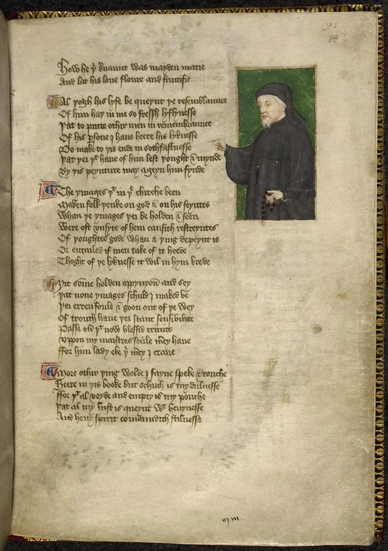

Chaucer's death did not leave English literature empty. It left later writers with a difficult and exciting inheritance: what could they do after such a powerful example? Some praised him, some borrowed his forms, and some returned to familiar stories with a different judgement. Meanwhile, religious writing, family letters and Arthurian prose continued to find readers. Near the end of the century, printing changed how a text could move through the world. Keep two images in mind as you read: a person copying a book by hand, and a printer making many copies from type. They belong to an overlapping culture. This chapter follows the movement from Chaucer's legacy toward the books and readers of the Tudor period.

Fifteenth-century English writing belongs between Chaucer's achievement and the Tudor literary world. Manuscripts still carried most texts, while Caxton's printing press at Westminster, established in 1476, changed how books could circulate near the century's end.

## The world of this age

<figure class="article-illustration" data-illustration="printing-press">
  
  <figcaption>A printing workshop in the age of Caxton.</figcaption>
</figure>

English society was built in layers. The king gave land to great lords, the lords gave land to knights, and each held it in return for service in war. At the bottom were the peasants, many of them villeins, who worked their lord's fields, paid dues in labour and goods, and could not leave the manor freely. In the towns, craftsmen and merchants joined guilds that controlled training, prices and quality.

The ideal man of the upper class was the knight: brave, loyal and polite. Stories about knights taught a code called **chivalry** and a fashion called **courtly love**, in which a knight served a noble lady with devotion, often from a distance. Most women worked on the land, in the home or in small trades, though a few, like the merchant's daughter Margery Kempe, travelled far on pilgrimage. The universities at Oxford and Cambridge took shape in this age and trained the clerks and priests who made up most of the educated class.

## The language

<figure class="article-illustration" data-illustration="pageant-play">
  
  <figcaption>A craft-guild mystery play on a pageant wagon.</figcaption>
</figure>

No other period changed English so fast. The old system of word endings, which Old English used to show who did what, wore away. Nouns lost their grammatical gender, and word order became much more fixed, with the subject first, then the verb, then the object, as it is today.

French poured into the vocabulary. Roughly ten thousand French words entered English in these centuries, among them *court*, *justice*, *prison*, *prayer* and *beauty*. Latin words arrived through the Church and the schools. The result was an English with a rich stock of near-synonyms, such as *kingly* (English), *royal* (French) and *regal* (Latin).

There was no standard language. Scholars usually describe five main dialects: Northern, East Midland, West Midland, Southern and Kentish. *Sir Gawain and the Green Knight* was written in a dialect of the north-west Midlands and *Piers Plowman* in the west Midlands. Chaucer wrote in the English of London, a form of East Midland.

## How writing reached readers

Print changed the picture. William Caxton, a London merchant who learned printing abroad, set up the first English press at Westminster in 1476 and printed more than a hundred titles. They included *The Canterbury Tales*, printed within a few years of the press opening, and Malory's *Le Morte d'Arthur*, finished on 31 July 1485.

Luck still mattered. In 1934 two famous finds were made. At Winchester College a teacher, Walter Oakeshott, found a manuscript of Malory that differed from Caxton's printed text. In the same year the only manuscript of *The Book of Margery Kempe* turned up in the home of the Butler-Bowdon family. It lay in a cupboard among old papers and the family's table-tennis equipment.

## Prose and Arthurian romance

The greatest English prose work of the period is *Le Morte d'Arthur* by Sir Thomas Malory. Its author says he finished it in prison about 1469 or 1470, and scholars still argue about which man named Malory he was. He gathered the Arthurian stories from French and English sources into eight long tales. They cover the rise of Arthur, the quest for the Holy Grail, the love of Lancelot and Guinevere, and the fall of the Round Table. Caxton printed the book in 1485 and cut it into twenty-one books and 507 chapters.

## Drama

English drama began in church. Short scenes about Easter and Christmas were acted as part of Latin services, and by the fourteenth century plays in English were being performed outdoors. The most important kind was the **mystery play**, a series of short plays on Bible history from the fall of the angels to the Last Judgment. These cycles were played in summer at the feast of Corpus Christi, on wagons called **pageants**, and each play was usually the work of a craft guild.

Four nearly complete cycles survive, from York, Chester, Wakefield and the group known as N-Town. The York cycle has 48 plays and was played from the mid-fourteenth century until 1569. The Wakefield, or Towneley, cycle has 32 plays, and its finest writer, called the Wakefield Master, is known for wit and satire. His *Second Shepherds' Play* shows a sheep thief, Mak, hiding a stolen lamb in a cradle as if it were a baby, before an angel announces the real birth of Christ.

The other great kind was the **morality play**, an allegory in which the hero stands for all mankind and is pulled between Vices and Virtues. *The Castle of Perseverance*, of about 1425, is the earliest surviving complete example, and *Mankind*, of about 1470, mixes sermon and comedy. The best known is *Everyman*. Death summons an ordinary man, his friend Fellowship refuses to go with him, and only Good Deeds will. It is generally taken to be a version of the Dutch play *Elckerlijc* of about 1495, and it reached print in English in the early sixteenth century.

## An interesting story

In 1490 William Caxton printed a book called *Eneydos* and added a short preface. In it he tells of some merchants sailing down the Thames towards Zeeland. With no wind, they waited, and went ashore at the Foreland to rest. One of them, a mercer named Sheffelde, went into a house and asked for food, and especially for "eggys". The woman of the house said she could speak no French. The merchant grew angry, for he spoke no French either and only wanted eggs. At last another man asked for "eyren", and she understood at once. Caxton ends with a worried question: should a printer write "egges" or "eyren"? One small word had shown him how much English changed from place to place.

## Criticism and scholarship

The finds of 1934 changed Malory studies. Eugène Vinaver edited the Winchester text in 1947. Later study of ink smudges on its pages showed that it had once been in Caxton's printing shop. For *Piers Plowman*, Lawrence Warner argued in 2011 that the C version began to circulate before the B version, so the usual A, B, C order of the poem's history may be wrong.

## Literature in focus

### Hoccleve, Lydgate and the Scottish writers

<figure class="article-illustration" data-sourced-image="chaucer">
  
  <figcaption>Chaucer in a manuscript associated with Thomas Hoccleve. <a href="https://commons.wikimedia.org/wiki/File:Chaucer_Hoccleve.png" target="_blank" rel="noopener">Source</a>. Public domain.</figcaption>
</figure>

Thomas Hoccleve and John Lydgate acknowledged Chaucer as an important predecessor. Their existence helps explain how his reputation continued through the fifteenth century. The label "Chaucerian" describes an influence or relationship; it does not make every later poet an exact imitator. A reader should ask what a later work does with the authority of an admired earlier writer.

Robert Henryson's *The Testament of Cresseid* revisits the story familiar from Chaucer's *Troilus and Criseyde*. The comparison raises questions about judgement, suffering and the fate of a character beyond an earlier narrative's ending. Scottish poetry belongs to its own linguistic and cultural setting, even when it responds to Chaucer.

### Private voices and public books

The *Paston Letters* preserve the concerns of a Norfolk family. Unlike an Arthurian romance, family correspondence can show the language of property, marriage, business and personal obligation. It should be read as correspondence written for particular purposes rather than as an invented plot. Margery Kempe's book gives another kind of personal voice, shaped around religious experience and recollection.

### Printing and survival

Caxton did not compose Malory's Arthurian narratives. He printed and organised a version of them. A manuscript witness and a printed edition can differ, so a title alone does not guarantee identical text. The Winchester manuscript is important because it lets readers compare a textual witness with Caxton's arrangement. The difference between author, copyist, printer and editor is essential to this period.

## After a great writer: inheritance becomes a question

What should a poet do when an admired predecessor seems to have said so much already? This question gives fifteenth-century poetry a human interest that the label Chaucerian can sometimes hide. Praising Chaucer is one response, but praise does not remove the need to write for a different setting. A later poet may borrow a form, continue a story or use an earlier writer's reputation to introduce another concern. Influence is a relationship, not a machine that produces identical poems.

Hoccleve and Lydgate belong in this discussion because they helped keep Chaucer's authority alive. To read them only as weaker copies would decide the question before reading the work. Ask instead what kind of poem is being written and what its audience needs. A poem offering counsel, a narrative revisiting history and a personal appeal may all make different uses of an inherited literary voice. The form should be understood through its purpose.

This is also a useful way to connect the century with the next age. Tudor writers did not receive Chaucer directly from a world in which nobody had read him since his death. His reputation continued through readers, writers, manuscripts and print. Literary history depends on that work of transmission. The person who preserves, imitates or prints an older work helps shape the future even when the result does not look like a dramatic new beginning.

## Henryson and the life of a character after Chaucer

The Testament of Cresseid makes an especially interesting bridge between literary inheritance and fresh judgement. It returns to a figure familiar from Chaucer's Troilus and Criseyde. Reading the later work beside the earlier one lets us ask what changes when a character's story is reopened. An ending that once seemed final can become the starting point for another writer's questions.

Before deciding that the later poem simply agrees with the earlier account, separate the voices involved. There is the earlier text, the later narrator, the character and the reader's own expectation. A revisiting of a story can expose how quickly readers judge someone whose circumstances they only partly understand. Notice which details encourage sympathy and which place responsibility on the character. The interest lies in the pressure between those responses.

The example also helps explain why literary boundaries cannot be drawn only around political kingdoms. Henryson writes in a Scottish setting and responds to material connected with Chaucer. The relationship crosses a cultural boundary while preserving its differences. For revision, remember both parts: there is a connection between the texts, but the later writer has his own language, audience and concerns.

## Malory: adventure held together by a troubled ideal

It is easy to remember Malory as a storehouse of Arthurian adventures. A richer approach asks what holds those adventures together. The ideal of a fellowship gives the stories a common centre, while rival loyalties and personal desires put that fellowship under strain. The pleasure of a quest therefore exists beside a larger question: can the world that makes the quest possible remain united?

Watch how a virtue can become difficult to practise. Loyalty to a companion may conflict with loyalty to a ruler; a private relationship may damage a public bond. When duties point in different directions, calling someone a good knight does not settle every decision. This tension makes the narrative more than a series of contests. The reader is drawn into judging conduct within a system whose ideals are both attractive and vulnerable.

The relation between individual adventure and the larger Arthurian story is important. A separate episode may give satisfaction through a victory or discovery. Yet the whole work can make that satisfaction less secure by showing a fellowship moving toward loss. When preparing an answer, connect a feature of the form with a feature of the theme. A gathering of stories can represent both the strength and the instability of a shared world.

Do not use the tales as direct evidence that the events of Arthur's world happened as narrated. They belong to a long literary tradition. Their historical importance lies partly in what later readers wanted from that tradition: models of conduct, exciting narratives and ways of thinking about loyalty and failure. The imagined past can reveal a period's values without being a factual record of that past.

## Caxton: why the printer matters

A printer is easy to treat as a name beside a date. In this chapter, try treating the printer as part of the reader's experience instead. A printed book needs a chosen text, an arrangement and an audience willing to read or buy it. Caxton's place in Malory's history therefore concerns more than the physical making of pages. His edition helped shape the form in which later readers encountered the Arthurian material.

The difference between the Winchester manuscript and the printed text makes this visible. A manuscript witness can allow a reader to question an arrangement that print has made familiar. Neither witness should be described as a simple window into an author's untouched intention. Texts have a history between composition and modern reading. An edition gives access to that history while also making choices of its own.

Caxton's story about different words for eggs is memorable because it turns a large language problem into an everyday encounter. A person asking for food can meet a difficulty that a printer faces on a much larger scale: which form of English will readers recognise? The anecdote does not mean that printing instantly created one national standard. It shows why choices about vocabulary and audience mattered in the first place.

## What a family letter can reveal

The Paston Letters offer a change of scale from Arthurian kingdoms. Here the reader meets the work of maintaining a family life: property, requests, obligations and relationships. Such documents can bring us close to practical concerns without turning into a modern diary of private feeling. A letter has a recipient and a purpose. Its writer may be trying to obtain help, explain conduct or manage a difficult situation.

When reading correspondence, ask what the writer wants the recipient to do. Then notice what is explained and what is taken for granted. Shared knowledge may remain unstated because the people involved already understand it. A modern reader must avoid filling those gaps with an invented story. The limits of a letter are part of its evidence, just as its words are.

The comparison with literary narrative is useful. A romance can organise events toward a designed effect, while a surviving sequence of letters may preserve the unevenness of daily needs. Both require interpretation, but they are different kinds of writing. Studying them together broadens our idea of literature's setting: the world of books includes households and business as well as courts, churches and the adventures of knights.

## Drama makes ideas visible

A morality play turns an inner conflict into action between characters. Instead of leaving the struggle between good and bad conduct entirely inside a person's mind, the form can put its pressures on stage. This makes abstraction visible. A name such as Good Deeds tells the audience how to understand a role, but performance still has to give that role a place in an unfolding encounter.

A mystery play works with a different kind of shared knowledge. Its biblical story may already be familiar, so surprise about the ending is not the only source of interest. Dialogue, action and the relation between serious purpose and everyday experience can make a known story vivid. The audience recognises a larger religious account while also watching particular people speak and act.

These forms help connect medieval drama with the later theatre without making them the same thing. The Elizabethan stage inherits ways of creating conflict, addressing an audience and showing a moral choice. It also develops within different institutions and conditions. The link is a continuing set of dramatic resources, not a claim that a morality play is already a Shakespearean tragedy.

## Moving toward the Tudor world

The century closes with several processes still in motion. Older works continue to be copied and read; printing offers another way to circulate them; writers return to Chaucer and Arthur while finding new purposes for familiar material. Nothing requires a reader to choose between complete continuity and complete change. The period is interesting because both are happening.

Carry that idea into the Early Tudor chapter. Classical learning and religious change will introduce fresh pressures, but those writers begin with an existing English reading culture. Their experiments make more sense when the fifteenth century is seen as a working bridge between literary worlds, full of readers and choices, rather than as a blank page between two famous names.

## The bridge works in both directions

Printing carries older writing forward, but it can also change how a past work is understood. A reader may begin to think of a particular arrangement as the work itself because that is the version most easily available. Manuscript evidence can then make a familiar book look newly complex. The period teaches us to ask how the text reached us before treating every feature of an edition as the author's final choice.

This question is useful beyond medieval study. Whenever we use a translated, selected or edited text, someone has helped organise the encounter. That fact does not make the encounter unreliable by definition. It makes editorial care important. A responsible edition explains its choices and gives readers a way to understand the evidence behind them. Caxton and the Winchester manuscript turn that general principle into a memorable example from this century.

## Key terms

- **Allegory** - a story in which characters and events stand for ideas, as in *Everyman*.
- **Mystery play** - a play on Bible history, performed by craft guilds at Corpus Christi.
- **Morality play** - an allegorical play about the soul of mankind, such as *Everyman*.

## Writers and works

| Writer | Works | What to remember |
|---|---|---|
| Thomas Hoccleve | The Regiment of Princes | Poetry after Chaucer |
| John Lydgate | The Siege of Thebes | A response to the Chaucerian storytelling tradition |

## Important points to remember

- The timeline uses 1400–1500 for this chapter. Literary boundaries are approximate.
- Check the date of a work separately from its writer's lifetime.
- Read this chapter alongside the wider period guide when comparing neighbouring ages.

## Quick revision - 10 points

1. **Bosworth Field** — Henry Tudor won at Bosworth Field and became Henry VII.
2. **In a cupboard in the Butler-Bowdon family home** — It lay among old papers and the family's table-tennis equipment.
3. **William Caxton** — Caxton printed more than a hundred titles.
4. **1485** — The book was finished on 31 July 1485.
5. **The Winchester Manuscript** — It has eight long tales, while Caxton cut the work into twenty-one books.
6. **The Second Shepherds' Play** — The thief is Mak, and the play belongs to the Wakefield cycle.
7. **A morality play** — Death summons an ordinary man, and only Good Deeds goes with him.
8. **A collection of family correspondence** — They preserve family, business and property concerns.
9. **Robert Henryson** — Henryson revisits a story familiar from Chaucer.
10. **Malory was the author and Caxton the printer** — The author and printer played different roles in the book’s history.

## Quick quiz - 15 questions

Tap an answer to see at once if it is right. You do not need to log in.

**1. Where was Richard III killed in 1485?**

- A) Bosworth Field
- B) Agincourt
- C) Smithfield
- D) Hastings

Answer: A. Henry Tudor won at Bosworth Field and became Henry VII.

**2. Where was the only manuscript of The Book of Margery Kempe found in 1934?**

- A) In the library of Winchester College
- B) In Exeter Cathedral
- C) In a cupboard in the Butler-Bowdon family home
- D) In a monastery in Italy

Answer: C. It lay among old papers and the family's table-tennis equipment.

**3. Who set up the first printing press in England, at Westminster, in 1476?**

- A) Wynkyn de Worde
- B) William Caxton
- C) Robert Crowley
- D) Thomas Malory

Answer: B. Caxton printed more than a hundred titles.

**4. In which year did Caxton print Malory's Le Morte d'Arthur?**

- A) 1450
- B) 1471
- C) 1476
- D) 1485

Answer: D. The book was finished on 31 July 1485.

**5. Which manuscript, found at Winchester College in 1934, differs from Caxton's printed Malory?**

- A) The Winchester Manuscript
- B) The Auchinleck Manuscript
- C) The Ellesmere Manuscript
- D) The Beowulf Manuscript

Answer: A. It has eight long tales, while Caxton cut the work into twenty-one books.

**6. In which play does a thief hide a stolen sheep in a cradle?**

- A) Everyman
- B) Mankind
- C) The Second Shepherds' Play
- D) The Castle of Perseverance

Answer: C. The thief is Mak, and the play belongs to the Wakefield cycle.

**7. What kind of play is Everyman?**

- A) A mystery play
- B) A chronicle play
- C) A revenge tragedy
- D) A morality play

Answer: D. Death summons an ordinary man, and only Good Deeds goes with him.

**8. What are the Paston Letters?**

- A) A sonnet sequence
- B) A revenge tragedy
- C) An epic in Latin
- D) A collection of family correspondence

Answer: D. They preserve family, business and property concerns.

**9. Who wrote The Testament of Cresseid?**

- A) Robert Henryson
- B) William Caxton
- C) John Milton
- D) Alexander Pope

Answer: A. Henryson revisits a story familiar from Chaucer.

**10. Which distinction is essential when studying Caxton and Malory?**

- A) Malory invented movable type
- B) Malory was the author and Caxton the printer
- C) They were the same person
- D) Caxton wrote all the tales

Answer: B. The author and printer played different roles in the book’s history.

**11. What does calling a poet Chaucerian usually indicate?**

- A) That the poem was printed by Chaucer
- B) That every line was copied unchanged
- C) A relationship of literary influence
- D) That the poet was Chaucer himself

Answer: C. An influence can be adapted to another purpose.

**12. Why compare the Winchester manuscript with Caxton's Malory?**

- A) To prove they are the same physical object
- B) To show Malory invented printing
- C) To turn romance into verified military history
- D) To examine differences between textual witnesses

Answer: D. The manuscript and the printed edition help reveal the text's history.

**13. What should be asked first when reading a family letter?**

- A) Who is addressed and what does the writer want?
- B) Which epic hero speaks?
- C) Why is every statement fictional?
- D) Which sonnet scheme is compulsory?

Answer: A. Correspondence is written for a particular situation and purpose.

**14. What does a morality play often make visible?**

- A) Only a royal genealogy
- B) A struggle involving conduct, virtues and vices
- C) Only an exact record of a battle
- D) Only a printing workshop

Answer: B. Abstract moral pressures can become characters and action.

**15. What best describes the relation between manuscript and early print culture?**

- A) Print preceded all manuscripts
- B) They had no readers in common
- C) They overlapped
- D) Every manuscript vanished in 1476

Answer: C. New technology did not immediately end older ways of making books.

## Frequently asked questions

**Does this chapter use exact historical boundaries?**
The dates are the timeline's study convention. Language, literary forms and writers' careers can cross them. Use the date of the particular work when a question asks about a narrower age.

**Where can I read the wider historical context?**
The [full period guide](/notes/middle-english/) contains the longer background. This chapter concentrates on the age named above and keeps its own revision and practice sections.

**Are these pictures historical documents?**
The artwork is illustrative. Captions identify representative or imagined scenes and modern painted interpretations; those images are not evidence that the pictured scene happened exactly as shown.

**How should I use the quiz?**
Read the explanations after answering. Questions about earlier events or later criticism are background questions, not claims that every named date falls inside the chapter's boundaries.

## Sources and further reading

The relevant background, text references and public practice material are retained from the [original middle english guide](/notes/middle-english/#sources). Publication dates, authorship and period boundaries should be checked against the source editions listed there.

- [Folger manuscript catalogue: the Malory manuscript](https://celm.folger.edu/repositories/british-library-additional-55000.html)

Afsar Khan, Ph.D. English
