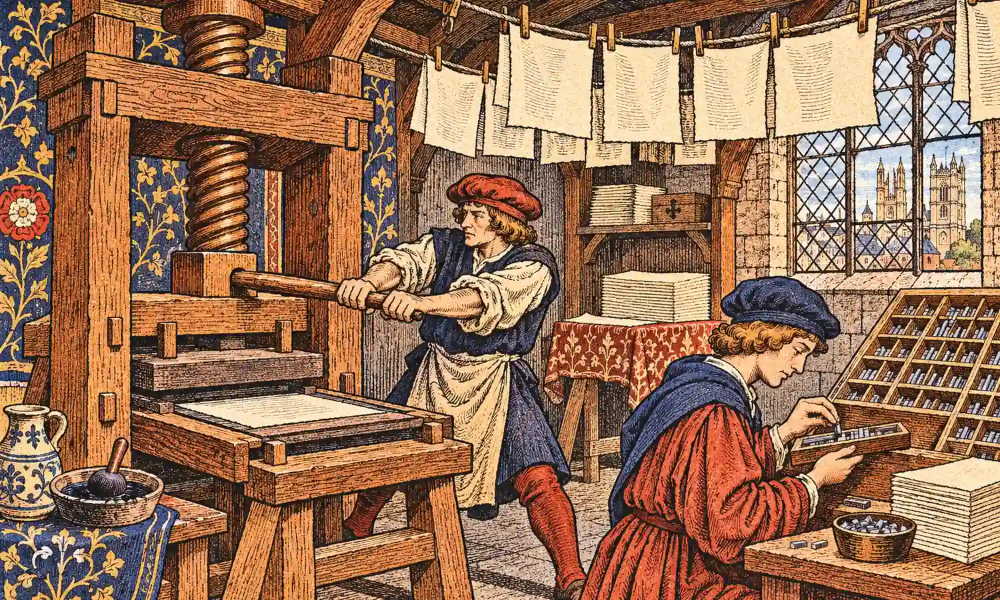
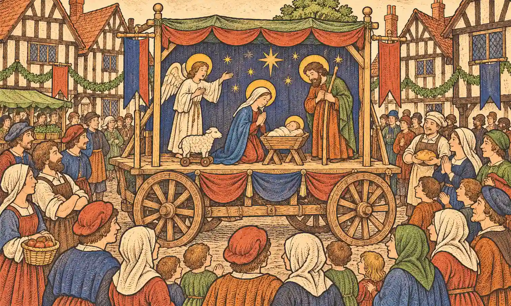

Fifteenth-century English writing belongs between Chaucer's achievement and the Tudor literary world. Manuscripts still carried most texts, while Caxton's printing press at Westminster, established in 1476, changed how books could circulate near the century's end.

## The world of this age

<figure class="article-illustration" data-illustration="printing-press">
  
  <figcaption>A printing workshop in the age of Caxton.</figcaption>
</figure>

English society was built in layers. The king gave land to great lords, the lords gave land to knights, and each held it in return for service in war. At the bottom were the peasants, many of them villeins, who worked their lord's fields, paid dues in labour and goods, and could not leave the manor freely. In the towns, craftsmen and merchants joined guilds that controlled training, prices and quality.

The ideal man of the upper class was the knight: brave, loyal and polite. Stories about knights taught a code called **chivalry** and a fashion called **courtly love**, in which a knight served a noble lady with devotion, often from a distance. Most women worked on the land, in the home or in small trades, though a few, like the merchant's daughter Margery Kempe, travelled far on pilgrimage. The universities at Oxford and Cambridge took shape in this age and trained the clerks and priests who made up most of the educated class.

## The language

<figure class="article-illustration" data-illustration="pageant-play">
  
  <figcaption>A craft-guild mystery play on a pageant wagon.</figcaption>
</figure>

No other period changed English so fast. The old system of word endings, which Old English used to show who did what, wore away. Nouns lost their grammatical gender, and word order became much more fixed, with the subject first, then the verb, then the object, as it is today.

French poured into the vocabulary. Roughly ten thousand French words entered English in these centuries, among them *court*, *justice*, *prison*, *prayer* and *beauty*. Latin words arrived through the Church and the schools. The result was an English with a rich stock of near-synonyms, such as *kingly* (English), *royal* (French) and *regal* (Latin).

There was no standard language. Scholars usually describe five main dialects: Northern, East Midland, West Midland, Southern and Kentish. *Sir Gawain and the Green Knight* was written in a dialect of the north-west Midlands and *Piers Plowman* in the west Midlands. Chaucer wrote in the English of London, a form of East Midland.

## How writing reached readers

Print changed the picture. William Caxton, a London merchant who learned printing abroad, set up the first English press at Westminster in 1476 and printed more than a hundred titles. They included *The Canterbury Tales*, printed within a few years of the press opening, and Malory's *Le Morte d'Arthur*, finished on 31 July 1485.

Luck still mattered. In 1934 two famous finds were made. At Winchester College a teacher, Walter Oakeshott, found a manuscript of Malory that differed from Caxton's printed text. In the same year the only manuscript of *The Book of Margery Kempe* turned up in the home of the Butler-Bowdon family. It lay in a cupboard among old papers and the family's table-tennis equipment.

## Prose and Arthurian romance

The greatest English prose work of the period is *Le Morte d'Arthur* by Sir Thomas Malory. Its author says he finished it in prison about 1469 or 1470, and scholars still argue about which man named Malory he was. He gathered the Arthurian stories from French and English sources into eight long tales. They cover the rise of Arthur, the quest for the Holy Grail, the love of Lancelot and Guinevere, and the fall of the Round Table. Caxton printed the book in 1485 and cut it into twenty-one books and 507 chapters.

## Drama

English drama began in church. Short scenes about Easter and Christmas were acted as part of Latin services, and by the fourteenth century plays in English were being performed outdoors. The most important kind was the **mystery play**, a series of short plays on Bible history from the fall of the angels to the Last Judgment. These cycles were played in summer at the feast of Corpus Christi, on wagons called **pageants**, and each play was usually the work of a craft guild.

Four nearly complete cycles survive, from York, Chester, Wakefield and the group known as N-Town. The York cycle has 48 plays and was played from the mid-fourteenth century until 1569. The Wakefield, or Towneley, cycle has 32 plays, and its finest writer, called the Wakefield Master, is known for wit and satire. His *Second Shepherds' Play* shows a sheep thief, Mak, hiding a stolen lamb in a cradle as if it were a baby, before an angel announces the real birth of Christ.

The other great kind was the **morality play**, an allegory in which the hero stands for all mankind and is pulled between Vices and Virtues. *The Castle of Perseverance*, of about 1425, is the earliest surviving complete example, and *Mankind*, of about 1470, mixes sermon and comedy. The best known is *Everyman*. Death summons an ordinary man, his friend Fellowship refuses to go with him, and only Good Deeds will. It is generally taken to be a version of the Dutch play *Elckerlijc* of about 1495, and it reached print in English in the early sixteenth century.

## An interesting story

In 1490 William Caxton printed a book called *Eneydos* and added a short preface. In it he tells of some merchants sailing down the Thames towards Zeeland. With no wind, they waited, and went ashore at the Foreland to rest. One of them, a mercer named Sheffelde, went into a house and asked for food, and especially for "eggys". The woman of the house said she could speak no French. The merchant grew angry, for he spoke no French either and only wanted eggs. At last another man asked for "eyren", and she understood at once. Caxton ends with a worried question: should a printer write "egges" or "eyren"? One small word had shown him how much English changed from place to place.

## Criticism and scholarship

The finds of 1934 changed Malory studies. Eugène Vinaver edited the Winchester text in 1947. Later study of ink smudges on its pages showed that it had once been in Caxton's printing shop. For *Piers Plowman*, Lawrence Warner argued in 2011 that the C version began to circulate before the B version, so the usual A, B, C order of the poem's history may be wrong.

## Literature in focus

### Hoccleve, Lydgate and the Scottish writers

Thomas Hoccleve and John Lydgate acknowledged Chaucer as an important predecessor. Their existence helps explain how his reputation continued through the fifteenth century. The label "Chaucerian" describes an influence or relationship; it does not make every later poet an exact imitator. A reader should ask what a later work does with the authority of an admired earlier writer.

Robert Henryson's *The Testament of Cresseid* revisits the story familiar from Chaucer's *Troilus and Criseyde*. The comparison raises questions about judgement, suffering and the fate of a character beyond an earlier narrative's ending. Scottish poetry belongs to its own linguistic and cultural setting, even when it responds to Chaucer.

### Private voices and public books

The *Paston Letters* preserve the concerns of a Norfolk family. Unlike an Arthurian romance, family correspondence can show the language of property, marriage, business and personal obligation. It should be read as correspondence written for particular purposes rather than as an invented plot. Margery Kempe's book gives another kind of personal voice, shaped around religious experience and recollection.

### Printing and survival

Caxton did not compose Malory's Arthurian narratives. He printed and organised a version of them. A manuscript witness and a printed edition can differ, so a title alone does not guarantee identical text. The Winchester manuscript is important because it lets readers compare a textual witness with Caxton's arrangement. The difference between author, copyist, printer and editor is essential to this period.

## Key terms

- **Allegory** - a story in which characters and events stand for ideas, as in *Everyman*.
- **Mystery play** - a play on Bible history, performed by craft guilds at Corpus Christi.
- **Morality play** - an allegorical play about the soul of mankind, such as *Everyman*.

## Writers and works

| Writer | Works | What to remember |
|---|---|---|
| Thomas Hoccleve | The Regiment of Princes | Poetry after Chaucer |
| John Lydgate | The Siege of Thebes | A response to the Chaucerian storytelling tradition |

## Important points to remember

- The timeline uses 1400–1500 for this chapter. Literary boundaries are approximate.
- Check the date of a work separately from its writer's lifetime.
- Read this chapter alongside the wider period guide when comparing neighbouring ages.

## Quick revision - 10 points

1. **Bosworth Field** — Henry Tudor won at Bosworth Field and became Henry VII.
2. **In a cupboard in the Butler-Bowdon family home** — It lay among old papers and the family's table-tennis equipment.
3. **William Caxton** — Caxton printed more than a hundred titles.
4. **1485** — The book was finished on 31 July 1485.
5. **The Winchester Manuscript** — It has eight long tales, while Caxton cut the work into twenty-one books.
6. **The Second Shepherds' Play** — The thief is Mak, and the play belongs to the Wakefield cycle.
7. **A morality play** — Death summons an ordinary man, and only Good Deeds goes with him.
8. **A collection of family correspondence** — They preserve family, business and property concerns.
9. **Robert Henryson** — Henryson revisits a story familiar from Chaucer.
10. **Malory was the author and Caxton the printer** — The author and printer played different roles in the book’s history.

## Quick quiz - 10 questions

Tap an answer to see at once if it is right. You do not need to log in.

**1. Where was Richard III killed in 1485?**

- A) Bosworth Field
- B) Agincourt
- C) Smithfield
- D) Hastings

Answer: A. Henry Tudor won at Bosworth Field and became Henry VII.

**2. Where was the only manuscript of The Book of Margery Kempe found in 1934?**

- A) In the library of Winchester College
- B) In Exeter Cathedral
- C) In a cupboard in the Butler-Bowdon family home
- D) In a monastery in Italy

Answer: C. It lay among old papers and the family's table-tennis equipment.

**3. Who set up the first printing press in England, at Westminster, in 1476?**

- A) Wynkyn de Worde
- B) William Caxton
- C) Robert Crowley
- D) Thomas Malory

Answer: B. Caxton printed more than a hundred titles.

**4. In which year did Caxton print Malory's Le Morte d'Arthur?**

- A) 1450
- B) 1471
- C) 1476
- D) 1485

Answer: D. The book was finished on 31 July 1485.

**5. Which manuscript, found at Winchester College in 1934, differs from Caxton's printed Malory?**

- A) The Winchester Manuscript
- B) The Auchinleck Manuscript
- C) The Ellesmere Manuscript
- D) The Beowulf Manuscript

Answer: A. It has eight long tales, while Caxton cut the work into twenty-one books.

**6. In which play does a thief hide a stolen sheep in a cradle?**

- A) Everyman
- B) Mankind
- C) The Second Shepherds' Play
- D) The Castle of Perseverance

Answer: C. The thief is Mak, and the play belongs to the Wakefield cycle.

**7. What kind of play is Everyman?**

- A) A mystery play
- B) A chronicle play
- C) A revenge tragedy
- D) A morality play

Answer: D. Death summons an ordinary man, and only Good Deeds goes with him.

**8. What are the Paston Letters?**

- A) A sonnet sequence
- B) A revenge tragedy
- C) An epic in Latin
- D) A collection of family correspondence

Answer: D. They preserve family, business and property concerns.

**9. Who wrote The Testament of Cresseid?**

- A) Robert Henryson
- B) William Caxton
- C) John Milton
- D) Alexander Pope

Answer: A. Henryson revisits a story familiar from Chaucer.

**10. Which distinction is essential when studying Caxton and Malory?**

- A) Malory invented movable type
- B) Malory was the author and Caxton the printer
- C) They were the same person
- D) Caxton wrote all the tales

Answer: B. The author and printer played different roles in the book’s history.

## Frequently asked questions

**Does this chapter use exact historical boundaries?**
The dates are the timeline's study convention. Language, literary forms and writers' careers can cross them. Use the date of the particular work when a question asks about a narrower age.

**Where can I read the wider historical context?**
The [full period guide](/notes/middle-english/) contains the longer background. This chapter concentrates on the age named above and keeps its own revision and practice sections.

**Are these pictures historical documents?**
The artwork is illustrative. Captions identify representative or imagined scenes and modern painted interpretations; those images are not evidence that the pictured scene happened exactly as shown.

**How should I use the quiz?**
Read the explanations after answering. Questions about earlier events or later criticism are background questions, not claims that every named date falls inside the chapter's boundaries.

## Sources and further reading

The relevant background, text references and public practice material are retained from the [original middle english guide](/notes/middle-english/#sources). Publication dates, authorship and period boundaries should be checked against the source editions listed there.

- [Folger manuscript catalogue: the Malory manuscript](https://celm.folger.edu/repositories/british-library-additional-55000.html)

Afsar Khan, Ph.D. English
