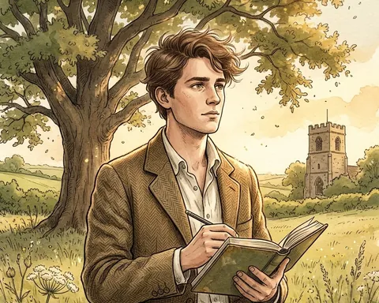

The Edwardian years had already made writers question the life beneath a comfortable surface. In poetry, the new reign of George V encouraged another language of beginnings. Edward Marsh's Georgian anthologies offered readers a selection of recent work, bringing different poetic voices into one book. This chapter follows that publishing connection without pretending that every contributor shared one style. A mysterious house in de la Mare, a remembered place in Brooke and an observed bird in Davies ask for different kinds of attention. The First World War adds another pressure, while Modernism develops beside them. Read the Georgian writers as participants in that crowded present, rather than as a quiet pause before Eliot arrived.

On this timeline, "Georgian" names a literary grouping that overlaps the late Edwardian years and the rise of Modernism. It is especially associated with the *Georgian Poetry* anthologies, first issued in 1912, rather than with a sharply bounded political reign.

## The world of this age

<figure class="article-illustration">
  
  <figcaption>Illustrative artwork for Georgian poetry; a modern interpretation.</figcaption>
</figure>

All of this was pushed aside on 4 August 1914. Germany had invaded Belgium, a country whose independence Britain had promised to protect, and Britain declared war. Many expected a short war, but armies dug long lines of trenches across France and Belgium, and it became a slow, grinding slaughter. On the first day of the Battle of the Somme, 1 July 1916, nearly 20,000 British soldiers were killed. The Armistice came on 11 November 1918.

Peace brought changes at home. The Representation of the People Act of 1918 gave the vote to almost all men over twenty-one and to women over thirty who met certain conditions. In 1928 women won the vote on the same terms as men.

Radio changed habits too. In 1922 the British Broadcasting Company began its programmes, and in 1927 it became the public British Broadcasting Corporation, so that families could hear news, music and plays at home.

## Poetry and the anthology

Poetry at the start of the century still looked back to the Victorians. In 1912 the editor Edward Marsh began to gather new verse into the anthology *Georgian Poetry*, named for the new king, George V. Poets such as Walter de la Mare, John Masefield, W. H. Davies and Rupert Brooke wrote of fields, villages and gentle feeling in clear, easy language. When war came, Brooke's sonnets of 1914 spoke of dying for England as a noble gift. He died of blood poisoning on 23 April 1915, on his way to Gallipoli, and was buried on the Greek island of Skyros.

## The war and changes in poetry

The war produced its own poetry. At first, many war poems were patriotic. As the fighting dragged on, soldiers began to write what they actually saw. Siegfried Sassoon, an officer awarded the Military Cross for bravery, wrote bitter poems about the trenches, and in 1917 he publicly protested against the way the war was being prolonged. Instead of punishing him, the army sent him to Craiglockhart War Hospital near Edinburgh, where he met a younger officer, Wilfred Owen.

With Sassoon's encouragement, Owen wrote poems about gas, mud and the death of young men, among them "Dulce et Decorum Est". Owen returned to the front and was killed on 4 November 1918, a week before the Armistice. Only a handful of his poems had been printed in his lifetime, and Sassoon helped bring out a collection in 1920.

## Other writing in the same years

Experimental writers had a problem, since ordinary publishers wanted books that would sell. New work therefore often began in small magazines with small circles of readers. Harriet Monroe founded *Poetry* in Chicago in 1912, and it printed Ezra Pound, T. S. Eliot and many others. In 1922 Eliot began *The Criterion*, which he edited until 1939.

Virginia Woolf and her husband Leonard bought a small hand printing press, and in 1917 they began the Hogarth Press in their home at Richmond. Fear of the law also shaped what appeared. D. H. Lawrence's *The Rainbow* was seized by the police and ordered destroyed in 1915. At the other end of the market, cheap books arrived. Allen Lane launched the first Penguin paperbacks in 1935 at sixpence each, so that good books could be bought by people who had never owned many.

## Literature in focus

### What the Georgian label means here

The timeline uses 1910–1936, the reign of George V, as a broad date frame. Georgian poetry has a narrower publishing history: Edward Marsh edited a series of *Georgian Poetry* anthologies beginning with the 1911–1912 volume, issued in 1912. The anthology movement and the whole reign are therefore not interchangeable.

### Read the anthology, not a stereotype

The first volume contains work by Rupert Brooke, Walter de la Mare, John Masefield, W. H. Davies and D. H. Lawrence, among others. Its preface presents the collection as a selection of recent writing rather than a complete survey of English poetry. This makes the anthology a useful primary source for checking membership. A poet's inclusion does not establish that every work he wrote follows one shared programme.

### Rupert Brooke

Brooke's reputation became closely tied to his war sonnets, especially "The Soldier". His earlier "The Old Vicarage, Grantchester" belongs to the first Georgian anthology. Comparing the two helps separate the poet's pre-war voice from his later public reputation. His idealising treatment of sacrifice differs from the trench poetry associated with Owen and Sassoon. The difference is an invitation to compare particular poems, not to assume that every wartime response was the same.

### Walter de la Mare

De la Mare's "The Listeners" is included in the first anthology. A traveller addresses a silent house, and the poem builds its effect from sound, suspense and the unanswered call. It is useful to notice how an apparently simple narrative can leave its central mystery unresolved. Georgian poetry is not adequately described as cheerful countryside verse when a poem like this places absence and uncertainty at its centre.

### John Masefield

Masefield's "Biography" is represented in the anthology, while sea poetry is another important part of his reputation. His work can be approached through its spoken rhythms and interest in journeys and experience. He became Poet Laureate in 1930. That public appointment falls within the timeline's wider date frame but long after the first anthology; it should not be mistaken for the beginning of the Georgian movement.

### W. H. Davies

Davies's poems in the first anthology include "The Kingfisher" and "Days too Short". He is also known for "Leisure" and the memoir *The Autobiography of a Super-Tramp*. A life that included poverty and travel complicates any assumption that all Georgian poets spoke from the same comfortable social position. The poems should be read for their exact observations, not as illustrations of one biographical label.

### Form and the reader

Lyric, narrative, rhyme and regular rhythm remain useful terms for studying this writing. For each poem, ask who speaks, what is observed, and what the ending changes. A familiar metre does not guarantee a simple emotional effect. Conversely, a poem can be direct and accessible without being artistically careless. These are questions for close reading rather than rules that every member must obey.

### Georgian and Modernist writing overlap

The same decades include Imagism, Eliot and the experimental novel. Georgian writing did not have to disappear before Modernism could exist. Compare de la Mare's narrative suspense with a Modernist poem's shifting voices, then explain what each method makes the reader do. The anthology category is most helpful when it makes those differences visible instead of turning literary history into a row of sealed boxes.

## Opening an anthology is different from opening a manifesto

An anthology gathers work into one place. A manifesto announces a position or programme. A reader should not assume that a collection automatically does both. Marsh's Georgian Poetry offers a selection of recent writing, and the variety of the contents matters. The shared cover creates a connection among contributors without making every poem an example of one rule.

This distinction gives us a practical way of reading the collection. Start with the contents page and choose two writers. Read their poems separately before deciding what they share. They may use different speakers, subjects and ways of ending. An account of Georgian poetry should be able to explain those differences as well as the group identity. Otherwise the label begins to hide the very writing it is supposed to introduce.

The selection also has limits. A collection cannot stand for every poem written during a reign. Its omissions do not prove that the missing writers were unimportant, and its inclusions do not make all later work by a contributor Georgian in the same sense. The anthology is evidence of an act of selection. That makes the editor part of the literary story, alongside the poets and their readers.

## Brooke: a place remembered and a place imagined

A poem about a place can do more than describe a landscape. It may connect a location with memory, belonging or a desired way of life. Brooke's association with Grantchester gives a useful starting point for this question. Ask whether the place matters mainly as something seen, something remembered or something valued from a distance. Each relation changes the emotional work of the description.

Remembering is selective. A poem can make a place meaningful by gathering some details and leaving others outside the frame. The reader does not have to accuse the speaker of dishonesty to notice that selection. The important question is what kind of home the poem constructs. Is the setting a real difficulty, a refuge from difficulty or a measure against which the present is judged?

This prepares a careful comparison with The Soldier. There, the imagined relation between an English self and a foreign place makes belonging central to the sonnet's argument. The familiar connection between land and identity is placed under the pressure of possible death. A reader can explain the strength of that feeling while also asking what the poem leaves unexamined. Interpretation need not choose between praise without questions and rejection without reading.

## De la Mare: listening to what does not answer

The Listeners gives the reader a traveller, a house and a call that is not answered in the ordinary way. Its suspense does not depend on a long explanation of a hidden history. Instead, the poem makes sound and silence part of the event. Something has been said; something appears to be heard; a satisfying reply remains absent. The reader is made to listen as well as follow a movement.

Notice the difference between a mystery and a puzzle with a supplied solution. A puzzle promises that the missing information can eventually be assembled into a clear answer. A poem may preserve uncertainty because uncertainty is part of its effect. To invent a definite account of who the listeners are would remove something the poem deliberately leaves open. A good reading explains how the unanswered question works.

The traveller's words still matter even without a reply. Speaking can become a way of keeping an obligation, recording presence or announcing that a task has been attempted. The relation between the act and its uncertain reception gives the scene emotional weight. This is one reason a narrative with few visible events can feel full of pressure.

The example also corrects an easy description of Georgian poetry as merely pleasant verse about rural life. A setting outside a city can hold unease and strangeness. Regular rhythm can make an encounter more haunting rather than more comfortable. The form and the subject must be examined together; neither the landscape nor the metre tells us the whole meaning in advance.

## Davies: the ordinary act of paying attention

Leisure raises a question that sounds simple: what do people lose when they have no time to notice the world? It is useful to think about attention as an action. Looking carefully requires time, and a life organised only around demands can make that time seem unavailable. The poem makes a familiar complaint into a judgement about the quality of living.

The point is not that observation must always lead to a grand discovery. A small scene can matter because a person has actually stopped to receive it. This gives a reader a way to approach Davies's nature poems without treating every bird or tree as a symbol waiting for a fixed translation. First notice what is there and how the language directs attention toward it. Interpretation can grow from that exactness.

Davies's varied life also warns us against imagining a uniform social background for the anthology's contributors. A literary grouping can bring together people whose experiences differ considerably. The shared interest of a collection must therefore be found in the poems and the publishing relationship, not assumed from an invented picture of a single comfortable circle.

## Masefield and the movement of a life

A poem that tells or recalls a life needs to organise time. It can hurry through years, pause at a moment or connect separate experiences through a repeated image. Masefield's place in the anthology gives us an opportunity to ask how narrative energy works within verse. The question concerns the movement of the language as well as the events being described.

Read a passage aloud and notice where the sentence continues across a line ending. Does the rhythm encourage forward motion, or does it make the reader stop? A line is a visible unit, but the sentence may have another shape. Their relation can give a poem force without requiring the fragmented method associated with some Modernist writing. Formal variety exists within a shared historical moment.

Masefield's later public role as Poet Laureate should be kept separate from the anthology's beginning. The appointment belongs to the history of his reputation, while the earlier poem belongs to the experience of reading a particular text. A biography can help us understand those contexts, but a title or honour should not take the place of explaining how the poem works.

## War changes the comparison

The First World War makes any simple account of these years difficult. Writers who shared part of a literary world could respond to the conflict differently. A poem that imagines sacrifice in ideal terms and one that concentrates on bodily suffering are doing different emotional and political work. The task is to describe those differences through their words, speakers and situations.

Avoid using later knowledge as a reason to stop listening to an earlier poem. Equally, do not let an attractive form prevent questions about what the poem asks a reader to accept. A comparison can consider both the emotional power of a work and the assumptions on which that power depends. That is more useful than sorting the poets into people who were simply right or wrong before the reading has begun.

The anthology frame and the war frame also do not cover exactly the same field. A poem included before the war may have no military subject, while a poet's later reputation may become dominated by a war poem. Separate the date of the volume, the date of a work and the event a work describes. This prevents an especially common confusion in accounts of the Georgian period.

## Reading beside Modernism

Modernist and Georgian writing belong to overlapping years. Rather than imagining one as a door that closes before the other opens, put two different poems beside each other. Does one give a continuous scene while the other moves between voices? How much does each explain? What kind of knowledge must a reader bring? Such questions reveal a difference in method without making chronology do all the work.

The comparison can also reveal shared concerns. Memory, fear, uncertainty and the difficulty of belonging are not owned by one movement. Writers can approach them through different forms. De la Mare's unanswered call and a Modernist poem's broken conversation may both leave the reader aware of failed communication, even though the techniques are different. A careful answer describes the resemblance and the limit of the resemblance.

Carry that habit into the next chapter. Period names help organise reading, but the individual work gives the evidence. The Georgian anthologies become most interesting when we use them to discover several voices, then ask how those voices participate in the larger changes of the twentieth century.

## A reading comparison you can actually hear

Read a short lyric aloud, then read it again while following the sentences rather than the lines. On the first reading, repeated sounds may seem to control the movement. On the second, you may notice a hesitation, a change of address or a thought that crosses the expected pause. The difference shows how a familiar form can contain a less familiar experience.

This exercise is particularly useful when a period has been dismissed as smooth or conventional. A general label cannot tell you whether a particular poem creates suspense, surprise or emotional difficulty. Those effects emerge from the relation between words, rhythm and situation. They need to be heard and described.

Next, compare the poem with a work that moves more openly between voices or fragments. Do not ask only which one is more modern. Ask what kind of attention each needs. One may guide you through a continuous scene while the other asks you to assemble relations among separate pieces. Both can be demanding in different ways.

The exercise gives a practical conclusion to the anthology story. A shared volume makes it easy to meet several writers, but it should lead toward closer reading of their differences. Once the poems have been encountered separately, the Georgian label becomes a useful historical connection rather than a substitute for hearing them. That is the bridge into the Modern chapter: more than one answer to the problem of writing a changed world was available at the same time.

The editor and the reader have different freedoms. An editor must choose a finite collection; a reader can continue beyond its boundaries. Use the anthology as a beginning. Follow a contributor into another poem, compare a later work with an earlier one, and notice whether the familiar label still helps. This turns the history of a group into the discovery of individual careers. It also keeps a useful distinction alive: being included in a book is a fact, while deciding what the inclusion means is an interpretation that needs support.

## Key terms

- **Imagism** - the movement of 1912-1914 led by Pound, which asked for direct, compressed pictures in poetry.
- **Georgian poetry** - poetry associated with the anthologies edited by Edward Marsh from 1912; the contributors wrote in a range of styles.
- **War poetry** - poetry by soldiers of the First World War, such as Owen, Sassoon and Rosenberg.

## Writers and works

| Writer | Works | What to remember |
|---|---|---|
| Edward Marsh (editor) | Georgian Poetry 1911–1912 | Anthology selection |
| Rupert Brooke | The Old Vicarage, Grantchester; The Soldier | Pre-war lyric and war sonnet |
| Walter de la Mare | The Listeners | Narrative, sound and mystery |
| John Masefield | Biography | A poem included in the first anthology |
| W. H. Davies | Leisure; The Kingfisher | Observation and the value of attention |

## Important points to remember

- The timeline uses 1910–1936 for this chapter. Literary boundaries are approximate.
- Check the date of a work separately from its writer's lifetime.
- Read this chapter alongside the wider period guide when comparing neighbouring ages.

## Quick revision - 10 points

1. **Edward Marsh** — Marsh edited the series beginning with the 1911–1912 volume.
2. **1912** — Its title refers to poems of 1911–1912; the preface is dated October 1912.
3. **Walter de la Mare** — The poem appears in the first anthology.
4. **The Old Vicarage, Grantchester** — It represents Brooke’s pre-war work.
5. **W. H. Davies** — Davies’s poem values the time and attention needed to observe life.
6. **John Masefield** — This appointment came well after the first anthology.
7. **D. H. Lawrence** — The anthology’s contents include Lawrence, showing the variety of its contributors.
8. **The reign of George V** — The political frame is wider than the anthology movement.
9. **They overlap in time** — Different poetic practices coexisted.
10. **It is a selection of recent poetry** — Marsh’s preface expressly presents a selection.

## Quick quiz - 15 questions

Tap an answer to see at once if it is right. You do not need to log in.

**1. Who edited the Georgian Poetry anthologies?**

- A) Edward Marsh
- B) T. S. Eliot
- C) Samuel Johnson
- D) William Caxton

Answer: A. Marsh edited the series beginning with the 1911–1912 volume.

**2. When was the first Georgian Poetry volume issued?**

- A) 1936
- B) 1912
- C) 1901
- D) 1925

Answer: B. Its title refers to poems of 1911–1912; the preface is dated October 1912.

**3. Who wrote The Listeners?**

- A) Rupert Brooke
- B) W. H. Davies
- C) Walter de la Mare
- D) John Masefield

Answer: C. The poem appears in the first anthology.

**4. Which Brooke poem is included in the first anthology?**

- A) The Waste Land
- B) Lycidas
- C) The Task
- D) The Old Vicarage, Grantchester

Answer: D. It represents Brooke’s pre-war work.

**5. Who wrote Leisure?**

- A) W. H. Davies
- B) Thomas Gray
- C) John Dryden
- D) Alexander Pope

Answer: A. Davies’s poem values the time and attention needed to observe life.

**6. Which poet became Poet Laureate in 1930?**

- A) Edward Marsh
- B) John Masefield
- C) Rupert Brooke
- D) Wilfred Owen

Answer: B. This appointment came well after the first anthology.

**7. Which writer is represented by The Snapdragon in the first anthology?**

- A) John Milton
- B) Geoffrey Chaucer
- C) D. H. Lawrence
- D) Charles Dickens

Answer: C. The anthology’s contents include Lawrence, showing the variety of its contributors.

**8. What do 1910–1936 signify on this timeline?**

- A) The dates of every Georgian anthology
- B) The reign of Edward VII
- C) The years of the First World War
- D) The reign of George V

Answer: D. The political frame is wider than the anthology movement.

**9. What describes the relationship between Georgian poetry and Modernism?**

- A) They overlap in time
- B) Modernism began only after 1936
- C) They are identical labels
- D) Georgian poetry belongs to the eighteenth century here

Answer: A. Different poetic practices coexisted.

**10. Which description of the first anthology is accurate?**

- A) It excludes every living poet
- B) It is a selection of recent poetry
- C) It claims to contain all English poems
- D) It contains only war sonnets

Answer: B. Marsh’s preface expressly presents a selection.

**11. Why should an anthology not automatically be treated as a manifesto?**

- A) An anthology has no editor
- B) All poems in a collection must be identical
- C) Selection does not necessarily announce one shared programme
- D) Every anthology contains only one writer

Answer: C. Shared publication can connect writers with different methods.

**12. What helps explain the effect of The Listeners?**

- A) A fully explained detective solution
- B) An account of a parliamentary vote
- C) A completed heroic battle
- D) The relation between a call and an unanswered presence

Answer: D. Sound, silence and uncertainty are central to the scene.

**13. What does Davies's Leisure ask readers to value?**

- A) Time and attention for noticing the world
- B) Only public fame
- C) Only commercial success
- D) The avoidance of every natural scene

Answer: A. The poem questions what is lost when life leaves no time to look.

**14. What should be compared when reading Georgian poetry beside Modernism?**

- A) A rule that rural settings cannot be unsettling
- B) Specific methods, voices and effects
- C) Only which label sounds newer
- D) Only the covers of textbooks

Answer: B. The works provide evidence of differences within overlapping years.

**15. What should be separated when studying a poet's war reputation?**

- A) The claim that all anthologies appeared in 1936
- B) The belief that every poet survived the war
- C) The date of a volume, a particular work and the event described
- D) The idea that all pre-war poems concern trenches

Answer: C. A later reputation can obscure the earlier range of a writer's work.

## Frequently asked questions

**Does this chapter use exact historical boundaries?**
The dates are the timeline's study convention. Language, literary forms and writers' careers can cross them. Use the date of the particular work when a question asks about a narrower age.

**Where can I read the wider historical context?**
The [full period guide](/notes/modern-age/) contains the longer background. This chapter concentrates on the age named above and keeps its own revision and practice sections.

**Are these pictures historical documents?**
The artwork is illustrative. Captions identify representative or imagined scenes and modern painted interpretations; those images are not evidence that the pictured scene happened exactly as shown.

**How should I use the quiz?**
Read the explanations after answering. Questions about earlier events or later criticism are background questions, not claims that every named date falls inside the chapter's boundaries.

## Sources and further reading

The relevant background, text references and public practice material are retained from the [original modern age guide](/notes/modern-age/#sources). Publication dates, authorship and period boundaries should be checked against the source editions listed there.

- [Georgian Poetry 1911–1912: primary anthology and contents](https://www.gutenberg.org/cache/epub/9484/pg9484.html)
- [Rupert Brooke — Poetry Foundation](https://www.poetryfoundation.org/poets/rupert-brooke)
- [Walter de la Mare — Poetry Foundation](https://www.poetryfoundation.org/poets/walter-de-la-mare)
- [John Masefield — Poetry Archive](https://poetryarchive.org/poet/john-masefield/)
- [W. H. Davies — Poetry Archive](https://poetryarchive.org/poet/w-h-davies/)

Afsar Khan, Ph.D. English
