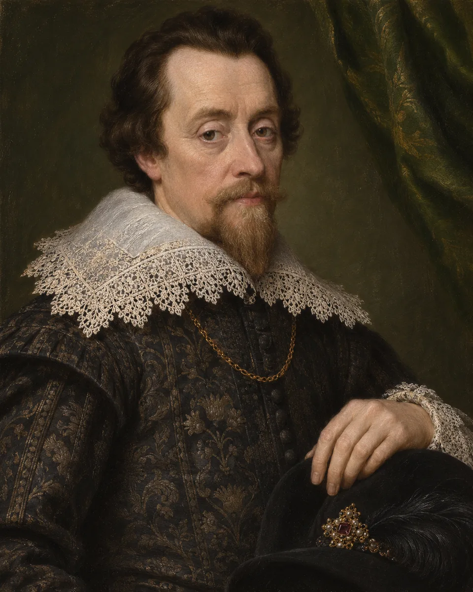
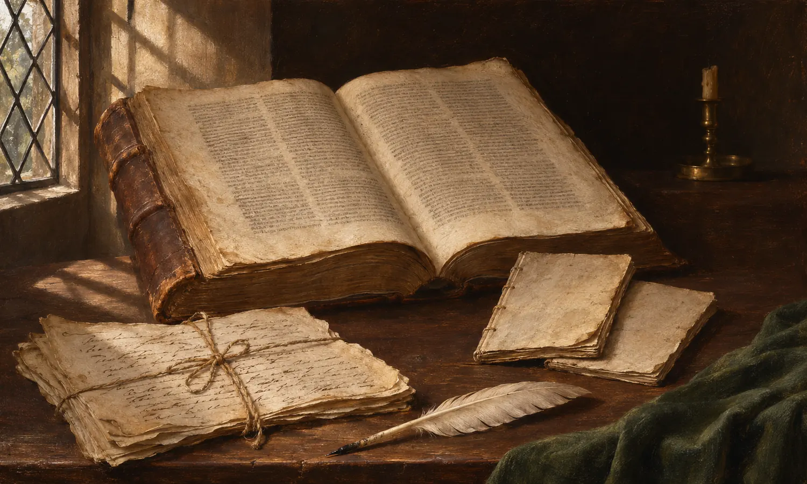
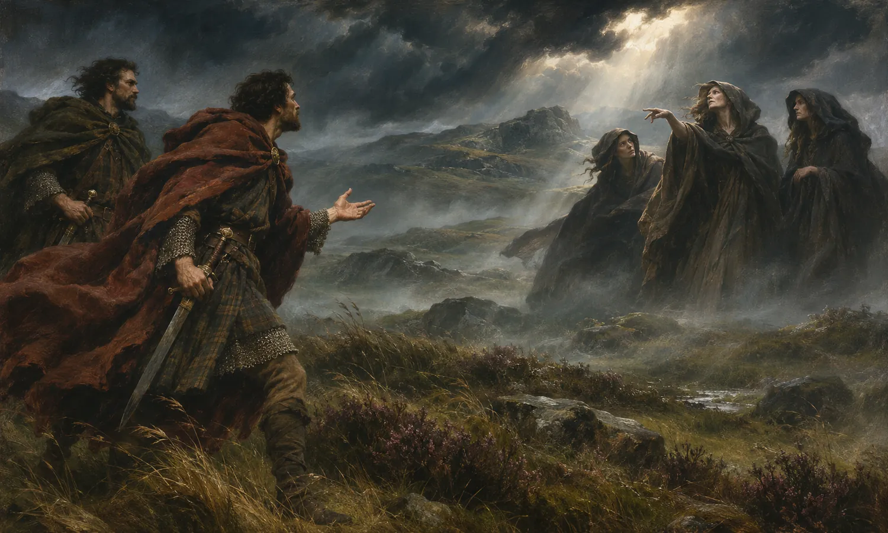
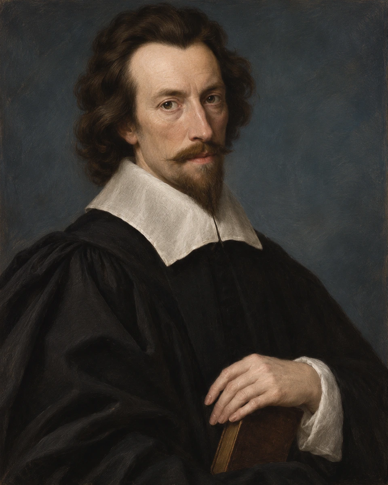

Elizabethan drama did not stop when Elizabeth died. Actors, writers and audiences carried their skills into the reign of James I. The connection is clear in Shakespeare's career, but continuity did not mean sameness. Jonson exposes greed through comedy; Webster places his characters in dangerous worlds of power; Donne makes a love poem sound like an urgent argument. The period becomes more interesting when these voices are heard together. As you read, ask what a speaker is trying to make someone believe. That question works in a tragedy, a satire, a sermon and a metaphysical lyric. It also helps explain why wit in this age is more than a clever phrase: it can be a way of testing ideas.

The Jacobean age is the reign of James I in England. Court and public theatre continued after Elizabeth I, but plays often looked more sharply at corruption, power and violence. Poetry also became more argumentative and intellectually surprising.

## The world of this age

<figure class="article-illustration article-illustration--float article-illustration--portrait" data-illustration="james-i">
  
  <figcaption>James I — modern painted interpretation.</figcaption>
</figure>

On 24 March 1603, Queen Elizabeth I died at Richmond Palace. She had ruled England for forty-four years. She had never married, and she left no child to take her crown. For years the English had asked each other a nervous question: who would rule after her? The answer came from the north. James VI of Scotland, a distant cousin through the Tudor family, travelled south and became James I of England.

The new king brought a love of books, a firm belief in his own royal power, and a queen, Anne of Denmark, who enjoyed music and dance. Poets found a court that wanted to be entertained, and the theatre found a royal friend. But the king also brought quarrels that his son could not settle. The struggle between crown and Parliament grew until England went to war with itself. A king was tried and beheaded, the theatres were shut, and for eleven years there was no king at all. In 1660 the monarchy came back.

James had been king of Scotland since he was thirteen months old, when his mother, Mary, Queen of Scots, was forced to give up her throne in 1567. He grew up among quarrelling nobles and stern Scottish preachers, and he learned to trust his own cleverness. He also wrote books. In *The True Law of Free Monarchies* (1598) he argued that a king receives his power from God and answers to God alone. This belief is called the **divine right of kings**. In Scotland he had ruled with it for years. In England it met a Parliament that was far more used to speaking its mind.

English kings could not rule without Parliament for one plain reason: only Parliament could vote for taxes. Elizabeth had known this and had handled its members with care. She had also left debts behind, because of her long wars with Spain and in Ireland. James spent freely on gifts and favourites, and the debts grew. In 1610 he tried a bargain called the Great Contract, meant to give him a steady income, but it failed. In 1614 he called a Parliament that passed no laws at all and was sent home within weeks. It is remembered as the Addled Parliament. After that, James ruled without a Parliament until 1621.

London was by far the largest city in England, and it was growing fast as people left their villages to look for work. Streets were crowded, and disease spread easily. When James came to the throne, plague was killing thousands of Londoners, his coronation was held with little ceremony, and the theatres stayed closed for many months. Plague returned in 1625 and again in the 1630s, and each time the playhouses shut their doors.

Society was divided into clear ranks. At the top stood the king and the great lords. Below them came the gentry, who owned land and ran the counties, then merchants, craftsmen and farmers, and a large body of labourers and servants. Rank decided a person's clothes, schooling and manners. Girls were mostly taught at home to run a household, few learned Latin, and a married woman had very few rights under the law. Even so, a small number of women found ways to write and publish.

A young gentleman's education followed a clear path. First came grammar school, then Oxford or Cambridge, and then the Inns of Court in London, where law was studied. The Inns were also clubs for young wits. Students went there to learn manners, make friends, watch plays and write verse. John Donne, Francis Beaumont and John Ford all spent time at them.

The wider world was opening too. In 1607 English settlers founded Jamestown in Virginia, the first lasting English colony in America. In 1620 a group of Separatists, now remembered as the Pilgrims, sailed in the *Mayflower* to found Plymouth in New England, because they wanted to worship in their own way, free from the English Church.

Cloth made from English wool was the country's chief export, and London merchants grew rich by selling it abroad. Long sea voyages were costly and risky, so merchants joined together in companies, where many investors shared the cost and the profit. The East India Company had been set up in 1600, and the Virginia Company followed in 1606. In 1615 James sent Sir Thomas Roe as his ambassador to the Mughal emperor Jahangir, hoping to win trading rights for the East India Company. Roe landed at Surat in September 1615, was received by Jahangir at Ajmer in January 1616, and stayed until 1619 without winning the full agreement he wanted.

England was a Protestant country, but its Church was a compromise left by Elizabeth. Puritans wanted to purify it further by removing robes and ceremonies that seemed Catholic. Catholics, who refused to attend Church of England services, paid heavy fines. When James came south, both groups hoped for relief. In January 1604, at Hampton Court Palace, he met leading churchmen to hear the Puritan requests. He refused to touch the system of bishops, warning that without bishops there would soon be no king. But one Puritan, John Rainolds, suggested a new translation of the Bible, and James agreed. That decision led to the King James Bible of 1611.

The Catholics were bitterly disappointed. A small group of them, led by Robert Catesby, planned to blow up Parliament on 5 November 1605, when the king would be present. Guy Fawkes, a soldier, was to guard the barrels of gunpowder hidden in a cellar under the House of Lords. A secret letter warned a Catholic lord, who passed it to the government, and Fawkes was caught in the cellar. The plotters were hunted down and executed, new laws against Catholics followed, and bonfires are still lit in Britain every 5 November.

Belief in the unseen was strong. James had studied witchcraft and had written a book, *Daemonologie*, in 1597, after witches in Scotland were accused of raising storms against the ship that brought him home with his bride. In 1604 England made its law against witches harsher. In 1612 a group of people from Pendle in Lancashire were tried, and most of them were hanged. This fear gave writers rich material, and *Macbeth* was written in such a world.

## The language and the Bible

<figure class="article-illustration" data-illustration="first-folio">
  
  <figcaption>Folio, quarto and manuscript: representative forms that preserved the plays.</figcaption>
</figure>

The English of these years is called Early Modern English. It is the language of Shakespeare and the King James Bible. It is close enough to read today, but spelling had no fixed rules, and people still used "thou" and "thee" for close friends, for inferiors and for God. The language was also growing fast. It had borrowed words from Latin, Greek, French and Italian, and many readers felt lost among them. In 1604 a schoolmaster named Robert Cawdrey published *A Table Alphabeticall*, a small list of hard English words with plain meanings. It is regarded as the first English dictionary.

The Bible of 1611 had a far larger effect. After the Hampton Court meeting, James appointed scholars to prepare a new English Bible. They worked in teams at Westminster, Oxford and Cambridge, and they drew heavily on earlier translators, above all William Tyndale. The book slowly became the Bible read aloud in English churches. Its calm, rhythmic sentences trained the ears of generations of speakers and writers.

Writers chose their styles with care. Jonson and Bacon liked short, firm sentences. Donne wrote as if arguing aloud, with sudden starts. Thomas Browne preferred long, rolling sentences full of Latin words, and Milton shaped English as if it were Latin, with long, balanced sentences.

## Manuscript and print

<figure class="article-illustration" data-illustration="macbeth">
  
  <figcaption>An imagined scene from Macbeth: the meeting on the heath.</figcaption>
</figure>

In 1603 a play was not thought of as a book. It was written to be acted, and it belonged to the acting company, which often kept the script away from printers. Some plays still reached print, in small cheap books called quartos, often with errors. Authority also watched the press. The Master of the Revels licensed every play for the stage, and the Church and Crown licensed books, which sometimes meant cutting dangerous lines.

Poems were handled differently. Gentleman poets often thought it undignified to print their verse, so poems were copied by hand and passed among friends. Many of Donne's poems were read this way for years, and they were printed only in 1633, two years after his death.

Ben Jonson changed the attitude to plays. In 1616 he published his plays, masques and poems together as *The Workes of Benjamin Jonson*. The grand volume claimed that plays deserved the same respect as any other literature. Shakespeare died that same year. In 1623 two actor friends from the King's Men, John Heminges and Henry Condell, gathered thirty-six of his plays into one large book, the **First Folio**. Eighteen of them had never been printed before, among them *Macbeth* and *The Tempest*, and without the book they might have been lost. It also carried a poem by Jonson, praising Shakespeare as a writer for all time, not for one age.

## Drama

<figure class="article-illustration article-illustration--float article-illustration--portrait" data-illustration="john-donne">
  
  <figcaption>John Donne — modern painted interpretation.</figcaption>
</figure>

The theatre that James inherited was already famous. In London, acting companies, each protected by a noble patron, played to crowds who paid a penny to stand in the yard and more to sit. In May 1603, within weeks of arriving, James made Shakespeare's company his own, and the Lord Chamberlain's Men became the King's Men. Other companies took the names of Queen Anne and Prince Henry. The King's Men acted at the open-air Globe in summer, and after 1608 they also used the indoor Blackfriars theatre in winter.

Shakespeare had written *Hamlet* and his great comedies before James arrived. In the Jacobean years he turned to darker stories: *Othello*, *King Lear*, *Macbeth*, *Antony and Cleopatra* and *Coriolanus*. *Macbeth*, written around 1606, suited the new king. James believed in witches, and he was said to descend from Banquo, the Scottish lord whom the witches in the play promise will father a line of kings. Later came *Pericles*, *Cymbeline*, *The Winter's Tale* and *The Tempest*, plays in which families are broken by jealousy or storm and healed only after long years. Shakespeare spent his last years mostly in Stratford and died on 23 April 1616.

Ben Jonson wrote differently. He was a bricklayer's stepson who taught himself Latin and Greek, and he believed that plays should correct foolishness, as the old Roman writers had done. His temper was hot: in 1598 he killed an actor in a duel and escaped hanging only by proving that he could read Latin. His comedies were sharp and crowded. In *Volpone* (1606), a rich Venetian pretends to be dying so that greedy friends will bring him gifts in the hope of inheriting his gold. In *The Alchemist* (1610), three tricksters take over a London house, left empty because of the plague, and cheat the greedy visitors who come hoping to get rich. Jonson called his method the **comedy of humours**. In old medicine a "humour" was a body fluid thought to rule a person's mood, and Jonson built each character around one ruling obsession.

At court the favourite entertainment was the **masque**, a show of music, dance, costume and painted scenery that ended when the masked players stepped down and danced with the audience. Queen Anne loved masques. Jonson wrote the words and the architect Inigo Jones designed the stage, and together they made *The Masque of Blackness* in 1605 and many others. The two men quarrelled over whether words or spectacle mattered more, and by 1631 Jonson had stopped writing for the court.

While Jonson laughed at fools, other playwrights stared at evil. Their tragedies are full of poison, spies, ghosts and cruel dukes, usually set in Italy or Spain, far from London, which let writers speak freely about wicked courts. This kind of play is called **revenge tragedy**, and it grew out of earlier plays such as Thomas Kyd's *The Spanish Tragedy* and Shakespeare's *Hamlet*. John Webster's *The White Devil* (about 1612) and *The Duchess of Malfi* (about 1613) are its best-known examples. In the second, a widowed duchess secretly marries her steward against the wishes of her two brothers, and they destroy her. Thomas Middleton and William Rowley's *The Changeling* (1622) tells how a young woman hires a servant to kill a man she does not want to marry, and finds that he demands a terrible price.

Not all plays were dark. Francis Beaumont and John Fletcher wrote **tragicomedies**, plays that bring the heroes close to death or disgrace and then end happily. Beaumont also wrote *The Knight of the Burning Pestle* (about 1607), which makes fun of a London grocer and his wife who interrupt a play to tell the actors what to do. After Beaumont died in 1616, Fletcher became the chief writer for the King's Men, and he even worked with Shakespeare on *Henry VIII*.

## Poetry

Poetry changed along with the theatre. The sweet, smooth sonnets of the 1590s no longer satisfied younger readers, who wanted wit, argument and surprise. The poet who gave them that was John Donne.

Donne was born in 1572 into a Catholic family at a time when Catholics were persecuted. His younger brother Henry died in prison after being arrested for sheltering a priest. Donne later left the old faith, studied law at Lincoln's Inn, and wrote clever, bold love poems that circulated in manuscript among friends. In 1601 he secretly married Anne More, the daughter of a powerful man, Sir George More, without his consent. Donne lost his post as secretary to the Lord Keeper, Sir Thomas Egerton, spent a short time in jail, and lived in poverty for years. King James finally urged him to take holy orders. Donne was ordained in 1615 and became Dean of St Paul's in 1621, where his sermons drew crowds. His later poems, such as the Holy Sonnets, burn with fear and love of God, as when he begs God to "batter my heart". He died in 1631.

Donne's poetry sounds nothing like Elizabethan smoothness. A poem may open with a shout, as in "The Canonization": "For God's sake hold your tongue, and let me love." He argues like a lawyer, mixes body and soul, and compares lovers to the most unexpected things, such as the two legs of a pair of compasses in "A Valediction: Forbidding Mourning". Such a comparison, stretched far and worked out with logic, is called a **conceit**. The poets who wrote in this way are called the **metaphysical poets**.

## Prose

The age was also one of argument and new thinking, and prose carried it. Its first great voice was Francis Bacon, a lawyer and statesman who believed that learning had been stuck for centuries on the words of old authorities such as Aristotle. In *The Advancement of Learning* (1605) and *Novum Organum* (1620) he argued that knowledge must grow through careful observation and experiment. His *Essays*, first printed in 1597 and enlarged in 1612 and 1625, are short and packed. In "Of Studies" he says that some books are to be tasted, others swallowed, and a few chewed and digested. Bacon rose to be Lord Chancellor in 1618, but in 1621 he was charged with accepting bribes, confessed, and lost his office. He spent his last years writing and died in 1626.

## An interesting story

On the afternoon of 29 June 1613, the Globe theatre was full for a new play about Henry VIII, called *All Is True*. When the king entered, a stage cannon was fired as part of the show. A spark landed in the thatched roof, and at first nobody noticed. The crowd thought the smoke was part of the performance. Within a short time the whole building burned to the ground, yet no one died. Sir Henry Wotton described the fire in a letter on 2 July, and he noted with dry humour that only wood, straw and a few cloaks were lost. One man's breeches caught fire, he wrote, and the man saved himself by putting them out with a bottle of ale. The Globe was rebuilt the next year, this time with a tiled roof.

## Criticism and scholarship

The name "metaphysical" began as a complaint. In 1693 John Dryden said that Donne showed off his learning and filled the minds of ladies with hard ideas when he should have been winning their hearts. In 1779, in his *Life of Cowley*, Samuel Johnson used the word metaphysical for a whole group of poets. He admired their learning but disliked their conceits, saying that in them "the most heterogeneous ideas are yoked by violence together".

For about two centuries Donne was little read. Then in 1921 H. J. C. Grierson published an anthology, *Metaphysical Lyrics and Poems of the Seventeenth Century*, and T. S. Eliot reviewed it in an essay, "The Metaphysical Poets". Eliot argued that these poets could feel a thought as directly as the smell of a rose, and that this power was lost after the seventeenth century, a change he called a "dissociation of sensibility". He blamed Milton and Dryden in part. His essay made Donne a favourite of modern poets and readers.

Drama had its own critics. A. C. Bradley's *Shakespearean Tragedy* (1904) studied *Hamlet*, *Othello*, *King Lear* and *Macbeth* through character. L. C. Knights's *Drama and Society in the Age of Jonson* (1937) linked the comedies of the time to a society hungry for money and rank. Jonathan Dollimore's *Radical Tragedy* (1984) argued that Jacobean tragedies questioned royal power and fixed ideas of human nature. For the Civil War years, Christopher Hill's *Milton and the English Revolution* (1977) read Milton against the fights of his time.

## Literature in focus

### A distinct reign within the Renaissance

Jacobean means the reign of James I in England, from 1603 to 1625. It is not another name for the whole seventeenth century. John Donne's career began earlier, and some of his poems appeared in print later; that does not make the labels useless, but it makes the date of an individual text important.

### Different kinds of dramatic judgement

In Jonson's comedy, greed and pretence are exposed through carefully organised action. Webster's tragedies place vulnerable characters within violent structures of authority. Shakespeare's tragedies explore the damage caused by ambition, mistrust and failures of judgement. These works can share a theatre culture while asking very different questions.

### Metaphysical argument

A conceit is more than a decorative comparison. In Donne, the comparison can organise a poem's argument and change how a reader understands love or faith. Follow each step of the reasoning: who speaks, what resistance the speaker imagines, and what the comparison is supposed to prove. "Metaphysical" is a later critical label, not the name of a club Donne founded.

## Writers and works

| Writer | Years | Best-known works of this age |
|---|---|---|
| William Shakespeare | 1564-1616 | *Othello*, *King Lear*, *Macbeth*, *The Winter's Tale*, *The Tempest* |
| Ben Jonson | 1572-1637 | *Volpone*, *The Alchemist*, *Bartholomew Fair*, *The Workes* (1616) |
| John Webster | c. 1580-c. 1634 | *The White Devil*, *The Duchess of Malfi* |
| Thomas Middleton | 1580-1627 | *A Chaste Maid in Cheapside*, *Women Beware Women*, *The Changeling* (with William Rowley) |
| Francis Beaumont | 1584-1616 | *The Knight of the Burning Pestle*; plays with Fletcher such as *Philaster* and *The Maid's Tragedy* |
| John Fletcher | 1579-1625 | Tragicomedies with Beaumont; *Henry VIII* and *The Two Noble Kinsmen* with Shakespeare |
| John Donne | 1572-1631 | *Songs and Sonnets*, *Holy Sonnets*, sermons, *Devotions upon Emergent Occasions* (1624) |
| Francis Bacon | 1561-1626 | *Essays*, *The Advancement of Learning*, *Novum Organum*, *The New Atlantis* (1627) |
| Robert Burton | 1577-1640 | *The Anatomy of Melancholy* (1621) |

## Key terms

- **Comedy of humours** - Jonson's kind of comedy, with characters each ruled by one obsession.
- **Masque** - a court entertainment of music, dance, costume and scenery.
- **Metaphysical poetry** - witty, argumentative poetry that uses surprising comparisons.
- **Conceit** - a surprising comparison that is stretched far and worked out with logic.

## Important points to remember

- The timeline uses 1603–1625 for this chapter. Literary boundaries are approximate.
- Check the date of a work separately from its writer's lifetime.
- Read this chapter alongside the wider period guide when comparing neighbouring ages.

## Quick revision - 14 points

1. **James I** — James VI of Scotland became James I of England after Elizabeth died.
2. **The King's Men** — James took the company under his own patronage soon after he arrived.
3. **A new English translation of the Bible** — James agreed to a new translation, which appeared in 1611.
4. **The Gunpowder Plot** — Catholic plotters led by Robert Catesby hid gunpowder under the House of Lords.
5. **Macbeth** — James believed in witches and was said to descend from Banquo.
6. **A fire started during a performance** — A stage cannon set the thatched roof on fire during a play about Henry VIII.
7. **Heminges and Condell** — John Heminges and Henry Condell were Shakespeare's friends in the King's Men.
8. **Volpone** — In *Volpone* the greedy visitors hope to inherit the rich man's gold.
9. **A comedy built on characters each ruled by one obsession** — Jonson built each character around one ruling "humour".
10. **John Webster** — John Webster wrote both *The White Devil* and *The Duchess of Malfi*.
11. **The Changeling** — *The Changeling* tells of a woman who hires a servant to commit murder.
12. **John Donne** — Donne became a priest after King James urged him to take holy orders.
13. **A surprising comparison worked out at length** — Donne's comparison of lovers to the legs of a pair of compasses is a famous example.
14. **1605** — In it Bacon argued that knowledge must grow through observation and experiment.

## Quick quiz - 19 questions

Tap an answer to see at once if it is right. You do not need to log in.

**1. Which king followed Queen Elizabeth I on the English throne in 1603?**

- A) Charles I
- B) James I
- C) Henry VIII
- D) Charles II

Answer: B. James VI of Scotland became James I of England after Elizabeth died.

**2. What did Shakespeare's company become called in 1603?**

- A) The Queen's Men
- B) The Admiral's Men
- C) Prince Henry's Men
- D) The King's Men

Answer: D. James took the company under his own patronage soon after he arrived.

**3. What did the Hampton Court meeting of January 1604 lead to?**

- A) The First Folio
- B) A new English translation of the Bible
- C) The Gunpowder Plot
- D) The Petition of Right

Answer: B. James agreed to a new translation, which appeared in 1611.

**4. Which event was planned for 5 November 1605 to blow up Parliament?**

- A) The Addled Parliament
- B) The Petition of Right
- C) The Gunpowder Plot
- D) The Great Contract

Answer: C. Catholic plotters led by Robert Catesby hid gunpowder under the House of Lords.

**5. Which play of about 1606 suited James because of its witches and Banquo?**

- A) The Tempest
- B) Othello
- C) King Lear
- D) Macbeth

Answer: D. James believed in witches and was said to descend from Banquo.

**6. How did the first Globe theatre end in 1613?**

- A) A storm destroyed it
- B) Parliament closed it
- C) A fire started during a performance
- D) It was sold and pulled down

Answer: C. A stage cannon set the thatched roof on fire during a play about Henry VIII.

**7. Which two men gathered thirty-six of Shakespeare's plays into the First Folio?**

- A) Jonson and Fletcher
- B) Heminges and Condell
- C) Burbage and Kempe
- D) Webster and Ford

Answer: B. John Heminges and Henry Condell were Shakespeare's friends in the King's Men.

**8. Which play by Jonson shows a Venetian pretending to be dying so that greedy visitors bring gifts?**

- A) Volpone
- B) The Alchemist
- C) The Changeling
- D) The White Devil

Answer: A. In *Volpone* the greedy visitors hope to inherit the rich man's gold.

**9. What is a comedy of humours?**

- A) A comedy written only for the court
- B) A comedy that has no plot
- C) A comedy in which characters change mood in every scene
- D) A comedy built on characters each ruled by one obsession

Answer: D. Jonson built each character around one ruling "humour".

**10. Who wrote *The Duchess of Malfi*?**

- A) Thomas Middleton
- B) John Ford
- C) John Webster
- D) Philip Massinger

Answer: C. John Webster wrote both *The White Devil* and *The Duchess of Malfi*.

**11. Which tragedy of 1622 was written by Middleton and Rowley?**

- A) The White Devil
- B) The Changeling
- C) 'Tis Pity She's a Whore
- D) The Duchess of Malfi

Answer: B. *The Changeling* tells of a woman who hires a servant to commit murder.

**12. Which poet was ordained in 1615 and became Dean of St Paul's in 1621?**

- A) George Herbert
- B) Andrew Marvell
- C) John Donne
- D) Henry Vaughan

Answer: C. Donne became a priest after King James urged him to take holy orders.

**13. What is a conceit?**

- A) A proud poet
- B) A short rhyming line
- C) A poem shaped like its subject
- D) A surprising comparison worked out at length

Answer: D. Donne's comparison of lovers to the legs of a pair of compasses is a famous example.

**14. In which year was Bacon's *The Advancement of Learning* published?**

- A) 1597
- B) 1620
- C) 1605
- D) 1625

Answer: C. In it Bacon argued that knowledge must grow through observation and experiment.

**15. How does a conceit often function in Donne?**

- A) It replaces every speaker with a king
- B) It guarantees the poem is historical prose
- C) It helps organise the poem's argument
- D) It supplies a compulsory happy ending

Answer: C. An extended comparison can make a reader reconsider a relationship or idea.

**16. Why is metaphysical a historical critical label?**

- A) Donne registered a club with that title
- B) It names a royal dynasty
- C) It means all poetry after 1945
- D) Later critics used it to describe certain poetic practices

Answer: D. The label should not be confused with a group formally founded by Donne.

**17. What does Jonson often expose through comedy?**

- A) Greed and pretence
- B) Only the Norman Conquest
- C) Only an editor's bibliography
- D) Only a pastoral funeral

Answer: A. Comic action can reveal failures of judgement.

**18. Which approach best compares Jacobean playwrights?**

- A) Describe all tragedy as autobiography
- B) Explain both shared conditions and distinct dramatic methods
- C) Assume all plays have one tone
- D) Ignore audiences and performance

Answer: B. A common theatre culture does not make the works identical.

**19. What should be kept distinct when dating Donne's work?**

- A) All monarchs' reigns as one year
- B) The reader's age and the poem's metre
- C) Composition, circulation and later publication
- D) Only the last printed edition and no other date

Answer: C. A writer's career and the history of individual texts can cross period boundaries.

## Frequently asked questions

**Does this chapter use exact historical boundaries?**
The dates are the timeline's study convention. Language, literary forms and writers' careers can cross them. Use the date of the particular work when a question asks about a narrower age.

**Where can I read the wider historical context?**
The [full period guide](/notes/jacobean-and-caroline-age/) contains the longer background. This chapter concentrates on the age named above and keeps its own revision and practice sections.

**Are these pictures historical documents?**
The artwork is illustrative. Captions identify representative or imagined scenes and modern painted interpretations; those images are not evidence that the pictured scene happened exactly as shown.

**How should I use the quiz?**
Read the explanations after answering. Questions about earlier events or later criticism are background questions, not claims that every named date falls inside the chapter's boundaries.

## Sources and further reading

The relevant background, text references and public practice material are retained from the [original jacobean and caroline age guide](/notes/jacobean-and-caroline-age/#sources). Publication dates, authorship and period boundaries should be checked against the source editions listed there.

- [Folger Shakespeare Library: the First Folio](https://www.folger.edu/explore/shakespeare-in-print/first-folio/)

Afsar Khan, Ph.D. English
