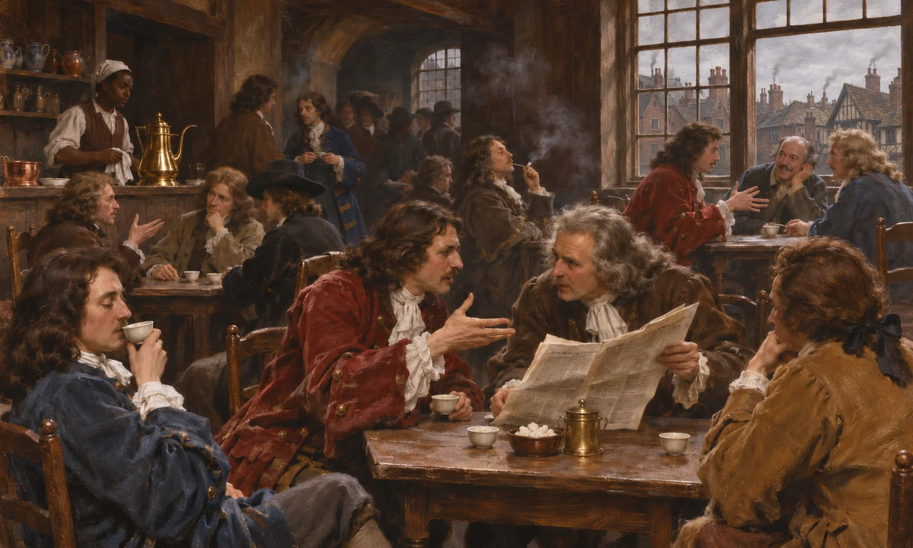
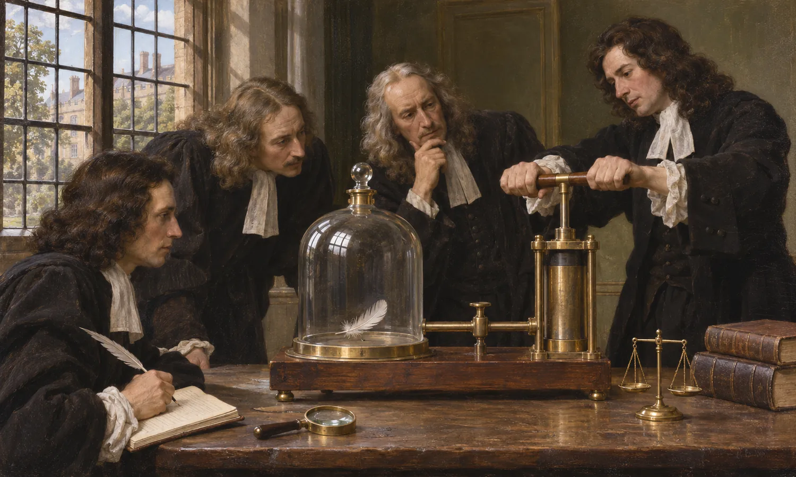
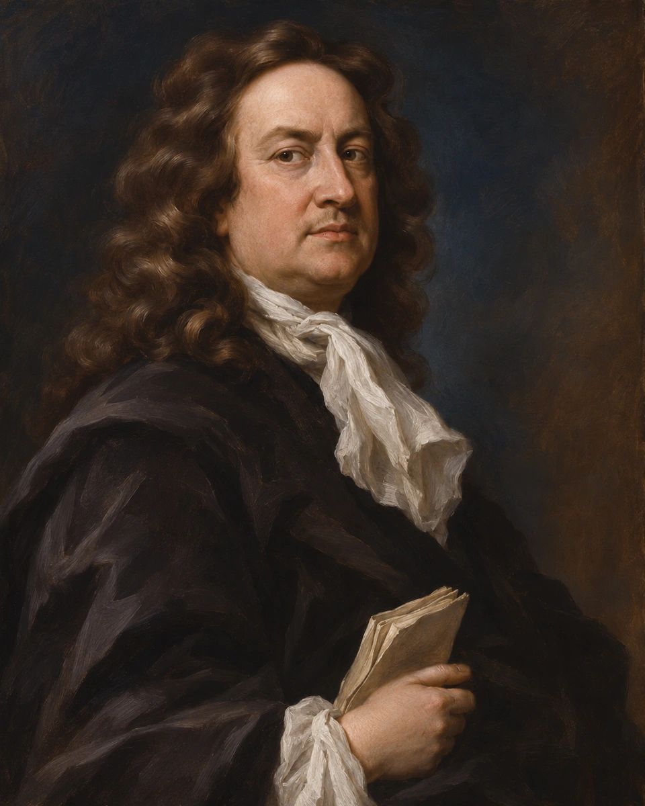

"Neoclassical" describes a long taste for order, proportion and classical models in English writing. On this timeline it covers 1660–1785, crossing the Restoration, Augustan age and Age of Sensibility. These shorter periods differ, so the broad label should not be used as if Dryden, Pope and Johnson wrote in one political moment.

## The world of this age

<figure class="article-illustration" data-illustration="coffee-house">
  
  <figcaption>Coffee houses brought together news, politics and literary talk.</figcaption>
</figure>

The republic did not last long after Oliver Cromwell died in September 1658. His son Richard became Lord Protector but had none of his father's authority, and in 1659 the army pushed him aside. England drifted toward new disorder. General George Monck, who commanded the army in Scotland, marched south to London in early 1660. A new Parliament met and invited Charles to come home.

London was by far the largest city in the country, and much of its talk happened in the coffee houses, where men drank coffee, read the news and argued about politics and poetry. Writers had favourite houses. Dryden is linked with Will's Coffee House in Covent Garden.

London was also a great port. Ships carried cloth, sugar, tobacco and spices, and tea and coffee were becoming common. Parliament passed Navigation Acts in the 1660s to make sure that trade with the English colonies travelled in English ships. English ships also carried enslaved Africans across the Atlantic, a cruel trade that grew in these years.

Religion mattered as much as politics. When Charles came home, the Church of England came home with him. The bishops returned, and the Book of Common Prayer was revised in 1662. It stayed the main Anglican prayer book for about three hundred years.

## The language

<figure class="article-illustration" data-illustration="royal-society">
  
  <figcaption>Observation and experiment at a representative Royal Society gathering.</figcaption>
</figure>

The writers of the Restoration had grown up in a time when words were weapons. Preachers, pamphleteers and politicians had filled the air with fiery speeches and very long sentences. Many readers now wanted calm, clear writing.

The new science helped this mood. The Royal Society, a club of people who loved experiment, met in London and received royal charters in 1662 and 1663. Its early members included scientists such as Robert Boyle and Robert Hooke, the architect Christopher Wren, and the writers John Evelyn, Edmund Waller and John Dryden. In 1667 Thomas Sprat published a *History of the Royal Society*, in which he praised careful experiment as the opposite of the angry passions of the war years. Writers close to the Society preferred a plain, clear style.

The French example added to the change. Charles's followers had lived in France and admired its tidy rules for plays and poems, and English writers began to value order, balance and good sense. In verse this meant the heroic couplet, two rhyming lines of ten syllables each. Sir John Denham's poem *Cooper's Hill*, first printed in 1642, was taken as a model. Dryden thought it set the exact standard of good writing, and he would make the couplet his own.

## Drama and its audience

<figure class="article-illustration article-illustration--float article-illustration--portrait" data-illustration="john-dryden">
  
  <figcaption>John Dryden — modern painted interpretation.</figcaption>
</figure>

The biggest change in literature came in the theatre. Parliament had closed all playhouses in 1642 and passed a further order against acting in 1647. For eighteen years plays could be read but not properly performed. One clever man found a way round the ban. In 1656 the playwright William Davenant staged *The Siege of Rhodes*, a story sung to music, as an "entertainment" in the manner of the ancients. It was an early English opera.

When Charles returned, he gave two men the sole right to stage plays in London. Davenant received one royal patent, and the playwright Thomas Killigrew received the other. Killigrew's King's Company opened in November 1660 in a converted tennis court with Shakespeare's *Henry IV, Part 1*. Davenant's company had the Duke of York as its patron and was called the Duke's Company.

The new theatres were nothing like the Globe. They were built for the purpose, roofed and well lit, with names such as Lincoln's Inn Fields, Dorset Garden and Drury Lane. A proscenium arch framed the stage, and painted scenery could be changed in front of the audience. The actors played on an apron stage that reached out into the room. Seats cost between one and four shillings, so the audience was mostly courtiers and well-off townspeople. The king and his brother often attended.

Women now acted on the public stage. During the closure no boys had been trained to play female parts, and actresses were already common on the continent. Pepys, who loved the theatre, noticed the handsome women on the stage with pleasure in 1662. Thomas Betterton became the leading actor of the age and learned the part of Hamlet from Davenant.

Comedy was the great success of the age. The court and the town liked plays that laughed at love, money and fashion, and that turned the grand ideas of the heroic plays upside down. A comedy of manners is a play about fashionable people in a polished society, driven by wit and by tricks of love. Its setting was London. Its people were young gallants, jealous husbands, country wives and foolish fops, and its chief sport was seduction and the hypocrisy around it. Names told the audience what to expect: Courtall, Lady Cockwood, Sir Fopling Flutter.

## Poetry and satire

The central figure of the age was John Dryden. Born in 1631, he had written verses on Cromwell's death in 1659, and in 1660 he welcomed the returning king in *Astraea Redux*. He then became the voice of the restored monarchy. *Annus Mirabilis* (1667) praised London and the king for surviving the Dutch war and the Great Fire. In 1668 he became Poet Laureate. For the next fourteen years or so he wrote mainly for the stage, which taught him to handle character and quick speech.

Then the Exclusion Crisis gave him a great subject. *Absalom and Achitophel* (1681) retells the Bible story of Absalom's revolt against his father David. In the poem David stands for Charles II, Absalom for the Duke of Monmouth, and Achitophel for Shaftesbury, who tempts Absalom to rebel. The Duke of Buckingham appears as Zimri. A poem in which real people hide behind other names is called a *histoire à clef*. Dryden used the heroic couplet to praise and to wound in the same line.

His rival in the theatre, Thomas Shadwell, became the target of *MacFlecknoe*, begun in the late 1670s and printed in 1682. It is a mock-heroic poem, which treats a small subject in the grand style of epic to make it look foolish. Shadwell is crowned the heir of the dull poet Flecknoe, holding a mug of ale instead of a royal orb. Dryden also wrote *Religio Laici* (1682), in defence of the Church of England, and *The Hind and the Panther* (1687), written after he joined the Roman Catholic Church under James II.

## Prose and ideas

John Bunyan, a tinker's son from Bedfordshire, wrote from the other side of the Restoration world. Much of his finest work was written in prison. In *Grace Abounding* (1666) he told the story of his own religious struggles. Then he turned his experience into a story for everyone. *The Pilgrim's Progress* (Part I, 1678; Part II, 1684) is an allegory, a tale whose people and places stand for ideas. A man named Christian leaves the City of Destruction and travels through the Slough of Despond, Vanity Fair and the Valley of the Shadow of Death to reach the Heavenly City. The people he meets have names such as Mr Worldly-Wiseman and Talkative, so the reader knows at once what each one stands for. In the second part his wife Christiana makes the same journey. Bunyan's language is plain, vivid and full of the Bible, and the book was read in ordinary homes for generations.

Aphra Behn wrote prose as well. Her short novel *Oroonoko* (1688) tells of an African prince who is tricked into slavery in Surinam, the colony where she had once lived. He rises in revolt against his masters, and the story presents him as a noble man and his oppressors as the ones who fail the test of honour.

New ideas also found their way into prose. Isaac Newton's *Principia* (1687) set out the laws of motion and gravity, and John Locke's *Essay Concerning Human Understanding* (1690) argued that knowledge comes from experience. Dryden wrote the best critical prose of the age, mostly in the prefaces to his own plays and poems.

## Criticism

Criticism began inside the age itself. Dryden's *Of Dramatic Poesie* (1668), written in 1665 when the plague had shut the theatres, is a conversation between four speakers who argue about ancient and modern drama and about French and English practice. It is the best critical essay of the age. Thomas Rymer, a stricter critic, judged English tragedy by classical rules, and his *A Short View of Tragedy* (1693) attacked Shakespeare's *Othello*. In 1698 Jeremy Collier's *A Short View of the Immorality and Profaneness of the English Stage* attacked the playwrights from the side of religion.

## Literature in focus

### A broad period and its shorter ages

The Neoclassical period on this timeline runs from 1660 to 1785. It contains the Restoration, the Augustan age and the Age of Sensibility. These are overlapping levels of description. Neoclassical points to the influence of classical models and habits of critical judgement; Restoration points first to a political event.

### From Dryden to Pope

Dryden's political satire and dramatic criticism helped establish a public language of judgement. Pope developed the heroic couplet into a remarkably flexible instrument of argument, praise and attack. In *The Rape of the Lock*, epic machinery is applied to a social quarrel. The difference in scale creates mock-heroic comedy: the form asks readers to reconsider the importance assigned to fashionable behaviour.

### Essays, satire and the novel

Addison and Steele's periodical essays brought a speaking, observant prose voice to a recurring readership. Swift's *Gulliver's Travels* makes imaginary journeys expose failures in human conduct. Defoe, Richardson and Fielding developed different kinds of prose fiction. It is therefore misleading to describe the whole period as poetry governed by rules.

### Johnson and the later century

Johnson's *Dictionary* appeared in 1755, his edition of Shakespeare in 1765, and his *Lives of the Poets* in 1779–1781. These works belong to a later moment than Pope's early satire. They connect language, textual judgement and the writer's working life. The later century also gave increasing attention to sympathy, memory, landscape and the Gothic.

### What changes within the period?

The broad label does not require every writer to sound alike. Put a Dryden satire, a Pope mock-epic and a Gray elegy beside one another and ask about speaker, audience and purpose. Classical models can be present in each without producing the same emotional effect. The separate Restoration, Augustan and Sensibility chapters provide the narrower historical settings.

## Key terms

- **Heroic couplet** - two rhyming lines of ten syllables each, the main verse form of the age.
- **Satire** - writing that attacks vice or folly through ridicule.
- **Mock-heroic** - a poem that treats a small or silly subject in the grand style of an epic.

## Writers and works

| Writer | Works | What to remember |
|---|---|---|
| Alexander Pope | The Rape of the Lock | Mock-heroic satire |
| Joseph Addison and Richard Steele | The Spectator | Periodical essay |
| Samuel Johnson | A Dictionary of the English Language (1755) | Language and literary judgement |

## Important points to remember

- The timeline uses 1660–1785 for this chapter. Literary boundaries are approximate.
- Check the date of a work separately from its writer's lifetime.
- Read this chapter alongside the wider period guide when comparing neighbouring ages.

## Quick revision - 14 points

1. **Charles II** — Charles II rode into London on 29 May 1660 and began the Restoration.
2. **Davenant and Killigrew** — Each of the two men received a patent giving his company the sole right to stage plays.
3. **To accept the Book of Common Prayer** — About 2,000 ministers who refused were driven from their churches, by Baxter's estimate.
4. **Samuel Pepys** — Pepys kept his diary until 1669 and recorded the plague and the Great Fire.
5. ***The Pilgrim's Progress*** — *Grace Abounding* is his own life story, while *The Pilgrim's Progress* turns it into an allegory.
6. ***MacFlecknoe*** — *MacFlecknoe* crowns Shadwell the heir of the dull poet Flecknoe.
7. **Keeping the Catholic Duke of York from the throne** — The struggle ran from 1679 to 1681 and produced the Whigs and the Tories.
8. **Heroic plays** — It copied the grand speeches of heroic plays until they sounded silly.
9. **Bombay** — Catherine of Braganza's dowry included Bombay, which Charles handed to the East India Company in 1668.
10. ***All for Love*** — Dryden wrote it in 1677 and claimed to follow Shakespeare while tidying the plot.
11. **The Earl of Rochester** — Rochester attacked the idea that human reason can be trusted.
12. **The Glorious Revolution** — James II fled, and William and Mary were crowned together in 1689.
13. ***The Man of Mode*** — Etherege wrote it in 1676.
14. **His wine and a Parmesan cheese** — Pepys and Sir William Penn dug a pit and put the wine and cheese in it.

## Quick quiz - 14 questions

Tap an answer to see at once if it is right. You do not need to log in.

**1. Which king came back to England in 1660?**

- A) Charles I
- B) Charles II
- C) James II
- D) William III

Answer: B. Charles II rode into London on 29 May 1660 and began the Restoration.

**2. Who held the two royal patents to stage plays in London after 1660?**

- A) Davenant and Killigrew
- B) Dryden and Wycherley
- C) Betterton and Pepys
- D) Etherege and Congreve

Answer: A. Each of the two men received a patent giving his company the sole right to stage plays.

**3. What did the Act of Uniformity of 1662 require of ministers?**

- A) To close the theatres
- B) To build new churches
- C) To leave England
- D) To accept the Book of Common Prayer

Answer: D. About 2,000 ministers who refused were driven from their churches, by Baxter's estimate.

**4. Which writer began a famous diary in January 1660?**

- A) John Bunyan
- B) Aphra Behn
- C) Samuel Pepys
- D) William Congreve

Answer: C. Pepys kept his diary until 1669 and recorded the plague and the Great Fire.

**5. Which work by Bunyan is an allegory in which Christian travels to the Heavenly City?**

- A) *The Pilgrim's Progress*
- B) *Grace Abounding*
- C) *Hudibras*
- D) *Oroonoko*

Answer: A. *Grace Abounding* is his own life story, while *The Pilgrim's Progress* turns it into an allegory.

**6. Which poem by Dryden mocks Thomas Shadwell?**

- A) *MacFlecknoe*
- B) *Annus Mirabilis*
- C) *Religio Laici*
- D) *Astraea Redux*

Answer: A. *MacFlecknoe* crowns Shadwell the heir of the dull poet Flecknoe.

**7. What was the Exclusion Crisis about?**

- A) Removing bishops from Parliament
- B) Closing the theatres
- C) Ending the war with the Dutch
- D) Keeping the Catholic Duke of York from the throne

Answer: D. The struggle ran from 1679 to 1681 and produced the Whigs and the Tories.

**8. What did Buckingham's *The Rehearsal* (1671) make fun of?**

- A) Puritan preachers
- B) Coffee houses
- C) Heroic plays
- D) The Royal Society

Answer: C. It copied the grand speeches of heroic plays until they sounded silly.

**9. Which Indian port city came to Charles II in his wife's dowry?**

- A) Calcutta
- B) Bombay
- C) Madras
- D) Surat

Answer: B. Catherine of Braganza's dowry included Bombay, which Charles handed to the East India Company in 1668.

**10. Which play by Dryden retells the story of Antony and Cleopatra in blank verse?**

- A) *The Orphan*
- B) *The Conquest of Granada*
- C) *The Rover*
- D) *All for Love*

Answer: D. Dryden wrote it in 1677 and claimed to follow Shakespeare while tidying the plot.

**11. Who wrote *A Satyr against Mankind* (1675)?**

- A) The Earl of Rochester
- B) Andrew Marvell
- C) Samuel Butler
- D) John Oldham

Answer: A. Rochester attacked the idea that human reason can be trusted.

**12. Which event of 1688 brought William III and Mary II to the throne?**

- A) The Popish Plot
- B) The Great Fire
- C) The Exclusion Crisis
- D) The Glorious Revolution

Answer: D. James II fled, and William and Mary were crowned together in 1689.

**13. Which comedy of manners features Dorimant and Sir Fopling Flutter?**

- A) *The Man of Mode*
- B) *The Way of the World*
- C) *Love for Love*
- D) *The Relapse*

Answer: A. Etherege wrote it in 1676.

**14. What did Pepys bury in his garden to save it from the Great Fire?**

- A) His diary
- B) His silver plate
- C) His wig
- D) His wine and a Parmesan cheese

Answer: D. Pepys and Sir William Penn dug a pit and put the wine and cheese in it.

## Frequently asked questions

**Does this chapter use exact historical boundaries?**
The dates are the timeline's study convention. Language, literary forms and writers' careers can cross them. Use the date of the particular work when a question asks about a narrower age.

**Where can I read the wider historical context?**
The [full period guide](/notes/restoration-age/) contains the longer background. This chapter concentrates on the age named above and keeps its own revision and practice sections.

**Are these pictures historical documents?**
The artwork is illustrative. Captions identify representative or imagined scenes and modern painted interpretations; those images are not evidence that the pictured scene happened exactly as shown.

**How should I use the quiz?**
Read the explanations after answering. Questions about earlier events or later criticism are background questions, not claims that every named date falls inside the chapter's boundaries.

## Sources and further reading

The relevant background, text references and public practice material are retained from the [original restoration age guide](/notes/restoration-age/#sources). Publication dates, authorship and period boundaries should be checked against the source editions listed there.

- [Thomas Gray Archive: Elegy, text and publication history](https://thomasgray.org/texts/poems/elcc)

Afsar Khan, Ph.D. English
