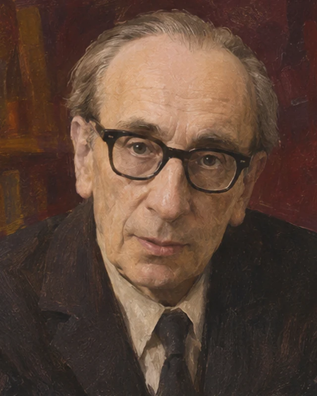

Imagine a small tea stall outside a college in Uttar Pradesh. A teacher says that education gives young people freedom. A student replies that a degree has little value without a job. The tea seller, who has never attended college, asks whether earning a living counts as education too. Another student repeats the teacher's words with a smile, but her tone makes them sound like a question.

Everyone is speaking about education, yet the word carries a different history for each person. The teacher remembers his classroom, while the student remembers the cost of her books. Even a person who remains silent may answer these remarks in his mind. If a novelist writes this scene, must one of these voices become the final truth of the story? Could the novel allow them to challenge each other without settling their argument?

**Dialogism** is Mikhail Bakhtin's account of meaning as something formed through relations between voices. This article in the literary theory and cultural studies series moves from everyday speech to the special possibilities of the novel. It follows Bakhtin's life, his study of Dostoevsky and his account of popular laughter. At the end, the readers will return to the tea stall with a different understanding of what they heard.

## Where dialogism came from

### A thinker in a changing Russia

<figure class="article-illustration article-illustration--float article-illustration--portrait">
  
  <figcaption>Mikhail Bakhtin. Modern painted interpretation. <a href="https://h5.ifeng.com/c/vivo/v002ZvyQN-_3nh1b70dJhZocUajdroLbt7zCibGXD543od6I__" target="_blank" rel="noopener">Portrait reference</a></figcaption>
</figure>

Mikhail Mikhailovich Bakhtin (1895-1975) was a Russian thinker whose work joined philosophy, language and literary criticism. He lived through the Russian Revolution of 1917 and the growth of the Soviet state. These events formed the historical world in which he developed his ideas. His writings, however, cannot be reduced to a simple response to one political event.

Bakhtin's early philosophical concerns included the relationship between the self and other people. A person can never see himself from exactly the position occupied by somebody else. For instance, a student giving a speech knows what she intends to say. Her classmates see her nervous hands and hear the pauses she hardly notices. Their positions make different kinds of knowledge possible.

### The Bakhtin Circle and the study of language

During the years following the Revolution, Bakhtin participated in intellectual groups in Russia. The name **Bakhtin Circle** refers to the thinkers who shared and developed related questions through discussion. Among its important figures were Valentin Voloshinov and Pavel Medvedev. Their work explored the social character of language and the relationship between artistic forms and social life.

Voloshinov published *Marxism and the Philosophy of Language* in 1929. Medvedev published *The Formal Method in Literary Scholarship* in 1928. Some accounts have attributed these books to Bakhtin himself, but their authorship remains disputed. Craig Brandist, in the *Internet Encyclopedia of Philosophy*, treats their differences seriously rather than accepting a single author for them.

Ferdinand de Saussure's distinction between the language system and individual speech had helped to establish modern linguistics. Bakhtin and his Circle were interested in something that a purely abstract description might leave aside. They asked how speakers use language in particular situations and respond to other speakers. This does not make grammatical study useless, but it gives the study of meaning another task.

### From literary form to living voices

Russian Formalism had drawn attention to the devices that make literary works different from ordinary communication. Bakhtin's approach also takes artistic form seriously, yet it asks what human and social relations form can express. The structure of a novel may reveal how one consciousness encounters another. A character's speech matters because of the position from which that character speaks.

In 1929 Bakhtin published his first book on Fyodor Dostoevsky, often translated as *Problems of Dostoevsky's Art*. A much enlarged version appeared in Moscow in 1963 as *Problems of Dostoevsky's Poetics*. The distinction between these editions matters because the later book develops the discussion of literary history and carnival. The familiar English translation by Caryl Emerson appeared in 1984.

Bakhtin suffered political persecution and spent years in exile in Kazakhstan. He subsequently taught in Saransk and continued his research under difficult conditions. His work received much wider attention after the new edition of the Dostoevsky book. The later publication history helps explain why a thinker active in the 1920s became widely influential much later.

### Did you know?

Bakhtin's influential English collection *The Dialogic Imagination* appeared in 1981, six years after his death. The volume brings together four essays selected from a Russian collection published in 1975. Michael Holquist edited the English volume, and Caryl Emerson and Holquist translated it.

### Important points to remember

- Mikhail Bakhtin lived from 1895 to 1975.
- The Russian Revolution took place in 1917.
- Voloshinov and Medvedev were associated with the Bakhtin Circle.
- The authorship of some Circle publications remains disputed.
- Bakhtin's first Dostoevsky book appeared in 1929.
- Its expanded Russian edition appeared in 1963.
- Caryl Emerson's English translation appeared in 1984.
- *The Dialogic Imagination* appeared in English in 1981.

## The core ideas of dialogism

### The utterance and its listeners

In "The Problem of Speech Genres", Bakhtin makes the **utterance** a basic unit of actual communication. An utterance is something expressed by a speaker or writer in a particular communicative situation. It may be as short as a greeting or as long as a book. Its boundaries depend on the change between speaking subjects, rather than merely on grammatical punctuation.

A sentence can be studied as a grammatical pattern without knowing who uses it. An utterance, however, belongs to an actual exchange between people. Suppose a mother tells her son that the door is open. She might be describing the house, asking him to close it or inviting him inside.

The expression has what Bakhtin calls **addressivity**, its quality of being directed towards someone. A speaker chooses words partly in anticipation of the listener's response. A student writing to a principal chooses a different tone from the one used with a friend. The student's relationship with the listener helps shape the message. Understanding involves a possible response.

### Dialogism and monologism

For Bakhtin, speech enters a world in which other people have already spoken. Words carry traces of earlier uses, familiar judgements and social expectations. A person may repeat another speaker's language in agreement or use it with a different intention. **Dialogism** describes these relations among utterances and the positions they express.

Imagine that the college announces that it is a centre of excellence. A student repeats the phrase after finding that the library is closed. The words may be exactly the same, but their force is now different. The second use answers the first and exposes the distance between a claim and an experience.

Dialogism is thus wider than a conversation printed between quotation marks. A poem, letter or apparently solitary speech may respond to voices that remain absent. In a novel, a narrator can argue silently against the beliefs expressed by a character. The presence of a second physical speaker is unnecessary for a dialogic relationship to exist.

**Monologism** describes an orientation that treats one consciousness or position as the final authority over others. A monologic novelist may allow a character to speak but explain away everything that character says. The character becomes an object of judgement rather than a consciousness with its own position. Bakhtin's contrast concerns the organisation of voices, not simply the number of speakers.

<figure class="article-illustration theory-diagram" aria-labelledby="theory-diagram-1">
  <figcaption id="theory-diagram-1">Two ways to organise the tea-stall debate</figcaption>
  <ul role="list">
    <li><strong>Dialogism</strong>The teacher’s statement invites an answer, and the student’s reply changes how readers hear it.</li>
    <li><strong>Monologism</strong>The narrative supplies a final judgement that all the other voices serve.</li>
  </ul>
</figure>

### Polyphony: a novel with independent voices

In his book on Dostoevsky, Bakhtin uses the term **polyphony**, borrowed from music. In polyphonic music, distinct melodic lines can be heard together without merging into a single melody. Bakhtin applies the analogy to novels in which different consciousnesses retain their independence. Their interaction gives the work its artistic unity, without making them all expressions of one judgement.

This does not mean that the author vanishes or loses control over the writing. On the contrary, arranging an encounter between distinct voices demands a particular kind of authorial activity. A novelist still chooses the characters and events. A large cast alone does not create polyphony. What changes is the relationship between the author's position and the characters' self-understanding.

Bakhtin's notion of **unfinalizability** expresses the refusal to treat another consciousness as completely finished and knowable. A character remains capable of answering a judgement about herself. In life, a teacher may describe a student as lazy, yet that student may contest the label. A final description of a person can hide the possibilities of future change.

### Heteroglossia and the social life of words

Bakhtin's essay "Discourse in the Novel" broadens the inquiry from individual consciousnesses to social languages. **Heteroglossia** means the diversity of socially marked kinds of speech within language. An occupation, generation or social group can develop distinctive expressions and habits of judgement. These forms of speech carry different ways of understanding the world.

For Bakhtin, the novel can bring these social languages into contact within one work. It can include a letter, an official notice and a character's private thoughts. Each kind of discourse carries assumptions from the social world where it normally appears. Their meeting reveals what one way of speaking conceals. Heteroglossia need not involve different national languages.

Bakhtin describes two tendencies operating within language. **Centripetal forces** move towards unity, standardisation and common authority. **Centrifugal forces** move towards differentiation and the growth of varied social languages. A school's insistence on standard grammar illustrates the first tendency, while students' slang illustrates the second. Both tendencies operate together.

### Double-voiced discourse

**Double-voiced discourse** occurs when an expression carries an orientation towards another person's discourse as well as the speaker's purpose. Imagine a clerk who calls an unnecessary form a wonderful example of efficiency. She uses the office's official language while exposing its weakness. One expression carries two attitudes towards the same situation.

**Parody** is an important case, since it imitates another discourse while introducing a different intention. Bakhtin also discusses hidden polemic, in which a statement is shaped by an opposing voice that remains unspoken. A person who repeatedly defends his generosity may be answering an accusation the reader never hears. The absent voice can thus shape the form of present speech.

Polyphony and heteroglossia should not be confused with double-voiced discourse. The last term describes a relationship within particular uses of language. Heteroglossia describes social speech diversity, while polyphony describes an artistic organisation of independent consciousnesses. The three ideas are connected, but each directs attention to a different feature of the novel.

<figure class="article-illustration theory-diagram" aria-labelledby="theory-diagram-2">
  <figcaption id="theory-diagram-2">Three features to listen for in a novel</figcaption>
  <ul role="list">
    <li><strong>Heteroglossia</strong>Different social languages, such as the speech of a teacher and the speech of a tea seller.</li>
    <li><strong>Double-voiced discourse</strong>A student repeats the teacher’s words, making one phrase carry both the teacher’s claim and her doubt.</li>
    <li><strong>Polyphony</strong>The novel gives distinct consciousnesses room to speak without settling their debate for them.</li>
  </ul>
</figure>

### The chronotope and the meeting of worlds

In "Forms of Time and of the Chronotope in the Novel", Bakhtin studies the **chronotope**, literally time-space. The term refers to the connected organisation of time and space in literary representation. Setting is not merely a background against which events happen. Particular places make particular forms of action and historical experience possible.

A railway platform at dawn may bring together strangers who would otherwise never meet. The timetable creates an urgent period of waiting, while the platform provides a shared space. A conversation that begins there may change a character's life before the train arrives. Time and place together organise the narrative opportunity.

Bakhtin discusses the road as a chronotope of encounters. He also connects the threshold with moments of crisis and decision. A doorway may become important when a character must decide whether to enter or leave. The decisive moment and the boundary in space acquire meaning together.

### Carnival and the temporary reversal of authority

In *Rabelais and His World*, Bakhtin examines popular festive culture in the Middle Ages and Renaissance. His account of **carnival** describes a form of collective life in which ordinary ranks and prohibitions are temporarily suspended. The festive crowd can laugh at the institutions and dignities that ordinarily command respect. This laughter creates another way of experiencing the social world.

A rough analogy is a college farewell performance where students imitate their teachers with permission. Familiar titles and solemn speeches become material for jokes. The people who usually receive instructions can briefly become the people who issue them. Such an occasion resembles one feature of carnival, without being identical to Bakhtin's historical account.

**Carnivalization** means the transformation of carnival's forms and attitudes into literary expression. A story can place a ruler beside a fool or allow a solemn ceremony to become a comedy. The encounter makes established categories appear less permanent. It can give literature an atmosphere of change and unusual freedom.

Bakhtin associates carnival laughter with renewal as well as mockery. His term **grotesque realism** refers to imagery that emphasises bodily life, growth and material existence. Food, eating and exaggerated bodies bring lofty ideals down to the shared world of human needs. The **grotesque body** is represented as open to change rather than perfectly enclosed and finished.

The laughter may be **ambivalent**, meaning that it combines opposed attitudes. A comic dethroning can destroy the appearance of permanent greatness while suggesting the possibility of renewal. Carnival is therefore more than a festival in a colourful setting. Its importance for Bakhtin lies in how it makes established distinctions unstable.

### Important points to remember

- The utterance belongs to a concrete act of communication.
- Addressivity means orientation towards an addressee.
- Dialogism includes relations with absent and anticipated voices.
- Monologism privileges a final authoritative position.
- Polyphony concerns independent consciousnesses within an artistic whole.
- Heteroglossia concerns socially differentiated forms of speech.
- Centripetal and centrifugal forces operate together in language.
- Double-voiced discourse carries an orientation towards another's words.
- The chronotope connects literary time and space.
- Carnivalization transforms carnival's principles into literary forms.

## Thinkers and texts

### Dostoevsky and the discovery of polyphony

Fyodor Dostoevsky's *Crime and Punishment* (1866) offers a useful entrance into Bakhtin's argument. Raskolnikov develops a theory that extraordinary individuals may cross ordinary moral limits. His actions bring that theory into contact with other people's experiences and beliefs. Sonya's faith and compassion present a very different way of understanding suffering and human responsibility.

A reader can examine their encounter without reducing Sonya to a convenient argument against Raskolnikov. Each character speaks out of a particular experience of the world. The novel's situations test ideas by giving them a human presence and consequences. Bakhtin's account asks how the literary work allows those positions to encounter each other.

In *The Brothers Karamazov* (1880), Ivan and Alyosha offer different responses to human suffering and belief. Ivan's account of the Grand Inquisitor opens a discussion of freedom, authority and faith. Alyosha responds to his brother as a person, not merely as an opponent in a formal debate. The exchange offers a way to think about Bakhtin's claim that ideas live through consciousnesses.

In *Problems of Dostoevsky's Poetics*, Bakhtin also considers the historical tradition of **Menippean satire**. This ancient form of writing can combine philosophical argument, unusual adventures and comic challenges to accepted ideas. The later Dostoevsky book links such traditions to carnivalized literature. It places the modern novel within a longer history of forms that make unusual encounters possible.

### The Dialogic Imagination and the novel

*The Dialogic Imagination* contains four essays, including "Epic and Novel" and "Discourse in the Novel". The other essays examine the prehistory of novelistic discourse and the literary chronotope. The collection shows how Bakhtin joined the study of style to questions of literary history. It gives the novel a special role in making language's diversity visible.

In "Epic and Novel", Bakhtin contrasts the epic's distant and authoritative past with the novel's contact with unfinished contemporary life. The epic in his account separates its heroic world from the present. The novel can approach the present through familiar language, humour and continuing change. This is a theoretical contrast, rather than a rule that every individual epic must obey.

Bakhtin is especially interested in the ability of novels to incorporate other forms of writing. A novel may contain a newspaper report or a letter alongside its narration. These embedded forms are transformed by their placement in a new artistic context. The novel can represent institutional language while inviting a reader to question it.

### Rabelais and popular laughter

François Rabelais, a French Renaissance writer, wrote the comic narratives associated with *Gargantua and Pantagruel*. Bakhtin reads their feasting, bodily exaggeration and comic treatment of authority in relation to popular festive culture. He argues that their humour should be understood through the traditions from which it emerged. What seems improper under one literary standard may express an alternative understanding of the world.

*Rabelais and His World* was published in Russian in 1965. Hélène Iswolsky's English translation appeared in 1968. Bakhtin's study links the Renaissance writer to older traditions of public festivity and familiar speech. It asks why the ordinary body and collective laughter could challenge an image of authority as distant and perfect.

### Speech Genres and Other Late Essays

The English collection *Speech Genres and Other Late Essays* appeared in 1986. It was edited by Caryl Emerson and Michael Holquist and translated by Vern W. McGee. "The Problem of Speech Genres" extends Bakhtin's concern with dialogue to the everyday forms through which communication takes place. It explains why speech has recognisable social patterns without becoming a completely fixed system.

Bakhtin calls these relatively stable forms **speech genres**. **Primary speech genres** arise in comparatively simple everyday communication, such as a greeting or a casual conversation. **Secondary speech genres** arise in more complex cultural communication, as in novels and scientific works. A novel can absorb everyday speech genres and give them a changed function within its larger structure.

<figure class="article-illustration theory-diagram" aria-labelledby="theory-diagram-3">
  <figcaption id="theory-diagram-3">How an everyday speech genre can enter a novel</figcaption>
  

    <strong>A primary genre within a secondary genre</strong>
    <ol class="theory-diagram-steps" role="list">
      <li>A greeting ordinarily opens a conversation</li>
      <li>A novelist places the greeting in a scene</li>
      <li>The wording of the greeting can now show tension between characters</li>
    </ol>
  

</figure>

### An interesting story

The history of the Dostoevsky book is itself a story of delayed publication and rediscovery. Its first version appeared in Leningrad in 1929, during a difficult period for independent intellectual work. Bakhtin experienced arrest and exile, and his writing was little known for years. In the 1950s and early 1960s, renewed scholarly interest helped bring his earlier work back into discussion. The enlarged Russian edition finally appeared in Moscow in 1963. Caryl Emerson later described the history of the two editions in her preface to the 1984 English translation. The book reached new generations of readers through a process that had taken decades.

### Key terms

- **Dialogism** - meaning formed through relationships among voices and utterances.
- **Utterance** - a concrete unit of communication by a speaking subject.
- **Addressivity** - orientation of an utterance towards an addressee.
- **Monologism** - organisation of discourse around a final authoritative consciousness.
- **Polyphony** - artistic coexistence of independent consciousnesses.
- **Unfinalizability** - openness of a person or consciousness to further response and change.
- **Heteroglossia** - diversity of socially differentiated kinds of speech.
- **Centripetal forces** - tendencies towards linguistic unity and centralisation.
- **Centrifugal forces** - tendencies towards linguistic differentiation and diversity.
- **Double-voiced discourse** - discourse oriented towards another voice as well as its own purpose.
- **Parody** - imitation of another discourse with a changed, often critical intention.
- **Hidden polemic** - discourse shaped by opposition to another, unspoken discourse.
- **Chronotope** - connected organisation of time and space in literature.
- **Carnival** - festive collective life temporarily suspending normal hierarchies.
- **Carnivalization** - literary transformation of carnival forms and attitudes.
- **Grotesque realism** - imagery stressing material bodily life and transformation.
- **Grotesque body** - a body imagined as open, changing and connected to the world.
- **Speech genre** - a relatively stable social form of utterance.
- **Primary speech genres** - relatively simple forms of everyday communication.
- **Secondary speech genres** - complex forms of cultural communication.

### Important points to remember

- *Crime and Punishment* appeared in 1866.
- *The Brothers Karamazov* appeared in 1880.
- Bakhtin relates Menippean satire to carnivalized literature.
- *The Dialogic Imagination* contains four essays.
- Bakhtin contrasts epic distance with the novel's unfinished present.
- *Rabelais and His World* appeared in Russian in 1965.
- Its first English translation appeared in 1968.
- *Speech Genres and Other Late Essays* appeared in English in 1986.
- Secondary speech genres can incorporate primary speech genres.

## Reading with dialogism

### Back at the tea stall

The tea stall from the opening now looks like a small meeting place of social languages. The teacher's expressions carry the language of educational institutions. The student speaks with the expectations of a job seeker, while the tea seller speaks from experience of work. Their statements reveal heteroglossia because they bring different social worlds into contact.

<figure class="article-illustration">
  
  <figcaption>Imagined scene. The college tea stall brings distinct social voices into the same conversation.</figcaption>
</figure>

Suppose the student repeats the claim that education brings freedom while looking at her unpaid fees. The statement now carries both the teacher's promise and the student's doubt. This is an example of double-voiced discourse. A reader must hear the earlier claim within the later repetition to understand the change of meaning.

The novelist might describe the teacher as foolish and declare the student's view completely correct. That arrangement would move towards monologism, even if the teacher receives several pages of dialogue. Another novelist might let each character develop a distinct position and allow their claims to challenge one another. The latter arrangement approaches the polyphonic ideal, though a brief scene alone cannot establish the structure of an entire novel.

The stall itself provides a chronotope of encounter. Its location outside the college and the brief interval after classes allow these different voices to meet.

### A literary example: Don Quixote

Miguel de Cervantes published the two parts of *Don Quixote* in 1605 and 1615. The novel follows a man whose reading of chivalric romances shapes his interpretation of everyday life. He tries to live according to the language and values of those older stories. Sancho Panza often brings a different understanding of the practical world to their conversations.

The encounter with windmills shows the distance between an inherited literary language and the visible world. Don Quixote interprets the windmills as giants, while Sancho identifies them as ordinary objects. The scene makes the assumptions of chivalric discourse visible through its meeting with another way of describing reality. Its comedy depends on the relation between those ways of speaking.

A Bakhtinian reading can follow the novel's parody of romance and its mixture of social languages. This is different from asserting that every character represents an independent consciousness in the precise Dostoevskian sense. The novel can be dialogic and rich in heteroglossia without meeting every condition of polyphony. A careful reader chooses a term that matches the particular effect being described.

### Important points to remember

- Social languages carry different experiences and expectations.
- Repeating another person's words may change their meaning.
- Several speakers do not guarantee polyphony.
- Time and space can enable a narrative encounter.
- *Don Quixote* appeared in two parts in 1605 and 1615.
- Cervantes brings chivalric language into contact with everyday experience.
- Heteroglossia and polyphony describe different kinds of literary organisation.

## Criticisms and legacy

### The case against dialogism

Bakhtin's account of the novel gives readers a strong way of noticing differences among voices. However, a critic must be careful about turning this account into a universal description of literary genres. A poem can contain rival perspectives, and a novel can suppress them. The usefulness of the distinction between monologic and dialogic writing depends on how it is applied.

Ken Hirschkop, in "Bakhtin, Discourse and Democracy" (1986), questions the political conclusions drawn from Bakhtin's theory of novelistic discourse. He points out that novels have not always produced the social changes associated with their supposedly subversive qualities. A form that challenges authority in one situation can be read quite differently in another. Artistic freedom cannot be treated as direct evidence of political freedom.

Peter Stallybrass and Allon White develop Bakhtin's treatment of cultural hierarchy in *The Politics and Poetics of Transgression* (1986). Their inquiry follows the opposition between high and low across bodies, places and social institutions. This approach helps readers ask under what conditions a reversal of hierarchy has consequences. A temporary festival does not, by itself, end the inequalities of daily life.

### From dialogue to intertextuality and cultural studies

Julia Kristeva introduced the concept of **intertextuality**, the formation of texts through relationships with other texts. Her essay on Bakhtin, "Word, Dialogue, and Novel", first appeared in French in 1967. She developed his insights about the relational character of language within a wider theoretical account of textual meaning. The concepts are related, but intertextuality should not simply be attributed to Bakhtin as his own term.

### How to read these thinkers

A reader can begin with the concrete words of an utterance and ask who speaks them. The next step is to consider the other voices to which the utterance responds. It may be useful to trace a particular way of speaking across a whole novel. The reader should then decide whether the passage illustrates double-voiced discourse, heteroglossia or another relation.

The tea stall has not changed since the beginning of the article. What has changed is the reader's ability to hear what is happening there. The word education contains earlier promises, immediate experiences and expectations of future answers. Bakhtin's work makes these relationships visible without requiring every speaker to arrive at one final agreement.

### Important points to remember

- Dialogue does not guarantee equality or agreement.
- Hirschkop questions the assumption that novelistic form necessarily produces political change.
- Stallybrass and White investigate high and low cultural hierarchies.
- A temporary reversal need not remove lasting inequality.
- Kristeva developed intertextuality through an engagement with Bakhtin's work.
- Her essay on Bakhtin appeared in French in 1967.
- A Bakhtinian reading connects words with their social and artistic contexts.

## Critics and works

| Thinker | Dates | Key work | Known for |
|---|---|---|---|
| Mikhail Bakhtin | 1895-1975 | *Problems of Dostoevsky's Poetics* (1963); *The Dialogic Imagination* (English, 1981) | Dialogism, polyphony, heteroglossia, chronotope |
| Mikhail Bakhtin | 1895-1975 | *Rabelais and His World* (Russian, 1965); *Speech Genres and Other Late Essays* (English, 1986) | Carnival, grotesque realism, utterance and speech genres |
| Valentin Voloshinov | c. 1895-1936 | *Marxism and the Philosophy of Language* (1929) | Social nature of language |
| Pavel Medvedev | 1891-1938 | *The Formal Method in Literary Scholarship* (1928) | Social approach to literary form |
| Julia Kristeva | Born 1941 | "Word, Dialogue, and Novel" (French, 1967) | Intertextuality |

## Quick revision - 50 points

1. Mikhail Mikhailovich Bakhtin lived from 1895 to 1975.
2. The Russian Revolution occurred in 1917.
3. Valentin Voloshinov belonged to the Bakhtin Circle.
4. Pavel Medvedev published *The Formal Method in Literary Scholarship* in 1928.
5. *Marxism and the Philosophy of Language* appeared under Voloshinov's name in 1929.
6. The authorship of some works associated with the Circle remains disputed.
7. The Circle explored the social character of language.
8. Bakhtin's first book on Dostoevsky appeared in 1929.
9. The expanded Russian edition appeared in 1963.
10. Bakhtin spent years in exile in Kazakhstan.
11. Caryl Emerson translated *Problems of Dostoevsky's Poetics* into English in 1984.
12. *The Dialogic Imagination* appeared in English in 1981.
13. Michael Holquist edited *The Dialogic Imagination*.
14. An utterance is a concrete unit of communication.
15. Addressivity is the orientation of speech towards an addressee.
16. A speaker may anticipate a listener's response.
17. Dialogism includes relationships with absent voices.
18. Monologism treats one position as the final authority.
19. Polyphony is a term borrowed from music.
20. Bakhtin associates polyphony particularly with Dostoevsky's novels.
21. A polyphonic author actively organises encounters between consciousnesses.
22. Unfinalizability resists treating a consciousness as completely finished.
23. Heteroglossia describes socially differentiated speech within language.
24. "Discourse in the Novel" develops the idea of heteroglossia.
25. Centripetal forces move towards linguistic unity.
26. Centrifugal forces encourage linguistic differentiation.
27. Both linguistic forces operate together.
28. Double-voiced discourse is oriented towards another's discourse.
29. Parody imitates another discourse with a changed intention.
30. Hidden polemic may answer an opposing voice that is never directly stated.
31. Chronotope literally means time-space.
32. Bakhtin treats the road as a chronotope of encounters.
33. The threshold can express moments of crisis and decision.
34. Carnival involves the temporary suspension of ordinary hierarchies.
35. Carnivalization transforms carnival forms into literary expression.
36. Grotesque realism emphasises material bodily life.
37. Carnival laughter is ambivalent and can suggest renewal.
38. *Crime and Punishment* appeared in 1866.
39. *The Brothers Karamazov* appeared in 1880.
40. Ivan Karamazov tells the story of the Grand Inquisitor.
41. Bakhtin connects Menippean satire with carnivalized literature.
42. *The Dialogic Imagination* contains four essays.
43. "Epic and Novel" contrasts the epic's distant past with the novel's unfinished present.
44. *Rabelais and His World* appeared in Russian in 1965.
45. Hélène Iswolsky's English translation appeared in 1968.
46. *Speech Genres and Other Late Essays* appeared in English in 1986.
47. Secondary speech genres can incorporate primary speech genres.
48. The two parts of *Don Quixote* appeared in 1605 and 1615.
49. Hirschkop questioned the political implications of Bakhtin's novel theory in 1986.
50. Kristeva's French essay on Bakhtin appeared in 1967 and developed the idea of intertextuality.

## Quick quiz - 25 questions

Tap an answer to see at once if it is right. You do not need to log in.

**1. What does dialogism primarily study?**

- A) The chronological order of events
- B) Relationships between voices and utterances
- C) The fixed meanings of individual words
- D) The metrical patterns of poetry

Answer: B. Dialogism studies how utterances answer and anticipate other voices.

**2. Which thinker belonged to the Bakhtin Circle?**

- A) Gérard Genette
- B) Umberto Eco
- C) Valentin Voloshinov
- D) Cleanth Brooks

Answer: C. Voloshinov participated in the Circle and studied the social character of language.

**3. When did Bakhtin publish his first book on Dostoevsky?**

- A) 1929
- B) 1917
- C) 1963
- D) 1984

Answer: A. The first Russian book appeared in 1929.

**4. In which year did the expanded Russian edition of the Dostoevsky book appear?**

- A) 1928
- B) 1965
- C) 1981
- D) 1963

Answer: D. The expanded edition was published as Problems of Dostoevsky’s Poetics in 1963.

**5. Who translated the 1984 English edition of Problems of Dostoevsky’s Poetics?**

- A) Hélène Iswolsky
- B) Caryl Emerson
- C) Vern W. McGee
- D) Julia Kristeva

Answer: B. Emerson translated the expanded Russian edition.

**6. What is an utterance in Bakhtin’s theory?**

- A) A concrete unit of communication
- B) A grammatical rule independent of use
- C) A sound without a social context
- D) A fixed dictionary definition

Answer: A. An utterance occurs in a particular communicative situation.

**7. Which term describes the orientation of an utterance towards its listener?**

- A) Chronotope
- B) Carnivalization
- C) Addressivity
- D) Polyphony

Answer: C. Addressivity concerns the addressee and the expected response.

**8. What is the defining feature of monologism?**

- A) All positions remain independent
- B) Social languages constantly differentiate
- C) A narrator anticipates a response
- D) One position claims final authority

Answer: D. Monologism organises other voices under one authoritative consciousness.

**9. From which art does Bakhtin borrow the term polyphony?**

- A) Music
- B) Sculpture
- C) Architecture
- D) Painting

Answer: A. Polyphony refers in music to distinct melodic lines heard together.

**10. Which novelist is central to Bakhtin’s theory of polyphony?**

- A) François Rabelais
- B) Fyodor Dostoevsky
- C) Miguel de Cervantes
- D) Charles Dickens

Answer: B. Bakhtin finds independent interacting consciousnesses particularly in Dostoevsky’s novels.

**11. What does unfinalizability suggest?**

- A) Every novel has an unfinished manuscript
- B) A sentence cannot end with punctuation
- C) A text must lack a plot
- D) A consciousness remains open to further response and change

Answer: D. Unfinalizability resists treating a person as completely known and finished.

**12. What is heteroglossia?**

- A) The repetition of identical sounds
- B) The complete uniformity of language
- C) The diversity of socially marked kinds of speech
- D) The chronological arrangement of a plot

Answer: C. Heteroglossia includes the different social languages that exist within a language.

**13. Which forces move towards linguistic standardisation and unity?**

- A) Centrifugal forces
- B) Centripetal forces
- C) Carnivalesque forces
- D) Chronotopic forces

Answer: B. Centripetal forces encourage common linguistic norms.

**14. Which term describes an utterance that carries an attitude towards another speaker’s words?**

- A) Monologic discourse
- B) Primary speech genre
- C) Double-voiced discourse
- D) Chronotope

Answer: C. Double-voiced discourse contains an orientation towards another voice.

**15. What is hidden polemic?**

- A) A statement shaped by an unspoken opposing voice
- B) A story told in reverse order
- C) A dictionary of technical terms
- D) A dialogue that contains no disagreement

Answer: A. An opposing discourse can influence the statement without being directly quoted.

**16. What does chronotope literally mean?**

- A) Many voices
- B) Public laughter
- C) Social speech
- D) Time-space

Answer: D. Chronotope connects literary representations of time and space.

**17. Which chronotope does Bakhtin associate with encounters?**

- A) The dictionary
- B) The footnote
- C) The road
- D) The printed title

Answer: C. The road permits meetings between characters who might otherwise remain apart.

**18. Which work develops Bakhtin’s account of popular festive culture?**

- A) *Rabelais and His World*
- B) *The Formal Method in Literary Scholarship*
- C) *Marxism and the Philosophy of Language*
- D) *Crime and Punishment*

Answer: A. The Rabelais study examines popular laughter and festive culture.

**19. When was the first English translation of Rabelais and His World published?**

- A) 1963
- B) 1981
- C) 1986
- D) 1968

Answer: D. Hélène Iswolsky’s translation appeared in 1968.

**20. What is carnivalization?**

- A) The separation of time from space
- B) The transformation of carnival forms into literature
- C) The removal of all character dialogue
- D) The study of grammatical correctness

Answer: B. Carnivalization applies carnival forms and attitudes within literary expression.

**21. What does grotesque realism emphasise?**

- A) The absolute perfection of a ruler
- B) The neutrality of scientific language
- C) The formal rules of epic metre
- D) Material bodily life and transformation

Answer: D. Bakhtin connects bodily imagery with material existence and renewal.

**22. Which collection contains The Problem of Speech Genres?**

- A) *The Dialogic Imagination*
- B) *Speech Genres and Other Late Essays*
- C) *Problems of Dostoevsky’s Poetics*
- D) *The Politics and Poetics of Transgression*

Answer: B. The essay appears in the English collection published in 1986.

**23. Which is an example of a primary speech genre?**

- A) A casual greeting
- B) A long scientific monograph
- C) A completed novel
- D) A complex research treatise

Answer: A. Primary speech genres arise in relatively simple everyday exchanges.

**24. Who developed intertextuality in an engagement with Bakhtin’s work?**

- A) Peter Stallybrass
- B) Ken Hirschkop
- C) Julia Kristeva
- D) Valentin Voloshinov

Answer: C. Kristeva developed the concept in her work on textual relations.

**25. Which claim best reflects Hirschkop’s objection to Bakhtin’s novel theory?**

- A) A subversive literary form does not guarantee political change
- B) All novels permanently abolish hierarchy
- C) Polyphony is merely a feature of musical notation
- D) Every literary work has a single final meaning

Answer: A. Hirschkop questions the automatic link between novelistic form and social transformation.

## Frequently asked questions

**What is Bakhtin's dialogism in simple words?**
Dialogism is the idea that words acquire meaning through their relationships with other voices. A speaker responds to earlier speech and anticipates later responses.

**What is the difference between polyphony and heteroglossia?**
Polyphony describes the artistic coexistence of independent consciousnesses, particularly in Bakhtin's reading of Dostoevsky. Heteroglossia describes the diversity of socially marked forms of speech within language and their representation in the novel.

**What is the difference between dialogue and dialogism?**
Dialogue often means a direct exchange between speakers. Dialogism is broader because a written or apparently solitary utterance can respond to earlier, absent or anticipated voices.

**What is a chronotope in literature?**
A chronotope is the connected organisation of time and space in a literary work. A road, for example, can provide the time and place for an encounter that changes a story.

**What is carnivalization according to Bakhtin?**
Carnivalization is the transformation of festive carnival forms into literature. It may temporarily reverse hierarchies, bring different social positions together and use laughter to question authority.

**Which are the major works of Mikhail Bakhtin?**
His major works include *Problems of Dostoevsky's Poetics*, *Rabelais and His World*, *The Dialogic Imagination* and *Speech Genres and Other Late Essays*. The last two titles refer to English collections of his essays.

## Sources

- Bakhtin, Mikhail. *Problems of Dostoevsky's Poetics*. Edited and translated by Caryl Emerson, University of Minnesota Press, 1984.
- Bakhtin, Mikhail. *The Dialogic Imagination: Four Essays*. Edited by Michael Holquist, translated by Caryl Emerson and Michael Holquist, University of Texas Press, 1981.
- Bakhtin, Mikhail. *Rabelais and His World*. Translated by Hélène Iswolsky, MIT Press, 1968.
- Bakhtin, Mikhail. *Speech Genres and Other Late Essays*. Edited by Caryl Emerson and Michael Holquist, translated by Vern W. McGee, University of Texas Press, 1986.
- Brandist, Craig. "The Bakhtin Circle." *Internet Encyclopedia of Philosophy*.
- Emerson, Caryl. "Bakhtin, Mikhail." *Filosofia: An Encyclopedia of Russian Thought*, Dickinson College.
- Hirschkop, Ken. "Bakhtin, Discourse and Democracy." *New Left Review*, 1986.
- Stallybrass, Peter, and Allon White. *The Politics and Poetics of Transgression*. Cornell University Press, 1986.
- Cervantes, Miguel de. *Don Quixote* (1605, 1615).
- Dostoevsky, Fyodor. *Crime and Punishment* (1866).
- Dostoevsky, Fyodor. *The Brothers Karamazov* (1880).

Afsar Khan, Ph.D. English
