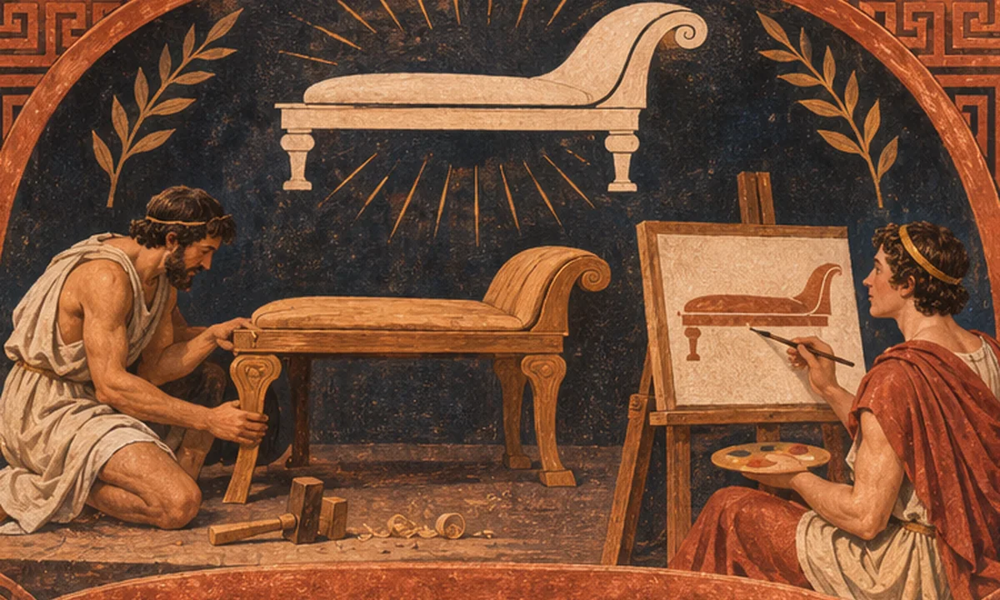
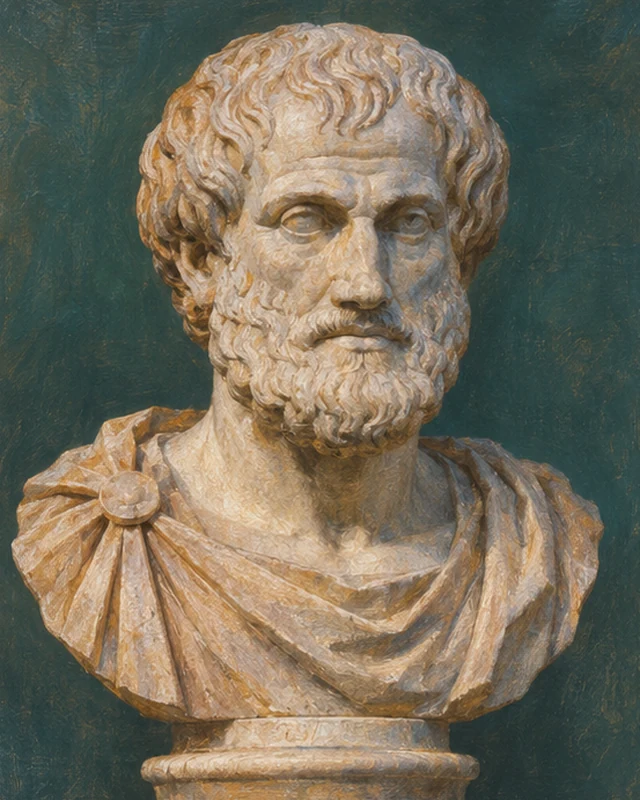

Picture an Athenian crowd at a theatre festival, and then a Roman reader with a scroll of Greek verse. Both are listening to poetry, and both have opinions about it. The first writers who put such opinions on paper and gave reasons for them are the classical critics. Their work is more than two thousand years old, yet students still use their words. *Imitation*, *plot*, *catharsis* and *sublime* all come from them.

Four names stand for this age. Plato asked whether poetry could be trusted. Aristotle answered by studying how a good tragedy is built. Horace, a Roman poet, gave practical advice to writers in a letter in verse. An unknown author, traditionally called Longinus, asked why some writing lifts a reader out of himself. Between them, they raised questions that later critics kept returning to. What is poetry? What is it for? What makes it great?

This is the second article in the series on the history of English literary criticism. It begins with writers who worked in Greek and Latin, not English. That is because English critics, from the Renaissance onward, argued with these four again and again. Sidney, Dryden and Johnson will appear in later articles, and each will be easier to follow once you know where their ideas came from.

## The world of classical criticism

### Poetry as a public art

For the Greeks, poetry was something heard in a crowd. Professional reciters, called rhapsodes, performed the poems of Homer aloud. Tragedies and comedies were staged at public festivals, and the audience judged them. In the introduction to this series, we met the comic poet Aristophanes, whose play *The Frogs* won first prize at its festival in 405 BCE. In that play, the god Dionysus acts as judge between two dead tragic poets. A city that listens to poetry together will soon ask whether what it hears is good for the people who hear it. This is why early Greek criticism cares so much about the effect of poetry on citizens, and not only about its beauty.

### From Greece to Rome

Plato (c. 428-348 BCE) and Aristotle (384-322 BCE) spent their working lives in the Greek world of the fourth century BCE. Aristotle was Plato's pupil, and much of what he wrote about poetry is an answer to his teacher.

Horace (65-8 BCE) belonged to a later world. He was born at Venusia in Italy and became a poet in Rome. His patron was Maecenas, a close aide of Octavian, who later became the emperor Augustus. Maecenas gave him a farm. Horace wrote for educated Romans who knew Greek literature well, and he told them to study the Greek models by night and by day.

The treatise *On the Sublime* was also written in Greek, but in the Roman world, and probably in the first century CE. Its author wrote to a cultured Roman friend named Postumius Terentianus. So the age we call classical covers more than four hundred years and two languages.

### A first map

In the map from the introduction, the ancient world leans mainly on the mimetic view, which treats literature as an imitation of life. Plato and Aristotle both start from imitation, although they judge it very differently. Horace looks chiefly at the audience and asks how poetry should please and help it. Longinus looks at the effect of great writing on the reader, and at the greatness of the writer's mind. This is only one way of sorting them. It is a map to help you travel, and not a rule.

### Did you know?

Horace believed in patience. In his *Art of Poetry*, he told writers to hold a poem back until the ninth year before letting it go out into the world. Few poets today would wait so long.

### Important points to remember

- Classical criticism comes from Greek and Roman writers, from Plato to Longinus.
- Greek poetry was performed in public, by rhapsodes and at festivals.
- Plato (c. 428-348 BCE) and Aristotle (384-322 BCE) belong to the Greek world of the fourth century BCE.
- Aristotle was Plato's pupil.
- Horace (65-8 BCE) was a Roman poet, and his patron was Maecenas.
- *On the Sublime* was written in Greek, probably in the first century CE, to Postumius Terentianus.
- In Abrams's map, the ancient world leans mainly on the mimetic view.
- Plato and Aristotle both start from imitation, but they judge it very differently.
- Horace told poets to hold a poem back until the ninth year.

## Plato: poetry on trial

Plato is the first great name in Western criticism, and he came to poetry as a suspicious judge. He did not ask whether poems are beautiful. He asked whether they are true, and whether they make people better or worse.

### The charge in the *Republic*

In the *Republic*, Plato describes an ideal city and asks how its future guardians should be raised. Stories are part of that training, so he asks which stories they should hear. In Books 2 and 3, he objects to tales that show the gods and heroes behaving badly. He also objects to passages about the underworld and about mourning, which he thinks would make the guardians fearful or weak.

In Book 3, he defines imitation (*mimesis*) as impersonation, which means a poet speaking in the voice of another person. His worry is that acting out a base character makes the actor, and the listener, more like that character. For this reason, imitative poets are not admitted to the city. Even a visiting poet who was holy and wonderful, he says, would be sent away.

### Third from the truth

Book 10 returns to the matter with a harder argument. Plato describes a ladder of reality. At the top is the true Form of a thing, such as a couch, which a god makes. Below it is the couch made by a craftsman, and below that is a painting of a couch made by an imitator. The painter copies only how the couch looks, and not what it is. The imitator, Plato says, is therefore third from the king and from the truth. Poets are imitators of the same kind.

<figure class="article-illustration">
  
  <figcaption>A painted interpretation of Plato’s three levels in the couch example.</figcaption>
</figure>

Plato also criticises Homer as ignorant, which suggests that a poet can write well without real knowledge. And he says that imitation harms the soul by strengthening its irrational part against reason. His main example is the grief shown on the tragic stage. In Benjamin Jowett's translation, poetry "feeds and waters the passions instead of drying them up".

### Poetry as inspiration: the *Ion*

The *Ion* shows another side of Plato's thought. Ion is a rhapsode who performs Homer. Socrates leads him to admit that he has no real knowledge that would let him judge other poets. Then Socrates offers a picture. A magnet lifts an iron ring, and that ring lifts another, so that a chain of rings hangs from a single magnet. In the picture, the Muse is the magnet, and poets and performers are rings that hang from her power. Poets, then, are "inspired and possessed". They do not write by skill.

In the *Phaedrus*, Plato calls poetry one of four kinds of divine madness. So he does not simply despise poetry. He doubts that it is a form of knowledge, and he is troubled by how strongly it moves people.

### The ancient quarrel, and an open door

Near the end of Book 10, Plato speaks of "an ancient quarrel between philosophy and poetry". He means that the two have long been rivals for the right to teach people how to live. Yet he does not close the matter. Poetry must be sent away from the ideal city, but she may come back if her defenders can speak for her, in verse or in prose, and show that she is useful and not only pleasant. Many later critics took up that invitation. The best known of them was Plato's own pupil.

### Important points to remember

- Plato asks whether poetry is true and whether it makes people better or worse.
- In Books 2 and 3 of the *Republic*, he objects to stories of bad gods and to passages that make guardians fearful.
- In Book 3, Plato defines *mimesis* as impersonation.
- Plato fears that acting a base character makes the actor more like it.
- Imitative poets are not admitted to the ideal city.
- In Book 10, the imitator is "third from the king and from the truth".
- Plato criticises Homer as ignorant and says imitation strengthens the irrational part of the soul.
- In the *Ion*, the Muse is a magnet and poets are "inspired and possessed".
- Plato speaks of "an ancient quarrel between philosophy and poetry".
- Poetry may return to the city if her defenders show that she is useful.

## Aristotle: the *Poetics*

<figure class="article-illustration article-illustration--float article-illustration--portrait">
  
  <figcaption>Aristotle in a modern painted study of an ancient bust type. <a href="https://artsandculture.google.com/asset/head-of-aristotle-unknown/_QFymkF6DMfotw?hl=en" target="_blank" rel="noopener">Portrait reference</a></figcaption>
</figure>

Aristotle (384-322 BCE) was Plato's pupil, and he wrote the *Poetics* in the fourth century BCE. It is the earliest surviving work of Greek dramatic theory, and the first surviving philosophical treatise about literature alone. Only half of it remains. In ancient times the work was split across two rolls, and the second part, on comedy, is lost. What survives is mostly about tragedy.

### Imitation is natural

Aristotle begins where Plato's attack began, with imitation, but he reaches a different view. In Part 4, he says that the instinct of imitation is "implanted in man from childhood", and that "no less universal is the pleasure felt in things imitated" (S. H. Butcher's translation). Imitation, then, is a natural human activity and a source of pleasure. It is not a danger that must be shut out of the city.

### The definition of tragedy

Aristotle's best-known definition comes in Part 6:

> "Tragedy, then, is an imitation of an action that is serious, complete, and of a certain magnitude."

Each word matters. The action is serious, so it deals with weighty things. It is complete, so it has a beginning, a middle and an end. It has magnitude, so it is large enough to matter. Aristotle adds that tragedy works through pity and fear, and that it brings about the *catharsis* of such feelings.

### The six parts and the plot

Aristotle says that every tragedy must have six parts, and that these parts decide its quality. They are plot (*mythos*), character (*ethos*), thought (*dianoia*), diction (*lexis*), song (*melos*) and spectacle (*opsis*). He also ranks them. Plot, he says, is "the first principle, and, as it were, the soul of a tragedy". Character holds the second place. Spectacle, the look of the stage, is "the least artistic" of the parts.

Plot comes first because a tragedy imitates an action, and plot is the arrangement of the events that make up that action.

<figure class="article-illustration criticism-map" aria-labelledby="criticism-map-title">
  <figcaption id="criticism-map-title">Aristotle’s six parts of tragedy</figcaption>
  <ul>
    <li><strong>Plot</strong>Arrangement of events</li>
    <li><strong>Character</strong>Qualities revealed in choices</li>
    <li><strong>Thought</strong>The ideas expressed</li>
    <li><strong>Diction</strong>Choice of words</li>
    <li><strong>Song</strong>The musical element</li>
    <li><strong>Spectacle</strong>What the audience sees</li>
  </ul>
</figure>

### A plot that holds together

A good plot, Aristotle says, has unity. It is built around one action, and its events are linked so closely that if one were removed, the whole would loosen. This is why he thinks tragedy is more unified than epic, which can hold many actions. One epic can supply the material for several tragedies.

Complex plots often contain two special moments. The first is a reversal (*peripeteia*), when fortune turns into its opposite. The second is a recognition (*anagnorisis*), when a character moves from ignorance to knowledge. A complex plot includes both.

### The tragic hero and the idea of error

Whom should a tragedy show? Aristotle answers in Part 13. The hero should be a person whose misfortune is brought about "not by vice or depravity, but by some error or frailty". The Greek word for this error is *hamartia*. It is usually translated as "miscalculation" or "mistake". Later readers, especially in the Romantic age, often took it to mean a "tragic flaw" in the hero's character, but that is a later reading.

The most tragic plot, in Aristotle's view, pushes a person who is not wicked into undeserved misfortune through a mistake. Such a story arouses pity for the one who suffers and fear for ourselves, since the sufferer is a person like us.

### Catharsis

Tragedy, Aristotle says, works through pity and fear to bring about the *catharsis* of those emotions. Scholars still do not agree on what he meant. The word is translated as "purgation", "purification" or "clarification". The idea behind all three is that watching a tragedy does something to the audience's feelings, and that the effect is good for them. Plato feared that tragedy would feed the passions. Aristotle's idea suggests that, in some way, tragedy may relieve or clear them.

### Poetry and history

In Part 9, Aristotle compares the poet with the historian. The historian tells what has happened, and the poet tells what might happen, according to probability or necessity. He concludes that "poetry is a more philosophical and a higher thing than history", because "poetry tends to express the universal, history the particular". This is another reply to Plato. A poem is not a copy of a copy. It can show the shape of human life more clearly than a list of events.

### What Aristotle did not say

Students often hear about the "three unities" of action, time and place, and they are told that these come from Aristotle. This is only partly true. Aristotle insists on unity of action. On time, he says only that tragedy tries, as far as it can, to fit within "a single revolution of the sun". On place, the *Poetics* says nothing at all.

The three unities as a firm rule came later. Lodovico Castelvetro set them out in his commentary on the *Poetics* in 1570. The French dramatist Pierre Corneille defended them in his *Trois Discours* (1655). A century later, Samuel Johnson, in his *Preface to Shakespeare* (1765), argued that the unities of time and place are not essential to a good play. So the phrase "the Aristotelian unities" is misleading.

### An interesting story

The *Poetics* nearly slipped out of Western sight. For a long time, Western readers did not have the Greek text. The work came back through a Latin translation of an Arabic version by the philosopher Averroes. That Arabic version had itself come through Syriac from a Greek manuscript made before 700 CE. Averroes read tragedy as praise and comedy as blame. In 1278, William of Moerbeke made an accurate Latin translation from the Greek, but almost nobody noticed it. Giorgio Valla published a Latin translation in 1498, and the Aldine Press printed the Greek text in 1508. Castelvetro's Italian editions followed in 1570 and 1576. So a short book written in fourth-century Athens reached the critics of the Renaissance by a long and crooked road.

### Important points to remember

- Aristotle (384-322 BCE) wrote the *Poetics* in the fourth century BCE.
- The *Poetics* is the earliest surviving work of Greek dramatic theory.
- The second book, on comedy, is lost.
- Aristotle says the instinct of imitation is natural and a source of pleasure.
- Tragedy is an imitation of an action that is serious, complete and of a certain magnitude.
- Tragedy has six parts: plot, character, thought, diction, song and spectacle.
- Plot is the soul of tragedy, character comes second, and spectacle is the least artistic part.
- A complex plot contains a reversal (*peripeteia*) and a recognition (*anagnorisis*).
- *Hamartia* means error or miscalculation, and it is not necessarily a "tragic flaw".
- Poetry is more philosophical than history because it expresses the universal.

## Horace: the *Art of Poetry*

Horace (65-8 BCE), whose full name was Quintus Horatius Flaccus, is best known today for his *Satires*, *Odes* and *Epistles*. Critics know him for one more work, the *Ars Poetica*, or *Art of Poetry*. It is a verse letter of 476 lines in hexameter, and it is sometimes called *Epistles* 2.3. Scholars disagree on its date, and sources place it somewhere between about 19 and 8 BCE. Horace addressed it to Lucius Calpurnius Piso and his two sons, who are known as the Pisones.

Because it is a letter, it moves from one piece of advice to the next, and it does not follow a single plan. Its lines are short and easy to remember. That is one reason it has been quoted for two thousand years.

### Unity and decorum

The poem opens with a joke. If a painter joined a horse's neck to a human head, Horace asks, could you keep from laughing? A poem, like a painting, must be one whole, and not a heap of unrelated parts. From this he moves to *decorum*, the idea that each kind of writing has its proper place and manner. A comic subject should not be told in the style of tragedy, and a speaker should talk as a person of his age and rank would talk.

Horace gives a sketch of the four ages of man to show what he means. The boy is "just able to pronounce his words". The youth, freed from his guardian, enjoys horses and hounds. The grown man seeks wealth. The old man is weighed down by troubles. A poet who gives a character the wrong manner for his age, Horace says, will not convince anyone.

### To profit or to delight

Horace's most famous idea is about the purpose of poetry. "Poets wish either to profit or to delight," he writes, in the Latin *aut prodesse volunt aut delectare poetae*. A few lines later he adds that the poet who joins the instructive with the agreeable "carries off every vote". The Latin phrase is *utile dulci*, "the useful with the sweet".

So the best poetry, for Horace, does both jobs at once. In the terms of Abrams's map, this is a pragmatic view, because it judges a poem by its effect on the audience. Later critics, from Sidney to Johnson, kept coming back to this pairing of instruction and pleasure.

### Practical advice for writers

Much of the letter is plain craft advice. A story should hurry on to the event and take the reader into the middle of things, which is the meaning of *in medias res*. A play should have five acts. A god should not come down on the stage to rescue the plot, unless the knot is worthy of a god's help. This is the origin of the phrase *deus ex machina*. Writers should read the Greek models by night and by day.

Horace also compares poetry with painting in the line *ut pictura poesis*, "as is painting, so is poetry". Some paintings strike you more when you stand near, and others when you stand at a distance. Poems are the same. He ends the letter with a joke. A bad poet who will not stop is like a bear that has burst through the gates of its den, and no reader is safe from him.

### Horace in translation

The *Art of Poetry* reached English readers through translation. Jacques Pelletier du Mans published the first French translation in 1541, and Thomas Drant published the first English translation in 1566. Ben Jonson also translated the poem, and his version appeared in 1640, after his death. The *Norton Anthology* says that the influence of the work on later poets and critics has been almost continuous, partly because its sayings are so easy to quote.

### Important points to remember

- Horace (65-8 BCE) was a Roman poet, and his full name was Quintus Horatius Flaccus.
- The *Ars Poetica* is a verse letter of 476 lines, sometimes called *Epistles* 2.3.
- It is addressed to Piso and his two sons, the Pisones.
- Its date is uncertain, but it falls between about 19 and 8 BCE.
- Horace says a poem must be a unified whole, and he warns against joining a horse's neck to a human head.
- Decorum means that each kind of writing has its proper place and style.
- Horace says poets wish either to profit or to delight, and the best join the useful with the sweet.
- *In medias res* means beginning in the middle of events.
- A god should not rescue the plot unless the knot is worthy of a god, which gave us *deus ex machina*.
- The first English translation of the *Art of Poetry* was by Thomas Drant in 1566.

## Longinus: *On the Sublime*

### An author without a name

The Greek treatise *On the Sublime* has no certain author. Its only early manuscript, now known as Parisinus Graecus 2036, was copied in the tenth century. It names the author as "Dionysius or Longinus". Early printers linked the work to Cassius Longinus, a scholar of the third century, but the treatise mentions no writer later than the first century CE. So the name Longinus stays in use out of habit, even though the real author is unknown. The first century CE is the usual guess for its date, but this is not certain.

The treatise is addressed to a friend, Postumius Terentianus. The first printed edition was made by Francis Robortello at Basel in 1554. It was Nicolas Boileau's French translation of 1674, however, that began the work's career in the history of criticism. William Smith's English translation of 1739 brought it back into prominence.

### What is the sublime?

Longinus calls the sublime a "loftiness and excellence of language". Its effect is unusual. A lofty passage, he says, does not convince the reader's reason but takes him out of himself. He is carried away. A true sublime also pleases everyone, and it pleases always. Its effect stays in the mind after the reading is over.

This is a different question from Aristotle's. Aristotle asks how a work is built. Longinus asks what makes a reader feel that he has been lifted up.

### The five sources

Longinus names five sources of the sublime. The first and most important is grandeur of thought. The others are strong emotion, certain figures of thought and speech, noble diction, and a dignified arrangement of words. A writer who has all five has a good chance of being great.

### Greatness of soul

The sublime, Longinus says, is "the image of greatness of soul". By this he means that great writing grows out of a great mind.

He gives striking examples. He praises the lawgiver of the Jews, who wrote "God said, let there be light, and there was light". He quotes the prayer of Ajax in the *Iliad*, who asks Zeus only to save the army from darkness. He compares the *Odyssey* to the setting sun. It is still great, he says, but it has lost its fervent heat. He also quotes a famous ode by Sappho, which begins "I deem that man divinely blest".

### After Longinus

Edmund Burke's *A Philosophical Enquiry into the Origin of Our Ideas of the Sublime and Beautiful* (1757) and Immanuel Kant's *Critique of the Power of Judgment* both draw on Longinus's idea of the sublime. The idea suited Romantic thinkers, who looked beyond logic to feeling and wonder. Yet the Romantics also grew wary of Longinus, partly because he had come to be linked with classical rules.

### Key terms

- **Classical criticism** - the criticism of the Greek and Roman writers, from Plato to Longinus.
- **Mimesis** - the Greek word for imitation, central to Plato and Aristotle.
- **Rhapsode** - a professional reciter of Homer's poems.
- **Ancient quarrel** - Plato's phrase for the old rivalry between philosophy and poetry.
- **Catharsis** - Aristotle's word for the purging, purifying or clearing of pity and fear that tragedy brings about.
- **Mythos** - the Greek word for plot, the first principle and soul of tragedy.
- **Hamartia** - the error or miscalculation that brings the tragic hero down.
- **Peripeteia** - a reversal, when fortune turns into its opposite.
- **Anagnorisis** - a recognition, when a character moves from ignorance to knowledge.
- **Unity of action** - the idea that a tragedy should be built around a single action.
- **Three unities** - the later rule of one action, one day and one place, set out by Castelvetro in 1570.
- **Ars Poetica** - Horace's verse letter on the art of poetry, also called *Epistles* 2.3.
- **Decorum** - the idea that each kind of writing, and each speaker, has its proper style.
- **Utile dulci** - Latin for "the useful with the sweet", Horace's pairing of instruction and pleasure.
- **In medias res** - beginning a story in the middle of events.
- **Deus ex machina** - a god brought on the stage to solve a plot, which Horace warns against.
- **Ut pictura poesis** - Latin for "as is painting, so is poetry".
- **Sublime** - loftiness of thought and language that carries the reader out of himself.
- **Greatness of soul** - the source of the sublime, according to Longinus.

### Important points to remember

- The author of *On the Sublime* is unknown, and the name Longinus is only traditional.
- The only early manuscript, Parisinus Graecus 2036, dates from the tenth century and names "Dionysius or Longinus".
- The treatise is usually dated to the first century CE and is addressed to Postumius Terentianus.
- Robortello printed the first edition in 1554, and Boileau's French translation of 1674 launched its career.
- William Smith's English translation of 1739 brought the treatise back into prominence.
- Longinus calls the sublime a loftiness and excellence of language that takes the reader out of himself.
- The five sources are grandeur of thought, strong emotion, figures, noble diction and dignified word arrangement.
- Grandeur of thought is the first and most important source.
- The sublime is "the image of greatness of soul".
- Burke and Kant both drew on Longinus's idea of the sublime.

## How classical criticism shaped what came after

### Ideas that stayed

Many words in the critic's vocabulary were made in this age. Plato gave critics the problem of *mimesis* and the long quarrel between philosophy and poetry. Aristotle gave them plot, the six parts of tragedy, catharsis and the claim that poetry is more philosophical than history. Horace gave them decorum and the pairing of the useful with the sweet. Longinus gave them the sublime and the thought that great writing comes from a great mind. Whenever a later critic uses one of these terms, he is speaking in a language that these four began.

### The long road to English

The texts did not reach English critics at once. Valla's Latin translation of the *Poetics* appeared in 1498, the Aldine Greek text in 1508, and Castelvetro's commentary in 1570. Horace was in English by 1566, and Jonson's version followed in 1640. Boileau brought Longinus to a wide audience in 1674. These dates fall in the Renaissance and the age of Dryden, which are the subject of the next articles. The ancient writers did not simply give answers to the English critics. They gave them questions, and also something to argue against.

### How to read the classical critics

When you read these four, ask three questions of each. What does this critic think poetry is? What does he think it is for? And what is he arguing against? Plato was arguing against the poets' hold on the Greek mind. Aristotle was arguing, politely, against Plato. Horace was arguing against careless writing. Longinus was arguing that great writing needs a great mind behind it. Asked this way, the four texts begin to speak to one another.

### Important points to remember

- Plato gave critics the problem of *mimesis* and the quarrel between philosophy and poetry.
- Aristotle gave critics plot, the six parts of tragedy, catharsis and the case for poetry as more philosophical than history.
- Horace gave critics decorum and the pairing of instruction and pleasure.
- Longinus gave critics the sublime and the link between great writing and a great mind.
- Valla's Latin *Poetics* appeared in 1498, and the Aldine Greek text in 1508.
- Castelvetro's commentary of 1570 set out the three unities.
- Drant's English *Art of Poetry* appeared in 1566, and Jonson's version in 1640.
- Boileau's French translation of 1674 brought Longinus to a wide audience.
- The classical writers gave later critics questions as well as answers.

## Critics and works

| Critic | Dates | Key work | Known for |
|---|---|---|---|
| Plato | c. 428-348 BCE | *Republic*, *Ion* | Doubt about imitative poetry; poets as inspired |
| Aristotle | 384-322 BCE | *Poetics* | Plot, the six parts of tragedy, catharsis |
| Horace | 65-8 BCE | *Ars Poetica* | Decorum; to profit or to delight |
| Longinus (traditional name of an unknown author) | Not known | *On the Sublime* | The sublime and greatness of soul |

## Quick revision - 50 points

1. Classical criticism comes from the Greek and Roman writers.
2. The four main classical critics are Plato, Aristotle, Horace and Longinus.
3. Greek poetry was performed in public, by rhapsodes and at festivals.
4. Plato lived from about 428 to 348 BCE.
5. Aristotle lived from 384 to 322 BCE and was Plato's pupil.
6. Horace lived from 65 to 8 BCE, and his patron was Maecenas.
7. In the *Republic*, Plato asks which stories the guardians of his ideal city should hear.
8. In Book 3 of the *Republic*, Plato defines *mimesis* as impersonation.
9. Plato feared that acting a base character makes the actor more like that character.
10. Plato said that imitative poets are not admitted to the ideal city.
11. In Book 10, Plato calls the imitator third from the king and from the truth.
12. Plato's ladder of reality runs from the Form made by a god to the craftsman's couch to the painter's picture.
13. Plato criticised Homer as ignorant of the things he described.
14. Plato said that imitation strengthens the irrational part of the soul against reason.
15. In the *Ion*, Ion is a rhapsode who performs Homer.
16. In the *Ion*, the Muse is the magnet and poets are "inspired and possessed".
17. In the *Phaedrus*, poetry is one of four kinds of divine madness.
18. Plato speaks of "an ancient quarrel between philosophy and poetry".
19. Plato said poetry may return to the city if her defenders can show that she is useful.
20. Aristotle wrote the *Poetics* in the fourth century BCE.
21. The second book of the *Poetics*, on comedy, is lost.
22. Aristotle said that the instinct of imitation is natural to humans from childhood.
23. Aristotle defined tragedy as an imitation of an action that is serious, complete and of a certain magnitude.
24. Tragedy has six parts: plot, character, thought, diction, song and spectacle.
25. Aristotle called plot the first principle and soul of tragedy.
26. In Aristotle's ranking, character holds the second place.
27. Aristotle called spectacle the least artistic of the parts.
28. A reversal of fortune is called *peripeteia*.
29. A recognition, a move from ignorance to knowledge, is called *anagnorisis*.
30. *Hamartia* is usually translated as error or miscalculation.
31. Catharsis is translated as purgation, purification or clarification.
32. Aristotle said that poetry is more philosophical than history.
33. Aristotle said that poetry tends to express the universal and history the particular.
34. Aristotle insisted on unity of action.
35. Aristotle said that tragedy tries to fit within a single revolution of the sun.
36. The *Poetics* says nothing about unity of place.
37. Castelvetro set out the three unities in his commentary of 1570.
38. Giorgio Valla published a Latin translation of the *Poetics* in 1498.
39. The Aldine Press printed the Greek text of the *Poetics* in 1508.
40. Horace's *Ars Poetica* is a verse letter of 476 lines.
41. Horace addressed the poem to Piso and his two sons, the Pisones.
42. Horace said that poets wish either to profit or to delight.
43. Horace praised the poet who joins the instructive with the agreeable.
44. *In medias res* means beginning in the middle of events.
45. Horace advised poets to hold a poem back until the ninth year.
46. The author of *On the Sublime* is unknown, and the manuscript says "Dionysius or Longinus".
47. Longinus says a lofty passage takes the reader out of himself.
48. Longinus names grandeur of thought as the first and most important source of the sublime.
49. Longinus calls the sublime "the image of greatness of soul".
50. Boileau's French translation of 1674 launched the career of *On the Sublime*.

## Quick quiz - 25 questions

Tap an answer to see at once if it is right. You do not need to log in.

**1. Who was Aristotle's teacher?**

- A) Socrates
- B) Plato
- C) Horace
- D) Longinus

Answer: B. Aristotle was Plato's pupil, and much of the *Poetics* answers Plato.

**2. What was Ion's job in Plato's dialogue *Ion*?**

- A) A painter
- B) A general
- C) A lawgiver
- D) A rhapsode

Answer: D. Ion was a rhapsode, a professional reciter who performed the poems of Homer.

**3. In Socrates's picture in the *Ion*, what does the magnet stand for?**

- A) The Muse
- B) The audience
- C) The critic
- D) The city

Answer: A. The Muse is the magnet, and poets and performers are rings that hang from her power.

**4. In Book 10 of the *Republic*, how far is the imitator from the truth?**

- A) First from the truth
- B) Second from the truth
- C) Third from the king and from the truth
- D) Fourth from the truth

Answer: C. Plato says the imitator is third from the king and from the truth, after the Form and the craftsman's object.

**5. What does Plato call the old rivalry between two ways of teaching people how to live?**

- A) The war of the arts
- B) The battle of the books
- C) The great debate
- D) The ancient quarrel between philosophy and poetry

Answer: D. Near the end of Book 10, Plato speaks of an ancient quarrel between philosophy and poetry.

**6. On what condition might poetry return to Plato's ideal city?**

- A) If it were written only in prose
- B) If her defenders could show that she is useful
- C) If the guardians asked for it
- D) If it were sung and not spoken

Answer: B. Plato allows poetry to return if her defenders can speak for her and show that she is useful.

**7. What does Aristotle say about the instinct of imitation?**

- A) It is natural to humans from childhood
- B) It is a skill only poets have
- C) It is a danger to the young
- D) It was invented by the Greeks

Answer: A. Aristotle calls the instinct of imitation natural and the pleasure in imitations universal.

**8. Which part of tragedy does Aristotle call "the soul of a tragedy"?**

- A) Character
- B) Spectacle
- C) Plot
- D) Diction

Answer: C. Aristotle calls plot the first principle and, as it were, the soul of a tragedy.

**9. Which part of tragedy does Aristotle call the least artistic?**

- A) Thought
- B) Spectacle
- C) Song
- D) Diction

Answer: B. Spectacle, the look of the stage, is the least artistic of the six parts.

**10. Which of these is not one of Aristotle's six parts of tragedy?**

- A) Thought
- B) Diction
- C) Song
- D) Rhyme

Answer: D. The six parts are plot, character, thought, diction, song and spectacle, and rhyme is not among them.

**11. What does *catharsis* refer to in the *Poetics*?**

- A) The clapping of the audience
- B) The entrance of the chorus
- C) The purging, purifying or clearing of pity and fear
- D) The final speech of the hero

Answer: C. Catharsis is the effect of tragedy on pity and fear, and scholars still debate its exact meaning.

**12. What is *peripeteia*?**

- A) A reversal, when fortune turns into its opposite
- B) A recognition of a lost person
- C) A speech by the chorus
- D) A change of scene

Answer: A. Peripeteia is a reversal of fortune, and anagnorisis is a recognition.

**13. What does Aristotle say about poetry and history?**

- A) History is more truthful than poetry
- B) Poetry and history are the same
- C) Poetry is only for pleasure
- D) Poetry is more philosophical because it expresses the universal

Answer: D. In Part 9, Aristotle says poetry tends to express the universal and history the particular.

**14. Which of the three unities does the *Poetics* say nothing about?**

- A) Action
- B) Place
- C) Time
- D) Character

Answer: B. Aristotle insists on unity of action and mentions a single revolution of the sun, but he says nothing about place.

**15. Who set out the three unities in a commentary on the *Poetics* in 1570?**

- A) Samuel Johnson
- B) Pierre Corneille
- C) Lodovico Castelvetro
- D) Giorgio Valla

Answer: C. Castelvetro set out the three unities in his commentary of 1570.

**16. What subject did the lost second book of the *Poetics* treat?**

- A) Comedy
- B) Epic
- C) Lyric
- D) History

Answer: A. The second book, on comedy, is lost.

**17. Which patron helped Horace and gave him a farm?**

- A) Augustus
- B) Piso
- C) Plato
- D) Maecenas

Answer: D. Maecenas, a close aide of Octavian, was Horace's patron and gave him a farm.

**18. To whom is Horace's *Art of Poetry* addressed?**

- A) Augustus
- B) Maecenas
- C) Piso and his two sons
- D) Virgil

Answer: C. The poem is addressed to Lucius Calpurnius Piso and his two sons, the Pisones.

**19. What does *aut prodesse volunt aut delectare poetae* mean?**

- A) Poets must obey the rules
- B) Poets wish either to profit or to delight
- C) Poets write for the gods
- D) Poets should never teach

Answer: B. Horace says that poets wish either to profit or to delight.

**20. What does *in medias res* mean?**

- A) Beginning in the middle of events
- B) Ending with a god
- C) Speaking to the audience
- D) Writing in verse

Answer: A. Horace advises the poet to hurry the reader into the middle of things.

**21. How long did Horace advise poets to hold back a poem?**

- A) One year
- B) Until the ninth year
- C) Five years
- D) Until the poet's death

Answer: B. In the *Art of Poetry*, Horace says a poem should be held back until the ninth year.

**22. What do we know about the author of *On the Sublime*?**

- A) He was Cassius Longinus of the third century
- B) He was Aristotle
- C) He was a pupil of Horace
- D) His identity is unknown

Answer: D. The manuscript says "Dionysius or Longinus", and the real author is unknown.

**23. What is the first and most important source of the sublime, according to Longinus?**

- A) Grandeur of thought
- B) Noble diction
- C) Dignified word arrangement
- D) Figures of speech

Answer: A. Longinus begins his list of five sources with grandeur of thought.

**24. To what does Longinus compare the *Odyssey*?**

- A) A calm sea
- B) A rising star
- C) The setting sun
- D) A winter storm

Answer: C. He says the *Odyssey* is still great but, like the setting sun, it has lost its fervent heat.

**25. Whose French translation of 1674 launched the career of *On the Sublime* in the history of criticism?**

- A) Corneille's
- B) Boileau's
- C) Robortello's
- D) Valla's

Answer: B. Nicolas Boileau's French translation of 1674 began the work's career in criticism.

## Frequently asked questions

**What is classical literary criticism?**
It is the criticism written by Greek and Roman authors, from Plato in the fourth century BCE to Longinus in the first century CE. Its main figures are Plato, Aristotle, Horace and Longinus, and its ideas are the root of much later criticism.

**Why did Plato want to send poets out of his ideal city?**
Plato feared that imitative poetry copied only appearances and strengthened the irrational part of the soul. He also thought that acting out bad characters made people more like them. Yet he left an open door, since poetry could return if her defenders showed that she was useful.

**What did Aristotle mean by catharsis?**
Aristotle said that tragedy works through pity and fear to bring about the catharsis of such feelings. The word is translated as purgation, purification or clarification, and scholars still debate which is best.

**Did Aristotle teach the three unities?**
Not exactly. Aristotle insisted on unity of action, and he said that tragedy tries to fit within a single revolution of the sun. He said nothing about unity of place. The three unities as a firm rule were set out later, by Castelvetro in 1570.

**What did Horace mean by instruct and delight?**
Horace said that poets wish either to profit or to delight, and that the poet who joins the instructive with the agreeable carries off every vote. He meant that the best poetry teaches and pleases at the same time.

**Who was Longinus?**
Nobody knows for certain. The only early manuscript of *On the Sublime* names "Dionysius or Longinus", and the work was probably written in the first century CE. The name Longinus stays in use as a traditional label for an unknown author.

## Sources

- Abrams, M. H., and Geoffrey Galt Harpham. *A Glossary of Literary Terms*. 11th ed., Cengage Learning, 2015.
- Abrams, M. H. *The Mirror and the Lamp: Romantic Theory and the Critical Tradition*. Oxford University Press, 1953.
- Drabble, Margaret, editor. *The Oxford Companion to English Literature*. 6th ed., Oxford University Press, 2000.
- Plato. *The Republic* (Books 2, 3 and 10). Translated by Benjamin Jowett, 1871.
- Plato. *Ion* and *Phaedrus*.
- Aristotle. *Poetics*. Translated by S. H. Butcher.
- Horace. *Ars Poetica* (*Epistles* 2.3). Translation adapted from C. Smart and E. H. Blakeney.
- Longinus (traditional name of an unknown author). *On the Sublime*.

Afsar Khan, Ph.D. English
