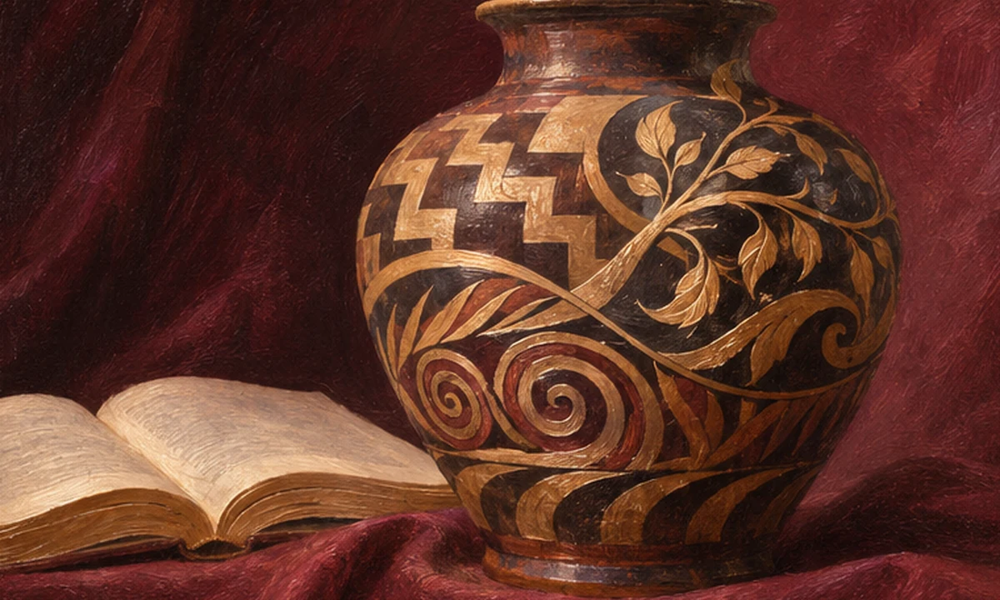
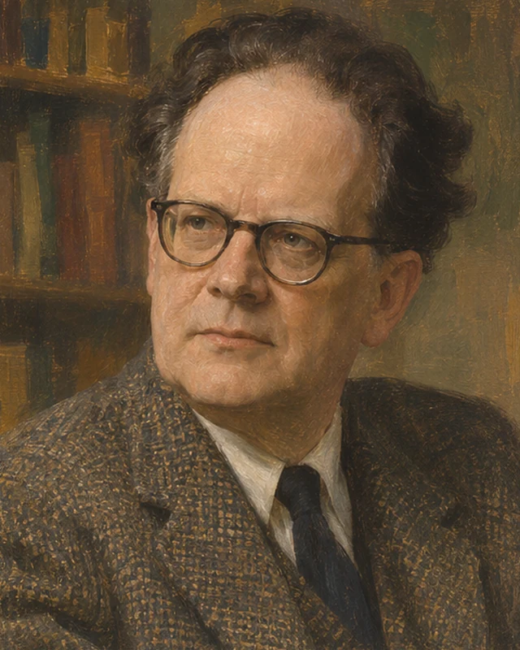

Picture an English literature seminar in Britain or America between 1930 and 1960. Students no longer spend the hour reciting a poet's biography or praising his noble sentiments. Instead, they lean closely over a single page—unpacking its puns, ironies, paradoxes and recurring myths—treating the literary work as a dense, living structure of words. This was the golden age of close reading and systematic literary criticism.

Four names and movements stand for this age. William Empson showed that verbal ambiguity is not a defect in poetry, but the very heart of its richness. F. R. Leavis joined intense close reading with fierce moral seriousness, reshaping the English canon through *Scrutiny* and *The Great Tradition*. The American New Critics—John Crowe Ransom, Cleanth Brooks, Allen Tate, W. K. Wimsatt and Monroe Beardsley—made the autonomous text the sole centre of literary judgment. Finally, Northrop Frye stepped back from single poems to map all of literature as one vast, unified system of myths and archetypes.

This is the eighth article in the series on the history of English literary criticism. In the previous article, we saw A. C. Bradley, T. S. Eliot and I. A. Richards turn criticism toward poetic autonomy, impersonality and classroom close reading. Mid-twentieth-century critics turned those breakthroughs into powerful schools of thought—setting the stage for the great wave of modern Literary Theory that followed in the late twentieth century.

## The world of mid twentieth-century criticism

### The triumph of close reading

Between 1930 and the 1960s, literary criticism became a professional academic discipline across British and American universities. Building directly on T. S. Eliot's focus on "the poetry, not the poet" and I. A. Richards's experiments in *Practical Criticism*, critics made **close reading**—slow, line-by-line attention to diction, imagery, tone and structure—the standard method of literary study.

### Two paths: text alone or culture and myth

Even within this shared devotion to the text, mid-century critics took sharply different paths. In America, the **New Critics** put the poem under a microscope, sealing it off from authorial biography and reader emotion. In Britain, **William Empson** opened up the tangled multiple meanings of poetic words, while **F. R. Leavis** insisted that close reading must serve moral vitality and defend culture against shallow mass society. Meanwhile, in Canada, **Northrop Frye** traded the microscope for a telescope—looking beyond isolated poems to uncover the universal patterns shared by all stories across history.

### A map of the age

In M. H. Abrams's map of critical theories, the mid-twentieth century is the high-water mark of the **objective view**, which treats the work of art as a self-contained verbal object. Yet Leavis kept Matthew Arnold's moral-pragmatic tradition fiercely alive, and Frye's grand structural maps pointed directly toward the European Structuralism of the 1960s.

### Did you know?

William Empson began his university career at Cambridge as a mathematics student before switching to English. He was only twenty-two years old—still an undergraduate writing weekly essays for his supervisor I. A. Richards—when he drafted *Seven Types of Ambiguity* (1930).

### Important points to remember

- Mid-twentieth-century criticism (1930-1960s) made close reading the core method of university English studies.
- The era builds directly on the foundations laid by T. S. Eliot and I. A. Richards.
- In Abrams's map, this period represents the peak of the **objective view** (the autonomous text), alongside Leavis's moral criticism and Frye's archetypal system.
- The four major pillars are William Empson, F. R. Leavis, the American New Critics and Northrop Frye.
- William Empson began writing *Seven Types of Ambiguity* as a Cambridge undergraduate supervised by I. A. Richards.

## William Empson: the richness of ambiguity

William Empson (1906-1984)—poet, critic and brilliant student of I. A. Richards—changed how readers think about poetic language with a single astonishing book: *Seven Types of Ambiguity* (1930; revised 1947 and 1953). His later critical works include *Some Versions of Pastoral* (1935), *The Structure of Complex Words* (1951) and *Milton's God* (1961).

### *Seven Types of Ambiguity* (1930)

In ordinary prose or scientific writing, ambiguity is usually treated as a fault—a sign of muddled thinking. Empson reversed that assumption for poetry. Poetic language, he showed, gains its power and density precisely because words can vibrate with several meanings at once. He defined ambiguity in an extended sense as:

> "Any verbal nuance, however slight, which gives room for alternative reactions to the same piece of language."

Empson arranged his examples on a rising scale of seven types, moving from simple richness to deep contradiction:

- **Type 1:** a single detail or metaphor is effective in several complementary ways at once (such as Shakespeare's "Bare ruined choirs, where late the sweet birds sang", where tree branches suggest ruined church arches, singing choirs and fading autumn).
- **Types 2 to 6:** progressive stages in which two or more meanings resolve into one idea, two unconnected meanings are given simultaneously by a pun, alternative meanings combine to show a complex state of mind, a simile is discovered mid-sentence, or a reader must invent interpretations to fill in an apparent contradiction.
- **Type 7:** the most intense form, where two meanings of a word are directly opposite, revealing a fundamental division in the author's mind.

### Why Empson stands apart

Although *Seven Types of Ambiguity* became a foundational text for American New Criticism, Empson was never a cold formalist. Unlike the New Critics, he refused to banish the author's biography or intention from criticism, and he always read with lively psychological curiosity and plain common sense.

### Important points to remember

- William Empson (1906-1984) published *Seven Types of Ambiguity* in 1930 (revised 1947 and 1953).
- He defined ambiguity as "any verbal nuance, however slight, which gives room for alternative reactions to the same piece of language".
- Empson arranged ambiguity into seven escalating types, from rich complementary metaphors (Type 1) to direct opposites revealing a divided mind (Type 7).
- His other major critical works include *Some Versions of Pastoral* (1935), *The Structure of Complex Words* (1951) and *Milton's God* (1961).
- Though he inspired New Criticism, Empson remained deeply interested in authorial intention and human psychology.

## F. R. Leavis: scrutiny and the great tradition

Frank Raymond Leavis (1895-1978), teaching at Cambridge alongside his wife and fellow scholar **Q. D. Leavis**, was the most fiercely debated British critic of the twentieth century. Through his influential quarterly journal ***Scrutiny*** (1932-1953) and his landmark books—*New Bearings in English Poetry* (1932), *Revaluation* (1936), *The Great Tradition* (1948) and *D. H. Lawrence: Novelist* (1955)—Leavis fused razor-sharp close reading with uncompromising moral judgment.

### *Scrutiny*, "life" and moral seriousness

Leavis inherited Matthew Arnold's belief that great literature protects a civilization's moral intelligence against commercialism and cheap mass media. Yet Leavis distrusted abstract literary theory. When pressed to state his theoretical principles, he replied that criticism works by concrete collaborative demonstration: the critic points to a passage and asks, "This is so, isn't it?", expecting the reader to respond, "Yes, but...".

For Leavis, the supreme test of literature was its **"reverent openness before life"**—whether a writer's language embodied genuine moral maturity, vitality and honesty. In *New Bearings in English Poetry* (1932), he championed modernists like T. S. Eliot, Ezra Pound and Gerard Manley Hopkins; in *Revaluation* (1936), he controversially demoted Milton and Shelley while elevating Donne, Pope and Keats.

### *The Great Tradition* (1948)

Leavis's most famous book opens with one of the boldest sentences in English criticism:

> "The great English novelists are Jane Austen, George Eliot, Henry James and Joseph Conrad."

Leavis chose these four because they combined artistic mastery with intense moral seriousness about human life. He soon added **D. H. Lawrence** as the great modern heir to this tradition (*D. H. Lawrence: Novelist*, 1955). Notoriously, in 1948 Leavis excluded Charles Dickens from the main line—calling him a great entertainer and praising only *Hard Times*—though he and Q. D. Leavis later revised that verdict in *Dickens the Novelist* (1970).

### The "Two Cultures" clash

In 1959, the scientist and novelist C. P. Snow delivered his famous Rede Lecture, **"The Two Cultures"**, lamenting the gulf between scientists and literary intellectuals and accusing literary writers of ignoring modern scientific progress. In 1962, Leavis delivered a blistering reply in his Richmond Lecture, insisting that technological progress without humane literary culture leaves society spiritually impoverished.

### Important points to remember

- F. R. Leavis (1895-1978) edited the Cambridge quarterly journal *Scrutiny* (1932-1953) with Q. D. Leavis and colleagues.
- His key books are *New Bearings in English Poetry* (1932), *Revaluation* (1936), *The Great Tradition* (1948) and *D. H. Lawrence: Novelist* (1955).
- Leavis distrusted abstract theory and described practical criticism as a dialogue: "This is so, isn't it?" — "Yes, but...".
- In *The Great Tradition* (1948), he named four great English novelists: **Jane Austen, George Eliot, Henry James and Joseph Conrad** (later adding D. H. Lawrence, and reconsidering Dickens in 1970).
- In 1962, Leavis fiercely attacked C. P. Snow's "Two Cultures" lecture (1959), defending humane literary culture against narrow technocracy.

## The New Critics: the poem as verbal icon

From the late 1930s through the 1950s, **New Criticism** became the dominant school of literary criticism in American universities. Many of its founders—**John Crowe Ransom**, **Allen Tate**, **Robert Penn Warren** and **Cleanth Brooks**—were Southern poet-critics, joined by major theorists such as **W. K. Wimsatt** and **Monroe C. Beardsley**. The movement took its name from Ransom's 1941 book, ***The New Criticism***, and spread rapidly through Brooks and Warren's hugely influential college textbook, *Understanding Poetry* (1938).

### The autonomous text and the two fallacies

For the New Critics, a poem is an independent, self-contained object made of words—what Wimsatt called a **"verbal icon"**. Everything needed to understand and judge the poem is already inside the text itself. To guard close reading against outside distractions, **W. K. Wimsatt and Monroe C. Beardsley** published two landmark essays (later collected in Wimsatt's *The Verbal Icon*, 1954):

- **The Intentional Fallacy (1946):** the mistake of judging or interpreting a poem by hunting for the author's private intention, letters or biography. Once a poem is written, it is detached from its author and belongs to the public; if the poet succeeded, the poem itself shows it.
- **The Affective Fallacy (1949):** the mistake of judging a poem by its emotional effect on the reader (tears, shivers or personal feelings). Confusing the poem with its results, they argued, makes the poem itself disappear into subjective impressionism.

### Paradox, irony, tension and the heresy of paraphrase

If a poem is neither the poet's diary nor the reader's private mood, how does it work? The New Critics searched for **organic unity** forged through conflict and complexity:

- **Cleanth Brooks** (*The Well Wrought Urn*, 1947) declared that "the language of poetry is the language of paradox". Great poems hold together opposing attitudes through **paradox** and **irony** (meaning shaped and qualified by context). Brooks also coined **"the heresy of paraphrase"**—the error of assuming that a plain prose summary captures the real meaning of a poem.
- **John Crowe Ransom** (*The New Criticism*, 1941) argued that a poem has two interwoven elements: **structure** (its logical paraphraseable argument) and **texture** (its rich local details, metaphors, metre and sound).
- **Allen Tate** introduced the term **tension** (combining **extension**, or literal dictionary meaning, with **intension**, or figurative suggestion) to measure the taut richness of good poetry.

<figure class="article-illustration">
  
  <figcaption>A painted interpretation of the urn as a metaphor for how the parts of a poem hold together.</figcaption>
</figure>

### Important points to remember

- New Criticism (1930s-1950s) took its name from John Crowe Ransom's *The New Criticism* (1941).
- Key figures include John Crowe Ransom, Cleanth Brooks, Robert Penn Warren, Allen Tate, W. K. Wimsatt and Monroe C. Beardsley.
- Brooks and Warren's *Understanding Poetry* (1938) spread New Critical close reading across American classrooms.
- Wimsatt and Beardsley defined the **Intentional Fallacy** (1946: judging by author's intent) and the **Affective Fallacy** (1949: judging by reader's emotional response), collected in *The Verbal Icon* (1954).
- Cleanth Brooks (*The Well Wrought Urn*, 1947) championed **paradox** and **irony** and coined **"the heresy of paraphrase"**.
- Ransom distinguished **structure** and **texture**; Allen Tate defined poetic **tension** (extension + intension).

## Northrop Frye: myths, modes and archetypes

<figure class="article-illustration article-illustration--float article-illustration--portrait">
  
  <figcaption>Northrop Frye in a modern painted interpretation. <a href="https://alumni.utoronto.ca/community/awards/awex/northrop-frye-awards" target="_blank" rel="noopener">Portrait reference</a></figcaption>
</figure>

While New Critics examined individual lyrics line by line, the Canadian scholar **Northrop Frye** (1912-1991) asked a much larger question: can all of literature be mapped as one interconnected whole? After his groundbreaking study of William Blake, *Fearful Symmetry* (1947), Frye published his masterpiece, ***Anatomy of Criticism: Four Essays*** (1957)—the most influential work of **Archetypal** (or **Myth**) **Criticism** in the twentieth century.

### Criticism as a science and the order of words

Frye felt that modern criticism was trapped between random personal taste and isolated close readings. Criticism, he argued, should become a systematic, coherent discipline—like biology or physics—with its own organising principles. Literature is not a pile of unrelated books copying raw reality; it is a self-contained **"order of words"**, where poems are made out of earlier poems and shared human conventions.

Frye distinguished two directions of reading: **centripetal** (moving inward to study the text's internal verbal pattern) and **centrifugal** (moving outward from words to external facts in the real world). Literature, Frye said, is primarily centripetal.

### The four mythoi and the five fictional modes

Drawing on anthropology (such as James Frazer's *The Golden Bough*) and Carl Jung's idea of collective patterns, Frye showed that Western literature revolves around recurring **archetypes**—shared plots, symbols and character types rooted in human desire and the cycle of the seasons. His two most famous schemes in *Anatomy of Criticism* are:

- **The Four Mythoi (matched to the four seasons):**
  - **Comedy** — the mythos of **Spring** (birth, triumph of youth, social renewal).
  - **Romance** — the mythos of **Summer** (adventure, heroic quest, triumph over darkness).
  - **Tragedy** — the mythos of **Autumn** (decline, isolation, the fall of the hero).
  - **Irony and Satire** — the mythos of **Winter** (disillusionment, darkness, parody of romance).
- **The Five Fictional Modes** (ranked by the hero's power of action compared with us and the natural world):
  1. **Myth:** the hero is a god, superior in *kind* to both humans and nature.
  2. **Romance:** the hero is superior in *degree* to other people and to natural laws.
  3. **High Mimetic:** the epic or tragic hero is superior in degree to other people, yet subject to natural law.
  4. **Low Mimetic:** the realistic hero is one of us, neither superior nor inferior.
  5. **Ironic:** the hero is inferior in power or intelligence to ourselves, so we look down on a scene of bondage or absurdity.

<figure class="article-illustration criticism-map" aria-labelledby="criticism-map-title">
  <figcaption id="criticism-map-title">Frye’s four mythoi and the seasons</figcaption>
  <ul>
    <li><strong>Spring · Comedy</strong>Renewal</li>
    <li><strong>Summer · Romance</strong>The heroic quest</li>
    <li><strong>Autumn · Tragedy</strong>The fall of the hero</li>
    <li><strong>Winter · Irony and satire</strong>Disillusionment</li>
  </ul>
</figure>

### An interesting story

When the twenty-two-year-old William Empson sat in I. A. Richards's rooms at Cambridge in 1928, they were discussing a single sonnet by Shakespeare. Empson began tossing out layers of overlapping meanings so rapidly that Richards remarked he ought to try doing the same thing to a few more poems. Empson walked out, locked himself away, and returned just two weeks later carrying a thick bundle of thirty thousand words—the core of *Seven Types of Ambiguity*, which became one of the most famous books of criticism ever written by an undergraduate.

### Key terms

- **Close reading** - detailed, line-by-line analysis of a text's language, imagery, tone and structure.
- **Ambiguity (Empson)** - "any verbal nuance, however slight, which gives room for alternative reactions to the same piece of language".
- **Seven Types of Ambiguity** - William Empson's 1930 classification of poetic ambiguity from rich metaphors (Type 1) to direct opposites (Type 7).
- **Scrutiny** - the influential Cambridge quarterly journal (1932-1953) edited by F. R. Leavis and Q. D. Leavis.
- **The Great Tradition** - F. R. Leavis's 1948 canon of morally serious English novelists: Jane Austen, George Eliot, Henry James and Joseph Conrad.
- **Two Cultures debate** - the 1959-1962 clash between C. P. Snow (defending scientific culture) and F. R. Leavis (defending humane literary culture).
- **New Criticism** - the mid-century American school (named after John Crowe Ransom's 1941 book) treating the poem as an autonomous verbal object.
- **Verbal icon** - W. K. Wimsatt's phrase for the self-contained, self-referential literary work.
- **Intentional Fallacy** - Wimsatt and Beardsley's term (1946) for the error of judging a poem by the author's private intention.
- **Affective Fallacy** - Wimsatt and Beardsley's term (1949) for the error of judging a poem by its emotional effect on the reader.
- **Heresy of paraphrase** - Cleanth Brooks's term (*The Well Wrought Urn*, 1947) for the mistake of equating a poem with its prose summary.
- **Paradox and irony** - Cleanth Brooks's central poetic qualities, binding opposing attitudes into organic unity.
- **Structure and texture** - John Crowe Ransom's distinction between a poem's logical argument (structure) and its rich local detail (texture).
- **Tension** - Allen Tate's term for the balanced poetic fusion of denotation (extension) and connotation (intension).
- **Archetypal / Myth Criticism** - Northrop Frye's method (*Anatomy of Criticism*, 1957) of tracing universal recurring symbols, plots and myths across literature.
- **Four Mythoi** - Frye's seasonal cycle of genres: Comedy (Spring), Romance (Summer), Tragedy (Autumn), and Irony/Satire (Winter).
- **Five Fictional Modes** - Frye's historical scale of heroes: Myth, Romance, High Mimetic, Low Mimetic and Ironic.
- **Centripetal vs. centrifugal reading** - Frye's distinction between inward textual reading and outward reference to the world.

### Important points to remember

- Northrop Frye (1912-1991) was a Canadian critic and the leading theorist of **Archetypal / Myth Criticism**.
- His major works include *Fearful Symmetry* (1947, on Blake) and *Anatomy of Criticism: Four Essays* (1957).
- Frye viewed literature as a self-contained "order of words" and aimed to make criticism a systematic discipline.
- He mapped **Four Mythoi** to the seasons: Comedy (Spring), Romance (Summer), Tragedy (Autumn), and Irony/Satire (Winter).
- He classified literature into **Five Fictional Modes**: Myth, Romance, High Mimetic, Low Mimetic and Ironic.
- He distinguished **centripetal** (inward verbal) from **centrifugal** (outward referential) reading.

## How mid twentieth-century criticism shaped what came after

### Ideas that stayed

Mid-twentieth-century critics gave English studies the everyday toolkit that students still use in exams and classrooms. Every time you unpack a poem's ambiguity, irony or paradox—or refuse to reduce a poem to a flat summary—you are using Empson and Cleanth Brooks. Every time you debate which books belong in the literary canon, you are echoing Leavis. Every time you spot a recurring quest myth or seasonal pattern across stories, you are thinking with Northrop Frye.

### From New Criticism and Frye to Structuralism and Theory

By the late 1960s, a new wave of European **Literary Theory**—Structuralism, Poststructuralism, Marxism, Feminism and Postcolonialism—challenged the New Critics for isolating texts from history, politics, gender and power. Yet these newer movements did not erase mid-century criticism. Structuralists built directly on Frye's systematic grids; Deconstructionists pushed Empson's verbal ambiguity even further; and close reading remained the indispensable starting point for almost every school of modern theory.

### How to read these critics

When you read Empson, Leavis, the New Critics and Frye, ask three simple questions of each. How closely does he zoom in on the **single text** versus the **wider system**? What does he shut **out** of criticism (author's biography, reader's feelings, abstract theory, or value judgments)? And what does he put **at the centre**—verbal ambiguity, moral vitality, ironic unity, or universal myth? Asked this way, the four voices form a clear, memorable map of mid-century English studies.

### Important points to remember

- Close reading, ambiguity, paradox and irony remain permanent tools of literary analysis.
- Leavis's canon debates laid the ground for later arguments over cultural value and representation.
- Northrop Frye's systematic archetypes served as a bridge to European Structuralism.
- Later twentieth-century Theory challenged New Criticism's separation of text from history and politics, while still relying on close reading.

## Critics and works

| Critic | Dates | Key work | Known for |
|---|---|---|---|
| William Empson | 1906-1984 | *Seven Types of Ambiguity* (1930), *Some Versions of Pastoral* (1935) | Verbal ambiguity as poetic richness; seven escalating types |
| F. R. Leavis | 1895-1978 | *Scrutiny* (1932-1953), *Revaluation* (1936), *The Great Tradition* (1948) | Moral seriousness; canon of English novelists; "Two Cultures" clash |
| John Crowe Ransom | 1888-1974 | *The New Criticism* (1941) | Naming New Criticism; structure vs. texture; ontological critic |
| Cleanth Brooks | 1906-1994 | *Understanding Poetry* (1938, with Warren), *The Well Wrought Urn* (1947) | Paradox, irony and "the heresy of paraphrase" |
| W. K. Wimsatt & Monroe Beardsley | 1907-1975 / 1915-1985 | "The Intentional Fallacy" (1946), "The Affective Fallacy" (1949), *The Verbal Icon* (1954) | Separating the poem from author's intent and reader's emotions |
| Northrop Frye | 1912-1991 | *Fearful Symmetry* (1947), *Anatomy of Criticism* (1957) | Archetypal/Myth criticism; four seasonal mythoi; five fictional modes |

## Quick revision - 50 points

1. Mid-twentieth-century criticism (1930-1960s) was the golden age of close reading and systematic literary study.
2. It built directly on the foundations laid by T. S. Eliot and I. A. Richards.
3. In Abrams's map, this era represents the peak of the objective view of literature.
4. William Empson lived from 1906 to 1984 and studied under I. A. Richards at Cambridge.
5. Empson published *Seven Types of Ambiguity* in 1930 (revised 1947 and 1953).
6. Empson defined ambiguity as "any verbal nuance, however slight, which gives room for alternative reactions to the same piece of language".
7. Empson classified poetic ambiguity into seven escalating types.
8. Type 1 ambiguity occurs when a detail or metaphor works in several complementary ways at once.
9. Type 7 ambiguity occurs when a word carries two directly opposite meanings showing a divided mind.
10. Empson also wrote *Some Versions of Pastoral* (1935), *The Structure of Complex Words* (1951) and *Milton's God* (1961).
11. F. R. Leavis lived from 1895 to 1978 and taught at Cambridge.
12. Leavis edited the quarterly journal *Scrutiny* from 1932 to 1953 alongside Q. D. Leavis and colleagues.
13. Leavis published *New Bearings in English Poetry* in 1932, championing Eliot, Pound and Hopkins.
14. Leavis published *Revaluation* in 1936, praising Donne, Pope and Keats while demoting Milton and Shelley.
15. Leavis described collaborative practical criticism as the exchange: "This is so, isn't it?" — "Yes, but...".
16. Leavis published *The Great Tradition* in 1948.
17. In *The Great Tradition*, Leavis named four great English novelists: Jane Austen, George Eliot, Henry James and Joseph Conrad.
18. Leavis later added D. H. Lawrence (*D. H. Lawrence: Novelist*, 1955) as their modern heir.
19. In 1948, Leavis praised only *Hard Times* by Dickens, though he later revised his view in *Dickens the Novelist* (1970).
20. In 1962, Leavis fiercely attacked C. P. Snow's 1959 Rede Lecture on "The Two Cultures".
21. American New Criticism flourished from the late 1930s through the 1950s.
22. The movement took its name from John Crowe Ransom's 1941 book, *The New Criticism*.
23. Key New Critics include Ransom, Cleanth Brooks, Robert Penn Warren, Allen Tate, W. K. Wimsatt and Monroe C. Beardsley.
24. Brooks and Warren's *Understanding Poetry* (1938) made New Critical close reading standard in classrooms.
25. New Critics treated the poem as a self-contained, autonomous object—a "verbal icon".
26. Wimsatt and Beardsley published "The Intentional Fallacy" in 1946.
27. The Intentional Fallacy is the error of judging or interpreting a poem by the author's private intention.
28. Wimsatt and Beardsley published "The Affective Fallacy" in 1949.
29. The Affective Fallacy is the error of judging a poem by its emotional effect on the reader.
30. Both fallacy essays were collected in Wimsatt's *The Verbal Icon* (1954).
31. Cleanth Brooks published *The Well Wrought Urn* in 1947.
32. Brooks declared that "the language of poetry is the language of paradox".
33. Brooks coined "the heresy of paraphrase" for the mistake of equating a poem with its prose summary.
34. Brooks emphasised irony as the modification of meaning by poetic context.
35. John Crowe Ransom distinguished a poem's logical "structure" from its rich local "texture".
36. Allen Tate introduced the term "tension" (combining literal extension and figurative intension).
37. Northrop Frye lived from 1912 to 1991 and was Canada's most famous literary theorist.
38. Frye's first major book was *Fearful Symmetry* (1947), a study of William Blake.
39. Frye published his masterpiece, *Anatomy of Criticism: Four Essays*, in 1957.
40. Frye is the leading theorist of Archetypal Criticism (also called Myth Criticism).
41. Frye viewed literature as a self-contained "order of words" and sought to make criticism systematic.
42. Frye distinguished centripetal (inward textual) reading from centrifugal (outward referential) reading.
43. Frye linked four archetypal mythoi to the four seasons of nature.
44. In Frye's system, Comedy is the mythos of Spring.
45. Romance is the mythos of Summer.
46. Tragedy is the mythos of Autumn.
47. Irony and Satire form the mythos of Winter.
48. Frye divided literature into five fictional modes: Myth, Romance, High Mimetic, Low Mimetic and Ironic.
49. In the Ironic mode, the hero is inferior in power or intelligence to the reader.
50. Frye's systematic grids helped bridge mid-century Formalism and late-twentieth-century Structuralism.

## Quick quiz - 25 questions

Tap an answer to see at once if it is right. You do not need to log in.

**1. In what year was William Empson's *Seven Types of Ambiguity* first published?**

- A) 1924
- B) 1930
- C) 1941
- D) 1948

Answer: B. Empson published *Seven Types of Ambiguity* in 1930 after drafting it as an undergraduate at Cambridge.

**2. Who was William Empson's supervisor at Cambridge when he drafted *Seven Types of Ambiguity*?**

- A) F. R. Leavis
- B) T. S. Eliot
- C) I. A. Richards
- D) A. C. Bradley

Answer: C. Empson wrote the initial essays under the supervision of I. A. Richards.

**3. How does Empson define "ambiguity" in *Seven Types of Ambiguity*?**

- A) A grammatical mistake that ruins clarity
- B) Any verbal nuance, however slight, which gives room for alternative reactions to the same piece of language
- C) The deliberate use of archaic words
- D) A conflict between the poet and the critic

Answer: B. Empson treated ambiguity broadly as the rich source of layered poetic meaning.

**4. In Empson's seven types, what defines Type 7 ambiguity?**

- A) A simple simile
- B) Two meanings of a word that are directly opposite, revealing a deep division in the author's mind
- C) A rhyme scheme that repeats
- D) A historical allusion

Answer: B. Type 7 is the most intense form of ambiguity, uniting directly contradictory meanings.

**5. What was the name of the influential Cambridge quarterly journal edited by F. R. Leavis from 1932 to 1953?**

- A) *The Criterion*
- B) *The Egoist*
- C) *Scrutiny*
- D) *The Kenyon Review*

Answer: C. Leavis, Q. D. Leavis and colleagues edited *Scrutiny* from 1932 to 1953.

**6. Which four English novelists did F. R. Leavis name in the opening sentence of *The Great Tradition* (1948)?**

- A) Defoe, Fielding, Dickens and Hardy
- B) Jane Austen, George Eliot, Henry James and Joseph Conrad
- C) Charlotte Brontë, Emily Brontë, Virginia Woolf and James Joyce
- D) Richardson, Scott, Thackeray and Trollope

Answer: B. Leavis declared Jane Austen, George Eliot, Henry James and Joseph Conrad the great English novelists.

**7. Which single novel by Charles Dickens did Leavis praise in *The Great Tradition* (1948)?**

- A) *Great Expectations*
- B) *Bleak House*
- C) *Hard Times*
- D) *David Copperfield*

Answer: C. In 1948 Leavis praised only *Hard Times* as a serious moral fable, though he later revised his view of Dickens in 1970.

**8. Which modern novelist did Leavis later add as the heir to "the great tradition" in a 1955 book?**

- A) James Joyce
- B) D. H. Lawrence
- C) Virginia Woolf
- D) E. M. Forster

Answer: B. Leavis championed Lawrence in *D. H. Lawrence: Novelist* (1955).

**9. With whom did F. R. Leavis clash in 1962 over "The Two Cultures"?**

- A) T. S. Eliot
- B) C. P. Snow
- C) Cleanth Brooks
- D) Northrop Frye

Answer: B. Leavis fiercely attacked C. P. Snow's 1959 Rede Lecture on "The Two Cultures" in his 1962 Richmond Lecture.

**10. Which 1941 book gave the American New Criticism its name?**

- A) Cleanth Brooks's *The Well Wrought Urn*
- B) John Crowe Ransom's *The New Criticism*
- C) W. K. Wimsatt's *The Verbal Icon*
- D) Northrop Frye's *Anatomy of Criticism*

Answer: B. John Crowe Ransom's *The New Criticism* (1941) supplied the movement's lasting name.

**11. Which widely used 1938 textbook by Cleanth Brooks and Robert Penn Warren spread New Critical close reading in classrooms?**

- A) *Practical Criticism*
- B) *Understanding Poetry*
- C) *The Sacred Wood*
- D) *Revaluation*

Answer: B. *Understanding Poetry* (1938) trained generations of students in close textual analysis.

**12. Who co-authored the landmark essays "The Intentional Fallacy" (1946) and "The Affective Fallacy" (1949)?**

- A) Cleanth Brooks and Robert Penn Warren
- B) W. K. Wimsatt and Monroe C. Beardsley
- C) John Crowe Ransom and Allen Tate
- D) I. A. Richards and C. K. Ogden

Answer: B. Wimsatt and Beardsley wrote both essays, later collected in Wimsatt's *The Verbal Icon* (1954).

**13. What is the "Intentional Fallacy"?**

- A) Judging a poem by the emotional tears it causes in a reader
- B) Judging or interpreting a poem by the author's private intention or biography
- C) Attributing human emotions to inanimate nature
- D) Overrating a poem because it is old

Answer: B. The Intentional Fallacy warns against treating the author's private intention as the standard for judging a published poem.

**14. What is the "Affective Fallacy"?**

- A) Judging a poem by its emotional effect on the reader
- B) Summarising a poem in plain prose
- C) Comparing a poem with classical touchstones
- D) Looking for puns and ambiguities

Answer: A. The Affective Fallacy confuses the poem itself with its psychological results in the reader.

**15. Who coined the phrase "the heresy of paraphrase" in *The Well Wrought Urn* (1947)?**

- A) John Crowe Ransom
- B) Allen Tate
- C) Cleanth Brooks
- D) William Empson

Answer: C. Cleanth Brooks argued that reducing a poem to a prose summary destroys its real poetic meaning.

**16. According to Cleanth Brooks, "the language of poetry is the language of ..."**

- A) "plain prose"
- B) "paradox"
- C) "history"
- D) "sincere confession"

Answer: B. Brooks opened *The Well Wrought Urn* by declaring that "the language of poetry is the language of paradox".

**17. Which New Critic distinguished a poem's logical "structure" from its rich local "texture"?**

- A) John Crowe Ransom
- B) Cleanth Brooks
- C) W. K. Wimsatt
- D) F. R. Leavis

Answer: A. Ransom contrasted a poem's logical argument (structure) with its local imagery, metre and sound (texture).

**18. Which New Critic defined poetic "tension" as the interplay of literal "extension" and figurative "intension"?**

- A) Robert Penn Warren
- B) Allen Tate
- C) Monroe Beardsley
- D) William Empson

Answer: B. Allen Tate coined the critical term "tension" from the logical terms extension and intension.

**19. In what year was Northrop Frye's *Anatomy of Criticism* published?**

- A) 1930
- B) 1947
- C) 1957
- D) 1962

Answer: C. Frye published *Anatomy of Criticism: Four Essays* in 1957.

**20. Which Romantic poet was the subject of Northrop Frye's groundbreaking 1947 book *Fearful Symmetry*?**

- A) William Wordsworth
- B) Percy Bysshe Shelley
- C) William Blake
- D) John Keats

Answer: C. *Fearful Symmetry* (1947) decoded the complex mythological system of William Blake.

**21. In Northrop Frye's seasonal cycle of the four mythoi, which genre corresponds to Spring?**

- A) Tragedy
- B) Romance
- C) Comedy
- D) Irony and Satire

Answer: C. In Frye's system, Comedy = Spring, Romance = Summer, Tragedy = Autumn, and Irony/Satire = Winter.

**22. In Frye's four mythoi, which season corresponds to Tragedy?**

- A) Spring
- B) Summer
- C) Autumn
- D) Winter

Answer: C. Tragedy is the mythos of Autumn, representing decline, fall and isolation.

**23. Which genre corresponds to Winter in Northrop Frye's *Anatomy of Criticism*?**

- A) Comedy
- B) Romance
- C) Tragedy
- D) Irony and Satire

Answer: D. Irony and Satire form the mythos of Winter, marked by darkness and disillusionment.

**24. In Frye's Five Fictional Modes, which mode features a hero who is inferior in power or intelligence to the reader?**

- A) Myth
- B) High Mimetic
- C) Low Mimetic
- D) Ironic

Answer: D. In the Ironic mode, the reader looks down on a hero of inferior power or freedom.

**25. In Frye's terminology, what does "centripetal" reading mean?**

- A) Reading outward to check historical facts in the real world
- B) Reading inward to study the text's internal verbal structure
- C) Reading only the author's biography
- D) Reading poems aloud in public

Answer: B. Centripetal reading moves inward into the literary structure, whereas centrifugal reading moves outward to external reference.

## Frequently asked questions

**What united mid-twentieth-century literary criticism?**
Despite sharp differences, Empson, Leavis, the American New Critics and Northrop Frye all moved away from biographical gossip and vague impressionism, making disciplined attention to the literary text—or the wider system of literary forms—the heart of university English studies.

**What did William Empson mean by "ambiguity"?**
In *Seven Types of Ambiguity* (1930), Empson used ambiguity not as a flaw, but as "any verbal nuance, however slight, which gives room for alternative reactions to the same piece of language", showing how layered meanings create poetic richness.

**Who belonged to F. R. Leavis's "Great Tradition"?**
In *The Great Tradition* (1948), Leavis named four morally serious English novelists—Jane Austen, George Eliot, Henry James and Joseph Conrad—later adding D. H. Lawrence as their modern successor.

**What are the Intentional Fallacy and the Affective Fallacy?**
Coined by W. K. Wimsatt and Monroe C. Beardsley, the Intentional Fallacy (1946) is the mistake of judging a poem by the author's private intention, while the Affective Fallacy (1949) is the mistake of judging it by its emotional effect on the reader.

**What is Cleanth Brooks's "heresy of paraphrase"?**
In *The Well Wrought Urn* (1947), Brooks argued that a poem's meaning is inseparable from its exact words, paradoxes and ironies—so treating a plain prose summary as equivalent to the poem is a critical heresy.

**How did Northrop Frye link literary genres to the four seasons?**
In *Anatomy of Criticism* (1957), Frye mapped four archetypal mythoi onto the seasonal cycle: Comedy to Spring, Romance to Summer, Tragedy to Autumn, and Irony and Satire to Winter.

## Sources

- Abrams, M. H., and Geoffrey Galt Harpham. *A Glossary of Literary Terms*. 11th ed., Cengage Learning, 2015.
- Abrams, M. H. *The Mirror and the Lamp: Romantic Theory and the Critical Tradition*. Oxford University Press, 1953.
- Drabble, Margaret, editor. *The Oxford Companion to English Literature*. 6th ed., Oxford University Press, 2000.
- Empson, William. *Seven Types of Ambiguity*. Chatto and Windus, 1930.
- Leavis, F. R. *New Bearings in English Poetry*. Chatto and Windus, 1932.
- Leavis, F. R. *The Great Tradition*. Chatto and Windus, 1948.
- Brooks, Cleanth, and Robert Penn Warren. *Understanding Poetry*. Henry Holt, 1938.
- Ransom, John Crowe. *The New Criticism*. New Directions, 1941.
- Brooks, Cleanth. *The Well Wrought Urn: Studies in the Structure of Poetry*. Reynal and Hitchcock, 1947.
- Wimsatt, W. K., and Monroe C. Beardsley. *The Verbal Icon: Studies in the Meaning of Poetry*. University of Kentucky Press, 1954.
- Frye, Northrop. *Anatomy of Criticism: Four Essays*. Princeton University Press, 1957.

Afsar Khan, Ph.D. English
