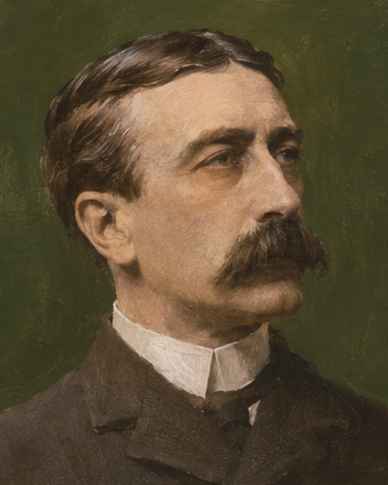

Imagine a boy buying vegetables in a market in Uttar Pradesh. He points towards a basket and asks for a kilo of *aloo*. His friend, who speaks English, calls the same vegetable a potato. The seller understands both words, although they sound quite different. None of those sounds is a natural part of the vegetable itself.

Now imagine that the boy asks for a kilo of onions instead. A small change in his words makes the seller reach for another basket. The order of the words matters too. Behind this ordinary conversation lies a shared system that the boy did not invent. How does that system connect sounds with ideas, and how do its different parts work together?

**Structural linguistics** studies language as a system whose elements gain their identity and value through relations with other elements. The Swiss linguist Ferdinand de Saussure gave this approach an influential foundation. This article in the literary theory and cultural studies series explains his account of language. It then shows why literary critics began to look for systems of meaning behind individual poems and stories.

## Where structural linguistics came from

### The nineteenth-century study of language

Long before Saussure, readers and teachers studied grammar and the history of words. Nineteenth-century European linguists developed methods of comparing languages and tracing their development over time. They examined regular changes in sounds and the relationships between languages with a common ancestor. Sanskrit became an important part of this comparative work on Indo-European languages.

This approach is called **comparative philology**, the historical and comparative study of languages. For example, English *mother*, Sanskrit *mātṛ* and Latin *mater* belong to a family of related words. A scholar can examine their similarities and differences to reconstruct aspects of earlier languages. The aim is to understand how languages developed, rather than simply to find words that happen to sound alike.

Saussure himself received training in this tradition. He studied at Leipzig and received his doctorate there in 1881. His early work explored the ancient vowel system of Indo-European languages. He later taught in Paris and returned to Geneva in 1891. His new approach grew from this knowledge of historical language study, rather than from ignorance of it.

### A different kind of question

A child can learn to speak Hindi without knowing the history of any Hindi word. She learns which sounds distinguish one word from another and which combinations make sense. Such knowledge allows her to produce sentences that she has never heard before. A history of Hindi cannot by itself explain how this present system works.

Saussure gave this second kind of inquiry a separate place in linguistics. He wanted the scholar to examine the relations between the elements of a language at a given time. It was possible to study such relations without first tracing each element back through earlier centuries. He did not mean that language had no history, or that historical study should stop.

The distinction can be seen in the study of English plural forms. A scholar may ask how the unusual plural *children* developed. Another may ask how speakers today distinguish *child* from *children* and *book* from *books*. The questions are related, but the evidence required to answer each question is different.

Habib, in his *A History of Literary Criticism* (2005), places Saussure at the foundation of structuralism. The shift from individual elements to the system of relations had effects far beyond linguistics. A reader of a novel could begin to examine the conventions that make a story understandable. Those conventions could be investigated across a group of novels, rather than treated as the invention of one novelist.

### A shared system rather than a private invention

Language presents a special problem for anyone who wants to study it scientifically. An actual conversation includes movements of the tongue, vibrations in the air and the activity of hearing. It may also include hesitation, emotion and the personal history of the speakers. Saussure distinguished the shared system of language from its individual use.

Think of a school where several teachers speak English with different accents. Their voices do not sound exactly alike, yet the pupils recognise many of the same words. Each teacher draws upon a set of conventions that other speakers understand. It is this shared knowledge that makes a detailed study of the system possible.

For Saussure, a language belongs to a community, and an individual receives it from that community. A person can invent a new expression or give an old word a private meaning. Such an invention becomes part of the shared language only when other speakers adopt it. The system therefore has a social character even when a person is speaking alone.

### Did you know?

Saussure's most influential book, *Course in General Linguistics*, appeared in 1916, three years after his death. It was prepared by editors using material connected with his lectures, rather than published by Saussure himself as a completed book.

### Important points to remember

- Comparative philology studies languages through historical comparison.
- Saussure trained in historical and comparative linguistics.
- He received his doctorate at Leipzig in 1881.
- He returned to Geneva in 1891.
- Structural linguistics studies relations within a language system.
- Historical inquiry and the study of a current language system answer different questions.
- Language is shared by a community of speakers.
- *Course in General Linguistics* appeared posthumously in 1916.

## The core ideas of structural linguistics

### Langue and parole

Saussure uses two French terms to separate the shared system from individual acts of language. **Langue** means the system of signs and conventions accepted by a community. **Parole** means the particular acts through which individuals use that system. A speaker's actual choice of words, their pronunciation and their combination in a sentence belong to parole.

Consider a group of students writing answers in English. They use the same general resources of vocabulary and grammar, but their answers are different. Each answer is an act of language use. The common resources that allow the students to express their ideas belong to langue.

Saussure made langue the principal object of his linguistic inquiry. It does not mean a dictionary, for it includes relations and conventions that speakers need not state consciously. Nor is it the private possession of any one speaker. Each individual participates in a system maintained through the life of a community.

The wider French term *langage* refers to language in its broad sense, including the varied aspects of human language activity. The distinction among these terms helps a reader understand why Saussure limits the object of his investigation. He wants to isolate a coherent system without claiming that individual speech is unimportant.

<figure class="article-illustration theory-diagram" aria-labelledby="theory-diagram-1">
  <figcaption id="theory-diagram-1">The language system and an instance of speech</figcaption>
  <ul role="list">
    <li><strong>Langue</strong>Shared vocabulary and grammar let people understand a request.</li>
    <li><strong>Parole</strong>Asking for a kilo of potatoes is one use of that shared system.</li>
  </ul>
</figure>

### The linguistic sign

Saussure rejects the view that language is simply a list of names attached to objects. For him, a **linguistic sign** unites two psychological elements. One is the **signifier**, or sound pattern that a speaker recognises or mentally recalls. The other is the **signified**, or concept associated with that pattern.

Consider the word *tree*. A reader can silently recall its sound without making a noise. That recognisable sound pattern is the signifier. The idea of a tree associated with it is the signified. An actual neem tree in the school playground is neither of these elements. It is an object to which the sign may refer.

The **referent** is the person, object or other entity to which an expression refers in a particular use. Saussure's two-part sign does not include the referent as a third component. This distinction explains why people can use words for imaginary beings or absent objects. A person can understand the word *unicorn* without meeting such a creature.

The two parts of the sign must be understood together. A sound pattern that carries no recognised concept is not a linguistic sign for the person hearing it. Conversely, the signified in this model is a concept as articulated through a language. The sign is the union of the two, rather than the signifier alone.

<figure class="article-illustration theory-diagram" aria-labelledby="theory-diagram-2">
  <figcaption id="theory-diagram-2">The linguistic sign joins two parts</figcaption>
  <ul role="list">
    <li><strong>Signifier</strong>The sound pattern you recognise when you hear or silently recall “tree”.</li>
    <li><strong>Signified</strong>The concept of a tree that the sound pattern calls to mind.</li>
  </ul>
</figure>

### The arbitrary nature of the sign

**Arbitrariness** means that there is generally no natural necessity linking a signifier to its signified. The English word *water* and the Hindi word *pani* illustrate this point. A community could use different sounds for the same general concept. Nothing about the physical properties of water requires one particular word.

Arbitrary does not mean that a speaker may alter meanings at will. A pupil cannot suddenly use *water* to mean a textbook and expect the class to understand. The sign is arbitrary in its relation between sound and concept, but conventional within the community. Its use depends on habits established through collective life. Saussure describes this stability as immutability, or resistance to individual change. Yet language also shows mutability, because shared conventions can change over time. Both features belong to a system passed from one generation to another.

Saussure also considers words that imitate sounds, a feature called **onomatopoeia**. The English expression *cock-a-doodle-doo* and other languages' forms for a rooster's call are different. Such imitations can be influenced by natural sound, but languages still shape them according to their own conventions. They do not turn language as a whole into a natural naming system.

Some signs are relatively motivated by other signs in the system. A speaker familiar with *ten* and *nine* can understand the formation of *nineteen*. Saussure distinguishes this kind of relative motivation from absolute arbitrariness. The signs from which a complex form is built still depend on linguistic conventions.

### The linear nature of the signifier

The second general principle of the linguistic sign concerns its sound pattern. **Linearity** means that the spoken signifier extends in time. Its elements occur in a succession, rather than all being uttered at the same instant. This succession makes the arrangement of sounds and words significant.

Compare the English words *tap* and *pat*. The same three sound units appear in different positions. The different sequence helps distinguish the two signs. In a sentence, the arrangement of words can likewise affect the relations between them.

This principle concerns the acoustic signifier, not every kind of sign that people use. A picture may present several visual elements at once. A reader of literature can therefore distinguish the sequence of spoken words from the arrangement of images in a painting. Saussure's particular account of linguistic signs should not be mechanically imposed on every medium.

### Difference, signification and linguistic value

**Signification** concerns the association between a signifier and a signified. **Linguistic value** concerns the position a sign occupies in relation to the other signs of its language. For Saussure, a word cannot be fully understood in isolation from the system that supplies its alternatives and contrasts.

The *Course* illustrates this distinction through English and French vocabulary. English commonly distinguishes *sheep*, the animal, from *mutton*, its meat. French *mouton* can cover both uses. Although *sheep* and *mouton* can refer to the same animal, their places within their respective vocabularies are different.

A similar difference can be seen in kinship vocabulary. English uses *uncle* for several relationships, while Hindi can distinguish a maternal uncle from a father's younger brother. These words divide a field of relationships in different ways. A translation may therefore require further information about the relationship intended.

Differences of sound matter as well. In English, *pin* and *bin* contrast in their initial consonants. Changing the initial sound can change the word recognised by the listener. A **phoneme** is a sound unit that can distinguish meaning in a particular language. Structural phonology developed the study of such contrasts in greater detail.

The principle of difference does not mean that language communicates nothing positive. The recognisable sound patterns and concepts together make up signs that speakers use. Saussure's point is that neither a sound unit nor a concept has its linguistic identity independently of the relations that distinguish it.

### Synchrony and diachrony

**Synchronic linguistics** studies a language system at a particular period. **Diachronic linguistics** studies how linguistic elements and relations change through time. A synchronic study could describe the grammar of present-day English. Another could describe the grammar of Middle English at an earlier stage.

A diachronic study could compare those two descriptions and investigate the development of English grammar. It might examine why forms found in Chaucer differ from the forms used today. A synchronic study is therefore not necessarily a study of modern language. It is a study that holds a particular stage relatively steady for the purpose of analysis.

Saussure explains the distinction by comparing language with chess. A player can understand the present position of the pieces without knowing every earlier move. One move then produces a new position, changing relationships between the pieces. Similarly, a change in language can alter the relations that a later synchronic analysis describes.

### Syntagmatic and associative relations

A **syntagmatic relation** connects elements that occur together in a sequence. In the sentence *The child reads a book*, the words occupy positions and form a meaningful combination. The noun *child* is related to the verb *reads* through the grammar of the sentence. These relations are present in the actual expression, or *in praesentia*.

An **associative relation** connects an element with other elements recalled through mental association. A speaker might think of *student*, *teacher* or *reader* as alternatives to *child*. Words may also be associated by root, suffix or sound, even when absent (*in absentia*).

Later structural linguistics commonly uses **paradigmatic relation** for relations between alternatives in a system. The term is particularly useful when analysing what could replace a word in the same position. Saussure's associative relations are broader than this particular type of substitution. Not every word associated in the mind can be inserted into the same sentence.

Literary writers continually choose among possible alternatives and combine the choices into sequences. A poet may choose *home* instead of *house* because the words carry different associations. A critic can investigate that choice alongside the words that actually surround it. The two kinds of relation thus help explain how language creates literary effects.

<figure class="article-illustration theory-diagram" aria-labelledby="theory-diagram-3">
  <figcaption id="theory-diagram-3">Combining words and choosing words</figcaption>
  <ul role="list">
    <li><strong>Syntagmatic relation</strong>In “The child reads a book”, child occurs alongside reads in the sentence.</li>
    <li><strong>Associative relation</strong>Hearing child may bring absent words such as student or reader to mind.</li>
  </ul>
</figure>

### Important points to remember

- Langue is the shared language system; parole is individual language use.
- The sign joins a signifier and a signified.
- The signified is a concept, not an external object.
- Arbitrariness concerns the absence of a necessary natural bond between the two parts of the sign.
- The spoken signifier unfolds in time.
- Linguistic value arises through relations and differences within a system.
- Synchrony studies a language state; diachrony studies change through time.
- Syntagmatic relations involve combination, while associative relations involve mental connections.

## Thinkers and texts

### Saussure and the Course

<figure class="article-illustration article-illustration--float article-illustration--portrait">
  
  <figcaption>Ferdinand de Saussure. Modern painted interpretation. <a href="https://www.tdg.ch/lunige-honore-le-linguiste-ferdinand-de-saussure-531152843658" target="_blank" rel="noopener">Portrait reference</a></figcaption>
</figure>

Ferdinand de Saussure lived from 1857 to 1913. He was a Swiss linguist who taught three courses in general linguistics at the University of Geneva between 1907 and 1911. These lectures provided the material for the book that later made him famous among students of literary theory.

The French title of the work is *Cours de linguistique générale*. The English title is *Course in General Linguistics*. Charles Bally and Albert Sechehaye edited the volume in collaboration with Albert Riedlinger. Wade Baskin's English translation appeared in 1959. These details matter because the published text is an editorial reconstruction of lectures.

The book discusses the object of linguistics, the sign, linguistic value and the distinction between synchronic and diachronic study. It also proposes the study of signs in society. These connected ideas form the basis for much later structuralist thought. The book is a work of linguistics, rather than a manual for interpreting novels.

### Semiology and the study of culture

Saussure proposes **semiology**, a general science concerned with the life of signs in society. Linguistics would form part of this wider study. A sign system need not use spoken words. Signals, conventions of politeness and other meaningful practices can be examined for the differences that people recognise within them.

A traffic light offers a simple illustration. Red and green have different meanings because road users know the relevant code. Their functions depend on a shared convention. Such a code is simpler than a human language, and it cannot express the full range of things that people can say.

The term **semiotics** is now widely used for the study of signs. Charles Sanders Peirce developed another influential account of signs. His framework differs from Saussure's two-part linguistic model. A detailed account of those differences belongs to the wider study of semiotics.

### From language to literature

Habib connects Saussure's linguistic work with the later structuralism of Claude Lévi-Strauss and Roland Barthes. They extended the attention to systems and relations into fields that included cultural practices. An individual story could be investigated as one example of a larger system of meaningful conventions.

A **binary opposition** is a contrast between two terms, such as presence and absence. Structuralist critics sometimes examine how recurring contrasts organise a narrative. In a tale, home and forest may acquire opposing values through repeated events. Such analysis develops the emphasis on relational meaning, rather than reproducing Saussure's linguistic method unchanged.

The reader must be careful not to assign every later structuralist claim to Saussure. His own main subject was language. Later critics developed separate methods for myths, narratives and popular culture. Their work will receive fuller attention in the wider articles on structuralism and semiotics.

### An interesting story

When Saussure was given responsibility for teaching general linguistics at Geneva in 1907, he began to reconsider how the subject should be presented. John E. Joseph's account describes how Saussure reshaped the course during its three offerings. After Saussure's death in 1913, Charles Bally and Albert Sechehaye gathered material from the lectures. With the collaboration of Albert Riedlinger, they prepared the volume published in 1916. The book eventually reached English readers through Wade Baskin's 1959 translation. Thus the text that brought Saussure's ideas to generations of literary students reached them through the work of editors and a translator.

### Key terms

- **Structural linguistics** - study of language through the relations within its system.
- **Comparative philology** - historical comparison of related languages.
- **Langage** - language activity in its broad sense.
- **Langue** - the shared system of linguistic conventions.
- **Parole** - particular acts of language use.
- **Linguistic sign** - the union of a signifier and a signified.
- **Signifier** - the mental sound pattern of a linguistic sign.
- **Signified** - the concept associated with the signifier.
- **Referent** - the entity to which an expression refers in use.
- **Arbitrariness** - absence of a necessary natural link between signifier and signified.
- **Linearity** - the unfolding of the acoustic signifier in time.
- **Signification** - the association of a signifier and a signified.
- **Linguistic value** - a sign's place among other signs in the system.
- **Phoneme** - a sound unit that can distinguish meaning.
- **Synchrony** - study of relations within a language state.
- **Diachrony** - study of language change through time.
- **Syntagmatic relation** - relation among elements combined in a sequence.
- **Associative relation** - relation among elements recalled by mental association.
- **Semiology** - Saussure's proposed science of signs in social life.
- **Binary opposition** - a contrast between two terms.

### Important points to remember

- Saussure lived from 1857 to 1913.
- He gave three courses in general linguistics at Geneva between 1907 and 1911.
- Charles Bally and Albert Sechehaye edited the *Course* with Albert Riedlinger.
- Wade Baskin's English translation appeared in 1959.
- Semiology studies signs in social life.
- Linguistics is part of Saussure's proposed wider science of signs.
- Lévi-Strauss and Barthes extended structuralist analysis beyond linguistics.

## Reading with structural linguistics

### Back to the vegetable market

The boy at the market uses a language whose conventions already exist. His actual request belongs to parole, while the shared knowledge that allows the seller to understand it belongs to langue. The words *aloo* and *potato* demonstrate that similar concepts can be expressed through different signifiers.

<figure class="article-illustration">
  
  <figcaption>Imagined market scene. The seller can recognise both “aloo” and “potato” when the boys ask for the same vegetable.</figcaption>
</figure>

The seller distinguishes a request for potatoes from a request for onions because the terms contrast within the vocabulary. The words in the request also form a sequence. A change in quantity or vegetable name may alter what the customer receives. A structural analysis makes visible these relations that speakers normally use without noticing them.

This example does not explain everything that happens in the market. It does not tell the reader how much the boy can afford or whether the seller treats him fairly. Those questions require evidence about social life. The method explains a particular aspect of the event, namely how its language can convey a request.

### A reading of a literary text

In William Blake's *Songs of Innocence and of Experience* (1794), the paired poems "The Lamb" and "The Tyger" use central animals to organise contrasting images. The lamb is associated with gentleness and innocence. The tiger raises difficult questions about creation and fearful power. Reading the poems together makes their contrasts more visible than reading either in isolation.

A structural reader can trace the words that appear around each animal. The shared question of creation connects the poems, while different choices of images and descriptions separate them. The significance of each image thus depends partly on its relations within the poem and across the pair. This is an application of relational analysis, not a claim that Saussure interpreted Blake himself.

A reader may also compare possible alternatives to particular words in the poems. Replacing the image of a lamb with a different animal would change the associations available to readers. Replacing the tiger with a harmless creature would change the tension of the second poem. The actual combinations and the alternatives that could have been chosen help explain those effects.

### Important points to remember

- An actual request in a market is an instance of parole.
- Shared conventions make the request understandable.
- Vocabulary differences help distinguish requests for different vegetables.
- Structural analysis examines combinations and possible alternatives.
- Blake's "The Lamb" and "The Tyger" can be read through contrasting images.
- A linguistic analysis does not by itself explain every social aspect of an event.

## Criticisms and legacy

### The case against structural linguistics

Valentin Voloshinov, in *Marxism and the Philosophy of Language* (1929), questioned approaches that isolate the linguistic system from living interaction. He discussed Saussure as a major representative of what he called abstract objectivism. For Voloshinov, the actual exchange between speakers deserves central attention. Language is shaped through concrete social activity and its historical conditions.

Imagine the word *sir* spoken in a classroom. It can express respect, fear or even irony, depending on the circumstances of the utterance. Its place in English vocabulary helps explain what makes it recognisable. Yet the shared system alone cannot establish the speaker's attitude on that occasion. Voloshinov's approach directs attention to such particular circumstances.

This objection need not erase the distinction between langue and parole. Separating a system from its use can help answer a limited question. The problem arises if a description of the system is treated as a complete account of language. Different kinds of inquiry may be needed to understand how words work in social life.

A later challenge comes from Jacques Derrida's *Of Grammatology* (1967). Derrida questions the traditional priority given to speech over writing and examines tensions in Saussure's treatment of their relationship. The *Course* gives spoken language primary importance and treats writing as a means of representing it. Derrida's criticism asks what happens when that hierarchy is examined more closely.

### What remained important

Structural linguistics gave later researchers a way of studying relations rather than collecting isolated features. Its influence reached structural phonology, semiology and literary criticism. The distinction between a language system and particular uses also helped literary theorists ask how conventions make individual texts possible.

The structural approach does not remove history from every kind of literary study. A critic may first describe the conventions of a group of texts from one period. Another inquiry may then examine how those conventions changed. The distinction between the questions is useful even when the investigations are brought together.

### How to read these thinkers

A reader can begin with the chapters on the sign and linguistic value in Saussure's *Course*. The introductory discussion of language and speech helps explain the object of his study. The treatment of synchrony and diachrony clarifies why that object can be considered at a particular period. These ideas prepare the ground for the later study of structuralist literary criticism.

It is helpful to test each distinction with an ordinary example before applying it to a poem. A student who can explain why *uncle* and its possible Hindi equivalents differ in value has understood more than a memorised definition. The same reader can then ask how a literary text uses a system of contrasts. The aim is to give reasons for an interpretation, rather than to attach theoretical labels to it.

### Important points to remember

- Voloshinov criticised abstract objectivism in his 1929 book.
- He emphasised language in concrete social interaction.
- Derrida questioned the priority of speech over writing in *Of Grammatology* (1967).
- Structural linguistics influenced literary criticism and semiology.
- A synchronic analysis can be combined with separate historical inquiry.
- The original linguistic concepts should be distinguished from later applications to literature.

## Critics and works

| Thinker | Dates | Key work | Known for |
|---|---|---|---|
| Ferdinand de Saussure | 1857-1913 | *Course in General Linguistics* (1916) | Language as a relational system of signs |
| Valentin Voloshinov | 1895-1936 | *Marxism and the Philosophy of Language* (1929) | Criticism of abstract objectivism |
| Jacques Derrida | 1930-2004 | *Of Grammatology* (1967) | Questioning the priority of speech over writing |

## Quick revision - 50 points

1. Comparative philology studies languages through historical comparison.
2. Sanskrit contributed to comparative work on Indo-European languages.
3. Saussure was trained in historical linguistics.
4. Saussure received his doctorate at Leipzig in 1881.
5. He returned to Geneva in 1891.
6. Structural linguistics studies relations among linguistic elements.
7. A language system is shared by a community.
8. Saussure lived from 1857 to 1913.
9. He taught three courses in general linguistics at Geneva.
10. These lectures took place between 1907 and 1911.
11. *Course in General Linguistics* appeared in 1916.
12. The book appeared after Saussure's death.
13. Charles Bally and Albert Sechehaye edited the book.
14. Albert Riedlinger collaborated in preparing the book.
15. Wade Baskin's English translation appeared in 1959.
16. Langage refers to language in its broad sense.
17. Langue is the shared system of linguistic conventions.
18. Parole refers to particular acts of language use.
19. Saussure made langue the principal object of linguistic study.
20. A linguistic sign unites two psychological elements.
21. The signifier is a mental sound pattern.
22. The signified is a concept.
23. The referent is not a third component of Saussure's linguistic sign.
24. The linguistic sign is not merely a name attached to an object.
25. Arbitrariness means there is no necessary natural bond between signifier and signified.
26. Immutability means resistance to individual change; mutability means change over time.
27. Onomatopoeia involves imitation of sounds.
28. Relative motivation can occur through relations among existing signs.
29. Linearity concerns the temporal succession of acoustic signifiers.
30. Signification involves the association of a signifier with a signified.
31. Linguistic value depends on relations with other signs.
32. English distinguishes sheep from mutton in a way French mouton does not.
33. Hindi and English divide some kinship relationships differently.
34. A phoneme can distinguish meaning in a language.
35. Synchrony studies relations at a particular stage of a language.
36. Diachrony studies language change over time.
37. Synchronic analysis can describe Middle English as well as present-day English.
38. Saussure compares language with chess to illustrate the relation of a system to change.
39. Syntagmatic relations connect elements in a sequence.
40. Associative relations connect elements through mental association.
41. Paradigmatic relations are commonly used to discuss possible alternatives.
42. Semiology is Saussure's proposed study of signs in social life.
43. Linguistics would form part of semiology.
44. Peirce developed a different framework for studying signs.
45. A binary opposition is a contrast between two terms.
46. Habib connects Saussure with Lévi-Strauss and Barthes.
47. Blake's lamb and tiger images can be analysed through contrasts.
48. Voloshinov criticised abstract objectivism in *Marxism and the Philosophy of Language* (1929).
49. Voloshinov emphasised actual social interaction in language study.
50. Derrida questioned the priority of speech over writing in *Of Grammatology* (1967).

## Quick quiz - 25 questions

Tap an answer to see at once if it is right. You do not need to log in.

**1. What is the main concern of structural linguistics?**

- A) The sales of printed books
- B) The moral character of an author
- C) Relations within a language system
- D) The biography of a reader

Answer: C. Structural linguistics studies how linguistic elements relate to one another.

**2. Where did Saussure receive his doctorate in 1881?**

- A) Leipzig
- B) Paris
- C) Geneva
- D) Oxford

Answer: A. He received his doctorate at Leipzig.

**3. When was Course in General Linguistics first published?**

- A) 1907
- B) 1916
- C) 1913
- D) 1959

Answer: B. The book appeared in French in 1916.

**4. Which pair edited the Course with Albert Riedlinger?**

- A) Wade Baskin and Roland Barthes
- B) Charles Bally and Albert Sechehaye
- C) Jacques Derrida and Valentin Voloshinov
- D) Claude Lévi-Strauss and Roman Jakobson

Answer: B. Bally and Sechehaye prepared the volume with Riedlinger.

**5. What does langue mean?**

- A) The shared system of language
- B) An individual's pronunciation of a word
- C) The history of printed books
- D) The physical sound of a particular utterance

Answer: A. Langue is the shared linguistic system.

**6. Which term denotes a particular act of language use?**

- A) Langage
- B) Parole
- C) Synchrony
- D) Semiology

Answer: B. Parole refers to actual individual uses of language.

**7. What is the signifier in Saussure's linguistic model?**

- A) A mental sound pattern
- B) The speaker's intention
- C) An object in the physical world
- D) A concept associated with a sound

Answer: A. The signifier is the recognisable sound pattern.

**8. What is the signified?**

- A) A printed letter
- B) A concept
- C) A sound wave
- D) An external object

Answer: B. The signified is the concept associated with the signifier.

**9. What does the arbitrariness of the sign mean?**

- A) All words imitate sounds in nature
- B) Speakers may change the meaning of any word at will
- C) There is no necessary natural bond between the signifier and signified
- D) Signs cannot communicate reliably

Answer: C. The association is conventional, not naturally required.

**10. Which example illustrates onomatopoeia?**

- A) The plural children
- B) The difference between present and past tense
- C) The contrast between child and student
- D) The expression cock-a-doodle-doo

Answer: D. Onomatopoeia involves the imitation of sound.

**11. What does linearity describe?**

- A) The arrangement of images in a painting
- B) The historical origin of a word
- C) The succession of the spoken signifier in time
- D) The number of concepts a speaker knows

Answer: C. Acoustic elements unfold one after another.

**12. What determines the linguistic value of a sign?**

- A) The physical size of its referent
- B) Its age alone
- C) Its relations with other signs
- D) The length of its written form

Answer: C. Linguistic value depends on contrasts and relations in the system.

**13. Which pair illustrates Saussure's distinction between French mouton and English vocabulary?**

- A) Home and house
- B) Pin and bin
- C) Tap and pat
- D) Sheep and mutton

Answer: D. English uses separate common words for the animal and its meat.

**14. Which inquiry is synchronic?**

- A) Tracing the origin of an English word from Latin
- B) Describing the grammar of Middle English at one stage
- C) Comparing changes in English over five centuries
- D) Tracing the development of plural forms

Answer: B. Synchrony holds a particular language stage relatively steady for analysis.

**15. Which kind of study investigates language change through time?**

- A) Semiology
- B) Synchronic linguistics
- C) Diachronic linguistics
- D) Syntagmatic analysis

Answer: C. Diachrony examines linguistic change.

**16. Which game does Saussure use to illustrate a system and its changing states?**

- A) Cricket
- B) Tennis
- C) Chess
- D) Kabaddi

Answer: C. The position of chess pieces illustrates relationships at a given stage.

**17. What connects words that occur together in a sentence?**

- A) A diachronic relation
- B) A syntagmatic relation
- C) A purely historical relation
- D) An arbitrary referent

Answer: B. Syntagmatic relations involve actual combinations in a sequence.

**18. Which relation links words recalled through mental connections?**

- A) Phonemic relation
- B) Referential relation
- C) Diachronic relation
- D) Associative relation

Answer: D. Associative relations include words recalled by similarity or other mental links.

**19. Who translated the Course into English in 1959?**

- A) Charles Bally
- B) Albert Riedlinger
- C) John E. Joseph
- D) Wade Baskin

Answer: D. Baskin's English translation appeared in 1959.

**20. What did Saussure call the proposed science of signs in social life?**

- A) Philology
- B) Narratology
- C) Phonology
- D) Semiology

Answer: D. Semiology is the wider science of signs that Saussure proposed.

**21. What is a binary opposition?**

- A) A contrast between two terms
- B) A sequence of three words
- C) A history of sound changes
- D) An imitation of a natural sound

Answer: A. Structuralist readers may examine paired contrasts.

**22. Which pair of Blake's poems illustrates relational analysis in the article?**

- A) The Chimney Sweeper and London
- B) The Garden of Love and The Fly
- C) The Sick Rose and A Poison Tree
- D) The Lamb and The Tyger

Answer: D. The paired animal images carry contrasting associations.

**23. Who criticised abstract objectivism in Marxism and the Philosophy of Language?**

- A) Valentin Voloshinov
- B) Ferdinand de Saussure
- C) Charles Bally
- D) Wade Baskin

Answer: A. Voloshinov emphasised concrete social interaction.

**24. Which book questions the traditional priority given to speech over writing?**

- A) Of Grammatology
- B) Marxism and the Philosophy of Language
- C) A History of Literary Criticism
- D) Course in General Linguistics

Answer: A. Derrida examines this hierarchy in Of Grammatology.

**25. What does a paradigmatic relation commonly help a critic examine?**

- A) Possible alternatives to a selected word
- B) Only the date of publication
- C) The physical properties of a referent
- D) The complete biography of a speaker

Answer: A. A paradigmatic analysis considers elements that could occupy the same position.

## Frequently asked questions

**What is structural linguistics in simple words?**
It studies language as a system of connected elements. A sound or word gains its linguistic identity through its relations and differences within that system.

**What is the difference between langue and parole?**
Langue is the shared system of linguistic signs and conventions. Parole refers to particular acts in which individual speakers use that system.

**What is the difference between signifier and signified?**
The signifier is the mental sound pattern and the signified is the associated concept. Together they form a linguistic sign. An external object is not a third component of Saussure's model.

**Why does Saussure call the sign arbitrary?**
There is generally no necessary natural connection between the sound pattern and the concept. The connection depends on the conventions of a linguistic community. This does not mean that individuals can change meanings at will.

**What is the difference between synchrony and diachrony?**
Synchrony examines a language system at a particular stage. Diachrony examines changes through time. Both forms of study can contribute to an understanding of language.

**How did Saussure influence literary theory?**
His account of meaning through relations helped later critics study conventions, contrasts and systems behind individual literary works. Saussure developed a linguistic theory; its applications to literature were developed by later thinkers.

## Sources

- Habib, M. A. R. *A History of Literary Criticism: From Plato to the Present*. Blackwell, 2005.
- Saussure, Ferdinand de. *Course in General Linguistics*. Edited by Charles Bally and Albert Sechehaye, in collaboration with Albert Riedlinger, translated by Wade Baskin, Philosophical Library, 1959.
- Joseph, John E. "Ferdinand de Saussure." *Oxford Bibliographies in Linguistics*. Oxford University Press, 2015.
- Voloshinov, Valentin. *Marxism and the Philosophy of Language*. Translated by Ladislav Matejka and I. R. Titunik, Seminar Press, 1973. Originally published 1929.
- Derrida, Jacques. *Of Grammatology*. Translated by Gayatri Chakravorty Spivak, Johns Hopkins University Press, 1976.
- Bennington, Geoffrey. "Saussure and Derrida." *The Cambridge Companion to Saussure*, edited by Carol Sanders, Cambridge University Press, 2004.
- Blake, William. *Songs of Innocence and of Experience*. 1794.

Afsar Khan, Ph.D. English
