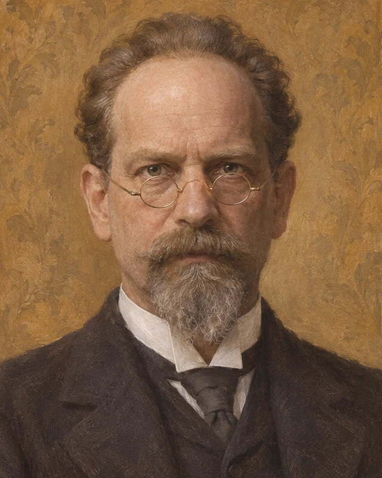

Imagine a student named Meera visiting her grandmother's house during the summer holidays. Inside an old wooden box, she finds a letter written by her grandmother as a young woman. The letter describes a train journey away from home and the fear of an uncertain future. Meera reads it as a story of adventure, but her grandmother remembers it as a painful separation.

The paper is the same, yet the two women experience its words differently. Meera begins to wonder how memories become meaningful, why past events appear differently to different people, and whether a written text can reveal something its writer never expected. These questions lead from the study of experience to the study of interpretation. They also help explain why a novel can feel different when a person reads it again after several years.

**Phenomenology** investigates how things are given in experience, while **hermeneutics** investigates the nature of understanding and interpretation. This article in the series on literary theory and cultural studies follows the movement between these two fields. Edmund Husserl begins with consciousness, Martin Heidegger turns towards human existence, Hans-Georg Gadamer examines historically situated understanding, and Paul Ricoeur explores the interpretation of texts and stories.

## Where phenomenology and hermeneutics came from

### Before the twentieth century

For a long time, the interpretation of difficult writings was an established part of religious and scholarly life. A reader of an ancient religious text might need to explain unfamiliar customs, obscure expressions or apparently contradictory passages. A legal reader faced a related problem when applying an old law to a new situation. Hermeneutics developed within such practices of interpretation, but eventually became a broader philosophical inquiry.

Friedrich Schleiermacher (1768-1834) extended hermeneutics beyond particular kinds of sacred and classical writing. He treated understanding as a general problem arising whenever people interpret discourse. His approach attends to grammar and to the individuality of the speaker or writer. A sentence must be understood within its language, yet it belongs to a particular act of expression.

Wilhelm Dilthey (1833-1911) connected interpretation with the study of human life and history. Human actions and works express experience in forms that other people can try to understand. The study of a letter, for example, differs from measuring its physical weight. Its historical setting and human significance demand attention that a weighing machine cannot provide.

The tradition thus developed a question about the relation between understanding and explanation. Scientific explanation can tell Meera how the paper was manufactured or why its colour has changed. Historical interpretation can investigate what the train journey meant in her grandmother's circumstances. Neither inquiry makes the other worthless, but each begins with a different kind of question.

### A new starting point in experience

At the beginning of the twentieth century, Husserl sought a rigorous philosophical account of experience and knowledge. His *Logical Investigations* appeared in 1900 and 1901, marking a major beginning of the phenomenological movement. Rather than explaining consciousness solely through its physical or psychological causes, he examined its structures and the objects towards which it is directed. The distinction matters because describing a perception and explaining its biological mechanism are different tasks.

Consider Meera looking at the letter before she opens it. She sees its front, expects another side and recognises the folded paper as one object. Although only part of it is directly visible, the unseen parts belong to her experience of the whole. Husserl's approach encourages careful attention to such ordinary but remarkable features of experience.

Heidegger, who worked with Husserl, took this inquiry in a different direction. He asked what it means for human beings to exist within a meaningful world. Understanding was therefore no longer simply a procedure used by a scholar studying an object. It belonged to the very way human beings encounter their surroundings and live their lives.

Gadamer developed this insight into philosophical hermeneutics, asking how inherited traditions shape understanding. Ricoeur later explored how language, symbols and narratives mediate human self-understanding. Their questions grew from related problems, but their answers do not form a single doctrine. The history of these ideas is a conversation in which each philosopher changes the question received from an earlier thinker.

### Did you know?

Gadamer lived to the age of 102. He remained academically active even in his nineties, when he still held regular office hours. His life therefore stretched from the beginnings of twentieth-century phenomenology into the twenty-first century.

### Important points to remember

- Hermeneutics developed from practices of interpreting texts.
- Schleiermacher broadened the study of interpretation.
- Dilthey linked understanding with human life and history.
- Husserl's *Logical Investigations* appeared in 1900 and 1901.
- Phenomenology examines the structures of experience.
- Heidegger gave phenomenology an explicitly interpretive direction.
- Gadamer remained academically active into his nineties.
- Ricoeur explored understanding through language and narrative.

## The core ideas of phenomenology and hermeneutics

### Intentionality: consciousness is directed

Husserl's central idea is **intentionality**, the directed character of consciousness. Seeing is seeing something, remembering is remembering something, and fearing is fearing something. The object need not exist in the physical world for a person to think about it. A child imagining a palace has an experience directed towards an imaginary palace.

Intentionality does not mean having an intention to perform an action. It describes the relation between an experience and what it concerns. Meera can remember her grandmother's voice without deliberately planning to remember it. The remembered voice is what her experience is about, even though nobody is speaking at that moment.

In *Ideas I* (1913), Husserl uses the terms **noesis** and **noema** to analyse intentional experience. Noesis concerns the intentional act, such as perceiving or remembering. Noema concerns the object as meant or presented in that act. The same letter can be perceived, remembered or imagined, but these are different modes of experiencing it.

<figure class="article-illustration theory-diagram" aria-labelledby="theory-diagram-1">
  <figcaption id="theory-diagram-1">Two aspects of Meera’s experience of the letter</figcaption>
  <ul role="list">
    <li><strong>Noesis · the act</strong>Meera sees the letter or remembers seeing it.</li>
    <li><strong>Noema · what the act presents</strong>The letter as seen on the table or as recalled later.</li>
  </ul>
</figure>

### The epoché and the phenomenological reduction

Ordinarily, people deal with things without investigating how those things appear to them. Husserl calls this everyday stance the **natural attitude**. The **epoché**, also called bracketing, suspends the ordinary unquestioned commitment to the world as simply given. It does not declare that the world is unreal or that external objects do not exist.

Suppose Meera hears a distant train while reading the letter. Instead of immediately asking whether the train is late, she attends to how the sound appears. It begins faintly, becomes louder and gradually fades while its earlier phases remain present in memory. Her attention moves from the practical object of concern to the structure of the experience.

The **phenomenological reduction** redirects philosophical inquiry towards the relation between consciousness and the world as experienced. A related procedure, **eidetic variation**, explores what is essential to a kind of experience through imagined variations. A cup may be red or blue, large or small, yet the perception of it as a physical thing involves more than one immediately visible aspect. Imagining variations helps distinguish necessary structures from accidental details.

Husserl's later work develops the idea of the **lifeworld**, the familiar world of lived experience that precedes scientific abstraction. Before a physicist measures the speed of a train, people already know what travelling and waiting mean. The lifeworld is shared with others, rather than being a sealed collection of private sensations. Scientific inquiry itself grows from activities within this ordinary world.

### Being-in-the-world: Heidegger's turn

Heidegger argues in *Being and Time* (1927) that human existence cannot be understood adequately as an isolated mind observing external objects. He calls the kind of being that we ourselves are **Dasein**, a German term often translated literally as being-there. A basic feature of Dasein is **being-in-the-world**, meaning that human existence already involves practical and meaningful relations with its surroundings.

A carpenter using a hammer illustrates this distinction. During familiar work, the hammer is encountered through what it enables the carpenter to do. Heidegger calls such availability **readiness-to-hand**. When the handle breaks, the hammer may become the object of explicit examination, illustrating the shift towards **presence-at-hand**, or considering something as an object with properties.

Meera's grandmother did not originally experience the railway station as a neutral arrangement of buildings. She was leaving home, carrying luggage and worrying about her destination. Each object appeared within a network of purposes and relationships. Heidegger's point is that practical involvement is a basic feature of human existence, not merely an addition to detached observation.

Heidegger calls our already given circumstances **thrownness**. No person chooses the historical period, family or language into which they are born. Yet people live towards possibilities and make choices within these circumstances. His account of **temporality** connects existence with the future, the past and the present as interrelated dimensions of life.

### The hermeneutic circle

A reader often understands a word through its sentence and a sentence through its surrounding passage. Yet the reader cannot understand the entire passage without first making sense of its smaller parts. This movement between parts and whole is commonly called the **hermeneutic circle**. It describes a process of correction and refinement rather than a hopeless logical trap.

Heidegger gives the circle a more fundamental significance. Interpretation always begins from some prior understanding, rather than from an entirely empty mind. Meera initially thinks that the letter concerns an exciting journey because she already knows familiar stories about travelling. Later details can expose the limitations of that first expectation and change her understanding of earlier sentences.

Gadamer develops this historical dimension of understanding. The reader brings inherited assumptions to a text, but the encounter can challenge those assumptions. A responsible interpretation therefore involves more than confirming what one expected to find. It remains open to the possibility that the work will answer a question in an unexpected way.

<figure class="article-illustration theory-diagram" aria-labelledby="theory-diagram-2">
  <figcaption id="theory-diagram-2">The hermeneutic circle in practice</figcaption>
  

    <strong>The parts and the whole can change how Meera reads the letter</strong>
    <ol class="theory-diagram-steps" role="list">
      <li><strong>Start with a first impression</strong>Meera reads the letter as a story of adventure.</li>
      <li><strong>Read a detail in context</strong>The writer’s fear points to a painful separation.</li>
      <li><strong>Revisit the whole letter</strong>The new reading changes how Meera understands the earlier details, which she can now reread.</li>
    </ol>
  

</figure>

### From a spoken word to a written text

Ricoeur draws attention to the difference between a conversation and writing. In conversation, the speaker may clarify a confusing sentence immediately, and both people may share a situation. Writing allows discourse to travel beyond its original occasion. Its later readers may live in circumstances very different from those of the writer.

Ricoeur calls the productive distance created by writing **distanciation**. Such distance makes possible a new engagement with the text rather than simply obstructing understanding. Meera can read the letter even when her grandmother is absent, and can consider the world it describes. Her interpretation nevertheless remains answerable to what the words actually say.

### Important points to remember

- Intentionality means the directed character of consciousness.
- Noesis concerns the act of experiencing.
- Noema concerns what is meant or presented in that act.
- The epoché suspends the natural attitude without denying reality.
- The lifeworld is the familiar world of lived experience.
- Dasein names the kind of being that we ourselves are.
- The hermeneutic circle involves prior understanding and its revision.
- Distanciation makes new encounters with written discourse possible.

## Thinkers and texts

### Edmund Husserl (1859-1938)

<figure class="article-illustration article-illustration--float article-illustration--portrait">
  
  <figcaption>Edmund Husserl. Modern painted interpretation. <a href="https://commons.wikimedia.org/wiki/File:Edmund_Husserl_1910s.jpg" target="_blank" rel="noopener">Portrait reference</a></figcaption>
</figure>

Husserl was trained in mathematics before developing his philosophical work. His *Logical Investigations* challenges attempts to ground logical validity simply in empirical facts about human psychology. His criticism of **psychologism**, the reduction of logical principles to psychological facts, distinguishes the validity of a truth from someone's mental act of recognising it. Different people can grasp the same mathematical proposition at different times.

*Ideas I* develops his transcendental approach, concerned with the conditions under which objects become meaningful for consciousness. *Cartesian Meditations* develops questions of the self and other subjects. In his later *The Crisis of European Sciences and Transcendental Phenomenology*, parts of which first appeared in 1936, he investigates the relation between scientific knowledge and the lifeworld. A larger German edition appeared posthumously in 1954, although the work remained unfinished.

A literary application of Husserl's approach might begin by describing a novel's presentation of a room through a character's perception. The critic would distinguish what is directly perceived from what is remembered or anticipated. This is an application of his philosophical method, rather than a claim that Husserl himself devised a general technique for interpreting novels. It directs attention to how a fictional world comes to appear meaningful.

### Martin Heidegger (1889-1976)

Heidegger taught at Marburg before succeeding Husserl at Freiburg in 1928. His *Being and Time* investigates the question of Being through an analysis of Dasein. It examines everyday life, understanding, care and the way human possibilities are shaped by mortality. Its purpose is philosophical inquiry into existence, rather than the presentation of advice for living happily.

Heidegger also distinguishes between living according to anonymous public expectations and taking responsibility for one's own possibilities. His concepts of **authenticity** and inauthenticity concern ways of existing, not simple labels for morally good and bad people. A student who follows a career merely because everyone recommends it illustrates one aspect of public expectation. Recognising one's own possibilities requires more than choosing an unusual career.

His later interest in art and poetry offers another connection with literary studies. In "The Origin of the Work of Art", he considers how artworks can disclose a meaningful world. A poem may bring familiar surroundings into view in an unfamiliar manner. The work is therefore more than a decorative copy of what is already known.

Heidegger's political history also requires attention. He became rector of Freiburg University and joined the Nazi Party in 1933. He resigned the rectorship in 1934 but remained a party member until the end of the regime. These facts remain relevant to critical study of his thought and must not be concealed by admiration for his philosophical influence.

### Hans-Georg Gadamer (1900-2002)

In *Truth and Method* (1960), Gadamer argues that understanding cannot be reduced to a procedure guaranteeing completely neutral results. A person already lives within a history and inherits ways of asking questions. Gadamer uses **prejudice** in the wider sense of a prior judgment, which may prove helpful or mistaken. A prior judgment becomes a problem when it prevents the interpreter from listening to the text.

Gadamer's **horizon** describes the range of understanding available from a historical standpoint. A **fusion of horizons** occurs when an encounter with another standpoint transforms understanding. This does not mean that the two standpoints were identical from the beginning. Nor does it mean that a modern reader can simply forget the distance separating the present from the past.

The concept of **historically effected consciousness** draws attention to the history operating within our own acts of interpretation. A modern reading of an older novel may reflect earlier criticism, translations and social debates. Gadamer also stresses application, because understanding a text involves grasping its meaning in a present situation. This is why a historical conversation can still matter to someone living today.

### Paul Ricoeur (1913-2005)

Ricoeur's *Freud and Philosophy: An Essay on Interpretation* first appeared in French in 1965. He examines approaches associated with Marx, Nietzsche and Freud that question apparent meanings. The **hermeneutics of suspicion** looks beneath surface explanations for forces that may be hidden from conscious awareness. A character's proud account of generosity, for instance, might conceal a desire for social approval.

Yet Ricoeur does not reduce interpretation to exposing falsehood. He also investigates how symbols and metaphors disclose meanings that ordinary literal statements cannot fully express. *The Rule of Metaphor* appeared in French in 1975, and *Interpretation Theory: Discourse and the Surplus of Meaning* appeared in English in 1976. A metaphor such as a house being a prison can reveal a whole pattern of restricted possibilities.

In *Time and Narrative*, published in French in three volumes from 1983 to 1985, Ricoeur studies how stories organise human time. The first stage of his threefold mimesis is **prefiguration**, the practical world of action and shared meanings preceding a story. The second, **configuration**, arranges events into a meaningful plot through emplotment. The third, **refiguration**, concerns the encounter between the story and the reader's world.

Meera understands the ordinary meaning of leaving home before opening the letter. The written account then shapes the journey into a story through its selection and arrangement of events. Reading the letter may finally change how she understands her own departure for college. These three stages offer a simple illustration of Ricoeur's account of narrative mediation.

In *Oneself as Another* (French original 1990), Ricoeur examines **narrative identity**, the way a person's identity can be understood through stories over time. He distinguishes *idem*, or sameness, from *ipse*, or selfhood. A person can change physically and emotionally while remaining responsible for an earlier promise. Identity therefore involves more than a collection of permanent characteristics.

### An interesting story

In 1922, Gadamer completed a dissertation on pleasure in Plato's dialogues at Marburg. Later that year, illness forced him to spend several months in isolation. According to the Hans-Georg Gadamer Society's chronology, he read Husserl's *Logical Investigations* and a manuscript by Heidegger during this period. In 1923 he travelled to Freiburg, attending classes with Heidegger and a seminar with Husserl. When Heidegger moved to Marburg that year, Gadamer returned there for the winter semester. This sequence helps explain the connections between Gadamer's early studies of Greek philosophy and his later work on interpretation. It also shows how an intellectual tradition develops through reading and teaching across generations.

### Key terms

- **Phenomenology** - philosophical investigation of the structures of experience.
- **Hermeneutics** - inquiry into understanding and interpretation.
- **Intentionality** - directedness of consciousness towards something.
- **Noesis** - the intentional act of consciousness.
- **Noema** - the object as meant in an intentional act.
- **Natural attitude** - ordinary unquestioned involvement with the world.
- **Epoché** - suspension of the natural attitude's usual commitments.
- **Phenomenological reduction** - redirection towards experience and its correlates.
- **Eidetic variation** - imagined variation to investigate essential structures.
- **Lifeworld** - the familiar world of lived experience.
- **Dasein** - Heidegger's term for the being that we ourselves are.
- **Being-in-the-world** - existence as already involved in meaningful surroundings.
- **Thrownness** - the given circumstances of human existence.
- **Hermeneutic circle** - interpretive movement between prior understanding, parts and whole.
- **Prejudice** - a prior judgment that may be revised.
- **Fusion of horizons** - transformation of understanding through a historical encounter.
- **Distanciation** - productive distance between discourse and its original situation.
- **Hermeneutics of suspicion** - interpretation that questions apparent meanings.
- **Emplotment** - arrangement of events into a meaningful story.
- **Narrative identity** - understanding selfhood through narrative over time.

### Important points to remember

- Husserl criticises psychologism in his early work.
- Heidegger's *Being and Time* appeared in 1927.
- Heidegger's analysis of art concerns the disclosure of a world.
- Gadamer's *Truth and Method* appeared in 1960.
- Gadamer treats inherited assumptions as possible resources for understanding.
- Ricoeur associates suspicion with Marx, Nietzsche and Freud.
- Ricoeur's threefold mimesis connects action, plot and reception.
- Narrative identity includes the relation between sameness and selfhood.

## Reading with phenomenology and hermeneutics

### Returning to the letter

At the beginning, Meera thought her grandmother's journey was an adventure. A phenomenological inquiry begins by noticing how the journey becomes present to her through reading. The text awakens imagined sights, remembered sounds and expectations about what will happen next. It allows an absent event to become the object of present consciousness.

<figure class="article-illustration">
  
  <figcaption>Imagined scene. Meera and her grandmother read the same letter through different experiences of leaving home.</figcaption>
</figure>

A Heideggerian reading turns towards the grandmother's practical world. The train is a means of leaving a familiar place and entering unfamiliar circumstances. Her worry belongs to her relations with home, family and future possibilities. Those relationships give the journey a meaning that a timetable cannot express.

A Gadamerian reading examines the difference between the women's historical situations. Meera's knowledge of independent travel shapes her first interpretation, while the grandmother's experience belongs to another setting. Listening to the grandmother allows Meera to question her initial assumption. Their understanding can develop without pretending that the difference between their lives has disappeared.

A Ricoeurian reading attends to how the letter has selected and arranged events. It asks what world the written account opens to readers and what its omissions might signify. The departure may become part of a larger story about independence or responsibility. A suspicious reading could examine whether family expectations were left unspoken, but would need evidence before claiming this.

<figure class="article-illustration criticism-map" aria-labelledby="theory-diagram-3">
  <figcaption id="theory-diagram-3">Four ways to read the same letter</figcaption>
  <ul role="list">
    <li><strong>Husserl</strong>How does the absent journey become present to Meera as she reads?</li>
    <li><strong>Heidegger</strong>What makes the station meaningful to someone leaving home?</li>
    <li><strong>Gadamer</strong>How does the conversation with her grandmother change the expectations Meera brings to the letter?</li>
    <li><strong>Ricoeur</strong>How does the written account arrange events and open the journey to a later reader?</li>
  </ul>
</figure>

### A literary example: Mrs Dalloway

Virginia Woolf's *Mrs Dalloway* (1925) follows events during a day in London. Clarissa Dalloway's present experiences frequently open into memories of her earlier life. The sound of Big Ben repeatedly brings the public measurement of time into relation with private experience. A phenomenological reader can study how the past becomes present through memory, without treating remembered events as physically happening again.

A Heideggerian reader might consider how Clarissa's social commitments and awareness of mortality shape her sense of possibility. A hermeneutic reading might investigate how knowledge of the aftermath of the First World War changes the reader's understanding of Septimus. Ricoeur's approach offers a way to examine how the narrative brings different experiences of time into one composition. These readings ask different questions of the same work, but all must attend closely to its language and structure.

### Important points to remember

- Fiction can present objects and events through intentional experience.
- Remembered events are experienced differently from present perceptions.
- Heideggerian reading attends to practical involvement and possibilities.
- Gadamerian interpretation examines the reader's historical assumptions.
- Ricoeur connects textual organisation with a reader's understanding.
- *Mrs Dalloway* appeared in 1925.
- Big Ben connects public time with private experience in Woolf's novel.

## Criticisms and legacy

### The case against phenomenology and hermeneutics

A central difficulty concerns whether a reader can identify structures of experience apart from historical and social conditions. Heidegger's *Being and Time* (1927) itself represents a major revision of the Husserlian starting point. For Heidegger, understanding human existence requires attention to the meaningful world in which existence already occurs. Husserl's own later studies of intersubjectivity and the lifeworld show that his philosophy cannot simply be dismissed as an account of private minds.

In *Validity in Interpretation* (1967), E. D. Hirsch defends the possibility of valid textual interpretation. He distinguishes a text's meaning, grounded in what its author meant, from its changing significance for later readers. This challenges approaches that allow present concerns to determine the meaning of a historical text. Meera's personal response to the letter does not automatically establish what her grandmother intended to communicate.

Jürgen Habermas questions Gadamer's confidence in the resources of tradition in "The Universality Claim of Hermeneutics" (1970). Social customs can carry unequal relations of power and distort communication. An inherited understanding may therefore require criticism rather than merely a sympathetic hearing. Ricoeur addresses this controversy in "Hermeneutics and the Critique of Ideology", seeking a productive relation between understanding and critical reflection.

### What lasted and what came next

Phenomenology contributed to approaches that investigate how literary worlds are experienced. Roman Ingarden's *The Literary Work of Art* (1931) analyses the structure of literary works and the aspects left unspecified by them. A reader may imagine the appearance of a fictional room even when the author gives very few details. The work nevertheless places constraints on what that reader may reasonably imagine.

This interest in the reader's activity later became significant for reception and reader-response approaches. The question of historical understanding also continued to matter in debates about interpretation. Ricoeur's narrative theory connects philosophical concerns about human time with literary studies and the interpretation of life stories. His work encourages critics to consider how narrative form and human understanding interact.

### How to read these thinkers

The four philosophers should be read as participants in a developing argument, rather than as interchangeable authorities. Husserl asks how objects are given to consciousness; Heidegger asks how understanding belongs to existence. Gadamer investigates the history and language within which understanding occurs. Ricoeur explores how texts, symbols and narratives mediate understanding across distance.

A reader can begin with a small passage and distinguish what it presents from what the reader adds. The next task is to test an interpretation against the whole work and its historical circumstances. Competing readings may reveal different features, but each requires reasons drawn from the text. Interpretation is neither the mechanical recovery of a single feeling nor permission to attach any meaning whatsoever.

Meera finally puts the letter back into its wooden box. She cannot become her grandmother or recover every detail of the original journey. Yet she can understand the account differently by examining her experience, her assumptions and the words before her. The old letter has opened a conversation between past and present, which is the philosophical journey this article has followed.

### Important points to remember

- Heidegger revises the Husserlian starting point through an analysis of existence.
- Hirsch distinguishes textual meaning from changing significance.
- *Validity in Interpretation* appeared in 1967.
- Habermas questions whether tradition can adequately expose distorted communication.
- Ricoeur seeks a relation between interpretation and critique.
- Ingarden investigates the structure and indeterminacy of literary works.
- A convincing interpretation remains answerable to textual evidence.

## Critics and works

| Thinker | Dates | Key work | Known for |
|---|---|---|---|
| Friedrich Schleiermacher | 1768-1834 | *Hermeneutics and Criticism* | General hermeneutics |
| Wilhelm Dilthey | 1833-1911 | *Introduction to the Human Sciences* | Understanding human life and history |
| Edmund Husserl | 1859-1938 | *Logical Investigations* (1900-1901); *Ideas I* (1913) | Intentionality and phenomenological reduction |
| Martin Heidegger | 1889-1976 | *Being and Time* (1927) | Dasein and being-in-the-world |
| Hans-Georg Gadamer | 1900-2002 | *Truth and Method* (1960) | Philosophical hermeneutics and fusion of horizons |
| Paul Ricoeur | 1913-2005 | *Time and Narrative* (1983-1985, French) | Threefold mimesis and narrative identity |
| Roman Ingarden | 1893-1970 | *The Literary Work of Art* (1931) | Structure of literary works |
| E. D. Hirsch | born 1928 | *Validity in Interpretation* (1967) | Meaning and significance |

## Quick revision - 50 points

1. Phenomenology investigates the structures of experience.
2. Hermeneutics studies understanding and interpretation.
3. Schleiermacher developed a general approach to interpreting discourse.
4. Dilthey connected interpretation with the historical study of human life.
5. Husserl's *Logical Investigations* appeared in 1900 and 1901.
6. Husserl received mathematical training before developing his philosophical work.
7. Psychologism reduces logical principles to psychological facts.
8. Intentionality describes the directed character of consciousness.
9. The object of an intentional experience need not physically exist.
10. Husserl published *Ideas I* in 1913.
11. Noesis concerns the intentional act.
12. Noema concerns the object as meant in an act.
13. The natural attitude takes the ordinary world for granted.
14. The epoché is also called bracketing.
15. Bracketing does not deny the existence of external reality.
16. Phenomenological reduction redirects attention to experience and its objects as experienced.
17. Eidetic variation investigates essential structures through imagined changes.
18. The lifeworld precedes scientific abstraction.
19. Parts of Husserl's *Crisis* appeared in 1936.
20. A larger posthumous German edition of the *Crisis* appeared in 1954.
21. Heidegger lived from 1889 to 1976.
22. *Being and Time* appeared in 1927.
23. Heidegger succeeded Husserl at Freiburg in 1928.
24. Dasein names the kind of being that human beings themselves are.
25. Being-in-the-world involves meaningful practical relations with surroundings.
26. Readiness-to-hand concerns things encountered through their practical uses.
27. Presence-at-hand concerns things considered as objects with properties.
28. Thrownness refers to the given circumstances of human existence.
29. Temporality concerns the interrelated dimensions of past, present and future.
30. Heidegger's authenticity concerns how one takes up one's possibilities.
31. The hermeneutic circle describes the movement between parts and whole in interpretation.
32. Gadamer studied with Husserl and Heidegger in Freiburg in 1923.
33. Gadamer lived from 1900 to 2002.
34. Gadamer published *Truth and Method* in 1960.
35. For Gadamer, prejudice can mean a prior judgment rather than a necessarily false belief.
36. A horizon is the range of understanding available from a historical standpoint.
37. A fusion of horizons involves a transformation of understanding.
38. Historically effected consciousness recognises the operation of history within interpretation.
39. Ricoeur lived from 1913 to 2005.
40. *Freud and Philosophy* first appeared in French in 1965.
41. Ricoeur associates the hermeneutics of suspicion with Marx, Nietzsche and Freud.
42. Distanciation is the productive distance between writing and its original occasion.
43. *The Rule of Metaphor* first appeared in French in 1975.
44. *Interpretation Theory: Discourse and the Surplus of Meaning* appeared in 1976.
45. The French volumes of *Time and Narrative* appeared from 1983 to 1985.
46. Prefiguration concerns the world of action preceding the narrative.
47. Configuration arranges events into a plot through emplotment.
48. Refiguration involves the encounter between the narrative and the reader's world.
49. Narrative identity connects selfhood with the stories through which life is understood.
50. Hirsch's *Validity in Interpretation* appeared in 1967.

## Quick quiz - 25 questions

Tap an answer to see at once if it is right. You do not need to log in.

**1. Which field investigates the structures of experience?**

- A) Philology
- B) Phenomenology
- C) Structural anthropology
- D) Textual bibliography

Answer: B. Phenomenology studies how objects and events are given in experience.

**2. Who linked interpretation to the historical study of human life?**

- A) Wilhelm Dilthey
- B) Paul Ricoeur
- C) Roman Ingarden
- D) Edmund Husserl

Answer: A. Dilthey investigated understanding in the human sciences.

**3. When did Husserl's *Logical Investigations* first appear?**

- A) 1913-1914
- B) 1927-1928
- C) 1900-1901
- D) 1936-1937

Answer: C. The two parts appeared in 1900 and 1901.

**4. What does intentionality mean in Husserl's philosophy?**

- A) A deliberate plan to act
- B) The author's private motives
- C) The grammatical form of a sentence
- D) The directedness of consciousness

Answer: D. Intentional experience is always directed towards something.

**5. What does noesis concern?**

- A) The intentional act
- B) The physical size of an object
- C) The author's biography
- D) The historical context of a text

Answer: A. Noesis names the act of experiencing or intending.

**6. Which term refers to the object as meant in an intentional act?**

- A) Dasein
- B) Noema
- C) Epoché
- D) Emplotment

Answer: B. The noema concerns what is meant or presented in that act.

**7. What is the purpose of the epoché?**

- A) To prove that external objects do not exist
- B) To recover a writer's childhood memories
- C) To suspend the ordinary unquestioned commitment to the world as simply given
- D) To eliminate all language from thought

Answer: C. Bracketing redirects attention without denying reality.

**8. Which procedure investigates essential structures by imagining changes?**

- A) Narrative configuration
- B) Ideological criticism
- C) Historical reconstruction
- D) Eidetic variation

Answer: D. Eidetic variation explores what remains essential across imagined variations.

**9. Which concept describes the familiar world of lived experience preceding scientific abstraction?**

- A) Lifeworld
- B) Noesis
- C) Narrative identity
- D) Presence-at-hand

Answer: A. Husserl's lifeworld is the familiar world from which scientific inquiry grows.

**10. Who wrote *Being and Time*?**

- A) Hans-Georg Gadamer
- B) Martin Heidegger
- C) Edmund Husserl
- D) Paul Ricoeur

Answer: B. Heidegger published this major work in 1927.

**11. What term does Heidegger use for the kind of being that we ourselves are?**

- A) Noema
- B) Ipse
- C) Dasein
- D) Epoché

Answer: C. Dasein is the central subject of the existential analysis in *Being and Time*.

**12. A carpenter using a hammer without examining it as a detached object illustrates which concept?**

- A) Presence-at-hand
- B) Distanciation
- C) Historical consciousness
- D) Readiness-to-hand

Answer: D. Readiness-to-hand concerns practical dealings with equipment.

**13. What does thrownness refer to?**

- A) The rejection of all inherited knowledge
- B) The given circumstances in which a person finds themselves
- C) The arrangement of events into a plot
- D) The suspension of belief in reality

Answer: B. Thrownness concerns conditions of existence that one has not chosen.

**14. Which concept describes interpretive movement between parts and whole?**

- A) Hermeneutic circle
- B) Eidetic variation
- C) Threefold mimesis
- D) Psychologism

Answer: A. Understanding individual passages and the whole work involves a continuing relation.

**15. Which book did Gadamer publish in 1960?**

- A) *Being and Time*
- B) *The Rule of Metaphor*
- C) *Truth and Method*
- D) *Validity in Interpretation*

Answer: C. *Truth and Method* is Gadamer's major work of philosophical hermeneutics.

**16. What is a prejudice in Gadamer's broad philosophical sense?**

- A) An always false and irrational belief
- B) A neutral scientific result
- C) An author's final intended meaning
- D) A prior judgment that may prove helpful or mistaken

Answer: D. Gadamer considers prior judgments possible conditions of understanding.

**17. What does a fusion of horizons involve?**

- A) A complete removal of historical differences
- B) A transformation of understanding through encounter
- C) A rejection of all prior knowledge
- D) A mechanical recovery of the author's thoughts

Answer: B. The encounter with a different standpoint can change the interpreter's horizon.

**18. Which thinker particularly develops the concept of distanciation in textual interpretation?**

- A) Paul Ricoeur
- B) Roman Ingarden
- C) Friedrich Schleiermacher
- D) Edmund Husserl

Answer: A. Ricoeur treats distance from the original occasion as a productive feature of writing.

**19. Which trio is associated with Ricoeur's hermeneutics of suspicion?**

- A) Plato, Aristotle and Horace
- B) Husserl, Gadamer and Ingarden
- C) Marx, Nietzsche and Freud
- D) Saussure, Jakobson and Propp

Answer: C. Ricoeur examines their challenges to the apparent meanings of experience and discourse.

**20. What is the second stage of Ricoeur's threefold mimesis?**

- A) Prefiguration
- B) Refiguration
- C) Bracketing
- D) Configuration

Answer: D. Configuration arranges the elements of action into a narrative plot.

**21. Which term describes the encounter between a narrative and the reader's world?**

- A) Noesis
- B) Refiguration
- C) Thrownness
- D) Prefiguration

Answer: B. Refiguration is the third stage of Ricoeur's threefold mimesis.

**22. Which work examines narrative identity through the distinction between sameness and selfhood?**

- A) *Oneself as Another*
- B) *Logical Investigations*
- C) *Truth and Method*
- D) *The Literary Work of Art*

Answer: A. Ricoeur develops the distinction between idem and ipse in this work.

**23. In *Mrs Dalloway*, which recurring feature connects public time with private experience?**

- A) A railway timetable
- B) An inherited letter
- C) The sound of Big Ben
- D) A broken hammer

Answer: C. Big Ben marks public time alongside the characters' memories and perceptions.

**24. Who distinguishes a text's meaning from its changing significance in *Validity in Interpretation*?**

- A) Jürgen Habermas
- B) Hans-Georg Gadamer
- C) Martin Heidegger
- D) E. D. Hirsch

Answer: D. Hirsch defends textual meaning grounded in what the author meant.

**25. What problem does Habermas raise against Gadamer's emphasis on tradition?**

- A) Tradition may carry unequal power and distorted communication
- B) Tradition makes the study of language impossible
- C) All historical texts have exactly one reader
- D) Scientific explanation cannot use language

Answer: A. Habermas stresses the need for critique of ideology and distorted communication.

## Frequently asked questions

**What is phenomenology in simple words?**
Phenomenology studies how things appear and become meaningful in experience. Husserl examines structures such as perception, memory and intentionality.

**What is the difference between phenomenology and hermeneutics?**
Phenomenology investigates experience, while hermeneutics investigates understanding and interpretation. Heidegger connects the two by showing how understanding belongs to our existence in the world.

**What is the difference between Husserl and Heidegger?**
Husserl develops an inquiry into consciousness and the conditions of meaningful experience. Heidegger directs phenomenology towards the question of Being and the practical, historical existence of Dasein.

**What is Gadamer's fusion of horizons?**
It is the transformation of understanding that can occur when a reader encounters another historical standpoint. It does not require abandoning one's historical situation or simply agreeing with the text.

**What is Ricoeur's hermeneutics of suspicion?**
It is a way of interpreting that challenges apparent meanings and investigates hidden forces. Ricoeur connects this approach with Marx, Nietzsche and Freud, while also exploring the recovery of meaning.

**How are phenomenology and hermeneutics used in literary criticism?**
They help readers examine how fictional worlds are experienced, how historical assumptions affect understanding and how narratives shape meaning. Interpretations must still be tested against the text.

## Sources

- Husserl, Edmund. *Logical Investigations*. 1900-1901.
- Husserl, Edmund. *Ideas Pertaining to a Pure Phenomenology and to a Phenomenological Philosophy, First Book*. 1913.
- Heidegger, Martin. *Being and Time*. 1927.
- Gadamer, Hans-Georg. *Truth and Method*. 1960.
- Ricoeur, Paul. *Freud and Philosophy: An Essay on Interpretation*. Yale University Press, 1970.
- Ricoeur, Paul. *Interpretation Theory: Discourse and the Surplus of Meaning*. Texas Christian University Press, 1976.
- Ricoeur, Paul. *Time and Narrative*. 3 vols., University of Chicago Press, 1984-1988.
- Hirsch, E. D. *Validity in Interpretation*. Yale University Press, 1967.
- Smith, David Woodruff. "Phenomenology." *Stanford Encyclopedia of Philosophy*.
- "Edmund Husserl." *Stanford Encyclopedia of Philosophy*.
- "Martin Heidegger." *Stanford Encyclopedia of Philosophy*.
- "Hans-Georg Gadamer." *Stanford Encyclopedia of Philosophy*.
- "Hermeneutics." *Stanford Encyclopedia of Philosophy*.
- "Paul Ricoeur." *Stanford Encyclopedia of Philosophy*.
- "Paul Ricoeur." *Internet Encyclopedia of Philosophy*.
- "Biography." Hans-Georg Gadamer Society.
- Woolf, Virginia. *Mrs Dalloway*. Hogarth Press, 1925.

Afsar Khan, Ph.D. English
