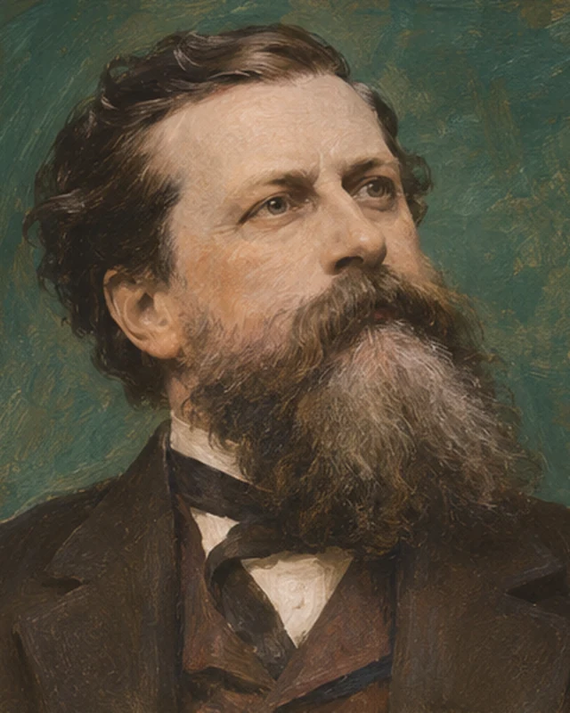
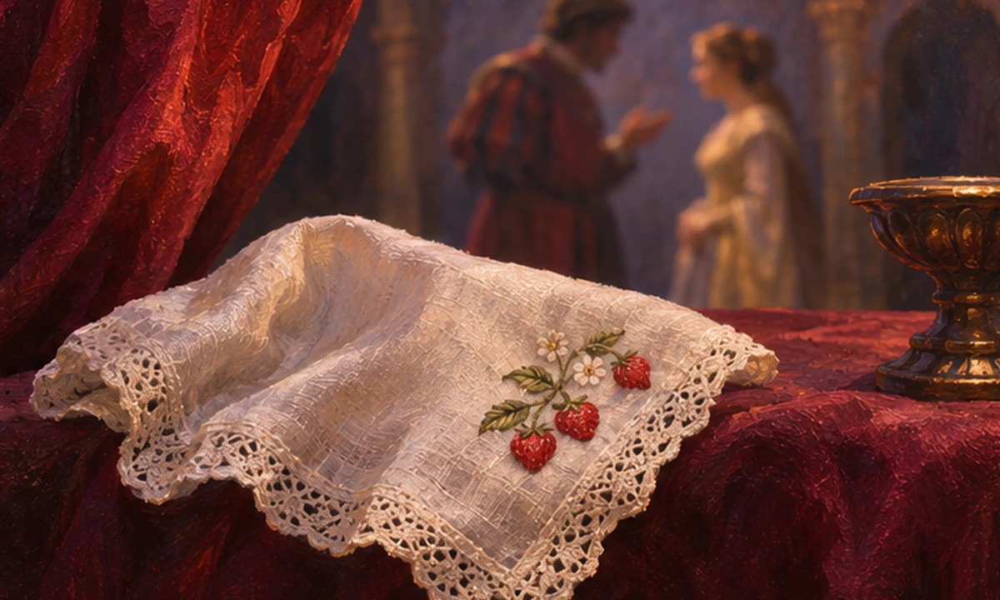

Imagine a student walking through a market in Lucknow on a rainy day. A tea shop has a picture of a steaming cup above its entrance. A wet umbrella rests beside the door, and a board announces that the tea is made in the traditional way. Behind the counter hangs an advertisement showing a happy family drinking tea together.

The student understands much of this without asking the shopkeeper a single question. The picture tells her what the shop sells, while the umbrella suggests recent rain. The advertisement invites her to connect tea with family warmth. Yet the picture, the umbrella and the advertisement do not produce meaning in quite the same way. How does an ordinary thing come to stand for something else? Why does an image convey an idea that it does not directly show?

**Semiotics** is the systematic study of signs and the processes through which they make meaning. This article in the literary theory and cultural studies series turns from the structure of narratives to the wider activity of sign-making. It explains Charles Sanders Peirce's theory of signs, Umberto Eco's account of codes and interpretation, and Roland Barthes's studies of images and cultural myths.

## Where semiotics came from

### Two routes to the study of signs

A child recognises a familiar school uniform and a passenger follows a railway signal. A reader understands a printed word without seeing the object that the word names. These activities involve relations between something perceived and something understood.

Thought about signs is older than modern literary theory. Two distinct approaches became especially influential in the modern study of meaning. The American philosopher Charles Sanders Peirce developed a general account of signs within his work on logic. The Swiss linguist Ferdinand de Saussure (1857-1913) proposed a science of signs within social life. Their projects developed independently and approached the subject from different directions.

Peirce often called his theory *semeiotic*. He was interested in the role of signs in thought, reasoning and inquiry. His approach therefore reaches beyond intentional messages sent from one person to another. The marks left by an animal on a path can function as signs even though the animal did not intend to communicate.

Saussure used the term **semiology**, from a Greek word for sign. In his posthumously published *Course in General Linguistics* (1916), he proposed that linguistics belonged within this larger science. For Saussure, a language is a shared system of differences. The value of an element depends upon its relations with other elements in that system.

Today the terms semiotics and semiology often overlap in use. However, the former is associated particularly with the tradition of Peirce, and the latter with Saussure and French structuralist thought. ### From linguistic signs to cultural signs

As Habib explains in *A History of Literary Criticism* (2005), structuralism took important ideas from Saussure's account of language. A novel could be examined in relation to the conventions that make its narrative and language understandable. The same kind of inquiry could extend to customs, advertisements and other forms of cultural activity.

During the twentieth century, Barthes brought this approach to French popular culture. His writings show how familiar objects can carry judgments about social life. Eco developed a wider theory of cultural signification and placed considerable attention on how people interpret texts. Both examined signs beyond ordinary speech, though they did not follow identical theories.

Literary criticism benefits from this wider study because a poem or novel contains more than names for objects. A character's clothing, the arrangement of rooms or the repeated mention of a colour may become meaningful. A critic must show how the text encourages those associations. Semiotics provides ways of asking such questions without assuming that every detail has a secret meaning.

### Did you know?

Peirce's major body of collected papers appeared after his death in 1914. Harvard University Press published the eight volumes of his *Collected Papers* between 1931 and 1958. His sign theory developed across many writings rather than being presented once in a single final textbook.

### Important points to remember

- Semiotics studies signs and the processes of meaning.
- Peirce approached signs through logic and inquiry.
- Saussure proposed semiology as a science of signs in social life.
- Saussure's *Course in General Linguistics* appeared in 1916.
- Semiotics includes signs that are not deliberate messages.
- Barthes extended the study of signs to popular culture.
- Eco studied cultural signification and textual interpretation.
- Peirce's eight-volume *Collected Papers* appeared between 1931 and 1958.

## The core ideas of semiotics

### The two-part sign and the three-part sign

Saussure distinguishes the **signifier**, or sound-image, from the **signified**, the concept associated with it. A spoken word such as tree has a familiar sound pattern. Its signified is the concept of a tree, rather than one particular plant growing outside. The linguistic sign joins these two sides.

The connection is generally arbitrary, which means that no natural necessity requires this particular sound to express this concept. Speakers of different languages use different words for the same kind of plant. However, an individual speaker cannot freely alter a word and expect everyone to understand. The shared convention makes the connection effective.

Peirce offers a **triadic sign**, meaning a relation involving three connected parts. They are the sign itself, its object and its interpretant. The sign in the narrower sense is often called the **representamen**, or sign-vehicle. It is what represents something within the relation.

The **object** is what the sign represents. It need not be a physical object in front of the observer. The **interpretant** is the sign's understood effect or the further sign through which its relation to the object becomes meaningful. It is not simply the person who observes the sign.

Suppose someone sees a muddy footprint outside a classroom. The footprint acts as a sign-vehicle, and a person's earlier presence is its object in this particular reading. The understanding that someone recently passed through becomes an interpretant. That understanding can lead to further inquiry about the person or the direction of travel.

Saussure's signified and Peirce's interpretant should therefore not be treated as perfectly interchangeable terms. The former belongs to Saussure's two-sided linguistic model. The latter belongs to a three-part relation and helps explain how one sign leads to further interpretation.

<figure class="article-illustration theory-diagram theory-diagram--triad" aria-labelledby="theory-diagram-1">
  <figcaption id="theory-diagram-1">Peirce’s three-part sign</figcaption>
  <ul role="list">
    <li><strong>Sign-vehicle</strong>A muddy footprint.</li>
    <li><strong>Object</strong>A person’s earlier presence.</li>
    <li><strong>Interpretant</strong>The understanding that someone passed through recently.</li>
  </ul>
</figure>

### Icon, index and symbol

Peirce distinguishes signs according to how they relate to their objects. His best-known classification contains the **icon**, **index** and **symbol**. These are different grounds on which a sign can represent an object.

An icon represents through a shared quality or resemblance. A drawing of a bicycle can suggest a bicycle through its shape. A diagram can be iconic through the similarity of its relations to those of the thing represented. A family tree, for example, shows relations of descent without resembling actual human bodies.

An index represents through a real connection with its object. Smoke can indicate fire because combustion produces smoke. A footprint has a physical connection with the foot that left it. A pointing finger can direct attention towards something present in the observer's surroundings.

A symbol represents through a general rule, habit or convention. A national flag has its significance through recognised social practices. Most ordinary words function symbolically because speakers learn their meaning through shared linguistic rules. A red traffic signal directs drivers to stop through a convention that people are expected to follow.

The three classes should not be treated as rigid boxes for every physical object. A photograph resembles what it depicts and can thus function iconically. A photograph made by light from an actual scene also has an indexical connection with that scene. In a particular setting, the same photograph can express a conventional idea, such as national pride. Peirce's categories describe relations rather than permanent labels attached to things.

<figure class="article-illustration theory-diagram" aria-labelledby="theory-diagram-2">
  <figcaption id="theory-diagram-2">Three ways a sign can stand for something</figcaption>
  <ul role="list">
    <li><strong>Icon · resemblance</strong>The drawing of a cup resembles a cup.</li>
    <li><strong>Index · connection</strong>A wet umbrella may point to recent rain.</li>
    <li><strong>Symbol · convention</strong>A red traffic signal means stop by an agreed rule.</li>
  </ul>
</figure>

### Semiosis and the growth of meaning

**Semiosis** is the activity or process through which signs produce interpretation. Peirce's theory allows an interpretant to function as another sign in a further relation. Eco develops this possibility as **unlimited semiosis**, the potential continuation of interpretation through further signs. This helps explain how meaning grows through thought and inquiry. A sign may direct attention towards an object and produce an understanding that can itself be interpreted.

Imagine a patient who notices a high reading on a thermometer. The reading suggests fever, and that understanding may lead to a medical examination. The next signs may support or change the first conclusion. The process does not mean that all possible explanations are equally reasonable.

Peirce also distinguishes kinds of interpretants in his later writings. The **immediate interpretant** concerns the interpretability available in a sign. The **dynamic interpretant** concerns the effect actually produced in a particular act of interpretation. The **final interpretant** concerns the effect toward which adequate interpretation would tend under suitable conditions. This last idea should not be confused with a person's final thought before leaving a discussion.

In Peirce's work, reasoning can begin with a possible explanation of a surprising sign. This kind of inference is called **abduction**. A detective who sees a broken window may suggest a break-in as one explanation. Further evidence is needed before the explanation can be accepted. The sign does not guarantee that the first hypothesis is true.

### Codes, signification and communication

Eco's approach gives considerable attention to the rules that make signs understandable. A **code** is a system of conventions that makes relations between expressions and contents available to interpreters. A school bell can mean the end of a lesson because its users know how the institution organises time.

**Signification** concerns how something can have meaning within such a system. **Communication** concerns the use of signs in a process of conveying something. The distinction matters because a person may interpret a sign without receiving a deliberate message. A weathered wall may suggest the age of a building to a visitor.

Eco also separates the investigation of codes from the investigation of **sign production**. Signs are made and recognised through different activities, not merely selected from a fixed dictionary. A speaker may invent a new expression, while an illustrator may construct an image using familiar visual conventions. A new sign can become understandable through the interpreter's knowledge of existing signs.

The same expression can carry different contents under different conditions. A black ribbon might suggest mourning in one setting and serve merely as decoration in another. A reader must examine the situation, the convention being used and the other signs that accompany it. This is why semiotic analysis is more than collecting a list of symbols and their supposed meanings.

### Denotation, connotation and myth

In the study of culture, **denotation** refers to a relatively direct level of meaning. **Connotation** refers to further associations that arise through cultural knowledge. An image of a school building can denote that building and suggest discipline or educational opportunity. The additional associations depend upon how the image is presented and understood.

Barthes uses this layered approach in his study of **myth**. Here myth does not mean merely an ancient story or a false statement. It is a second-order system of signification in which a sign already formed at one level becomes the form of a further message. The further message may give social values the appearance of natural facts.

An advertisement may show a luxurious house and connect its image with personal achievement. The house is recognisable at one level, while the larger message associates expensive property with success. The reader may then ask how this value was constructed and what other ideas of achievement are being excluded. This is the kind of question that makes Barthes's semiology a form of cultural criticism.

### Important points to remember

- Saussure's sign joins a signifier and a signified.
- Peirce's model joins a sign, an object and an interpretant.
- An interpretant is not the same as an interpreter.
- An icon represents through resemblance or shared quality.
- An index depends on a real connection with its object.
- A symbol depends on convention, habit or rule.
- Semiosis is the process of sign interpretation.
- Abduction proposes a possible explanation of evidence.
- Eco distinguishes signification from communication.
- Barthes's myth operates at a second level of signification.

## Thinkers and texts

### Charles Sanders Peirce: signs and reasoning

<figure class="article-illustration article-illustration--float article-illustration--portrait">
  
  <figcaption>Charles Sanders Peirce. Modern painted interpretation. <a href="https://commons.wikimedia.org/wiki/File:Charles_Sanders_Peirce.jpg" target="_blank" rel="noopener">Portrait reference</a></figcaption>
</figure>

Charles Sanders Peirce (1839-1914) was an American philosopher, logician and scientist. He helped establish the philosophical tradition known as pragmatism. His essays "The Fixation of Belief" (1877) and "How to Make Our Ideas Clear" (1878) examine problems of inquiry and the clarification of ideas. His account of signs belongs to this wider concern with how knowledge develops.

Peirce's categories of **Firstness**, **Secondness** and **Thirdness** provide a wider philosophical background for his classifications. Firstness concerns quality or possibility considered in itself. Secondness concerns actual encounter, resistance or reaction. Thirdness concerns mediation, generality and law. The three categories help explain the distinctions among kinds of signs without reducing Peirce's entire philosophy to three familiar examples.

### Umberto Eco: the code and the active reader

Umberto Eco (1932-2016) was an Italian novelist and scholar of semiotics. He taught semiotics at the University of Bologna. His *Opera aperta* (1962), later published in English as *The Open Work*, explores works that invite a participating interpreter. Such participation does not require the disappearance of the work's design.

His Italian treatise on general semiotics appeared in 1975. The English *A Theory of Semiotics* followed in 1976. It brings together the study of codes and the ways signs are produced. Eco thereby investigates both established cultural conventions and the creation of new meaningful forms.

In *The Role of the Reader* (1979), he considers the cooperation a text requires from its readers. His **model reader** is the role and set of interpretive abilities that a text presupposes or seeks to create. This reader is not a particular individual buying a book. A reader of a detective novel, for instance, is expected to connect clues and understand changes in the available evidence.

Eco also uses the idea of an **encyclopedia** to describe the network of cultural knowledge available for interpretation. Knowing a word includes more than learning its shortest dictionary definition. Stories, customs and previous uses of the word may inform its meaning in a particular passage. Such knowledge can be extended and corrected through further reading.

His distinction between relatively open and closed texts concerns the range of cooperation they encourage. An open text permits several organised paths through its meanings. A relatively closed text directs its audience towards a more restricted response. Neither label means that a real reader is physically prevented from making an unexpected association.

Eco's first novel, *The Name of the Rose*, appeared in Italian in 1980. It presents a medieval investigation in which reading signs and interpreting texts are central activities. His later theoretical works include *Semiotics and the Philosophy of Language* (1984) and *The Limits of Interpretation* (1990). They develop questions about the relation between signs, knowledge and responsible interpretation.

### Roland Barthes: from ordinary images to cultural criticism

Roland Barthes (1915-1980) was a French critic. His *Mythologies* appeared in 1957, collecting essays on French cultural life. As discussed in the article on structuralism, he reads such practices as professional wrestling through their signs. Here the concern is especially with the passage from a recognisable sign to a cultural judgment.

In the essay "Myth Today", Barthes describes a cover of *Paris Match* showing a Black soldier in French uniform saluting. The image carries a recognisable message about a soldier and his gesture. Barthes interprets its further message as a favourable representation of French imperial power. The image helps present a political claim as something ordinary and unquestionable.

This example distinguishes myth from a simple visual falsehood. The photograph need not be fabricated for its arrangement and use to support a political idea. The second level of meaning depends on selecting an image and placing it within a particular historical setting. Barthes's criticism returns that apparently natural meaning to history.

In *Elements of Semiology* (1964), Barthes develops distinctions for the study of sign systems. A **metalanguage** is a system used to speak about another system of signs. When a critic uses the vocabulary of grammar to describe a poem, grammar functions as a metalanguage. In connotation, by contrast, a prior sign functions on the expression side of a further system.

Barthes also examines the relations of words and pictures in "Rhetoric of the Image" (1964). His example is an advertisement for Panzani food products. He distinguishes a linguistic message, a coded iconic message and a non-coded iconic message. These refer respectively to words, culturally coded visual associations and the relatively literal level of the depicted scene. The distinction helps explain why seeing objects is different from recognising their intended cultural associations.

Barthes calls one function of accompanying language **anchorage**. Words guide the viewer towards a selected interpretation of an image that could otherwise suggest several meanings. A caption below a picture of people walking could identify them as visitors rather than demonstrators. The caption narrows the possible readings.

He calls another function **relay**. Here words and images contribute different parts of a larger message, as in a comic strip. A drawing shows a person entering a room, while a speech bubble provides information unavailable from the picture alone. The two contribute together to the development of the story.

### An interesting story

In September 1989, Eco addressed the Peirce International Congress at Harvard University in Cambridge, Massachusetts. He raised a problem that connects the American philosopher's sign theory with the reading of literature. If each interpretation may produce further interpretations, does this mean that every reading is acceptable? Eco later recalled the congress in his contribution to *Interpretation and Overinterpretation* (1992). He explained that his account of unlimited semiosis did not abolish the criteria for interpretation. Peirce helps explain how meaning can develop through further signs. Eco asks how a reader can distinguish supported interpretations from unsupported ones.

### Key terms

- **Semiotics** - the study of signs and their processes of meaning.
- **Semiology** - the study of signs, especially in the tradition of Saussure.
- **Signifier** - the sound-image or expression side of a linguistic sign.
- **Signified** - the concept associated with a linguistic signifier.
- **Representamen** - the sign-vehicle that represents an object.
- **Object** - that which a sign represents.
- **Interpretant** - the understood effect or further sign in a sign relation.
- **Icon** - a sign related to its object through resemblance or shared quality.
- **Index** - a sign related to its object through a real connection.
- **Symbol** - a sign related to its object through habit or convention.
- **Semiosis** - the process in which signs produce interpretation.
- **Abduction** - inference that proposes a possible explanation.
- **Code** - conventions making expressions and contents relatable.
- **Signification** - the operation through which something carries meaning.
- **Denotation** - a relatively direct level of meaning.
- **Connotation** - further meaning produced through cultural associations.
- **Myth** - in Barthes, a second-order system of signification.
- **Model reader** - the interpretive role and abilities a text anticipates.
- **Anchorage** - language that guides the interpretation of an image.
- **Relay** - a relation in which words and images contribute complementary information.

### Important points to remember

- Peirce lived from 1839 to 1914.
- His philosophy distinguishes Firstness, Secondness and Thirdness.
- Eco's *Opera aperta* appeared in 1962.
- The English *A Theory of Semiotics* appeared in 1976.
- *The Role of the Reader* appeared in 1979.
- Barthes published *Mythologies* in 1957.
- "Rhetoric of the Image" examines a Panzani advertisement.
- Anchorage guides the reading of an image.
- Relay combines complementary verbal and visual information.

## Reading with semiotics

### Returning to the tea shop

The student in the opening scene reads several different kinds of signs. In Peirce's terms, the drawing of a cup works iconically through its visual resemblance to a cup. The wet umbrella may work indexically because of its connection with recent wet conditions. The written board works largely through the conventions of language.

An analysis following Eco examines the knowledge needed to understand the shop. The words on the board presume a reader who knows the language and the customs surrounding tea. The drawing also presumes familiarity with a common kind of drink and container. An unfamiliar visitor could recognise the shape without knowing the local associations attached to it.

Barthes's approach directs attention to the advertisement. A family drinking tea provides a recognisable scene, while its presentation may connect the product with domestic affection. If a caption suggests that the tea brings families together, it anchors that reading. The advertisement invites the viewer to accept a social association as if it were a property of the product.

<figure class="article-illustration theory-diagram" aria-labelledby="theory-diagram-3">
  <figcaption id="theory-diagram-3">How the tea advertisement makes a cultural association feel natural</figcaption>
  

    <strong>A Barthesian reading of the advertisement</strong>
    <ol class="theory-diagram-steps" role="list">
      <li>Denotation. A family drinks tea.</li>
      <li>Connotation. The scene suggests affection.</li>
      <li>Myth. Tea appears to be a natural part of family closeness.</li>
    </ol>
  

</figure>

### The handkerchief in Shakespeare's Othello

In Shakespeare's *Othello*, the handkerchief associated with Desdemona acquires several kinds of significance. It is a gift connected with her marriage and thus becomes a token of affection and fidelity. Iago uses the handkerchief to encourage Othello to believe that Desdemona has been unfaithful. Its movement between characters becomes central to the developing deception.

<figure class="article-illustration">
  
  <figcaption>Imagined still life from Shakespeare’s Othello. Iago turns a gift associated with Desdemona’s fidelity into supposed evidence against her.</figcaption>
</figure>

Othello treats its supposed possession by Cassio as evidence of an affair. In Peirce's terms, he takes it as an index of an event that he believes has occurred. The inference is mistaken because the object has reached Cassio through a different chain of events. The play shows why a sign must be interpreted through knowledge of its actual connections.

The handkerchief also gains meaning through shared values attached to marriage and gifts. A Barthesian reading could examine how these associations allow a physical object to become a sign of sexual fidelity. An Eco-inspired reading could compare Othello's interpretation with the fuller evidence the audience receives. The audience has access to signs that Othello misunderstands or cannot see.

### Important points to remember

- The cup image functions iconically in the opening scene.
- A wet umbrella can be interpreted as an index.
- The shop's written board relies on linguistic conventions.
- The advertisement adds cultural meanings to a recognisable scene.
- Othello treats the handkerchief as evidence of infidelity.
- The audience knows more about the handkerchief than Othello does.

## Criticisms and legacy

### The case against unrestricted semiotic readings

A method that treats ordinary things as signs can become difficult to control. A reader might connect any detail with almost any idea and then mistake that connection for a demonstrated meaning. Eco addresses this danger in *The Limits of Interpretation* (1990) and *Interpretation and Overinterpretation* (1992). His objection is directed against the loss of criteria for judging readings, rather than against the activity of interpretation itself.

Eco distinguishes the *intentio auctoris*, the intention of the author, from the *intentio lectoris*, the intention of the reader. He also considers the *intentio operis*, the intention of the work. The last phrase refers to the direction of meaning that readers can test against the organisation of the text itself. It need not be identical to what an author privately intended.

An interpretation can be imaginative without being convincing. If a poem repeatedly joins a closed door with a character's fear, a reading of the door as isolation has some support. If nothing in the poem suggests a particular political party, reading that door as a secret reference to that party requires further evidence. Eco's account asks the reader to return to the text.

Barthes's own criticism of myth raises another difficulty for a mechanical analysis of signs. The same photograph can carry different meanings when it is moved from an advertisement into a historical archive. Its interpretation depends on cultural circumstances. A classification of its visual features alone cannot explain why a particular social message is persuasive.

### What lasted and what came next

Semiotics helps readers examine the relation between verbal and nonverbal communication. It provides a language for comparing a novel's descriptions with pictures, gestures and other forms of representation. Barthes's study of myth is especially relevant to later cultural studies, which asks how ordinary practices carry social meanings. Eco's attention to textual cooperation also connects semiotics with theories of reading.

Peirce's account remains distinctive because it attends to relations with objects and to the activity of inquiry. It can explain why an interpretation changes when new evidence appears. Saussure's tradition, in contrast, directs attention towards systems of differences and conventions. A careful reader can learn from both without forcing their terms into a single model.

### How to read these thinkers

It is useful to begin with a small example and identify what kind of question is being asked. Peirce helps explain how a sign represents something and how its interpretation develops. Eco helps explain which codes and kinds of knowledge allow a text to be understood. Barthes helps investigate the cultural messages that may be built from familiar signs.

### Important points to remember

- Eco opposes interpretations that lack adequate criteria.
- Unlimited semiosis does not justify every reading.
- *Intentio auctoris* concerns authorial intention.
- *Intentio lectoris* concerns the reader's intention.
- *Intentio operis* concerns the work's own organisation of meaning.
- Cultural context helps determine how signs are understood.
- Semiotics connects literary analysis with the study of images and culture.

## Critics and works

| Thinker | Dates | Key work | Known for |
|---|---|---|---|
| Charles Sanders Peirce | 1839-1914 | *Collected Papers* (1931-1958); "How to Make Our Ideas Clear" (1878) | Triadic sign, icon, index, symbol and semiosis |
| Ferdinand de Saussure | 1857-1913 | *Course in General Linguistics* (1916) | Semiology and the two-sided linguistic sign |
| Umberto Eco | 1932-2016 | *A Theory of Semiotics* (1976); *The Role of the Reader* (1979) | Codes, sign production and interpretive cooperation |
| Roland Barthes | 1915-1980 | *Mythologies* (1957); "Rhetoric of the Image" (1964) | Myth, cultural signification, anchorage and relay |

## Quick revision - 50 points

1. Semiotics is the systematic study of signs and their processes of meaning.
2. Peirce developed his theory of signs within the study of logic.
3. Saussure proposed semiology as the science of signs within social life.
4. Saussure's *Course in General Linguistics* appeared in 1916.
5. Peirce often called his theory *semeiotic*.
6. A sign can function without deliberate communication.
7. Saussure's linguistic sign consists of a signifier and a signified.
8. The signifier is the sound-image in Saussure's model.
9. The signified is a concept, rather than a particular external object.
10. The connection between signifier and signified is generally arbitrary.
11. Peirce's sign relation is triadic.
12. The representamen is the sign-vehicle.
13. The object is what the sign represents.
14. The interpretant is the sign's understood effect or further sign.
15. An icon represents through resemblance or shared quality.
16. An index represents through a real connection with its object.
17. A symbol represents through convention, habit or rule.
18. A photograph may combine iconic, indexical and symbolic features.
19. Semiosis is the process through which signs produce interpretation.
20. Unlimited semiosis allows interpretation to continue through further signs.
21. The immediate interpretant concerns the interpretability available in a sign.
22. The dynamic interpretant concerns the effect produced in an actual interpretation.
23. The final interpretant concerns the effect towards which adequate interpretation would tend.
24. Abduction proposes a possible explanation of surprising evidence.
25. Peirce lived from 1839 to 1914.
26. "The Fixation of Belief" appeared in 1877.
27. "How to Make Our Ideas Clear" appeared in 1878.
28. Peirce's *Collected Papers* appeared in eight volumes between 1931 and 1958.
29. Firstness concerns quality or possibility considered in itself.
30. Secondness concerns actual encounter or reaction.
31. Thirdness concerns mediation, generality and law.
32. Eco lived from 1932 to 2016.
33. Eco taught semiotics at the University of Bologna.
34. Eco's *Opera aperta* appeared in 1962.
35. The English *A Theory of Semiotics* appeared in 1976.
36. Eco distinguishes signification from communication.
37. A code makes meaningful relations between expressions and contents available.
38. Eco's *The Role of the Reader* appeared in 1979.
39. The model reader is an interpretive role anticipated by a text.
40. Eco's encyclopedia is a network of cultural knowledge used in interpretation.
41. Eco's first novel, *The Name of the Rose*, appeared in Italian in 1980.
42. Barthes lived from 1915 to 1980.
43. Barthes's *Mythologies* appeared in 1957.
44. Denotation is a relatively direct level of meaning.
45. Connotation concerns further cultural associations.
46. Barthes describes myth as a second-order system of signification.
47. Barthes examines a Panzani advertisement in "Rhetoric of the Image" (1964).
48. Anchorage guides the interpretation of an image through language.
49. Relay allows words and pictures to contribute complementary information.
50. Eco's *intentio operis* concerns the organisation of meaning within a work.

## Quick quiz - 25 questions

Tap an answer to see at once if it is right. You do not need to log in.

**1. What does semiotics primarily study?**

- A) Signs and the processes through which they make meaning
- B) The historical sequence of literary periods
- C) The financial conditions of book publication
- D) The classification of poetic metres

Answer: A. Semiotics investigates signs and their processes of meaning.

**2. Who proposed semiology as a science of signs in social life?**

- A) Seymour Chatman
- B) Ferdinand de Saussure
- C) Gerald Prince
- D) Tzvetan Todorov

Answer: B. Saussure proposed semiology in his account of general linguistics.

**3. Which three elements form Peirce's sign relation?**

- A) Author, narrator and reader
- B) Word, sentence and paragraph
- C) Sign, object and interpretant
- D) Denotation, connotation and myth

Answer: C. Peirce's model is triadic and connects a sign with its object through an interpretant.

**4. What is the signified in Saussure's model?**

- A) The physical object alone
- B) The printed shape of a letter alone
- C) The person who reads a sign
- D) The concept associated with a signifier

Answer: D. The signified is a concept rather than a particular external object.

**5. Which type of sign represents through resemblance?**

- A) Icon
- B) Index
- C) Symbol
- D) Interpretant

Answer: A. An icon represents through a resemblance or shared quality.

**6. Which type of sign is illustrated by a footprint indicating someone's earlier presence?**

- A) Metalanguage
- B) Index
- C) Symbol
- D) Myth

Answer: B. A footprint has a real physical connection with the person who left it.

**7. What makes an ordinary word function primarily as a symbol in Peirce's classification?**

- A) Its physical connection with the object
- B) Its resemblance to the object
- C) A learned rule or convention
- D) Its location in a printed book

Answer: C. Symbols depend on habit, convention or general rule.

**8. What does an interpretant refer to in Peirce's theory?**

- A) The author of a text
- B) The physical object represented
- C) The person observing the sign
- D) The understood effect or further sign produced in interpretation

Answer: D. The interpretant is part of the sign relation and is not simply the observer.

**9. Which term describes the process through which signs produce interpretation?**

- A) Semiosis
- B) Anchorage
- C) Denotation
- D) Relay

Answer: A. Semiosis is the activity of sign interpretation.

**10. Which kind of reasoning proposes a possible explanation of a surprising sign?**

- A) Connotation
- B) Abduction
- C) Anchorage
- D) Denotation

Answer: B. Abduction proposes a hypothesis that can be tested against further evidence.

**11. Which Peircean category is associated with mediation and general law?**

- A) Firstness
- B) Secondness
- C) Thirdness
- D) Signification

Answer: C. Thirdness concerns mediation, generality and law.

**12. In which year did Peirce publish "How to Make Our Ideas Clear"?**

- A) 1916
- B) 1957
- C) 1877
- D) 1878

Answer: D. The essay appeared in 1878, following "The Fixation of Belief" in 1877.

**13. Who wrote *A Theory of Semiotics*?**

- A) Umberto Eco
- B) Roland Barthes
- C) Ferdinand de Saussure
- D) Charles Sanders Peirce

Answer: A. Eco's English treatise appeared in 1976 and studies codes and sign production.

**14. What is a code in Eco's approach?**

- A) A physical trace of an event
- B) A system of conventions relating expressions and contents
- C) A resemblance between two objects
- D) A private association without shared meaning

Answer: B. A code makes meaningful relations available through conventions.

**15. What does Eco mean by the model reader?**

- A) The first person to buy a book
- B) The author of a novel
- C) An interpretive role and abilities anticipated by a text
- D) The narrator of every fictional work

Answer: C. The model reader describes the cooperation and interpretive abilities a text presupposes or creates.

**16. Which work by Eco first appeared in Italian in 1962?**

- A) *The Name of the Rose*
- B) *The Limits of Interpretation*
- C) *Lector in fabula*
- D) *Opera aperta*

Answer: D. *Opera aperta*, later published in English as *The Open Work*, appeared in 1962.

**17. What is the encyclopedia in Eco's theory?**

- A) A network of cultural knowledge available for interpretation
- B) A single printed dictionary of symbols
- C) A list of a novel's characters
- D) A catalogue of the author's private notes

Answer: A. Eco's encyclopedia includes the interconnected cultural knowledge through which signs are interpreted.

**18. Which work was published by Roland Barthes in 1957?**

- A) *The Role of the Reader*
- B) *Mythologies*
- C) *Elements of Semiology*
- D) *A Theory of Semiotics*

Answer: B. *Mythologies* examines the meanings carried by ordinary cultural practices.

**19. What does connotation refer to?**

- A) The physical cause of an index
- B) The sound-image alone
- C) Further culturally produced associations of a sign
- D) The complete absence of interpretation

Answer: C. Connotation concerns associations added through cultural knowledge.

**20. How does myth function in Barthes's theory?**

- A) It removes all meaning from a sign.
- B) It is identical to an ancient folk narrative.
- C) It is limited to false photographs.
- D) It uses a prior sign as the form of a second-order message.

Answer: D. Myth reuses an already meaningful sign and can present historical values as natural.

**21. Which advertisement does Barthes examine in "Rhetoric of the Image"?**

- A) A Panzani food advertisement
- B) A railway advertisement
- C) A watch advertisement
- D) A school advertisement

Answer: A. Barthes analyses a Panzani advertisement to distinguish different levels of visual and verbal meaning.

**22. What is the function of anchorage?**

- A) To provide a causal connection between a footprint and a foot
- B) To guide a viewer towards a selected interpretation of an image
- C) To remove the need for any cultural knowledge
- D) To describe every possible interpretation as equally valid

Answer: B. Anchorage uses language, such as a caption, to direct the reading of an image.

**23. In which relationship do words and images contribute complementary parts of a message?**

- A) Abduction
- B) Indexicality
- C) Relay
- D) Firstness

Answer: C. In relay, the verbal and visual elements work together to convey information.

**24. What does Othello's interpretation of the handkerchief demonstrate?**

- A) An index always guarantees a correct inference.
- B) Signs have no relation to cultural values.
- C) A physical object cannot function as a sign.
- D) A sign can support a mistaken inference when its real connections are misunderstood.

Answer: D. Othello misreads the handkerchief as evidence of an affair because he does not know its actual chain of movement.

**25. Which term does Eco use for the intention of the work?**

- A) *Intentio operis*
- B) *Intentio lectoris*
- C) *Intentio auctoris*
- D) *Opera aperta*

Answer: A. *Intentio operis* refers to the direction of meaning that can be tested against the organisation of the work itself.

## Frequently asked questions

**What is semiotics in literary theory?**
Semiotics is the study of signs and the ways they produce meaning. In literature, it helps explain how words, objects, images and cultural conventions work together to create meaning.

**What is the difference between Saussure's and Peirce's sign models?**
Saussure's linguistic sign has two sides, the signifier and the signified. Peirce describes a three-part relation involving a sign, its object and an interpretant.

**What are icons, indices and symbols?**
They are three ways in which signs relate to their objects in Peirce's classification. An icon uses resemblance, an index depends on a real connection, and a symbol depends on convention or habit.

**What is Umberto Eco's contribution to semiotics?**
Eco developed theories of codes, sign production and textual interpretation. He explained how readers cooperate with texts and why the possibility of further interpretation does not make every reading acceptable.

**What does Roland Barthes mean by myth?**
Barthes uses myth to describe a second-order system of signification. An existing sign becomes the form of a further cultural message, which may make a historically produced belief appear natural.

**What is the difference between anchorage and relay?**
Anchorage occurs when words guide the interpretation of an image. Relay occurs when words and images supply complementary information, as in a comic strip.

## Sources

- Habib, M. A. R. *A History of Literary Criticism: From Plato to the Present*. Blackwell Publishing, 2005.
- Saussure, Ferdinand de. *Course in General Linguistics*. Edited by Charles Bally and Albert Sechehaye, with Albert Riedlinger, 1916.
- Atkin, Albert. "Peirce's Theory of Signs." *Stanford Encyclopedia of Philosophy*.
- Burch, Robert. "Charles Sanders Peirce." *Stanford Encyclopedia of Philosophy*.
- Peirce, Charles Sanders. *Collected Papers of Charles Sanders Peirce*. Harvard University Press, 1931-1958.
- Eco, Umberto. *A Theory of Semiotics*. Indiana University Press, 1976.
- Eco, Umberto. *The Role of the Reader: Explorations in the Semiotics of Texts*. Indiana University Press, 1979.
- Eco, Umberto. *Semiotics and the Philosophy of Language*. Indiana University Press, 1984.
- Eco, Umberto. *The Limits of Interpretation*. Indiana University Press, 1990.
- Eco, Umberto, with others. *Interpretation and Overinterpretation*. Edited by Stefan Collini, Cambridge University Press, 1992.
- Pisanty, Valentina. "From the Model Reader to the Limits of Interpretation." *Semiotica*, 2015.
- Barthes, Roland. *Mythologies*. Éditions du Seuil, 1957.
- Barthes, Roland. "Rhétorique de l'image." *Communications*, 1964.
- Barthes, Roland. *Elements of Semiology*. Translated by Annette Lavers and Colin Smith, Farrar, Straus and Giroux, 1967.
- Shakespeare, William. *Othello*.

Afsar Khan, Ph.D. English
