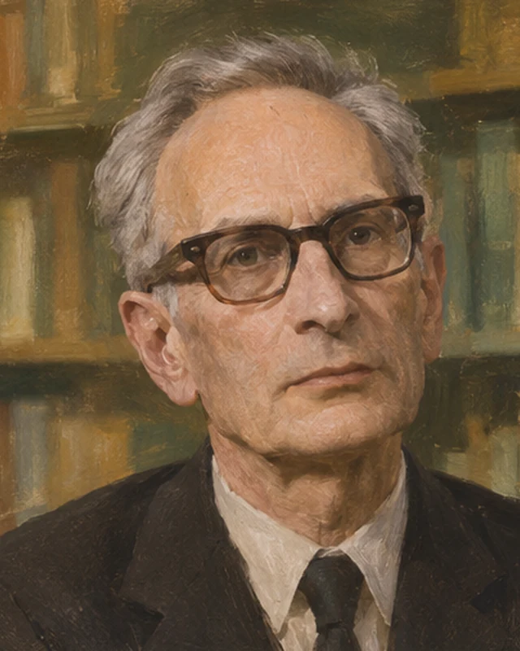

Imagine a story about a village whose only well dries up. A young woman decides to bring water from a distant spring. An elderly farmer shows her a safe path, while a greedy merchant tries to stop her. She reaches the spring and helps her neighbours obtain water again.

Now imagine a Hindi film about a town where a powerful man controls the supply of electricity. A young engineer, helped by a friend, finds a way to restore the supply. The two stories seem to follow a similar pattern. What makes this pattern recognisable? Can a reader describe it without knowing the personal history of either writer?

<figure class="article-illustration theory-diagram" aria-labelledby="theory-diagram-1">
  <figcaption id="theory-diagram-1">Two stories share a pattern</figcaption>
  

    <strong>The village well</strong>
    <ol class="theory-diagram-steps" role="list">
      <li>The well dries up</li>
      <li>A woman seeks water with a farmer’s help</li>
      <li>Villagers gain access to water</li>
    </ol>
  

  

    <strong>The electricity supply</strong>
    <ol class="theory-diagram-steps" role="list">
      <li>A powerful man controls the supply</li>
      <li>An engineer acts with a friend’s help</li>
      <li>The town’s supply is restored</li>
    </ol>
  

</figure>

**Structuralism** studies the systems of relationships and conventions that make particular texts and cultural practices meaningful. This article in the literary theory and cultural studies series takes up the ideas that grew from structural linguistics. It explains how Claude Lévi-Strauss studied myths, how Roland Barthes read cultural signs and literary texts, and how Tzvetan Todorov and A. J. Greimas studied narrative.

## Where structuralism came from

### From language to cultural systems

A person who watches a cricket match for the first time sees people running and throwing a ball. Someone who knows cricket sees a contest between two teams governed by shared rules. Its meaning depends on the rules and the other events of the game.

The Swiss linguist Ferdinand de Saussure had asked a related question about language. His *Course in General Linguistics* appeared in 1916, after his death. He distinguished **langue**, the shared system of language, from **parole**, its particular uses. Words gain their linguistic value through differences and relationships within that system.

Habib, in *A History of Literary Criticism* (2005), connects this linguistic approach with the growth of structuralism. A scholar could study the conventions of a form rather than treating each use as entirely new. For literary study, the important change was the scale of the question. The conventions of storytelling could become an object of study in their own right.

### From formalism to structuralism

Russian Formalism had already drawn attention to the organisation of literary works. Vladimir Propp's *Morphology of the Folktale* (1928) examined recurring actions in a collection of Russian wonder tales. Propp called these actions functions. Their identity depended on their contribution to the progress of a tale rather than on the name of the character who performed them.

A king and a poor farmer might each send someone on a journey. The people have different social positions, but their actions can occupy a similar place in a story. This approach encouraged critics to distinguish the visible details of a story from its underlying arrangements. Propp's findings later helped shape Greimas's account of narrative roles.

New Criticism also studied literary form, but the structuralist question is often wider than the individual work. A New Critical reading of one poem might examine its tensions and unity. A structuralist might ask what conventions allow a particular kind of poem to be recognised at all. Neither description means that every critic in either school followed an identical method.

### The growth of French structuralism

During the middle decades of the twentieth century, structural methods entered anthropology and literary study. Anthropology is the study of human societies and cultures. Claude Lévi-Strauss drew on linguistics to examine such matters as kinship, or socially recognised family relationships. His work also considered how societies organise myths and categories of experience.

Roland Barthes extended the study of signs to ordinary objects and public images. An advertisement, a photograph or a sporting event could be examined as a meaningful cultural practice. Todorov and Greimas pursued the study of narrative as an organised system. Their work became particularly influential in French intellectual life during the 1960s.

These thinkers did not all study the same material or use identical methods. Lévi-Strauss asked how myths express relations between cultural categories. Barthes examined how signs produce meanings that a society may take for granted. Todorov explored the rules of stories, while Greimas developed models of meaning and action. The shared interest was in relations rather than in isolated details.

### Did you know?

Barthes's *S/Z* (1970) is a book-length reading of a single short work of fiction, Balzac's "Sarrasine". The French national library records that the original edition of *S/Z* also contains Balzac's text. A small narrative thus became the material for a much larger investigation of how reading produces meaning.

### Important points to remember

- Saussure's *Course in General Linguistics* appeared in 1916.
- Langue is a shared language system, while parole is its particular use.
- Structuralism shifts attention from isolated elements to their relations.
- Propp's *Morphology of the Folktale* appeared in 1928.
- Propp identified recurring functions in Russian wonder tales.
- Structuralism became influential in French intellectual life in the 1960s.
- Lévi-Strauss extended structural methods to anthropology.
- Barthes studied everyday cultural signs as well as literary texts.

## The core ideas of structuralism

### The system behind the individual example

A structure is an arrangement of elements whose relations help explain how a system works. Consider two different school timetables. One contains English before mathematics, and another contains mathematics before English. Both are recognisable as timetables because they organise subjects within an agreed division of time.

A **genre** is a recognised kind of literary or cultural work. Detective stories may vary in setting and characters while sharing familiar plot relations.

This distinction leads to the terms surface structure and deep structure. **Surface structure** here means the particular arrangement that appears in a text or cultural object. **Deep structure** means an underlying organisation that a theorist proposes to account for that arrangement. The terms have different technical uses in different theories, including the work of Greimas. They are not an instruction to ignore the surface of a text.

For example, a lost key and a lost letter may give two narratives quite different objects. Both narratives may nevertheless organise their action around a search for something missing. The proposed underlying relationship can be tested against the details of both stories. If important details resist the model, the reader should reconsider the model.

### Difference and binary opposition

Saussure's account of language shows why difference matters. A sign has a place in a system because it can be distinguished from other signs. The word *day*, for instance, has a relationship with *night* that matters in particular uses. In stories, a pair of contrasting concepts can organise much more than a single sentence.

A **binary opposition** is a pair of contrasting terms or categories. Lévi-Strauss often examined contrasts such as nature and culture or raw and cooked. A story might distinguish the familiar village from an unknown forest. The village need not always represent safety, and the forest need not always represent danger. These meanings must be established from the actual text.

A narrative may bring two apparently separate categories into contact. Cooking transforms raw material through a learned practice. For Lévi-Strauss, such transformations could help make relations between nature and culture intelligible. A reader can likewise examine a character who crosses from the ordinary world into a magical one. The crossing may reveal a relationship that the initial opposition alone cannot explain.

A binary opposition is therefore more than a pair of dictionary opposites. A critic should examine how the contrast operates and whether other terms complicate it. In one story, wealth may be contrasted with poverty. In another, the important contrast may lie between generosity and greed, regardless of wealth.

### Signs, codes and cultural meanings

A sign connects a recognisable form with a concept. A **code** is a system of conventions through which signs can be understood. A school bell is a physical sound, but students know from convention when it announces the end of a lesson. The sound alone does not explain why they begin packing their bags.

Barthes uses the study of signs, often called **semiology**, to examine cultural communication. An object may carry a direct meaning and acquire further associations within a community. **Denotation** is the relatively direct meaning assigned to a sign. **Connotation** refers to meanings and associations added through cultural conventions.

Imagine an advertisement that shows a family eating dinner around a large table. At one level it represents a meal. At another, it may associate a product with belonging and family happiness. Those associations need not be contained in the product itself. They depend on how the picture is arranged and on what its viewers have learned to recognise.

In *Mythologies* (1957), Barthes treats **myth** as a second-order system of meaning. An already meaningful sign can become the form through which a further cultural message is expressed. The result can make an historically produced belief appear natural or inevitable. This use of myth is different from the study of traditional mythic narratives by Lévi-Strauss.

### Narrative grammar and transformation

A grammar describes the principles by which meaningful combinations are formed. Todorov extended the analogy with grammar to narratives. Instead of studying sentences alone, he asked how actions and states could combine into larger patterns of storytelling. The patterns are models of narrative possibilities rather than rules that every author must obey.

A short sequence may begin with a person possessing something, move through its loss and end with its recovery. This gives a change from one state to another. Todorov's account of narrative progression distinguishes an initial **equilibrium**, a relatively stable situation, from its disturbance and a new equilibrium. The ending need not reproduce the exact conditions that existed at the beginning.

This movement from loss to recovery illustrates **transformation**, a change in narrative conditions or relations.

A reader can also separate the events in their imagined chronological order from the way they are told. Todorov discussed this distinction through **story and discourse**. A tale of a recovered letter might begin with its discovery. Later passages could describe how it was lost. The underlying sequence and the presentation of that sequence are related but different objects of study.

### Roles rather than individual characters

Greimas examined action through a model of relations between functional positions. He used the term **actant** for a role in an action, which need not be filled by a person. An object or an abstract force can help or obstruct a character's pursuit of a goal. The model allows comparison between stories with very different casts of characters.

For a student trying to reach a remote examination centre, a bus might be a helper. A flooded road might be an opponent. A teacher might help the student plan the journey. These examples show why an actant differs from a character. Several people may occupy one functional position, and one person may occupy several positions.

### Important points to remember

- Structuralists examine the system behind particular instances.
- Surface structure and deep structure distinguish visible arrangements from proposed underlying relations.
- A binary opposition is a pair of contrasting categories.
- Denotation and connotation are different levels of meaning.
- Barthes's myth operates as a second-order system of meaning.
- Todorov investigates narrative grammar and transformation.
- An equilibrium is a relatively stable narrative state.
- Story and discourse distinguish events from their presentation.
- An actant is a functional role, not necessarily a person.

## Thinkers and texts

### Claude Lévi-Strauss: the structure of myths

<figure class="article-illustration article-illustration--float article-illustration--portrait">
  
  <figcaption>Claude Lévi-Strauss. Modern painted interpretation. <a href="https://journals.openedition.org/lettre-cdf/232" target="_blank" rel="noopener">Portrait reference</a></figcaption>
</figure>

Claude Lévi-Strauss (1908-2009) was a French anthropologist. His work applied insights from structural linguistics to cultural systems. In *The Elementary Structures of Kinship*, first published in French in 1949, he investigated rules of kinship and marriage. He approached these relationships as parts of a social system rather than as independent personal choices.

His essay "The Structural Study of Myth" appeared in the *Journal of American Folklore* in 1955. A revised version was included in *Anthropologie structurale* (1958), published in English as *Structural Anthropology* (1963). In the essay, he explores the relationships between units of myth, often known as **mythemes**. A mytheme is a constituent unit of a myth considered through its structural relations.

Lévi-Strauss uses the Greek myth of Oedipus as one example. He compares episodes in the wider Theban mythical cycle that show excessive attachment to blood relations with episodes that violate such bonds. He also compares elements concerning human emergence from the earth and attempts to deny that origin. His arrangement seeks a relation between two sets of contrasts. It is an interpretation of the myth rather than a proven account of ancient Greek belief.

His method does not simply retell the events in chronological order. It places related elements together to make their contrasts visible. He also treats different versions of a myth as relevant to the investigation. No single version need be declared the only authentic one before comparison can begin.

### Roland Barthes: from myth to the plural text

Roland Barthes (1915-1980) was a French critic and theorist. His early books include *Writing Degree Zero* (1953) and *Mythologies* (1957). In the latter, he examines ordinary French cultural practices, including professional wrestling. Such material becomes significant when it reveals conventions through which a society represents itself.

A wrestler's behaviour, for example, may be legible as a display of injustice or punishment. The audience responds to the significance of a gesture within the spectacle. Barthes's account shows why cultural analysis can examine performed signs rather than simply record physical actions. His attention to ideology also prevents his work from being reduced to the classification of forms.

In *Elements of Semiology* (1964), Barthes develops the study of sign systems. In his essay on structural analysis of narrative (1966), he explores levels of narrative organisation. Some events open or close important possibilities for the story, while others fill the intervals between those events. The distinction helps a reader explain why removing one detail might change a plot more profoundly than removing another.

In *S/Z* (1970), Barthes divides Balzac's "Sarrasine" into reading units called **lexias**. He traces five codes through these units. The **hermeneutic code** concerns enigmas and their disclosure. The **proairetic code** concerns actions and the expectations they create. The **semic code** concerns associations that contribute to the characterisation of people, places or things.

The **symbolic code** concerns deeper contrasts and symbolic relations. The **cultural code**, also called the referential code, draws on bodies of socially shared knowledge. The codes may operate together in a single passage. Barthes's method in this book emphasises the plurality of reading, which also moves beyond the search for one fixed underlying structure.

### Tzvetan Todorov: the grammar of stories

Tzvetan Todorov (1939-2017) was a Bulgarian-born literary theorist who worked in France. His *Grammaire du Décaméron* (1969), or *Grammar of the Decameron*, studies the narratives of Giovanni Boccaccio's collection. In this book he introduced the French term *narratologie*, from which the English term **narratology** comes. Narratology is the systematic study of narrative.

Todorov uses the analogy of language to describe the components of a story. Characters can be treated rather like nouns, their qualities like adjectives and actions like verbs. A narrative proposition may state that a character is in a particular condition. Another may describe an action that changes that condition. The units can then be studied in terms of the rules connecting them.

His model of equilibrium, disturbance and renewed equilibrium is a way of describing narrative change. It is useful even if the change is unwelcome to a character. A tragic ending can establish a changed condition without solving the original problem happily. The model concerns the organisation of states, not a guarantee of a pleasant outcome.

<figure class="article-illustration theory-diagram" aria-labelledby="theory-diagram-2">
  <figcaption id="theory-diagram-2">Todorov’s model of narrative change</figcaption>
  

    <strong>The village example</strong>
    <ol class="theory-diagram-steps" role="list">
      <li>Equilibrium. The well supplies water.</li>
      <li>Disturbance. The well dries up.</li>
      <li>Changed equilibrium. Villagers gain access to a spring.</li>
    </ol>
  

</figure>

### A. J. Greimas: meaning and the actantial model

Algirdas Julien Greimas (1917-1992) was a Lithuanian-French scholar of semiotics and semantics. **Semantics** is the study of meaning. His *Sémantique structurale* (1966), or *Structural Semantics*, develops an account of the organisation of meaning. His **actantial model** identifies six functional positions, arranged in three related pairs.

The subject pursues an object, which may be a goal rather than a physical thing. This is the axis of desire. The sender initiates or motivates the pursuit, and the receiver benefits from it. This is the axis of transmission. The helper assists the pursuit, while the opponent hinders it, forming the axis of power.

Greimas also developed the **semiotic square**, a model for exploring logical relations among meanings. A pair such as obligatory and forbidden can be considered alongside their negations, not obligatory and not forbidden. The square distinguishes opposition from contradiction. A critic should not automatically assume that every use of a negated term is equivalent to the opposite positive term.

### An interesting story

During the Second World War, Claude Lévi-Strauss went to New York, where he taught at the New School for Social Research. He encountered Roman Jakobson, a linguist whose work grew from Russian Formalism and the Prague school of linguistic study. Their intellectual friendship helped Lévi-Strauss recognise how methods developed for studying sounds and their relations could be adapted to anthropology. By 1949, he had published his major study of kinship in French. In 1955 he published his essay on the structural study of myth. The encounter in New York helps explain how an approach developed for language could travel into the study of stories and societies.

### Key terms

- **Structuralism** - study of the systems of relations that make texts and practices meaningful.
- **Langue** - the shared system of a language.
- **Parole** - a particular use of that system.
- **Genre** - a recognised kind of literary or cultural work.
- **Surface structure** - the particular arrangement presented in a text.
- **Deep structure** - an underlying organisation proposed to account for visible arrangements.
- **Binary opposition** - a pair of contrasting categories.
- **Code** - a system of conventions through which signs are understood.
- **Semiology** - the study of signs and sign systems.
- **Denotation** - the relatively direct meaning of a sign.
- **Connotation** - further associations produced through cultural conventions.
- **Myth** - in Barthes, a second-order system of meaning.
- **Mytheme** - a constituent unit of a myth considered through structural relations.
- **Narratology** - the systematic study of narrative.
- **Equilibrium** - a relatively stable state within a narrative.
- **Transformation** - a change in a narrative state or relationship.
- **Story and discourse** - the events of a narrative and their mode of presentation.
- **Lexia** - a reading unit into which Barthes divides a text in *S/Z*.
- **Actant** - a functional position within an action.
- **Semiotic square** - a model of relations among contrasting terms and their negations.

### Important points to remember

- Lévi-Strauss published "The Structural Study of Myth" in 1955.
- *Structural Anthropology* appeared in French in 1958 and in English in 1963.
- Lévi-Strauss compares mythemes and different versions of myths.
- Barthes published *Mythologies* in 1957 and *S/Z* in 1970.
- *S/Z* studies Balzac's "Sarrasine" through five codes.
- Todorov introduced narratology in *Grammar of the Decameron* (1969).
- Greimas published *Structural Semantics* in 1966.
- The actantial model contains six roles grouped into three axes.
- The semiotic square examines relations among terms and their negations.

## Reading with structuralism

### Returning to the village story

The imaginary story about the dried well can now be read through these different methods. A reader following Lévi-Strauss might examine the contrasts between scarcity and abundance, selfishness and collective welfare. The journey links the village with a distant source of water. The merchant and the farmer respond differently to a common need. Those relations help organise the meaning of the tale.

<figure class="article-illustration">
  
  <figcaption>Imagined scene. The farmer shows the woman where to look for water after the village well dries up.</figcaption>
</figure>

A reader following Barthes might notice the associations attached to the elderly farmer. His age and knowledge may suggest experience or wisdom through a cultural code. The merchant's actions create expectations through the proairetic code. The unanswered question of whether the woman will reach the spring belongs to the hermeneutic code. These codes can coexist within a few lines of narration.

Todorov's model identifies the ordinary supply of water as an initial state. The drying of the well disturbs that arrangement. The journey and the discovery lead towards a changed condition in which water is available. Greimas's model treats the woman as the subject and obtaining water as her object. The shared need motivates the quest, the villagers benefit, the farmer helps and the merchant obstructs it.

<figure class="article-illustration theory-diagram" aria-labelledby="theory-diagram-3">
  <figcaption id="theory-diagram-3">Greimas’s three axes in the village story</figcaption>
  <ul role="list">
    <li><strong>Desire</strong>The woman is the subject. Her object is access to water.</li>
    <li><strong>Transmission</strong>The need for water is the sender. The villagers who benefit are the receivers.</li>
    <li><strong>Power</strong>The farmer is the helper. The merchant is the opponent.</li>
  </ul>
</figure>

The approaches overlap, but each reveals something different. Todorov's model explains the change of state over time. Greimas's model describes positions and relationships within the action. A Barthesian reading can consider the cultural meanings attached to the roles themselves.

### A literary example: Shakespeare's The Tempest

In Shakespeare's *The Tempest*, Prospero lives on an island after losing his dukedom. The play brings his former enemies to that island. Its final movement involves reconciliation, the restoration of his position and plans to return to Italy. A Todorov-inspired reading can trace a disturbance and a changed arrangement of power across these events.

A reading inspired by Greimas could treat Prospero as the subject of a pursuit to recover his political position. Ariel helps him act, while his enemies are involved in the conflict that originally displaced him. This is one model of one pursuit, not an exhaustive description of the entire play. Ariel's own aim of gaining freedom calls for a different model.

A structuralist might also examine the relation between freedom and service. The contrast takes different forms in the situations of Ariel and Caliban. A reader can ask whether the ending resolves the contrast for everyone in the play. That question exposes a limit of a simple account of restoration. The political and personal interests of the characters need not all reach the same conclusion.

### Important points to remember

- Lévi-Strauss's approach looks for relations between contrasting categories.
- Barthes's codes can operate together in the same passage.
- Todorov's model explains movement between narrative states.
- Greimas's model describes functional roles in a pursuit.
- Prospero and Ariel have different goals in *The Tempest*.
- A single actantial model need not explain every action in a play.
- Structuralist readings should be tested against particular textual details.

## Criticisms and legacy

### The case against structuralism

Jacques Derrida questioned assumptions about structure in his 1966 lecture "Structure, Sign and Play in the Discourse of the Human Sciences" at Johns Hopkins University. He examined Lévi-Strauss's use of the nature and culture opposition. The prohibition of incest creates a difficulty for a strict separation of these two categories. It is a cultural rule, yet Lévi-Strauss also treats it as having universal scope.

Derrida uses this difficulty to question the apparent certainty of the opposition. A conceptual system can depend on distinctions that it cannot keep entirely separate. The problem does not make it useless to compare categories. It asks the critic to notice where a system's own terms fail to account for the complexity of their relations.

Jan Christoph Meister, in his account of narratology for *The Living Handbook of Narratology* (2014 revision), examines a different limitation. A very general grammar of narrative may classify a wide range of stories without adequately explaining their particular features. He identifies this difficulty in the effort to derive the visible forms of stories from Greimas's highly abstract models. A critic must distinguish a useful description from a claim to explain how every narrative is generated.

### What structuralism left behind

The influence of structuralism can be seen in the later study of narrative and culture. Narratology developed methods for describing how stories are told, including questions about time and perspective. A structural approach also encouraged researchers to compare different forms of cultural expression. A story can be examined alongside a film without assuming that words and moving images are identical media.

Barthes's work illustrates how the movement also opened paths beyond itself. His later treatment of multiple codes in *S/Z* makes it difficult to reduce reading to the recovery of a single stable message. Later poststructuralist approaches challenged confidence in fixed systems more directly. These developments do not mean that structural methods simply disappeared.

The focus on conventions remains useful in teaching literature. Readers may recognise a detective story before knowing which character committed the crime. They know enough of the genre to understand the significance of a clue. A structuralist analysis can make such shared knowledge explicit rather than treating recognition as a mysterious personal gift.

### How to read these thinkers

A useful reading begins with the kind of material a thinker examines. Lévi-Strauss studies relationships within and between myths, while Barthes investigates cultural and literary signification. Todorov studies patterns of narrative change. Greimas provides a way to describe relationships between roles and meanings. Their technical terms should be understood within those distinct projects.

The next step is to use a model on a small example and see what it explains. A reader might identify two contrasting terms or describe one character's pursuit. If the model ignores the differences between characters, it can be adjusted or supplemented with another reading. Structuralism is most informative when its categories direct attention to features that can actually be examined in a text.

### Important points to remember

- Derrida questioned the stability of conceptual oppositions in his 1966 lecture.
- The nature and culture contrast in Lévi-Strauss is one of Derrida's examples.
- Meister questions the explanatory power of highly general narrative grammars.
- Structuralism influenced the development of narratology.
- Later Barthes emphasises multiple codes and meanings.
- Structuralist methods need not exclude other approaches to reading.
- A model is useful when it can explain specific features of the material.

## Critics and works

| Thinker | Dates | Key work | Known for |
|---|---|---|---|
| Claude Lévi-Strauss | 1908-2009 | "The Structural Study of Myth" (1955); *Structural Anthropology* (French original, 1958) | Structural anthropology, mythemes and binary opposition |
| Roland Barthes | 1915-1980 | *Mythologies* (1957); *S/Z* (1970) | Cultural myths, semiology and five reading codes |
| Tzvetan Todorov | 1939-2017 | *Grammar of the Decameron* (French original, 1969) | Narrative grammar, transformation and narratology |
| A. J. Greimas | 1917-1992 | *Structural Semantics* (French original, 1966) | Actantial model and semiotic square |

## Quick revision - 50 points

1. Structuralism studies the systems of relations that make texts and cultural practices meaningful.
2. Saussure's *Course in General Linguistics* appeared in 1916.
3. Langue is the shared system of a language.
4. Parole refers to particular uses of a language system.
5. Propp's *Morphology of the Folktale* appeared in 1928.
6. Propp classified recurring actions in Russian wonder tales as functions.
7. Structuralism became influential in French intellectual life during the 1960s.
8. Lévi-Strauss applied structural linguistics to anthropology.
9. A genre is a recognised kind of literary or cultural work.
10. Surface structure refers to the particular arrangement presented in a text.
11. Deep structure refers to an underlying organisation proposed by a theorist.
12. A binary opposition consists of two contrasting categories.
13. Raw and cooked form an opposition studied by Lévi-Strauss.
14. A code is a system of conventions through which signs are understood.
15. Denotation is the relatively direct meaning of a sign.
16. Connotation refers to further cultural associations of a sign.
17. Barthes treats myth as a second-order system of meaning.
18. Myth in Barthes can make historical beliefs seem natural.
19. Narrative grammar examines how states and actions combine.
20. An equilibrium is a relatively stable narrative state.
21. Transformation refers to a change in narrative conditions or relations.
22. Story and discourse distinguish events from their presentation.
23. An actant is a functional position in an action.
24. An actant need not be a person.
25. Lévi-Strauss lived from 1908 to 2009.
26. *The Elementary Structures of Kinship* first appeared in French in 1949.
27. "The Structural Study of Myth" appeared in the *Journal of American Folklore* in 1955.
28. *Anthropologie structurale* appeared in 1958.
29. The English *Structural Anthropology* appeared in 1963.
30. Mythemes are constituent units of a myth considered through structural relations.
31. Lévi-Strauss examines the Oedipus myth by grouping related elements.
32. Lévi-Strauss treats multiple versions of a myth as relevant evidence.
33. Barthes lived from 1915 to 1980.
34. *Writing Degree Zero* appeared in 1953.
35. *Mythologies* appeared in 1957.
36. *Elements of Semiology* appeared in 1964.
37. Barthes's essay on structural analysis of narrative appeared in 1966.
38. *S/Z* (1970) studies Balzac's "Sarrasine".
39. Barthes calls the reading units in *S/Z* lexias.
40. The hermeneutic code concerns enigmas and their disclosure.
41. The proairetic code concerns actions and their expectations.
42. The semic code concerns associations contributing to characterisation.
43. The symbolic code concerns symbolic contrasts and relationships.
44. The cultural code draws on shared social knowledge.
45. Todorov introduced narratology in *Grammar of the Decameron* (1969).
46. Todorov compares characters to nouns and actions to verbs.
47. Greimas published *Structural Semantics* in 1966.
48. The actantial model identifies six positions arranged in three pairs.
49. The semiotic square examines contrasting terms and their negations.
50. Derrida questioned structuralist assumptions in a lecture at Johns Hopkins University in 1966.

## Quick quiz - 25 questions

Tap an answer to see at once if it is right. You do not need to log in.

**1. What is the main concern of structuralism?**

- A) Reconstructing the private life of an author
- B) Studying systems of relations that produce meaning
- C) Judging all texts by moral standards
- D) Tracing every word to its earliest origin

Answer: B. Structuralism seeks the relations and conventions that make particular texts meaningful.

**2. Which of Saussure's terms refers to the shared system of language?**

- A) Langue
- B) Parole
- C) Lexia
- D) Mytheme

Answer: A. Langue is the shared system, in contrast to the particular uses called parole.

**3. Which work by Propp was published in 1928?**

- A) *Structural Anthropology*
- B) *Grammar of the Decameron*
- C) *Structural Semantics*
- D) *Morphology of the Folktale*

Answer: D. Propp studied recurring functions in Russian wonder tales in this book.

**4. What does a binary opposition consist of?**

- A) Two successive episodes in a story
- B) Two identical cultural signs
- C) Two contrasting terms or categories
- D) Two translations of the same word

Answer: C. A binary opposition organises meaning through a contrast such as raw and cooked.

**5. Which term refers to further cultural associations of a sign?**

- A) Connotation
- B) Denotation
- C) Equilibrium
- D) Transformation

Answer: A. Connotation concerns the associations that a sign acquires within a cultural system.

**6. What kind of system is myth in Barthes's account?**

- A) A grammatical rule for sentence formation
- B) A collection of ancient religious stories alone
- C) A second-order system of meaning
- D) A chronological list of historical events

Answer: C. In Barthes's account, an existing sign can carry a further cultural message.

**7. Which thinker wrote "The Structural Study of Myth"?**

- A) Roland Barthes
- B) Claude Lévi-Strauss
- C) Tzvetan Todorov
- D) A. J. Greimas

Answer: B. Lévi-Strauss published this essay in 1955.

**8. In which year did the French original of *Structural Anthropology* appear?**

- A) 1949
- B) 1955
- C) 1963
- D) 1958

Answer: D. The French *Anthropologie structurale* appeared in 1958; the English translation followed in 1963.

**9. What is a mytheme?**

- A) A unit of a myth considered through structural relations
- B) A fixed rule of grammatical agreement
- C) A narrator's personal judgement
- D) A type of narrative ending

Answer: A. Lévi-Strauss examines constituent units of myths and how they relate to each other.

**10. Which Greek myth does Lévi-Strauss analyse in his 1955 essay?**

- A) The myth of Orpheus
- B) The myth of Prometheus
- C) The myth of Oedipus
- D) The myth of Narcissus

Answer: C. He groups episodes from the wider Oedipus and Theban mythical cycle.

**11. Which approach to different versions of a myth is associated with Lévi-Strauss?**

- A) Reject all versions except the oldest written one
- B) Study only versions from one author
- C) Treat variations as errors that must be removed
- D) Treat different versions as relevant evidence

Answer: D. Comparing versions helps a structuralist investigate recurring and transformed relations.

**12. Which book by Barthes appeared in 1957?**

- A) *Writing Degree Zero*
- B) *Mythologies*
- C) *Elements of Semiology*
- D) *S/Z*

Answer: B. *Mythologies* examines cultural signs and the way historical beliefs appear natural.

**13. Which of Barthes's works examines Balzac's "Sarrasine"?**

- A) *Elements of Semiology*
- B) *Writing Degree Zero*
- C) *S/Z*
- D) *Mythologies*

Answer: C. Barthes published his detailed reading of "Sarrasine" in 1970.

**14. What does Barthes call the reading units in *S/Z*?**

- A) Lexias
- B) Actants
- C) Mythemes
- D) Equilibria

Answer: A. Lexias are the units into which Barthes divides the text for analysis.

**15. Which of Barthes's five codes concerns narrative enigmas and their disclosure?**

- A) Cultural code
- B) Semic code
- C) Symbolic code
- D) Hermeneutic code

Answer: D. The hermeneutic code concerns questions, mysteries and the process of revealing answers.

**16. Which code concerns actions and the expectations they produce?**

- A) Semic code
- B) Proairetic code
- C) Hermeneutic code
- D) Cultural code

Answer: B. The proairetic code concerns action and the connections readers anticipate between actions.

**17. In which book did Todorov introduce the term narratology?**

- A) *Grammar of the Decameron*
- B) *Structural Anthropology*
- C) *Structural Semantics*
- D) *S/Z*

Answer: A. Todorov introduced the French term *narratologie* in this book in 1969.

**18. In Todorov's analogy with grammar, what do narrative actions correspond to?**

- A) Nouns
- B) Adjectives
- C) Verbs
- D) Articles

Answer: C. Actions correspond to verbs, while characters can be compared with nouns.

**19. Which sequence best represents Todorov's model of narrative progression?**

- A) Disturbance, new equilibrium, initial equilibrium
- B) Initial equilibrium, disturbance, new equilibrium
- C) Narrator, reader, author
- D) Signifier, signified, connotation

Answer: B. The movement describes a change from a stable situation through disturbance towards another state.

**20. What does discourse describe in Todorov's distinction between story and discourse?**

- A) The birthplace of a writer
- B) The chronological sequence of events alone
- C) The general rules of language alone
- D) The way the narrative events are presented

Answer: D. Discourse concerns how events are communicated, rather than just their imagined chronology.

**21. In which year did Greimas publish the French original of *Structural Semantics*?**

- A) 1957
- B) 1969
- C) 1966
- D) 1970

Answer: C. *Sémantique structurale* appeared in 1966.

**22. Which pair forms the axis of desire in Greimas's actantial model?**

- A) Subject and object
- B) Sender and receiver
- C) Helper and opponent
- D) Story and discourse

Answer: A. The subject pursues an object, which may be a goal rather than a material thing.

**23. A flooded road prevents a student from reaching an examination centre. Which actantial role does the road occupy in this action?**

- A) Object
- B) Receiver
- C) Helper
- D) Opponent

Answer: D. An opponent obstructs the subject's pursuit, and it need not be a human character.

**24. Which model distinguishes opposition from contradiction by considering terms and their negations?**

- A) The equilibrium model
- B) The semiotic square
- C) The five reading codes
- D) The story and discourse distinction

Answer: B. Greimas's semiotic square explores logical relations among opposed terms and their negations.

**25. Who delivered "Structure, Sign and Play in the Discourse of the Human Sciences" in 1966?**

- A) Roman Jakobson
- B) Jacques Derrida
- C) Claude Lévi-Strauss
- D) Tzvetan Todorov

Answer: B. Derrida's lecture at Johns Hopkins University questioned assumptions about structure and conceptual opposition.

## Frequently asked questions

**What is structuralism in literary criticism?**
Structuralism studies the relations and conventions that make literary works meaningful. It looks beyond an individual work to the systems that allow readers to recognise and understand such works.

**How is structuralism different from Russian Formalism?**
Russian Formalism studies literary devices and the organisation of works. Structuralism extends the inquiry to underlying systems and conventions across texts and cultural practices. Propp's study of recurring folktale functions helped connect the two approaches.

**What is a mytheme according to Lévi-Strauss?**
A mytheme is a constituent unit of a myth examined through its relations with other units. Lévi-Strauss compares such relations within myths and across different versions.

**What are Roland Barthes's five codes?**
They are the hermeneutic, proairetic, semic, symbolic and cultural codes. In *S/Z*, Barthes examines how they operate together in the reading of Balzac's "Sarrasine".

**What is Todorov's equilibrium model?**
It describes narrative progression as movement from an initial equilibrium through a disturbance to a new equilibrium. The final state can differ from the initial one, and the outcome need not be happy.

**What are the six actants in Greimas's model?**
They are subject, object, sender, receiver, helper and opponent. They are functional roles in an action, not necessarily six distinct characters.

## Sources

- Barthes, Roland. *Mythologies*. Éditions du Seuil, 1957.
- Barthes, Roland. *S/Z*. Éditions du Seuil, 1970.
- Derrida, Jacques. "Structure, Sign and Play in the Discourse of the Human Sciences." In *Writing and Difference*, translated by Alan Bass, University of Chicago Press, 1978.
- Greimas, Algirdas Julien. *Sémantique structurale: Recherche et méthode*. Larousse, 1966.
- Habib, M. A. R. *A History of Literary Criticism: From Plato to the Present*. Blackwell, 2005.
- Hébert, Louis. "The Actantial Model." *Signo*, 2006.
- Hühn, Peter. "Event and Eventfulness." *The Living Handbook of Narratology*, University of Hamburg, revised 2013.
- Farrell, Joseph. "Structuralism." Course notes, University of Pennsylvania.
- Lévi-Strauss, Claude. "The Structural Study of Myth." *Journal of American Folklore*, 1955.
- Meister, Jan Christoph. "Narratology." *The Living Handbook of Narratology*, University of Hamburg, revised 2014.
- Prince, Gerald. "Narratology." *The Cambridge History of Literary Criticism*, Cambridge University Press, 1995.
- Saussure, Ferdinand de. *Course in General Linguistics*. French original, Payot, 1916.
- Todorov, Tzvetan. *Grammaire du Décaméron*. Mouton, 1969.

Afsar Khan, Ph.D. English
